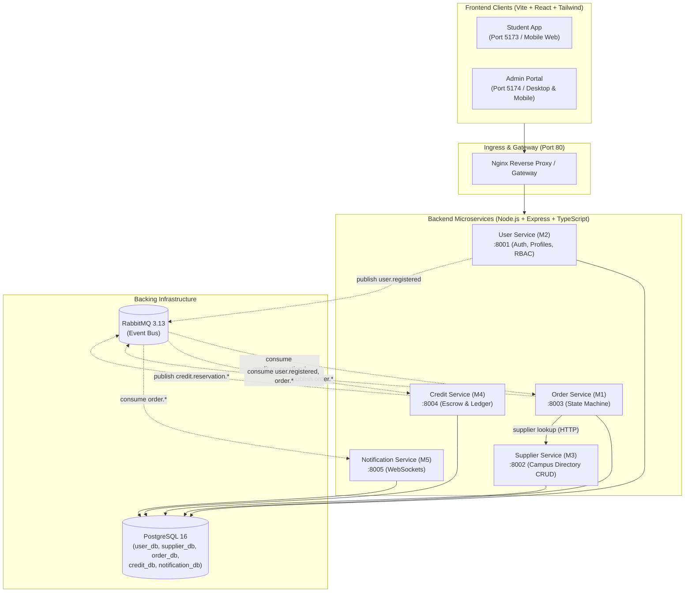

<!--
AI Assistance Disclosure:
Tool: Claude Code (model: Claude Fable 5.1), date: 2026-10-26
Scope: Test-command table gained the `npm run test:e2e:ui:realtime` row and the artifacts note names `test-results/uat-realtime/` (issue #197).
Author review: <to be completed by Reallyeasy1>

Tool: Claude Code (model: Claude Fable 5.1), date: 2026-10-25
Scope: Test-command table gained the `npm run coverage` row (moved here from the deleted docs/ci.md while merging main into PR #147).
Author review: <to be completed by Reallyeasy1>

Tool: Codex (model: GPT-6), date: 2026-10-25
Scope: Added source-linked technical navigation and corrected verified Claude workflow facts; preserved course policy and permissions.
Author review: <to be completed by Reallyeasy1>

Tool: Google Antigravity Agent, date: 2026-10-22
Scope: Fixed Local Development Workflow migration/seeding ordering (db:deploy before db:seed), documented root db:deploy and offline db:seed commands, added .env setup to Quick Start with Docker, and updated test:seed and test:acceptance descriptions.
Author review: <to be completed by yanhwee>

Tool: Google Antigravity Agent, date: 2026-10-21
Scope: Updated JWT key generation instructions after removing clipboard copying from scripts/generate-jwt-keys.mjs.
Author review: <to be completed by yanhwee>

Tool: Google Antigravity Agent, date: 2026-10-21
Scope: Consolidated CI/testing documentation from docs/ci.md into Testing & Verification, removed docs/ from the monorepo tree, and updated System Documentation links to point to the project Wiki.
Author review: <to be completed by yanhwee>

Tool: Google Antigravity Agent, date: 2026-10-21
Scope: Updated local development server commands, test category table, and monorepo structure tree for scripts/dev.mjs, scripts/prisma-migrate.mjs, and test:e2e:api.
Author review: <to be completed by yanhwee>

Tool: Claude Code (model: Claude Opus 5.5 subagent, Claude Fable 5.1 session), date: 2026-10-18
Scope: Refreshed facts to main @ 7f2d972: diagram arrows, Milestone Status (D2 done, D3 prepared, wiki link), access URLs for all services, seed commands, Testing & Verification categories, seed-account permissions, Monorepo Structure tree; merged the second disclosure block into this one.
Author review: <to be completed by Reallyeasy1>

Tool: Google Antigravity Agent, date: 2026-10-11
Scope: Updated documentation links to the flattened specification structure.
Author review: <to be completed by author after review>

Tool: Codex (model: GPT-6), date: 2026-09-30
Scope: Documented the working admin gateway route and student login navigation.
Author review: <to be completed by huangjiaxi1111>

Tool: Codex (model: GPT-5.6 Terra), date: 2026-09-22
Scope: Updated D2 test and seed-account descriptions to match the author-approved User Service contracts.
Author review: <to be completed by ngkhengyang>

Tool: Codex (model: GPT-5.6 Terra), date: 2026-09-22
Scope: Corrected stale Milestone D2 implementation facts after the author-approved User and Supplier Service migrations.
Author review: <to be completed by ngkhengyang>

Tool: Claude Code (model: Claude Fable 5.1), date: 2026-09-21
Scope: Added the "Documentation index" and "Claude Code set-up" links under Milestone Documentation. Nothing else in this file was changed.
Author review: <to be completed by Reallyeasy1>

Tool: Codex (model: GPT-6), date: 2026-09-24
Scope: Updated the local RabbitMQ dashboard login for separate service identities.
Author review: <to be completed by huangjiaxi1111>
-->


# Friend of Campus (FoC) 🏃‍♂️💨

> **CS3219 Software Design and Architecture (AY26/27 S1) — Project Group 25**  
> Peer-to-Peer Campus Errand Platform with Closed Credit Economy & Verified Campus Suppliers

Friend of Campus connects NUS students who need quick favors (coffee from COM3, printing at Central Library, parcel pickup from PGPR) with peers already walking nearby. The platform operates on a **closed credit economy** with escrow guarantees, discrete milestone updates, role-based access control, and asynchronous event notifications.

---

## 🏛️ Architecture & System Design

The platform uses a **Database-per-Service Microservices Architecture** organized in an **npm workspaces monorepo**:



### Key Design Highlight: Multi-Service Prisma Isolation
To avoid client collisions in the root `node_modules/@prisma/client`, each microservice maintains its schema at `prisma/schema.prisma` and generates its client to an isolated internal path (`output = "../src/generated/prisma"`), re-exported through `src/database/client.ts`. This guarantees compile-time type safety and prevents engine dylib conflicts across services.

---

## 🎯 Milestone Status

| Milestone | Scope & Deliverables | Status |
| :--- | :--- | :---: |
| **D1** | System Design, Product Backlog, Wireframes & Contracts | ✅ Completed |
| **D2** | **User Service (M2) & Supplier Service (M3) Integration**<br/>• PostgreSQL persistence via Prisma ORM<br/>• Password hashing and valid-email account registration<br/>• Ed25519 access tokens, opaque refresh sessions, and Express RBAC middleware<br/>• Cross-service authorization (Admin CRUD vs Student 403 Forbidden)<br/>• Admin Portal (CRUD modals, sorting, search, Screen 6 mobile cards)<br/>• Student App live directory integration & spot pre-selection<br/>• Automated end-to-end contract suite requiring seeded PostgreSQL | ✅ **Completed** |
| **D3** | **Order Service (M1), Credit Service (M4) & Notification Service (M5)**<br/>• All five services real (Prisma + PostgreSQL 16, one database each)<br/>• Errand lifecycle with transactional outbox, optimistic locking and single-winner accept<br/>• Credit wallets, ledger, escrow reserve/settle/refund and welcome grant over RabbitMQ<br/>• Notification consumer, store, REST and authenticated WebSocket; student-app bell, toasts and Alerts board<br/>• Admin order management (cancel, complete, unassign) and user management<br/>• CI with isolated test orchestration | 📋 **Prepared** (demo script and evidence: wiki [Milestone D3](https://github.com/AY2627S1-CS3219-P25/friend-on-campus/wiki/Milestone-D3); Week 10) |
| **D4** | **Cloud Deployment, Kubernetes & Distributed Concurrency Testing**<br/>• Production AWS Infrastructure as Code (VPC, Subnets, ALB, ECR, EBS, IAM) via Terraform<br/>• Lightweight Kubernetes (K3s) with stateful master (`t3.medium` + 25GB gp3) and elastic worker ASG (`t3.small`)<br/>• Two-Tier Autoscaling: Pod-level HPA (2 $\to$ 5 replicas) + VM-level EC2 ASG (1 $\to$ 3 nodes)<br/>• Keyless CI/CD via GitHub Actions using AWS IAM OIDC and SSH-free SSM Run Command<br/>• Distributed k6 concurrency verification (single-winner ACID claim race & traffic spike autoscaling)<br/>• Comprehensive student learning & architecture guide ([`docs/cloud-deployment-and-devops-guide.md`](docs/cloud-deployment-and-devops-guide.md)) | 🚀 **Ready & Configured** |

---

## 🚀 Quick Start with Docker (Recommended)

To spin up all microservices, frontends, PostgreSQL, RabbitMQ, Debezium CDC, and the Nginx Gateway (each service automatically runs `prisma migrate deploy` and seeds its database on container startup):

```bash
# 1. One-time environment setup (if .env does not exist yet):
cp .env.example .env
npm run generate:jwt-keys   # paste the printed JWT_PRIVATE_KEY and JWT_PUBLIC_KEY into .env

# 2. Build and start the full stack:
docker compose up --build
```

> **Upgrading or resetting an existing local Docker volume:** If your local machine previously ran an older stack (with classic RabbitMQ queues or pre-CDC volumes), reset the volumes and remove orphaned containers before starting so RabbitMQ recreates the consumer queues as quorum queues (`x-queue-type: quorum`) and Debezium starts cleanly:
> ```bash
> docker compose down -v --remove-orphans
> docker compose up --build
> ```

### Accessing the Platform
| Component | Local Access URL | Description |
| :--- | :--- | :--- |
| **Unified Web Ingress** | [http://localhost](http://localhost) | Main Gateway (routes to Student Mobile App) |
| **Admin Portal** | [http://localhost/admin/](http://localhost/admin/) | Admin login, supplier, user and order management; also available directly at [port 5174](http://localhost:5174/admin/) |
| **Student App** | [http://localhost:5173](http://localhost:5173) | Student Errand Feed & Campus Spots |
| **User Service Health** | [http://localhost:8001/health](http://localhost:8001/health) | M2 Health Probe (`/api/users/me` for auth) |
| **Supplier Service Health**| [http://localhost:8002/health](http://localhost:8002/health) | M3 Health Probe (`/api/suppliers` for catalog) |
| **Order Service Health** | [http://localhost:8003/health](http://localhost:8003/health) | M1 Health Probe (`/api/orders` for errands) |
| **Credit Service Health** | [http://localhost:8004/health](http://localhost:8004/health) | M4 Health Probe (`/api/credits/wallet`, `/api/credits/ledger`) |
| **Notification Service Health** | [http://localhost:8005/health](http://localhost:8005/health) | M5 Health Probe (`/api/notifications`; WebSocket through the gateway at `ws://localhost/ws/`) |
| **RabbitMQ Web Dashboard** | [http://localhost:15672](http://localhost:15672) | Development login: `campus_admin` / `campus-admin-dev` (vhost `campus`; AMQP on port 5672) |
| **PostgreSQL Shell** | `docker exec -it campuserrand-postgres psql -U postgres` | Database shell |

---

## 💻 Local Development Workflow (Without Docker)

When developing individual features directly on your machine with instant TypeScript execution (`tsx`) and hot-reloading:

### 1. Install dependencies & generate Prisma clients
```bash
npm install
```
*(Runs root `postinstall` hook which automatically executes `prisma generate` across all services).*

### 2. Configure Environment & JWT Keys
Copy `.env.example` to `.env` and generate an Ed25519 key pair for JWT access token signing:
```bash
cp .env.example .env
npm run generate:jwt-keys   # prints JWT_PRIVATE_KEY and JWT_PUBLIC_KEY; paste them into .env
```

### 3. Start PostgreSQL & RabbitMQ
```bash
docker compose up postgres rabbitmq -d
```

### 4. Apply Database Migrations
`docker/postgres-init/` only provisions the five empty databases and least-privilege service roles (`user_svc`, `supplier_svc`, `order_svc`, `credit_svc`, `notification_svc`). Apply all committed Prisma migrations across every service before seeding or starting Debezium CDC:
```bash
# Apply committed migrations across all 5 services (prisma migrate deploy)
npm run db:deploy

# Or apply migrations for an individual service:
npm run db:deploy -w @campus-errand/user-service
```
*(Note: Use `db:deploy` to apply existing migrations—the least-privilege service roles do not have `CREATEDB` permissions for Prisma's shadow database. When authoring a new schema change with `npm run db:migrate -w @campus-errand/<service>`, supply a superuser `DATABASE_URL` or `SHADOW_DATABASE_URL`.)*

Transactional outbox events from User, Order, and Credit are published to RabbitMQ by Debezium (`debezium-user`, `debezium-order`, `debezium-credit`). Once migrations are applied, start the CDC connectors so outbox events flow during host-based development:
```bash
docker compose up --no-deps -d debezium-user debezium-order debezium-credit
```

### 5. Seed Databases (First-Time Setup)
```bash
# Seed all services at once (User, Supplier, Order, and Credit)
npm run db:seed

# Or seed individual workspaces:
npm run db:seed -w @campus-errand/user-service     # admin@nus.edu.sg, alice@u.nus.edu, bob@u.nus.edu
npm run db:seed -w @campus-errand/supplier-service # 21 verified NUS campus locations from CSV
npm run db:seed -w @campus-errand/order-service    # sample OPEN errands (requires SEED_SAMPLE_ORDERS=true in .env)
npm run db:seed -w @campus-errand/credit-service   # 100-credit wallets for the three seed accounts
```
*(When `user-service` is running at `USER_SERVICE_URL`, `credit-service` resolves the seed accounts via HTTP login; when run offline before starting dev servers, it falls back to the deterministic seed account UUIDs.)*

### 6. Run Development Servers
```bash
# Run everything in parallel (5 backend services + 2 frontend apps)
npm run dev

# Or run only backend services or only frontend apps in parallel
npm run dev:services    # Ports 8001–8005
npm run dev:apps        # Ports 5173–5174

# Or run individual workspaces (via scripts/dev.mjs filter or native npm -w)
npm run dev -- user supplier
npm run dev -w services/user-service         # Port 8001 (User & Auth Service)
npm run dev -w services/supplier-service     # Port 8002 (Supplier Directory Service)
npm run dev -w services/order-service        # Port 8003 (Order Service)
npm run dev -w services/credit-service       # Port 8004 (Credit Service)
npm run dev -w services/notification-service # Port 8005 (Notification Service)
npm run dev -w apps/student-app              # Port 5173 (Student Web App)
npm run dev -w apps/admin-portal             # Port 5174 (Admin Web Portal)
```

---

## 🧪 Testing & Verification

### Full Isolated Suite
Creates a uniquely named Compose project on free loopback ports, runs every category below (installing Chromium if needed), and removes only that project's containers and volumes:
```bash
npm test
```

### Test Categories
| Command | Scope |
| :--- | :--- |
| `npm run test:unit` | Unit suites (Node's built-in `node --test` via `tsx`, no framework): user, supplier, order and notification services |
| `npm run test:integration` | PostgreSQL-backed suites: user-service admin guard, notification store and routes, credit-service |
| `npm run test:messaging` | PostgreSQL + RabbitMQ suites: credit-service, notification-service, order-service (`npm test` provisions isolated `credit_messaging_test` and `order_messaging_test` databases automatically; direct runs require migrated `_test` databases and the `*_TEST_*` env vars below) |
| `npm run test:migration` / `npm run test:seed` | Credit Service migration and seed validation (`test:migration` and `test:seed` run on `credit-service`) |
| `npm run test:acceptance` | Acceptance drivers against a healthy Compose stack: `scripts/uat/uat-d2-api.mjs`, `scripts/uat/uat-notifications.mjs`, and `scripts/uat/uat-cdc.mjs` |
| `npm run test:e2e:api` | Milestone D2 API end-to-end suite (`scripts/test-d2-e2e.ts`, below) |
| `npm run test:e2e:ui` | Chromium browser UAT (`scripts/uat/uat-d2-ui.mjs`, Playwright) against a healthy Compose stack |
| `npm run test:e2e:ui:realtime` | Multi-client real-time UAT (`scripts/uat/uat-realtime.mjs`, Playwright): the requester on two clients, two couriers racing for one errand; checks notifications and chat stay consistent live. Registers one throwaway `uatcourier-<stamp>@u.nus.edu` account. `UAT_RESTART_CHAT=1` adds a Chat Service container restart under load (opt-in; runs `docker restart` on the host) |
| `npm run coverage` | Unit coverage per service via Node's built-in reporter; writes `services/<svc>/coverage/lcov.info` (git-ignored) for editor extensions such as Coverage Gutters. Not a CI check |
| `npm run test:e2e` | API E2E, then browser UAT, using the isolated orchestration |
| `npm run ci:validate-tests` | Checks workspace `test:*` scripts against the static CI matrices in `.github/workflows/ci.yml` |

### CI & Test-Suite Conventions (`.github/workflows/ci.yml`)
- **Naming convention:** Package-level automated tests use `test:unit`, `test:integration`, `test:messaging`, `test:migration`, or `test:seed`. Interactive/watch scripts (`test:watch`) are excluded from CI.
- **Static matrix validation:** Whenever adding, renaming, moving, or removing a test script, update the corresponding matrix entry in `.github/workflows/ci.yml` and run `npm run ci:validate-tests`.
- **Direct category environment variables:** Running `npm test` provisions isolated databases and injects test URLs automatically. When running `test:integration`, `test:messaging`, `test:migration`, or `test:seed` directly outside `npm test`, supply migrated `_test` databases (`POSTGRES_ADMIN_URL=... TEST_DATABASE_NAME=... node scripts/ci/create-test-database.mjs`) and the required test environment variables (`USER_TEST_DATABASE_URL`, `CREDIT_TEST_DATABASE_URL`, `ORDER_TEST_DATABASE_URL`, `NOTIFICATION_TEST_DATABASE_URL`, `CREDIT_TEST_RABBITMQ_URL`, `NOTIFICATION_TEST_RABBITMQ_URL`).
- **Test artifacts:** Browser UAT screenshots and JSON reports are written to the git-ignored `test-results/` directory (`test-results/screenshots/`, `test-results/uat-d2-ui-results.json`, `test-results/uat-d2-api-results.json`, `test-results/uat-realtime/`) and uploaded as CI workflow artifacts.

### Automated Milestone D2 End-to-End Suite
Generates a test-only Ed25519 key pair and verifies account registration followed by
separate login, immutable email, administration authorization (user list, status and role toggles), supplier querying,
and cross-service ADMIN RBAC enforcement. It requires PostgreSQL with the User and Supplier
Service seed data present; it does not use the `.env` JWT key pair. It spawns user-service and
supplier-service itself on ports 8001/8002, so those ports must be free.

```bash
npm run test:e2e:api
```

### Lint, Build & Universal Typecheck
Typechecks all 10 workspaces (2 apps, 5 services, 3 packages); each service's `typecheck` covers its tests too:
```bash
npm run lint
npm run build
npm run typecheck
```

---

## ☁️ Cloud Deployment & DevOps (Milestone D4)

Friend on Campus implements a **Two-Tier Autoscaling Cloud-Native Architecture** on Amazon Web Services (AWS) using **Terraform (IaC)**, **Lightweight Kubernetes (K3s)**, **GitHub Actions Continuous Delivery (CD)**, and **k6 Distributed Concurrency Testing**:

```
[ Public Clients / k6 ] ──HTTPS──> [ AWS Application Load Balancer ]
                                                 │ (Port 80)
                ┌────────────────────────────────┴────────────────────────────────┐
                ▼                                                                 ▼
┌───────────────────────────────┐               ┌──────────────────────────────────────────────────┐
│   Node 1: Master & Data Node  │               │   Stateless Worker Tier (Auto Scaling Group)     │
│       (t3.medium / Fixed)     │               │   (t3.small / min=1, desired=1, max=3)          │
│ • K3s Control Plane Server    │               │ • Traefik Ingress Controller                     │
│ • PostgreSQL 16 (6 databases) │               │ • NGINX API Gateway                              │
│ • RabbitMQ 3.13 Quorum Queues │               │ • 6 Microservices (Tier 1 HPA Replicas: 2 → 5)  │
│ • Debezium Server 2.7 CDC     │               │ • Student App & Admin Portal SPAs                │
│ • 25 GB gp3 Persistent EBS    │               └──────────────────────────────────────────────────┘
└───────────────────────────────┘                                 │
                ▲                                                 │ (Flannel VXLAN Overlay UDP 8472)
                └─────────────────────────────────────────────────┘
```

### End-to-End Developer Workflow: Day 1 vs. Day 2

| Phase | What Happens | Who Runs It | How It Works |
| :--- | :--- | :--- | :--- |
| **Day 1: Cloud Provisioning** (One-Time) | Cloud datacenter & K8s cluster genesis | 1 designated teammate | Run `terraform apply` locally from `infra/terraform/` to provision the VPC, ALB, ECR repositories, EBS volume, IAM OIDC trust, and EC2 nodes. Then bootstrap baseline K8s manifests (`infra/k8s/`) via AWS SSM. |
| **Day 2: Everyday Coding** (Continuous) | Automated build, container push & rolling deployment | **Automated** on `git push origin main` | Developers work locally as usual (`npm run dev`). When code is pushed to `main`, GitHub Actions (`deploy.yml`) uses keyless AWS IAM OIDC, builds `linux/amd64` images via Docker Buildx, pushes to Amazon ECR, and executes AWS SSM Run Command on Node 1 (`kubectl set image` + `kubectl rollout status`) for **zero-downtime rolling updates**. |
| **Day 3: Verification & Load Testing** | Concurrency verification & live scaling evidence | Any teammate | Open the public ALB DNS in your browser, or run k6 concurrency tests (`tests/k6/`) from your laptop against the cloud cluster. |

### Quick Operations Cheat Sheet

```bash
# 1. Provision or update cloud infrastructure (Day 1 only)
cd infra/terraform && terraform apply

# 2. Open a secure terminal into the cluster (Zero SSH keys needed!)
aws ssm start-session --target $(cd infra/terraform && terraform output -raw master_instance_id)

# 3. Verify running pods and services
kubectl get pods -n foc -o wide

# 4. Run distributed concurrency verification (Milestone D4 Category N3)
k6 run --env BASE_URL=http://<ALB_DNS_NAME> tests/k6/order-claim-race.js

# 5. Run traffic spike test to trigger live HPA autoscaling (Milestone D4 Category N4)
k6 run --env BASE_URL=http://<ALB_DNS_NAME> tests/k6/discovery-load.js

# 6. Nightly Budget Pause (Halts compute billing to preserve S$50 SGD budget)
aws autoscaling set-desired-capacity --auto-scaling-group-name $(cd infra/terraform && terraform output -raw worker_asg_name) --desired-capacity 0
aws ec2 stop-instances --instance-ids $(cd infra/terraform && terraform output -raw master_instance_id)

# 7. Morning Cluster Resume (Wakes up cluster in ~60-90 seconds)
aws ec2 start-instances --instance-ids $(cd infra/terraform && terraform output -raw master_instance_id)
aws autoscaling set-desired-capacity --auto-scaling-group-name $(cd infra/terraform && terraform output -raw worker_asg_name) --desired-capacity 1
```

> 📖 **Comprehensive Walkthrough**: For in-depth architectural explanations, cost calculations, Kubernetes networking deep-dive, and troubleshooting runbooks, see the [Cloud Deployment, Kubernetes & DevOps Guide](docs/cloud-deployment-and-devops-guide.md).

---

---

## 🔐 Default Seed Accounts & Credentials

For local development, testing, and mentor demonstrations, the following accounts are pre-seeded:

| Role | Email Address | Password | Permissions |
| :--- | :--- | :--- | :--- |
| **Administrator** | `admin@nus.edu.sg` | `Password123!` | Full directory CRUD; user management (list, enable/disable, role toggle, delete); admin order cancel / complete / unassign |
| **Student (Alice)** | `alice@u.nus.edu` | `Password123!` | Dual-role (Requester/Courier), read directory, manage profile; 100 starting credits |
| **Student (Bob)** | `bob@u.nus.edu` | `Password123!` | Dual-role (Requester/Courier), read directory, manage profile; 100 starting credits |

---

## 📦 Monorepo Structure

```
friend-on-campus/
├── apps/
│   ├── student-app/             # Student Mobile PWA (Port 5173)
│   └── admin-portal/            # Staff Admin Web Portal (Port 5174)
├── services/
│   ├── user-service/            # Port 8001: Auth, Profiles, RBAC (M2)
│   ├── supplier-service/        # Port 8002: Campus Locations CRUD (M3)
│   ├── order-service/           # Port 8003: Lifecycle State Machine (M1)
│   ├── credit-service/          # Port 8004: Closed Economy Ledger & Escrow (M4)
│   └── notification-service/    # Port 8005: WebSockets & Async Push (M5)
├── packages/
│   ├── auth/                    # @campus-errand/auth: offline Ed25519 access-token verification middleware
│   ├── common-dtos/             # Shared TypeScript schemas, DTOs & event types
│   └── messaging/               # @campus-errand/messaging: RabbitMQ quorum-queue & DLQ consumer/publisher client
├── infra/
│   ├── terraform/               # Production AWS IaC (VPC, ASG, ALB, ECR, EBS, IAM)
│   └── k8s/                     # K3s manifests (Stateful data node + stateless worker tier)
├── gateway/
│   └── nginx.conf               # Port 80 gateway routes: /api/*, /ws/, /admin/, /
├── docker/
│   ├── debezium/                # Debezium Server CDC configs for User, Order and Credit outboxes
│   ├── postgres-init/           # Creates the five logical databases and least-privilege roles
│   └── rabbitmq/                # Broker config and definitions: vhost, exchanges, service accounts, permissions
├── scripts/
│   ├── ci/                      # Isolated aggregate test runner, test-matrix validator, test-database helper
│   ├── uat/                     # Acceptance drivers: API, notifications, Chromium UI
│   ├── dev.mjs                  # Parallel cross-platform workspace dev runner
│   ├── generate-jwt-keys.mjs    # Ed25519 key pair for .env
│   ├── prisma-migrate.mjs       # Shared Prisma migration runner with .env loading
│   └── test-d2-e2e.ts           # Milestone D2 contract suite with test-only Ed25519 keys
├── tests/
│   ├── k6/                      # Distributed load & concurrency tests (race conditions & HPA)
│   └── postman/                 # Postman collection and environment
├── data/
│   ├── csv/                     # NUS campus supplier seed datasets
│   └── images/                  # Supplier images
├── ai/
│   └── usage-log.md             # AI assistance usage disclosures per course policy
├── docker-compose.yml           # Full stack
└── docker-compose.test.yml      # Port and container-name overrides for the isolated test stacks
```

---

## 📄 System Documentation & Project Wiki

- **[Cloud Deployment, Kubernetes & DevOps Guide](docs/cloud-deployment-and-devops-guide.md)**: Master student learning guide for AWS Terraform IaC, K3s manifests, two-tier autoscaling, GitHub Actions CD via OIDC/SSM, and k6 concurrency testing.
- **[Technical reference and complete documentation index](docs/README.md)**: All five services, frontends, packages, infrastructure and source/Wiki audit.
- **[Test and UAT configuration](docs/development/testing-strategy.md#driver-environment-matrix)**: `GW`, `AMQP_URL`, `WS_URL`, output paths and broker-port overrides for each driver.
- **[Documentation verification and pending questions](docs/audits/review-findings.md)**: Actual check results, source boundaries and human review items.

Full architectural documentation, domain specifications, and milestone presentation guides are maintained in the **[Project Wiki](https://github.com/AY2627S1-CS3219-P25/friend-on-campus/wiki)**:

- **[Wiki Home](https://github.com/AY2627S1-CS3219-P25/friend-on-campus/wiki)**: Project overview & milestone navigation
- **[System Architecture](https://github.com/AY2627S1-CS3219-P25/friend-on-campus/wiki/Architecture)**: Microservice topology, Debezium CDC outbox connectors, RabbitMQ quorum queues, and reservation saga choreography
- **[Authentication & Roles](https://github.com/AY2627S1-CS3219-P25/friend-on-campus/wiki/Authentication-and-Roles)**: Ed25519 access tokens, rotating opaque refresh cookies, RBAC matrix, and least-privilege database/broker identities
- **[Services & Domain Lifecycle](https://github.com/AY2627S1-CS3219-P25/friend-on-campus/wiki/Services)**: Order state machine (`PENDING` → `OPEN` → `ACCEPTED` → `IN_TRANSIT` → `DELIVERED` → `COMPLETED`), closed credit economy & escrow ledger, and real-time notifications
- **[Data Model](https://github.com/AY2627S1-CS3219-P25/friend-on-campus/wiki/Data-Model)**: Per-service PostgreSQL schemas (`user_db`, `supplier_db`, `order_db`, `credit_db`, `notification_db`)
- **[Testing & Evidence](https://github.com/AY2627S1-CS3219-P25/friend-on-campus/wiki/Testing-and-Evidence)** & **[Milestone D3](https://github.com/AY2627S1-CS3219-P25/friend-on-campus/wiki/Milestone-D3)**: Automated test matrix, acceptance evidence, and Milestone D3 presentation runbook
- **Claude Code Set-up**: [`.claude/README.md`](./.claude/README.md) & [`CLAUDE.md`](./CLAUDE.md)
