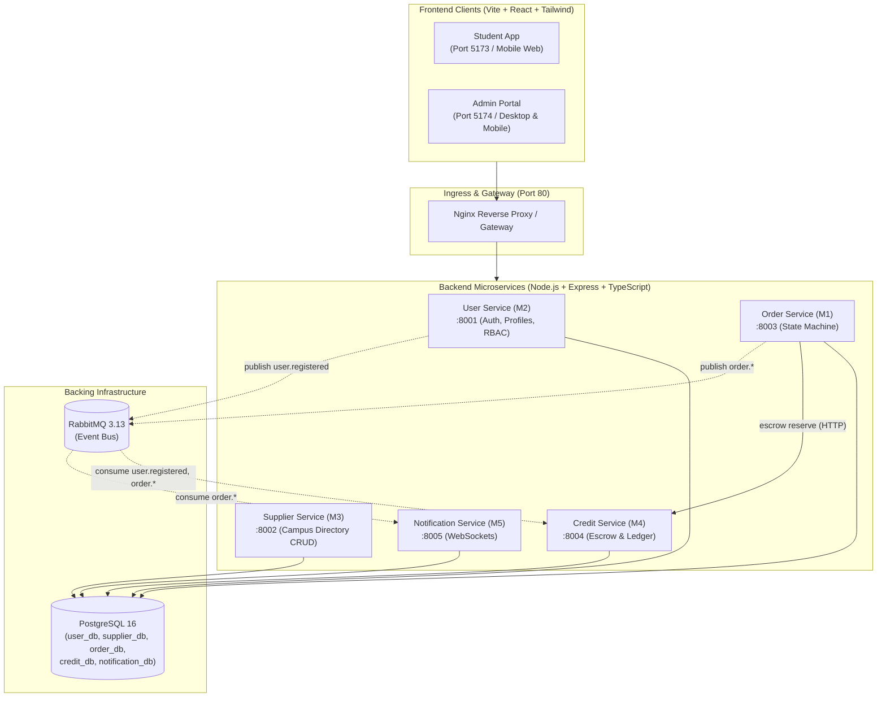

<!--
AI Assistance Disclosure:
Tool: Google Antigravity Agent, date: 2026-10-21
Scope: Updated local development server commands, test category table, and monorepo structure tree for scripts/dev.mjs, scripts/prisma-migrate.mjs, and test:e2e:api.
Author review: <to be completed by yanhwee>

Tool: Claude Code (model: Claude Opus 5.5 subagent, Claude Fable 5.1 session), date: 2026-10-18
Scope: Refreshed facts to main @ 7f2d972: diagram arrows, Milestone Status (D2 done, D3 prepared, wiki link), access URLs for all services, seed commands, Testing & Verification categories, seed-account permissions, Monorepo Structure tree; merged the second disclosure block into this one.
Author review: <to be completed by Reallyeasy1>

Tool: Google Antigravity Agent, date: 2026-10-11
Scope: Updated documentation links to the flattened specification structure.
Author review: <to be completed by author after review>

Tool: Codex (model: GPT-6), date: 2026-09-30
Scope: Documented the working admin gateway route and student login navigation.
Author review: <to be completed by huangjiaxi1111>

Tool: Codex (model: GPT-5.6 Terra), date: 2026-09-22
Scope: Updated D2 test and seed-account descriptions to match the author-approved User Service contracts.
Author review: <to be completed by ngkhengyang>

Tool: Codex (model: GPT-5.6 Terra), date: 2026-09-22
Scope: Corrected stale Milestone D2 implementation facts after the author-approved User and Supplier Service migrations.
Author review: <to be completed by ngkhengyang>

Tool: Claude Code (model: Claude Fable 5.1), date: 2026-09-21
Scope: Added the "Documentation index" and "Claude Code set-up" links under Milestone Documentation. Nothing else in this file was changed.
Author review: <to be completed by Reallyeasy1>

Tool: Codex (model: GPT-6), date: 2026-09-24
Scope: Updated the local RabbitMQ dashboard login for separate service identities.
Author review: <to be completed by huangjiaxi1111>
-->


# Friend of Campus (FoC) 🏃‍♂️💨

> **CS3219 Software Design and Architecture (AY26/27 S1) — Project Group 25**  
> Peer-to-Peer Campus Errand Platform with Closed Credit Economy & Verified Campus Suppliers

Friend of Campus connects NUS students who need quick favors (coffee from COM3, printing at Central Library, parcel pickup from PGPR) with peers already walking nearby. The platform operates on a **closed credit economy** with escrow guarantees, discrete milestone updates, role-based access control, and asynchronous event notifications.

---

## 🏛️ Architecture & System Design

The platform uses a **Database-per-Service Microservices Architecture** organized in an **npm workspaces monorepo**:



### Key Design Highlight: Multi-Service Prisma Isolation
To avoid client collisions in the root `node_modules/@prisma/client`, each microservice maintains its schema at `prisma/schema.prisma` and generates its client to an isolated internal path (`output = "../src/generated/prisma"`), re-exported through `src/database/client.ts`. This guarantees compile-time type safety and prevents engine dylib conflicts across services.

---

## 🎯 Milestone Status

| Milestone | Scope & Deliverables | Status |
| :--- | :--- | :---: |
| **D1** | System Design, Product Backlog, Wireframes & Contracts | ✅ Completed |
| **D2** | **User Service (M2) & Supplier Service (M3) Integration**<br/>• PostgreSQL persistence via Prisma ORM<br/>• Password hashing and valid-email account registration<br/>• Ed25519 access tokens, opaque refresh sessions, and Express RBAC middleware<br/>• Cross-service authorization (Admin CRUD vs Student 403 Forbidden)<br/>• Admin Portal (CRUD modals, sorting, search, Screen 6 mobile cards)<br/>• Student App live directory integration & spot pre-selection<br/>• Automated end-to-end contract suite requiring seeded PostgreSQL | ✅ **Completed** |
| **D3** | **Order Service (M1), Credit Service (M4) & Notification Service (M5)**<br/>• All five services real (Prisma + PostgreSQL 16, one database each)<br/>• Errand lifecycle with transactional outbox, optimistic locking and single-winner accept<br/>• Credit wallets, ledger, escrow reserve/settle/refund and welcome grant over RabbitMQ<br/>• Notification consumer, store, REST and authenticated WebSocket; student-app bell, toasts and Alerts board<br/>• Admin order management (cancel, complete, unassign) and user management<br/>• CI with isolated test orchestration | 📋 **Prepared** (demo script and evidence: wiki [Milestone D3](https://github.com/AY2627S1-CS3219-P25/friend-on-campus/wiki/Milestone-D3); Week 10) |
| **D4** | Final deliverable | ⏳ Upcoming |

---

## 🚀 Quick Start with Docker (Recommended)

To spin up all microservices, frontends, PostgreSQL, RabbitMQ, Debezium CDC, and the Nginx Gateway:

```bash
# In project root:
docker compose up --build
```

> **Upgrading an existing local Docker volume:** If your local machine previously ran an older stack (with classic RabbitMQ queues or pre-CDC `order_db` volumes), reset the volumes once before starting so RabbitMQ recreates the consumer queues as quorum queues (`x-queue-type: quorum`) and Debezium starts cleanly:
> ```bash
> docker compose down -v
> docker compose up --build
> ```

### Accessing the Platform
| Component | Local Access URL | Description |
| :--- | :--- | :--- |
| **Unified Web Ingress** | [http://localhost](http://localhost) | Main Gateway (routes to Student Mobile App) |
| **Admin Portal** | [http://localhost/admin/](http://localhost/admin/) | Admin login, supplier, user and order management; also available directly at [port 5174](http://localhost:5174/admin/) |
| **Student App** | [http://localhost:5173](http://localhost:5173) | Student Errand Feed & Campus Spots |
| **User Service Health** | [http://localhost:8001/health](http://localhost:8001/health) | M2 Health Probe (`/api/users/me` for auth) |
| **Supplier Service Health**| [http://localhost:8002/health](http://localhost:8002/health) | M3 Health Probe (`/api/suppliers` for catalog) |
| **Order Service Health** | [http://localhost:8003/health](http://localhost:8003/health) | M1 Health Probe (`/api/orders` for errands) |
| **Credit Service Health** | [http://localhost:8004/health](http://localhost:8004/health) | M4 Health Probe (`/api/credits/wallet`, `/api/credits/ledger`) |
| **Notification Service Health** | [http://localhost:8005/health](http://localhost:8005/health) | M5 Health Probe (`/api/notifications`; WebSocket through the gateway at `ws://localhost/ws/`) |
| **RabbitMQ Web Dashboard** | [http://localhost:15672](http://localhost:15672) | Development login: `campus_admin` / `campus-admin-dev` (vhost `campus`; AMQP on port 5672) |
| **PostgreSQL Shell** | `docker exec -it campuserrand-postgres psql -U postgres` | Database shell |

---

## 💻 Local Development Workflow (Without Docker)

When developing individual features directly on your machine with instant TypeScript execution (`tsx`) and hot-reloading:

### 1. Install dependencies & generate Prisma clients
```bash
npm install
```
*(Runs root `postinstall` hook which automatically executes `prisma generate` across all services).*

### 2. Configure Environment & JWT Keys
Copy `.env.example` to `.env` and generate an Ed25519 key pair for JWT access token signing:
```bash
cp .env.example .env
npm run generate:jwt-keys   # copies JWT_PRIVATE_KEY and JWT_PUBLIC_KEY to the clipboard; paste them into .env
# where clipboard copying is unsupported, print them instead:
npm run generate:jwt-keys -- --print
```

### 3. Start PostgreSQL & RabbitMQ
```bash
docker compose up postgres rabbitmq -d
```
*(Note: In `order-service`, transactional outbox events in `order_db.public.outbox_events` are tailed and published to RabbitMQ by the `debezium` CDC container rather than an in-process Node.js poller. When testing end-to-end order event flows in host-based dev, start `docker compose up debezium -d` after running `order-service` database migrations.)*

### 4. Seed Databases (First Time Setup)
```bash
# Seed User Service (admin@nus.edu.sg, alice@u.nus.edu, bob@u.nus.edu)
npm run db:seed --workspace=@campus-errand/user-service

# Seed Supplier Service (21 verified NUS campus locations from CSV)
npm run db:seed --workspace=@campus-errand/supplier-service

# Seed Credit Service wallets for the three seeded accounts
# (logs in through the User Service, so user-service must be running at USER_SERVICE_URL, default http://localhost:8001)
npm run db:seed --workspace=@campus-errand/credit-service

# Seed Order Service sample errands (skipped when order_db already contains orders)
npm run db:seed --workspace=@campus-errand/order-service
```
*(Apply each service's migrations first with `npm run db:migrate --workspace=@campus-errand/<service>`. Under Docker Compose every service runs `prisma migrate deploy` and its seed, where it has one, on container boot.)*

### 5. Run Development Servers
```bash
# Run everything in parallel (5 backend services + 2 frontend apps)
npm run dev

# Or run only backend services or only frontend apps in parallel
npm run dev:services    # Ports 8001–8005
npm run dev:apps        # Ports 5173–5174

# Or run individual workspaces (via scripts/dev.mjs filter or native npm -w)
npm run dev -- user supplier
npm run dev -w services/user-service        # Port 8001 (User & Auth Service)
npm run dev -w services/supplier-service    # Port 8002 (Supplier Directory Service)
npm run dev -w services/order-service       # Port 8003 (Order Service)
npm run dev -w services/credit-service      # Port 8004 (Credit Service)
npm run dev -w services/notification-service # Port 8005 (Notification Service)
npm run dev -w apps/student-app             # Port 5173 (Student Web App)
npm run dev -w apps/admin-portal            # Port 5174 (Admin Web Portal)
```

---

## 🧪 Testing & Verification

CI jobs, prerequisites and the static test-matrix rules are documented in [`docs/ci.md`](./docs/ci.md).

### Full Isolated Suite
Creates a uniquely named Compose project on free loopback ports, runs every category below (installing Chromium if needed), and removes only that project's containers and volumes:
```bash
npm test
```

### Test Categories
| Command | Scope |
| :--- | :--- |
| `npm run test:unit` | Unit suites (Node's built-in `node --test` via `tsx`, no framework): user, supplier, order and notification services |
| `npm run test:integration` | PostgreSQL-backed suites: user-service admin guard, notification store and routes, credit-service |
| `npm run test:messaging` | PostgreSQL + RabbitMQ suites: credit-service, notification-service, order-service |
| `npm run test:migration` / `npm run test:seed` | Credit Service migration and seed validation |
| `npm run test:acceptance` | Acceptance drivers against a healthy Compose stack: `scripts/uat/uat-d2-api.mjs`, then `scripts/uat/uat-notifications.mjs` |
| `npm run test:e2e:api` | Milestone D2 API end-to-end suite (`scripts/test-d2-e2e.ts`, below) |
| `npm run test:e2e:ui` | Chromium browser UAT (`scripts/uat/uat-d2-ui.mjs`, Playwright) against a healthy Compose stack |
| `npm run test:e2e` | API E2E, then browser UAT, using the isolated orchestration |
| `npm run ci:validate-tests` | Checks package test scripts against the static CI matrices |

### Automated Milestone D2 End-to-End Suite
Generates a test-only Ed25519 key pair and verifies account registration followed by
separate login, immutable email, administration authorization (user list, status and role toggles), supplier querying,
and cross-service ADMIN RBAC enforcement. It requires PostgreSQL with the User and Supplier
Service seed data present; it does not use the `.env` JWT key pair. It spawns user-service and
supplier-service itself on ports 8001/8002, so those ports must be free.

```bash
npm run test:e2e:api
```

### Lint, Build & Universal Typecheck
Typechecks all 9 workspaces (2 apps, 5 services, 2 packages); each service's `typecheck` covers its tests too:
```bash
npm run lint
npm run build
npm run typecheck
```

---

## 🔐 Default Seed Accounts & Credentials

For local development, testing, and mentor demonstrations, the following accounts are pre-seeded:

| Role | Email Address | Password | Permissions |
| :--- | :--- | :--- | :--- |
| **Administrator** | `admin@nus.edu.sg` | `Password123!` | Full directory CRUD; user management (list, enable/disable, role toggle, delete); admin order cancel / complete / unassign |
| **Student (Alice)** | `alice@u.nus.edu` | `Password123!` | Dual-role (Requester/Courier), read directory, manage profile; 100 starting credits |
| **Student (Bob)** | `bob@u.nus.edu` | `Password123!` | Dual-role (Requester/Courier), read directory, manage profile; 100 starting credits |

---

## 📦 Monorepo Structure

```
friend-on-campus/
├── apps/
│   ├── student-app/             # Student Mobile PWA (Port 5173)
│   └── admin-portal/            # Staff Admin Web Portal (Port 5174)
├── services/
│   ├── user-service/            # Port 8001: Auth, Profiles, RBAC (M2)
│   ├── supplier-service/        # Port 8002: Campus Locations CRUD (M3)
│   ├── order-service/           # Port 8003: Lifecycle State Machine (M1)
│   ├── credit-service/          # Port 8004: Closed Economy Ledger & Escrow (M4)
│   └── notification-service/    # Port 8005: WebSockets & Async Push (M5)
├── packages/
│   ├── auth/                    # @campus-errand/auth: offline Ed25519 access-token verification middleware
│   └── common-dtos/             # Shared TypeScript schemas, DTOs & event types
├── gateway/
│   └── nginx.conf               # Port 80 gateway routes: /api/*, /ws/, /admin/, /
├── docker/
│   ├── postgres-init/           # Creates the five logical databases (tables come from per-service migrations)
│   └── rabbitmq/                # Broker config and definitions: vhost, exchanges, service accounts, permissions
├── scripts/
│   ├── ci/                      # Isolated aggregate test runner, test-matrix validator, test-database helper
│   ├── uat/                     # Acceptance drivers: API, notifications, Chromium UI
│   ├── dev.mjs                  # Parallel cross-platform workspace dev runner
│   ├── generate-jwt-keys.mjs    # Ed25519 key pair for .env
│   ├── prisma-migrate.mjs       # Shared Prisma migration runner with .env loading
│   └── test-d2-e2e.ts           # Milestone D2 contract suite with test-only Ed25519 keys
├── tests/
│   └── postman/                 # Postman collection and environment
├── data/
│   ├── csv/                     # NUS campus supplier seed datasets
│   └── images/                  # Supplier images
├── docs/                        # System specifications and CI documentation
├── ai/
│   └── usage-log.md             # AI assistance usage disclosures per course policy
├── docker-compose.yml           # Full stack
└── docker-compose.test.yml      # Port and container-name overrides for the isolated test stacks
```

---

## 📄 System Documentation & Specifications

- **Documentation Index**: [`docs/README.md`](./docs/README.md)
- **System Architecture Specification**: [`docs/architecture.md`](./docs/architecture.md)
- **Errand Lifecycle & Credit Economy Specification**: [`docs/errand-specification.md`](./docs/errand-specification.md)
- **Security & Access Control Specification**: [`docs/security.md`](./docs/security.md)
- **Continuous Integration & Testing**: [`docs/ci.md`](./docs/ci.md)
- **Project wiki (milestone pages)**: [Milestone D3](https://github.com/AY2627S1-CS3219-P25/friend-on-campus/wiki/Milestone-D3)
- **Claude Code set-up for this repo**: [`.claude/README.md`](./.claude/README.md)
