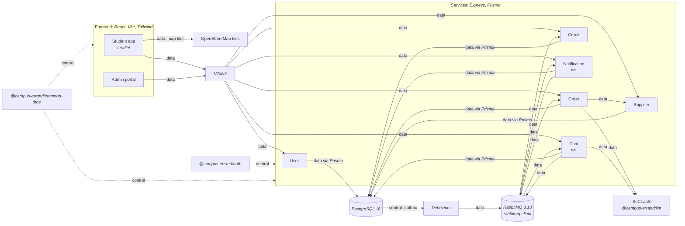

<!--
AI Assistance Disclosure:
Tool: Codex (model: GPT-6), date: 2026-11-09
Scope: Keep the thirteen-guide index concise while linking corrected failure boundaries and recording the expanded explanations, diagrams and executed checks.
Author review: <to be completed by Reallyeasy1>

Tool: Codex (model: GPT-6), date: 2026-11-09
Scope: Replace fragmented navigation/audits with one task index, compact provenance and unresolved-boundary notes; preserve prior attribution in history and consolidated records.
Author review: <to be completed by Reallyeasy1>

Tool: Codex (model: GPT-6), date: 2026-11-09
Scope: Reconcile the active documentation with main b989758 and simplify navigation; preserve historical attribution.
Author review: <to be completed by Reallyeasy1>

Tool: Codex (model: GPT-6), date: 2026-11-08
Scope: Link the ECS rollout after retirement of the K3s deployment files.
Author review: <to be completed by the author>

Tool: Codex (model: GPT-6), date: 2026-11-08
Scope: Update confirmed migration decisions and architecture navigation.
Author review: <to be completed by the author>

Tool: Codex (model: GPT-6), date: 2026-11-08
Scope: Update target-architecture navigation for the author-requested CloudFront entry point, origin TLS requirements and incremental costs.
Author review: <to be completed by the author>

Tool: Codex (model: GPT-6), date: 2026-11-08
Scope: Link the author's confirmed shared-host ECS target architecture separately from implemented deployment references.
Author review: <to be completed by the author>

Tool: Claude Code (model: Claude Fable 5.1), date: 2026-10-26
Scope: Inventory row for the errand details page implementation plan (docs/superpowers/plans/, issues #188 and #189).
Author review: <to be completed by Reallyeasy1>

Tool: Claude Code (model: Claude Fable 5.1), date: 2026-10-25
Scope: Chat row now links the new chat-service README and D4 specification (PR #148 head f39ab1f, pending); two inventory rows added.
Author review: <to be completed by Reallyeasy1>

Tool: Claude Code (model: Claude Fable 5.1), date: 2026-10-20
Scope: Added the Chat Service row to the service table.
Author review: <to be completed by Reallyeasy1>

Tool: Codex (model: GPT-6), date: 2026-10-25
Scope: Source-linked implementation documentation and evidence review requested by Reallyeasy1.
Author review: <to be completed by Reallyeasy1>

Tool: Claude Code (model: Claude Fable 5.1), date: 2026-10-25
Scope: Added drift rows D26-D30 (Chat PR #148 head f39ab1f versus main 9a36146, issue #56 and the wiki Chat proposal) and a pointer to the Chat decision register; earlier rows unchanged.
Author review: <to be completed by Reallyeasy1>

Tool: Claude Code (model: Claude Fable 5.1), date: 2026-10-25
Scope: Recorded the PR #148 head and main commit inspected for the Chat documents and added the issue #56 row; wiki snapshot unchanged.
Author review: <to be completed by Reallyeasy1>

Tool: Claude Code (model: Claude Fable 5.1), date: 2026-10-25
Scope: Added the Chat (pending PR #148) coverage row; other rows unchanged and not reverified.
Author review: <to be completed by Reallyeasy1>

Tool: Codex (model: GPT-6), date: 2026-11-09
Scope: Record executed documentation/local checks, independent corrections and unavailable runtime evidence for the November cleanup.
Author review: <to be completed by Reallyeasy1>

Tool: Claude Code (model: Claude Fable 5.1), date: 2026-10-25
Scope: Added the dated "Chat documentation checks" block (executed chat-service unit run, link/anchor/Mermaid validation, inventory check); earlier checks not rerun.
Author review: <to be completed by Reallyeasy1>
-->

# Developer documentation

New to Friend on Campus? Read [how the system works](architecture/system-overview.md), then [run it locally](development/local-development.md). Each service has one guide covering its behavior, API, data, tests and troubleshooting.

## Find the right guide

| I want to… | Read |
|---|---|
| Understand ownership, authentication and asynchronous work | [System overview](architecture/system-overview.md) |
| Start the stack, edit a service or upgrade local data | [Local development](development/local-development.md) |
| Pick a test suite and interpret its evidence | [Testing](development/testing-strategy.md) |
| Understand the AWS request path, scaling and operations | [Cloud deployment](new-cloud-architecture-guide.md) |
| Diagnose delayed events, retries or missing realtime updates | [Messaging and recovery](infrastructure/cdc-and-broker.md) |
| Work on screens, session state, maps or live updates | [Frontend development](frontend/README.md) |

| Service guide | Start here for… |
|---|---|
| [User](services/user-service/README.md) | Registration, login, sessions, profile and administration |
| [Supplier](services/supplier-service/README.md) | Directory queries, coordinates, imports and admin writes |
| [Order](services/order-service/README.md) | Errand lifecycle, reservation Saga, disputes and assistant drafts |
| [Credit](services/credit-service/README.md) | Wallets, escrow, ledger, settlement and refunds |
| [Notification](services/notification-service/README.md) | Recipient policy, inbox/read state and delivery |
| [Chat](services/chat-service/README.md) | Conversation access, ordered history, sockets and translation |

Commands with specialist operational detail stay beside their implementation: [ECS rollout](../infra/terraform/ecs/README.md), [k6 harness](../tests/k6/README.md), [auth package examples](../packages/auth/README.md) and [Postman collection](../tests/postman/order_credit_README.md). These guides link to them rather than maintaining competing runbooks.

## Tech stack

Everything is TypeScript on Node.js, tested with *node --test* and linted with *ESLint*. Legend: *italic text* is a library or framework, solid `->` is data flow, dashed `-.-.-.-` is control flow.

## Known limits and design context

The service guides describe implemented behavior, including its limits. Read their failure sections before promising recovery or access guarantees:

- [Chat access and projection](services/chat-service/README.md#opening-a-conversation-and-checking-access): administrator reads and stale membership differ from stricter participant-only wording. A terminal event received before the conversation exists is discarded; waiting does not necessarily repair its state. Repeated SEND is not persistently idempotent.
- [Wallet initialization](services/credit-service/README.md#wallet-initialization): a missing wallet can reflect delayed processing or the User/Credit email-limit mismatch. [Order](services/order-service/README.md#submission-and-the-saga) has no general PENDING watchdog; [messaging](infrastructure/cdc-and-broker.md) has no automated DLQ replay/alert loop.
- [Cloud operations](new-cloud-architecture-guide.md): configured logs and scaling policies are not evidence of a complete monitoring stack, extra host capacity or successful failover.

The [testing guide](development/testing-strategy.md) explains target overrides and fixture cleanup before its commands, keeps original performance requirements separate from relaxed k6 limits, and records the four unresolved findings on merged PR #252. A merged PR, a closed issue, an HTTP success response and a completed business operation are different kinds of evidence.

The [wiki](https://github.com/AY2627S1-CS3219-P25/friend-on-campus/wiki) remains useful for design and milestone history, but some pages still say five services, pending Chat/inbox/fanout work, or current K3s/Traefik deployment. Notification bindings/retry descriptions, Supplier commands/coordinate requirements and some testing/monitoring proposals also need reconciliation. These pages were left unchanged; use source and the current guides for implementation.

Earlier plans, review findings, human decision fields, estimates and dated test evidence remain available in the [pre-consolidation history](https://github.com/AY2627S1-CS3219-P25/friend-on-campus/tree/c45f9ed0eb46a54ac68937393e0355da34dd9f9d/docs/archive). They are not current runbooks or newly approved requirements. The wiki links the old Chat specification at an immutable commit, so removing its current forwarding page does not break that historical reference.

## Baseline and verification

- **Code/configuration:** [PR #255](https://github.com/AY2627S1-CS3219-P25/friend-on-campus/pull/255) head [`bc0efa4`](https://github.com/AY2627S1-CS3219-P25/friend-on-campus/commit/bc0efa46e9385ddb482cd3b56dbeea86badedce2), with application baseline main [`b989758`](https://github.com/AY2627S1-CS3219-P25/friend-on-campus/commit/b989758e766cb593c3b8c94102eb6dfb5c7d8491), rechecked 9 November 2026 (SGT). The expanded explanations describe that source, not verified live AWS state.
- **Wiki:** read-only revision `0571db5d4ad8c89679131c8707aae105402c7618`; 42 pages inventoried, relevant implementation descriptions compared with source.
- **Checks for this expansion:** typechecking passed all twelve workspaces; the CI matrix validator passed twenty workspace suites and four system commands. Focused User/Order/Credit unit runs passed 115/74/22 tests respectively. All thirteen docs remain reachable from this index; local links/anchors, pinned repository/wiki references, command names and whitespace checks passed. All twenty diagrams parse with Mermaid 12.3.0.
- **Not exercised:** database/broker integration, browser UAT, live load, AWS deployment or failover. Diagram visual rendering remains unverified: the headless Chromium download returned an invalid archive. Application code is unchanged. Third-party website availability was not exhaustively checked.

To maintain these docs, update the owning guide and its source links when behavior changes. Keep current limitations beside the affected flow; keep this index as navigation, not a second specification. Preserve historical attribution and pending human-review fields, and only change a verification date after checking the relevant claims. [CLAUDE.md](../CLAUDE.md) contains contribution and AI-use policy.
