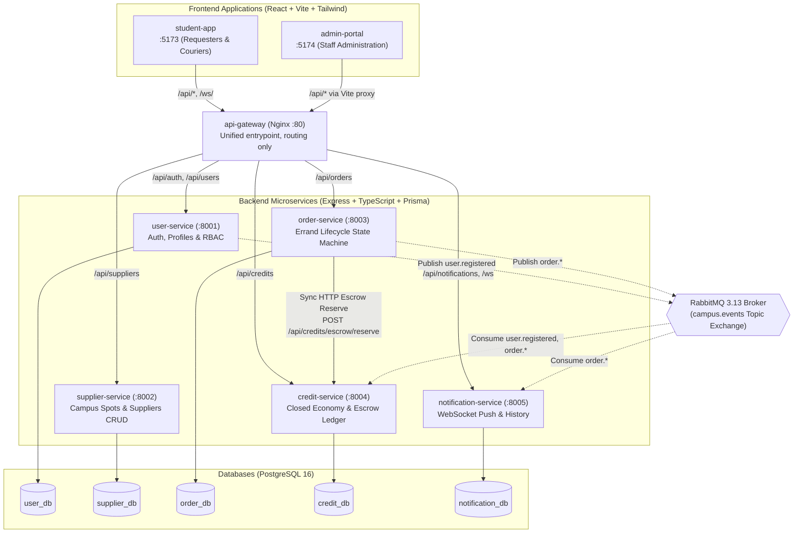

<!--
AI Assistance Disclosure:
Tool: Google Antigravity Agent, date: 2026-10-11
Scope: Authored unified System Architecture specification, consolidating system topology, component diagram, microservices breakdown, database-per-service pattern, and async event choreography.
Author review: <to be completed by author after review>
-->

# System Architecture Specification

Friend of Campus (FoC) is a distributed campus errand platform built on a **Database-per-Service Microservices Architecture**. It decouples distinct business domains into independently scalable, isolated services connected through synchronous REST APIs and an asynchronous RabbitMQ event bus.

---

## 1. High-Level Component Topology

---

## 2. Microservice Responsibilities & Boundaries

| Service | Port | Database | Primary Responsibilities | Key Interactions |
|---|---|---|---|---|
| **User Service** | `8001` | `user_db` | User registration, password hashing (scrypt), Ed25519 token signing, opaque refresh sessions, user profile management, RBAC, and last-admin safety guard. | Publishes `user.registered` to RabbitMQ via Transactional Outbox upon new student sign-up. |
| **Supplier Service** | `8002` | `supplier_db` | Directory of campus merchants, dining outlets, and collection points. Search, category filtering, campus zone queries, and Admin-only CRUD. | Verifies Ed25519 JWTs offline. Queried by clients when creating errand requests. |
| **Order Service** | `8003` | `order_db` | Complete lifecycle state machine for errands (`DRAFT` &rarr; `OPEN` &rarr; `ACCEPTED` &rarr; `IN_TRANSIT` &rarr; `DELIVERED` &rarr; `COMPLETED`, `CANCELLED`, `EXPIRED`). Atomic single-winner courier claiming and background expiry sweeper. | Synchronous HTTP call to Credit Service to reserve escrow during errand creation. Publishes order lifecycle events via Transactional Outbox. |
| **Credit Service** | `8004` | `credit_db` | Closed credit economy wallet accounts, transaction ledger, and per-order escrow holds, settlements, and refunds. | Exposes `POST /api/credits/escrow/reserve`. Consumes `user.registered` (grants 100 credits), `order.completed` (settles escrow), and `order.cancelled` / `order.expired` (refunds escrow). |
| **Notification Service** | `8005` | `notification_db` | Real-time push notifications over authenticated WebSockets (`/ws`), unread notification badge counts, and user notification history. | Consumes `order.*` events from RabbitMQ to construct localized errand alerts. |

---

## 3. Communication Patterns

### A. Synchronous HTTP (Strong Consistency)
Synchronous REST calls are reserved for workflows where immediate consistency and caller feedback are non-negotiable:
- **Order Creation & Escrow Hold**: When a student posts an errand, `order-service` calls `POST /api/credits/escrow/reserve` on `credit-service`.
  - If the requester lacks sufficient available credits, Credit Service returns `400 INSUFFICIENT_CREDITS`, and Order Service aborts the errand creation immediately.
  - If Credit Service is unreachable, Order Service fails fast with `503 SERVICE_UNAVAILABLE`, preventing orphaned errand postings.

### B. Asynchronous Event Choreography (Eventual Consistency)
Cross-service workflows that do not require blocking the user response are decoupled using RabbitMQ 3.13:
- **Exchange**: Durable topic exchange `campus.events` in the `campus` vhost.
- **Transactional Outbox Pattern**:
  - `user-service` and `order-service` persist state transitions and domain events within the same atomic PostgreSQL transaction (writing to `outbox_events`).
  - An asynchronous publisher worker continuously polls `outbox_events`, publishes to RabbitMQ with publisher confirms, and marks events as `PUBLISHED`.
  - This guarantees **at-least-once delivery** without distributed 2-phase commits (2PC) and ensures no events are lost if the process crashes.
- **Idempotent Consumers**:
  - `credit-service` and `notification-service` maintain tables (`processed_credit_events`, `notifications`) recording unique `eventId` values.
  - Replayed or duplicate deliveries are recognized and acknowledged safely without double-charging or duplicate alerts.

---

## 4. Data Architecture (Database-per-Service)

Each microservice owns its data store exclusively:
1. **Zero Cross-Database Queries**: No service directly reads or writes to another service's database. No cross-database SQL joins or foreign keys exist.
2. **PostgreSQL 16 Instance**: For local development and containerized deployment, all 5 logical databases run inside a single containerized PostgreSQL 16 server (`user_db`, `supplier_db`, `order_db`, `credit_db`, `notification_db`).
3. **Prisma Schema Ownership**: Each microservice maintains its own Prisma schema (`src/database/prisma/schema.prisma`) and generates its isolated client (`output = "../generated/client"`) to avoid namespace collisions.

---

## 5. Containerization & Orchestration

The entire platform is defined and orchestrated using `docker-compose.yml`:
- **API Gateway (`nginx:alpine`)**: Maps port 80 to frontend apps and service APIs.
- **Service Containers**: Multi-stage Dockerfiles compiling TypeScript to Node 20 runtime.
- **Startup Coordination**:
  - PostgreSQL health checks (`pg_isready`) gate service starts.
  - Microservices automatically run `prisma migrate deploy` on startup before accepting traffic.
  - RabbitMQ definition bootstrapping (`docker/rabbitmq/definitions.json`) pre-configures exchanges, queues, and dedicated credentials per service.
