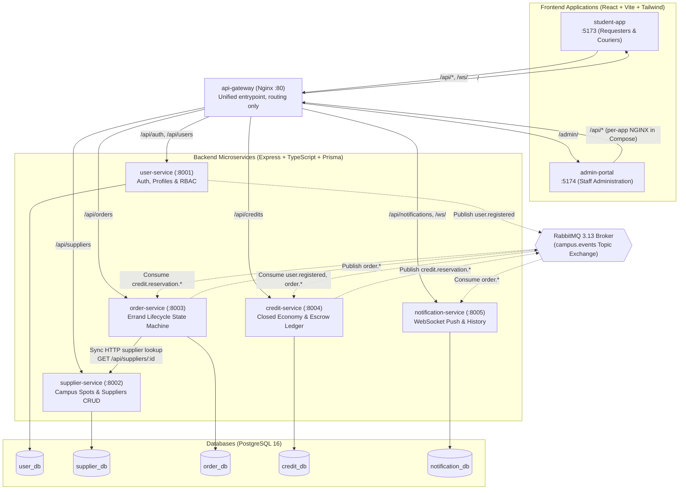

<!--
AI Assistance Disclosure:
Tool: Codex (model: GPT-6), date: 2026-10-18
Scope: Align service interactions and outbox facts with the author-approved asynchronous reservation flow.
Author review: <to be completed by huangjiaxi1111>
Tool: Claude Code (model: Claude Opus 5.5 subagent, Claude Fable 5.1 session), date: 2026-10-18
Scope: Verified against main @ 7f2d972 and corrected facts (frontend proxy path, notification consumption, escrow-reserve failure statuses, outbox status names, gateway image); added gateway route table, outbox relay and expiry sweeper intervals, compensating refund, queue/retry/DLQ topology, WebSocket protocol, container runtime facts, and CI / Claude PR review. Facts only, no rationale added.
Author review: <to be completed by Reallyeasy1>

Tool: Google Antigravity Agent, date: 2026-10-11
Scope: Authored unified System Architecture specification, consolidating system topology, component diagram, microservices breakdown, database-per-service pattern, and async event choreography.
Author review: <to be completed by author after review>
-->

# System Architecture Specification

Friend of Campus (FoC) is a distributed campus errand platform built on a **Database-per-Service Microservices Architecture**. It decouples distinct business domains into independently scalable, isolated services connected through synchronous REST APIs and an asynchronous RabbitMQ event bus.

---

## 1. High-Level Component Topology

---

## 2. Microservice Responsibilities & Boundaries

| Service | Port | Database | Primary Responsibilities | Key Interactions |
|---|---|---|---|---|
| **User Service** | `8001` | `user_db` | User registration, password hashing (scrypt), Ed25519 token signing, opaque refresh sessions, user profile management, RBAC, and last-admin safety guard. | Publishes `user.registered` to RabbitMQ via Transactional Outbox upon new student sign-up. |
| **Supplier Service** | `8002` | `supplier_db` | Directory of campus merchants, dining outlets, and collection points. Search, category filtering, campus zone queries, and Admin-only CRUD. | Verifies Ed25519 JWTs offline. Queried by clients when creating errand requests. |
| **Order Service** | `8003` | `order_db` | Complete lifecycle state machine for errands (`DRAFT` &rarr; `OPEN` &rarr; `ACCEPTED` &rarr; `IN_TRANSIT` &rarr; `DELIVERED` &rarr; `COMPLETED`, `CANCELLED`, `EXPIRED`). Atomic single-winner courier claiming and background expiry sweeper. | Synchronous HTTP call to Supplier Service (supplier lookup) during errand creation. Asynchronous escrow reservation and lifecycle events via Transactional Outbox. Expiry sweeper every 30 s (`EXPIRY_SWEEPER_INTERVAL_MS`). |
| **Credit Service** | `8004` | `credit_db` | Closed credit economy wallet accounts, transaction ledger, and per-order escrow holds, settlements, and refunds. | Consumes `user.registered` (grants 100 credits), `order.reservation.requested` (reserves escrow and publishes `credit.reservation.succeeded` / `credit.reservation.failed`), `order.completed` (settles escrow), and `order.cancelled` / `order.expired` (refunds escrow). All escrow mutations occur via RabbitMQ; `/api/credits/escrow*` is blocked (`403`) at the gateway. |
| **Notification Service** | `8005` | `notification_db` | Real-time push notifications over authenticated WebSockets (`/ws`), unread notification badge counts, and user notification history. | Consumes all seven `order.*` events from RabbitMQ. Only `order.accepted`, `order.in_transit` and `order.delivered` produce a notification (stored, then pushed to the requester); the other keys are acknowledged without one. |

---

## 3. Communication Patterns

### A. Synchronous HTTP (Strong Consistency)
Synchronous REST calls are reserved for workflows where immediate consistency and caller feedback are non-negotiable:
- **Supplier Verification on Order Creation**: When a student posts an errand, `order-service` looks the supplier up with `GET /api/suppliers/:id` on `supplier-service` (unknown or inactive supplier → `400`; Supplier Service unreachable → `503`) before writing the order submission and `order.reservation.requested` outbox event.

### B. Asynchronous Event Choreography (Eventual Consistency)
Cross-service workflows that do not require blocking the user response are decoupled using RabbitMQ 3.13:
- **Exchange**: Durable topic exchange `campus.events` in the `campus` vhost.
- **Transactional Outbox Pattern**:
  - `user-service` and `order-service` persist state transitions and domain events within the same atomic PostgreSQL transaction (writing to `outbox_events`).
  - An asynchronous publisher worker polls `outbox_events` every 2 s (order-service `OUTBOX_RELAY_INTERVAL_MS`, batch `OUTBOX_BATCH_SIZE` = 20; user-service uses the same 2 s / 20 defaults) and is also triggered right after each write. It publishes oldest-first to `campus.events` with routing key = event type, `persistent` and `mandatory` flags, publisher confirms, and `messageId` = `eventId`, then marks the row `DELIVERED`. On a broker failure the row stays `PENDING` (retry count incremented) and the batch stops; an unparsable payload is marked `FAILED`.
  - This guarantees **at-least-once delivery** without distributed 2-phase commits (2PC) and ensures no events are lost if the process crashes.
- **Event envelope**: every event carries `eventId` (UUID), `eventType` and `timestamp` (ISO-8601 UTC). Payload fields are listed in `docs/errand-specification.md` §5 and defined in `packages/common-dtos/src/index.ts` §5.
- **Idempotent Consumers**:
  - `credit-service` and `notification-service` maintain tables (`processed_credit_events`, `notifications`) recording unique `eventId` values.
  - Replayed or duplicate deliveries are recognized and acknowledged safely without double-charging or duplicate alerts.
  - Credit Service applies each event in a `Serializable` transaction, retried up to 9 times on Prisma `P2034`/`P2002`.

### C. Broker Topology (`docker/rabbitmq/definitions.json` + consumer code)
`definitions.json` is imported at broker boot and defines the `campus` vhost, the durable topic exchange `campus.events`, the durable direct exchange `campus.events.dlx`, and one account per service. Each consumer asserts its own queues, retry exchange and bindings on startup (`src/messaging/rabbitmq.ts`, settings in `src/config.ts`).

| Account | Publishes (topic permission on `campus.events`) | Reads |
|---|---|---|
| `user_service` | `user.registered` | nothing |
| `order_service` | `order.created`, `order.accepted`, `order.in_transit`, `order.delivered`, `order.completed`, `order.cancelled`, `order.expired` | nothing |
| `credit_service` | nothing on `campus.events` | `user.registered`, `order.completed`, `order.cancelled`, `order.expired` |
| `notification_service` | nothing on `campus.events` | all seven `order.*` keys |
| `campus_admin` | management UI (`administrator` tag, password `campus-admin-dev`) | everything in `campus` |
| `credit_test` | test queues `credit-test.*` only | test queues `credit-test.*` only |

| Consumer | Main queue (bound to `campus.events`) | Retry exchange / queue | Retry delay × limit | Dead-letter exchange → queue |
|---|---|---|---|---|
| credit-service | `credit-service.events` | `credit-service.events.retry` (direct) | 1 s × 5 (`CREDIT_RETRY_DELAY_MS`, `CREDIT_RETRY_LIMIT`) | `campus.events.dlx` → `credit-service.events.dlq` |
| notification-service | `notification-service.events` | `notification-service.events.retry` (direct) | 2 s × 30 (`NOTIFICATION_RETRY_DELAY_MS`, `NOTIFICATION_RETRY_LIMIT`) | `notification-service.events.dlx` → `notification-service.events.dlq` |

- All queues and exchanges are durable; prefetch is 1 on the main and retry channels.
- A failed message is classified. A transient failure under the retry limit is republished (with confirms) to the retry queue with a retry-count header; a retry worker waits out the delay and republishes it through the default exchange to the consumer's own main queue only. A permanent failure, or a transient one past the limit, is republished to the dead-letter queue. The original delivery is then acknowledged.

### D. WebSocket (Notification Service)
- The gateway forwards `/ws/` to the root path of `notification-service`, which serves REST and WebSocket on one HTTP server (port 8005).
- The client's first frame is `{ "type": "AUTH", "token": "<access token>" }`; the server replies `{ "type": "AUTH_OK", "unreadCount": n }` and then pushes `{ "type": "NOTIFICATION", "data": … }` for each new notification of that user.
- The socket is closed with code `4401` when no valid AUTH frame arrives within 5 s, for an invalid token, and when the access token expires. A ping every 30 s evicts sockets that did not answer the previous one.
- A notification row is stored before it is pushed; `notifications.eventId` is unique, which is the consumer's deduplication.

---

## 4. Data Architecture (Database-per-Service)

Each microservice owns its data store exclusively:
1. **Zero Cross-Database Queries**: No service directly reads or writes to another service's database. No cross-database SQL joins or foreign keys exist.
2. **PostgreSQL 16 Instance**: For local development and containerized deployment, all 5 logical databases run inside a single containerized PostgreSQL 16 server (`user_db`, `supplier_db`, `order_db`, `credit_db`, `notification_db`).
3. **Prisma Schema Ownership**: Each microservice maintains its own Prisma schema (`prisma/schema.prisma`) and generates its isolated client (`output = "../src/database/generated/client"`) to avoid namespace collisions.
4. **Tables per database** (Prisma `@@map` names; migrations under each service's `prisma/migrations/`; `docker/postgres-init/01-init-databases.sql` provisions the five logical databases along with five dedicated least-privilege PostgreSQL roles — `user_svc`, `supplier_svc`, `order_svc`, `credit_svc`, `notification_svc` — and revokes `PUBLIC` connection privileges):

| Database | Tables |
|---|---|
| `user_db` | `users`, `sessions`, `outbox_events` |
| `supplier_db` | `suppliers` |
| `order_db` | `orders` (with `version` column for optimistic locking), `outbox_events` |
| `credit_db` | `credit_wallets`, `credit_transactions`, `credit_grants`, `credit_escrows`, `processed_credit_events` |
| `notification_db` | `notifications` (unique `event_id`; index on `user_id, created_at desc`) |

---

## 5. Containerization & Orchestration

The entire platform is defined and orchestrated using `docker-compose.yml`:
- **API Gateway (`nginx:1.31.7-alpine3.24`, digest-pinned)**: Maps port 80 to frontend apps and service APIs (routes below).
- **Service Containers**: Multi-stage Dockerfiles compiling TypeScript to Node 20 runtime (`node:20.20.2-alpine3.23`, digest-pinned). Frontend images build static assets with Vite and serve them from `nginx:1.31.7-alpine3.24` with a per-app `nginx.conf` that proxies `/api` (and `/ws/` for the student app) to the gateway. `.dockerignore` excludes `*.md`.
- **Runtime user and PID 1**: every application runtime stage switches to its base image's non-root user (`node` for backends, `nginx` for frontends). Backends end with `exec node dist/index.js`, so node is PID 1; Compose sets `init: true` on all five backend services so `SIGTERM` reaches it. user-, supplier-, order- and credit-service register a `SIGTERM` handler; notification-service does not.
- **Broker health probe**: the `rabbitmq` health check runs `su-exec rabbitmq rabbitmq-diagnostics check_port_connectivity` (as the server user, not root); the container itself runs as root so its entrypoint repairs ownership of `/var/lib/rabbitmq`.
- **Startup Coordination**:
  - PostgreSQL health checks (`pg_isready`) gate service starts.
  - Microservices automatically run `prisma migrate deploy` on startup before accepting traffic, then their seed where one exists (user and supplier must succeed; credit and order seeds may fail without stopping the service).
  - RabbitMQ definition bootstrapping (`docker/rabbitmq/definitions.json`) pre-configures the vhost, exchanges, and dedicated credentials per service; queues are declared by the consumers.
  - Every backend and frontend has a health check (`/ready` for user- and notification-service, `/health` for the rest); the gateway waits for all of them to be `service_healthy`. credit-service also waits for a healthy user-service.

### Gateway routes (`gateway/nginx.conf`)

| Path | Upstream |
|---|---|
| `/api/auth/`, `/api/users`, `/api/users/` | `user-service:8001` |
| `/api/suppliers`, `/api/suppliers/` | `supplier-service:8002` |
| `/api/orders`, `/api/orders/` | `order-service:8003` |
| `/api/credits`, `/api/credits/` | `credit-service:8004` |
| `/api/notifications`, `/api/notifications/` | `notification-service:8005` |
| `/ws/` | `notification-service:8005` root path (HTTP/1.1 upgrade, 86400 s read/send timeout) |
| `/admin` (301 → `/admin/`), `/admin/` | `admin-portal:5174` |
| any other `/api` path | `404` |
| `/` | `student-app:5173` |

### Ports

| Component | Port(s) |
|---|---|
| api-gateway | 80 |
| student-app / admin-portal | 5173 / 5174 |
| user / supplier / order / credit / notification service | 8001 / 8002 / 8003 / 8004 / 8005 |
| postgres | 5432 |
| rabbitmq | 5672 (AMQP), 15672 (management UI) |

### CI and automated review (`.github/workflows/`)
- `ci.yml` runs on every pull request and on pushes to `main`: lint, build, type checks, test-matrix consistency, unit / integration / messaging / migration / seed matrices, Compose acceptance, D2 API E2E, Chromium browser UAT, and a final test gate. Details: `docs/ci.md`.
- `claude-pr-review.yml` (`Claude PR review`) runs on non-draft pull requests from this repository: it posts inline review comments and one summary comment, including a **Linked issues** section that checks the PR's `Closes #n` lines. It does not fail the PR and is not part of the test gate.
