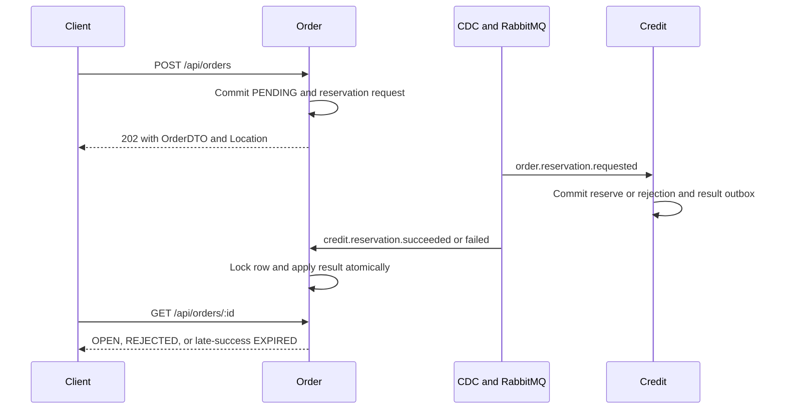

<!--
AI Assistance Disclosure:
Tool: Claude Code (model: Claude Fable 5.1), date: 2026-10-25
Scope: Added the Chat Service socket and history section (F8, PR #148), moved from the former docs/architecture.md section 3E while merging main into that PR.
Author review: <to be completed by Reallyeasy1>

Tool: Codex (model: GPT-6), date: 2026-10-25
Scope: Source-linked implementation documentation and evidence review requested by Reallyeasy1.
Author review: <to be completed by Reallyeasy1>
-->

# Communication and event catalogue

Implementation baseline: [`52d791e`](https://github.com/AY2627S1-CS3219-P25/friend-on-campus/commit/52d791e4eea28ce7d817f025ef096f8d96bda467); inspected 2026-10-25 (SGT). Pending work is explicitly labelled.

This is the shared catalogue of implemented event relationships. Service pages describe local handling and link here; DTO unions alone are not an exhaustive event inventory.

| Event | Durable producer | Consumer effect at this baseline |
|---|---|---|
| user.registered | User: user + outbox transaction | Credit welcome grant/wallet initialization |
| order.reservation.requested | Order: PENDING + outbox transaction | Credit reserves escrow or records a business rejection result |
| credit.reservation.succeeded | Credit: processed identity + reserve + result outbox transaction | Order applies OPEN + order.created, or late-success EXPIRED + order.expired |
| credit.reservation.failed | Credit: dedup identity + failure result outbox | Order changes matching PENDING to REJECTED |
| order.created | Order when reservation success publishes an unexpired order | Notification validates and acknowledges, no notification row |
| order.accepted | Order acceptance transaction | Notification ORDER_ACCEPTED to requester |
| order.in_transit | Order pickup transaction | Notification ORDER_PICKED_UP to requester |
| order.delivered | Order delivery transaction | Notification ORDER_DELIVERED to requester |
| order.completed | Order completion transaction | Credit settles; Notification acknowledges without a row |
| order.cancelled | Order cancellation transaction | Credit refunds; Notification acknowledges without a row |
| order.expired | Order expiry transaction | Credit refunds; Notification acknowledges without a row |

Order and Credit consumers use persistent state/idempotency guards. Notification subscribes to seven lifecycle keys, not `order.reservation.requested`. No `order.rejected`, `order.unassigned`, `credit.escrow.settled` or `credit.escrow.refunded` is produced on this baseline; these appear in pending PR #184.

## Transport and transaction boundaries

User writes `outbox_events`; Order writes its own `outbox_events`; Credit writes `credit_outbox_events`. Debezium tails committed changes and publishes to topic exchange `campus.events`. A database commit and the later consumer effect are separate transactions in different services. Outbox status/retry columns are retained schema fields, not proof that a running polling worker marks delivery.

The diagram groups separate connector deliveries. Supplier validation happens before the first Order transaction. An expired successful reservation produces a refund-triggering event; the expiry sweeper itself selects OPEN orders, not all PENDING orders.

## Chat socket and history (Chat Service, F8)

The gateway forwards `/ws/chat/` to the root path of `chat-service` (port 8006) and `/api/chat` to its REST routes; both share one HTTP server.

- Handshake as on the Notification socket: first frame `{ "type": "AUTH", "token": "<access token>" }`, reply `{ "type": "AUTH_OK" }`, close `4401` on a missing, invalid or expired token, 30 s ping eviction. Sockets are filed by user id.
- The client sends `{ "type": "SEND", "orderId", "text", "clientId"? }`. The server stores the message and pushes `{ "type": "MESSAGE", "orderId", "message" }` to every socket of both participants, or answers the sender with `{ "type": "ERROR", "orderId", "clientId", "code", "message" }` (`NOT_FOUND`, `FORBIDDEN`, `CLOSED`, `EMPTY`, `NO_USERNAME`, `BAD_FRAME`).
- History: `GET /api/chat/:orderId?afterSequence=&limit=` returns the conversation and its messages in sequence order to the requester, the assigned courier and admins; when no conversation row exists it is created from `GET /api/orders/:id` on the Order Service (the caller's token forwarded), and a 404 or an unavailable Order Service answers 404 or 503.
- Conversation rows are projected from `order.accepted` (create, or replace the courier), `order.in_transit` and `order.delivered` (timestamps) and `order.completed`, `order.cancelled`, `order.expired` (`closedAt`); events for an order with no row are acknowledged without effect. Messages may be sent only while `closedAt` is null; the sender's username and role are copied from the access token.

## Failure behavior

Order/Credit classify permanent, infrastructure and transient errors. Infrastructure errors retry without the transient count limit; other retryable errors use a bounded delivery-count threshold. Notification uses only permanent and transient classes at this baseline. Defaults and broker semantics are in [messaging](../packages/messaging.md).

A dead-lettered message is not a successfully completed business effect. No automatic DLQ replay/alerting service is implemented. A stored notification can survive missed socket delivery; socket frames are not durably acknowledged by clients. Avoid describing this entire pipeline as exactly-once delivery.

## Evidence

Order's reservation messaging suite uses a manually relayed Order outbox and a real Credit CDC connector, plus injected duplicates/failures. It is hybrid coverage, not proof of all production connectors. `uat-cdc.mjs` separately exercises the registration/reservation/refund chain. See [testing strategy](../development/testing-strategy.md) for prerequisites and current execution status.

## Source evidence and related reading

- [`packages/common-dtos/src/index.ts`](../../packages/common-dtos/src/index.ts)
- [`services/user-service/src/persistence/auth-repository.ts`](../../services/user-service/src/persistence/auth-repository.ts)
- [`services/order-service/src/repositories/order.repository.ts`](../../services/order-service/src/repositories/order.repository.ts)
- [`services/credit-service/src/credits/service.ts`](../../services/credit-service/src/credits/service.ts)
- [`services/notification-service/src/notifications/events.ts`](../../services/notification-service/src/notifications/events.ts)
- [`services/order-service/test/reservation.messaging.test.ts`](../../services/order-service/test/reservation.messaging.test.ts)
- [`scripts/uat/uat-cdc.mjs`](../../scripts/uat/uat-cdc.mjs)
- [Wiki: Architecture](https://github.com/AY2627S1-CS3219-P25/friend-on-campus/wiki/Architecture)
- [Documentation index](../README.md) · [Drift register](../audits/documentation-drift.md) · [Verification record](../audits/review-findings.md)
