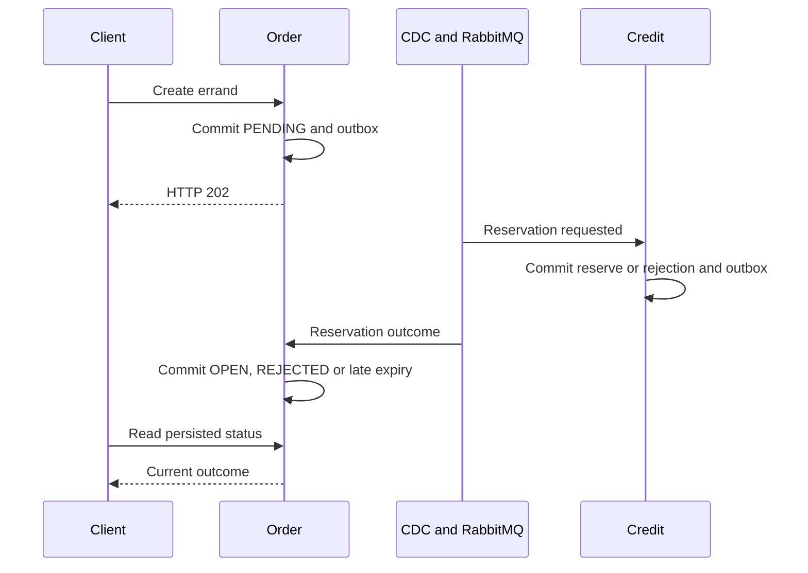

<!--
AI Assistance Disclosure:
Tool: Codex (model: GPT-6), date: 2026-11-09
Scope: Reconcile the active documentation with main b989758 and simplify navigation; preserve historical attribution.
Author review: <to be completed by Reallyeasy1>

Tool: Claude Code (model: Claude Fable 5.1), date: 2026-10-25
Scope: Added the Chat Service socket and history section (F8, PR #148), moved from the former docs/architecture.md section 3E while merging main into that PR.
Author review: <to be completed by Reallyeasy1>

Tool: Codex (model: GPT-6), date: 2026-10-25
Scope: Source-linked implementation documentation and evidence review requested by Reallyeasy1.
Author review: <to be completed by Reallyeasy1>
-->

# Communication and events

Implementation inspected at [`b989758`](https://github.com/AY2627S1-CS3219-P25/friend-on-campus/commit/b989758e766cb593c3b8c94102eb6dfb5c7d8491) on 9 November 2026 (SGT). This is a code/configuration reference, not verification of the live deployment.

There are two messaging paths: durable business events for cross-service effects, and realtime signals for notifying WebSocket-owning replicas. Neither makes delivery exactly once.

## Domain events and the reservation Saga

User, Order and Credit commit their own outbox rows with business changes. Three Debezium connectors publish those rows to `campus.events`; consumers apply subsequent transactions in their own databases.

| Event family | Producer | Consumer effect |
|---|---|---|
| `user.registered` | User | Credit creates the welcome grant/wallet idempotently |
| `order.reservation.requested` | Order | Credit reserves escrow or records a business rejection |
| `credit.reservation.succeeded` / `.failed` | Credit | Order moves matching `PENDING` to `OPEN` / `REJECTED`; a late successful reservation can expire and trigger refund |
| `order.created`, `.accepted`, `.in_transit`, `.delivered`, `.rejected`, `.unassigned` | Order | Notification builds recipient-specific lifecycle messages; Chat consumes its configured lifecycle subset |
| `order.completed` | Order | Credit settles escrow; Notification and Chat process lifecycle facts |
| `order.cancelled`, `.expired` | Order | Credit refunds escrow; Notification and Chat process lifecycle facts |
| `credit.escrow.settled`, `.refunded` | Credit | Notification records financial receipts from committed money effects |

The table groups event families; exact bindings and notification recipients are in the [Notification event mapping](../services/notification-service/implementation.md) and [Chat reference](../services/chat-service/README.md). In particular, Chat does not currently consume `order.unassigned`; do not infer access revocation from Notification receiving it.

Supplier validation precedes creation. Order v2 lifecycle facts carry the committed version, previous/current status, actor metadata and reason codes where applicable. Complete/cancel commits Order state before Credit processes its separate event; verify the wallet or financial receipt before claiming a payout/refund. The [Order runtime](../services/order-service/runtime-and-testing.md) and [Credit runtime](../services/credit-service/runtime-and-testing.md) describe failure paths and idempotency.

## Realtime signals between replicas

Chat and Notification commit a service-owned realtime outbox with each relevant persisted change. A leased relay publishes to a service-specific durable fanout exchange. Each running replica has an exclusive, bounded, expiring queue; it rereads authoritative rows and pushes to its local authenticated sockets.

These live queues are separate from business quorum queues and their DLQs. Signals may expire, be duplicated or be missed during reconnects. Persisted REST history/inbox catch-up is the recovery source. Client-side deduplication prevents repeated display; it does not turn repeated SEND commands into exactly-once message creation.

See [shared messaging](../packages/messaging.md) for relay leases, confirms, queue limits and retry classifications. There is no implemented realtime DLQ or general automatic business-DLQ replay service in this baseline.

## Synchronous calls and verification

Order reads Supplier during creation and uses the shared LLM helper for assistant drafts. Chat can fetch Order to initialise a missing conversation and uses its translation path; existing projections have the limits described in the Chat guide. Frontend refresh calls go to User, while normal downstream JWT validation is offline.

Tests are scoped evidence: messaging integration, CDC acceptance and multi-client browser tests cover different boundaries. A passing client test alone does not prove independent replica routing or live AWS behavior. Use [testing strategy](../development/testing-strategy.md) and the [verification record](../audits/review-findings.md).

Sources: [common DTOs](../../packages/common-dtos/src/index.ts), [Order repository](../../services/order-service/src/repositories/order.repository.ts), [Credit service](../../services/credit-service/src/credits/service.ts), [Notification events](../../services/notification-service/src/notifications/events.ts), [CDC/broker configuration](../infrastructure/cdc-and-broker.md).

[Documentation index](../README.md)
