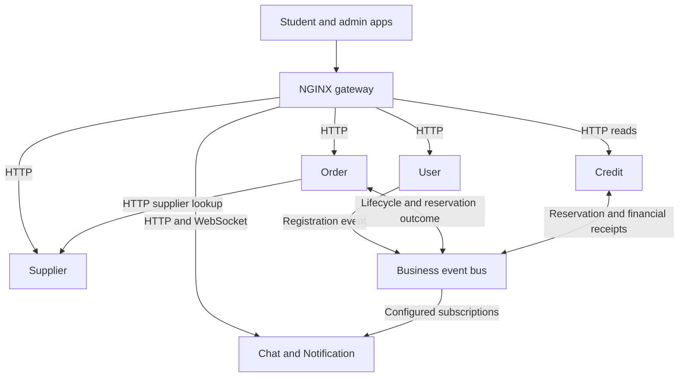

<!--
AI Assistance Disclosure:
Tool: Codex (model: GPT-6), date: 2026-11-09
Scope: Consolidate system boundaries, data, security and shared contracts into one source-checked developer explanation with a concrete errand journey.
Author review: <to be completed by Reallyeasy1>

Tool: Codex (model: GPT-6), date: 2026-11-09
Scope: Reconcile the active documentation with main b989758 and simplify navigation; preserve historical attribution.
Author review: <to be completed by Reallyeasy1>

Tool: Claude Code (model: Claude Fable 5.1), date: 2026-10-25
Scope: Added the Chat Service (F8, PR #148) row to the runtime table while merging main into that PR.
Author review: <to be completed by Reallyeasy1>

Tool: Codex (model: GPT-6), date: 2026-10-25
Scope: Source-linked implementation documentation and evidence review requested by Reallyeasy1.
Author review: <to be completed by Reallyeasy1>

Tool: Claude Code (model: Claude Fable 5.1), date: 2026-10-25
Scope: Added the Chat Service socket and history section (F8, PR #148), moved from the former docs/architecture.md section 3E while merging main into that PR.
Author review: <to be completed by Reallyeasy1>

Tool: Codex (model: GPT-6), date: 2026-11-09
Scope: Reconcile implementation guidance with current source, simplify duplication and preserve historical attribution.
Author review: <to be completed by the author>
-->

# How Friend on Campus works

Friend on Campus lets a student post an errand, reserve a reward, work with a courier and confirm completion. The interesting part is that these steps do not happen in one database transaction: Order decides the errand state, Credit controls the money, and Chat and Notification maintain their own views.

Start here to understand those boundaries. For a runnable environment, use [local development](../development/local-development.md); for deployment topology, use the [AWS guide](../new-cloud-architecture-guide.md). The [documentation index](../README.md#baseline-and-verification) records the inspected revisions and verification limits for these guides.

## The service map

There are **six backend services**, two React applications and an NGINX gateway. The frontends present the workflows; the services own the business rules. A shared package is a library loaded into a service, not an additional running backend.

The diagram separates browser commands from the event-driven workflow. Arrows labelled HTTP are direct calls. The event bus represents RabbitMQ plus the CDC publication path; it is not a shared database.

Notification consumes Order lifecycle and Credit receipt events; Chat consumes its configured Order lifecycle events. Chat can additionally read Order to initialise a missing conversation. That fallback does not imply that it checks the authoritative order on every request. The service guide explains the resulting membership-freshness limitation. Realtime fanout between replicas is a separate mechanism from the business events shown above.

| Service | What it owns | Main gateway routes | Local port |
|---|---|---|---:|
| [User](../services/user-service/README.md) | Accounts, passwords, refresh sessions, profile and user administration | `/api/auth`, `/api/users` | 8001 |
| [Supplier](../services/supplier-service/README.md) | Campus supplier directory, active status and coordinates | `/api/suppliers` | 8002 |
| [Order](../services/order-service/README.md) | Errands, assignment, lifecycle, disputes and assistant drafts | `/api/orders` | 8003 |
| [Credit](../services/credit-service/README.md) | Wallets, ledger, welcome grants and reward escrow | `/api/credits` | 8004 |
| [Notification](../services/notification-service/README.md) | Recipient inbox, read state and order projection | `/api/notifications`, `/ws/` | 8005 |
| [Chat](../services/chat-service/README.md) | Conversations, ordered messages and translation | `/api/chat`, `/ws/chat/` | 8006 |

The local gateway serves the student app at `/` and the admin app at `/admin/`. Direct frontend development uses ports 5173 and 5174. These are local addresses, not a list of publicly exposed AWS ports.

## Follow one errand through the system

Suppose a student posts an errand offering 10 credits.

1. **The browser submits a command.** Order validates the request and checks the chosen supplier. It stores a `PENDING` errand together with an outbox row describing the reservation request.
2. **Order responds before the reservation finishes.** HTTP `202` means the request entered the asynchronous workflow. It does not establish that the wallet has been charged or the errand is visible as `OPEN`.
3. **Credit decides whether the reward can be reserved.** Debezium publishes the committed outbox row to RabbitMQ. Credit processes it in its own database, then publishes the reservation result through its own outbox.
4. **Order applies the result.** A matching pending order becomes `OPEN` or `REJECTED`; late success has an expiry/refund path. The frontend must observe persisted status rather than infer success from the initial response.
5. **Other services update their views.** Notification creates recipient-specific inbox entries; Chat consumes its configured lifecycle events. Their data can briefly lag behind Order.
6. **Completion and payment are separate commits.** Confirming delivery changes Order first. Credit later settles the escrow and emits a committed financial receipt. Cancellation similarly reaches the refund through an event.

This is the **Saga**: several local transactions connected by events, with compensating actions such as refunding a reservation. It is not a distributed SQL transaction. See the [Order guide](../services/order-service/README.md) for the full state machine and the [Credit guide](../services/credit-service/README.md) for the money example and replay rules.

For troubleshooting, ask which commit has actually happened. An order stuck at `PENDING`, an `OPEN` order missing from a stale screen, and a cancelled order awaiting its refund are different conditions and need different checks.

## Data ownership and consistency

Each backend owns a logical PostgreSQL database, Prisma schema, migration history and generated client. Locally, one PostgreSQL server hosts the six databases; on AWS, RDS supplies the database server. Database-per-service does not mean one physical machine per service.

| Database | Main persisted state | Transaction boundary |
|---|---|---|
| `user_db` | Users, sessions, registration outbox | Registration and its publication intent commit together |
| `supplier_db` | Supplier directory | Supplier validation and updates are local |
| `order_db` | Orders and domain outbox | Lifecycle predicates/version and resulting events commit together; dispute flags do not emit an event |
| `credit_db` | Wallets, ledger, grants, escrows, event receipts and outbox | Serializable processing includes money changes, deduplication and publication intents |
| `notification_db` | Inbox, processed events, order projection and realtime outbox | Event receipt, recipient rows and live-delivery intents commit together |
| `chat_db` | Conversations, messages and realtime outbox | Conversation locking allocates sequence numbers and commits messages with their delivery intents |

An **outbox** is a database table recording work that should be published after the business transaction commits. It closes the gap between saving a change and asking another component to act. It does not, by itself, make consumers run exactly once.

Cross-service IDs are scalar references, not cross-database foreign keys. Deleting a User does not cascade into another service's committed orders or ledger. Orders retain supplier snapshots, so editing a supplier does not rewrite earlier errands. A newly registered student can temporarily lack a wallet while the registration event is still being processed.

Schema changes belong to each service's Prisma migrations. The [initialisation SQL](../../docker/postgres-init/01-init-databases.sql) creates databases and roles, not application tables. Read SQL migrations alongside Prisma schemas: SQL checks and expression indexes are not all represented in the schema declarations. Use the [development guide](../development/local-development.md) for migration and seed commands rather than manually patching tables.

## Two kinds of asynchronous delivery

Business events and live UI updates solve different problems:

| Path | Carries | Publication and recovery |
|---|---|---|
| Business events | Registration, lifecycle, reservation and financial outcomes | User/Order/Credit outboxes → Debezium → durable business queues; consumers apply idempotent effects, with retry/DLQ boundaries |
| Realtime signals | References to saved Chat messages, inbox changes or read state | Chat/Notification realtime outboxes → service relays → per-replica fanout queues; reconnecting clients recover persisted history through HTTP |

For example, a saved chat message can exist even if a browser misses its live push. The reconnecting client reads history. Conversely, receiving an Order completion notification does not mean the separate Credit settlement has already committed; the financial receipt is separate evidence.

The [messaging and recovery guide](../infrastructure/cdc-and-broker.md) explains acknowledgements, retries, queue limits and failure diagnosis. Neither path promises permanent, exactly-once socket delivery, and there is no general automated DLQ replay service at this baseline.

## Authentication and authorization

**Authentication** identifies the caller. **Authorization** decides whether that caller can perform this action on this record. NGINX routes the request, while backend services enforce authorization.

User signs short-lived Ed25519 JWT access tokens. The browser keeps its access token in memory and sends it as `Authorization: Bearer …`. Services use `@campus-errand/auth` to verify the token locally; they do not call User for every request. The refresh token is an opaque HttpOnly cookie backed by a hashed session record in User's database.

| Boundary | Current behavior | Consequence |
|---|---|---|
| JWT verification | Signature, EdDSA/JWT header, issuer, audience, expiry and claim validation; default expiry 15 minutes | A valid signature alone is insufficient; service configuration must agree on keys, issuer and audience |
| Refresh | Session rotation and enabled-user check; default one-day idle window or 30 days with keep-logged-in | Refresh can fail even while an older access token is still valid |
| Cookie | HttpOnly, SameSite=Lax, `/api/auth` path; Secure in production | JavaScript cannot read the cookie; proxy/origin configuration still matters |
| Role checks | STUDENT/ADMIN claims plus service-specific ownership/state predicates | Hiding a button in the frontend is not authorization |
| WebSockets | Service-specific first-frame authentication and access checks | A socket upgrade alone does not authenticate the connection |

Logout deletes the refresh session. Disabling an account blocks new login/refresh. Neither immediately revokes an already issued access token at offline downstream verifiers. Changing a password also does not revoke every existing session automatically. See [User](../services/user-service/README.md) for the exact session and administration behavior.

There are two especially important implementation limits:

- **Order development authentication:** without a public key, `ORDER_DEV_AUTH=1` or `true` enables identity headers. This is not guarded by `NODE_ENV`; it must not be enabled on an exposed deployment.
- **Chat membership:** history permits participants or ADMIN, while sending is participant-only. Existing conversation projections can be stale after unassignment. The [Chat guide](../services/chat-service/README.md) separates current behavior from the stricter participant-only requirement.

CloudFront gives the browser HTTPS, but the current origin hop to the ALB is HTTP. Do not infer end-to-end encryption from the browser padlock; the [AWS guide](../new-cloud-architecture-guide.md) explains the configured network boundary.

## Shared libraries and contracts

| Package | Use it for | Do not assume |
|---|---|---|
| [`auth`](../../packages/auth/README.md) | Token verification, Express middleware, principal types and ADMIN gate | A database/session lookup or automatic global revocation |
| [`common-dtos`](../../packages/common-dtos/src/index.ts) | Shared API, event and socket TypeScript shapes | Runtime validation or proof that every declared event/state is implemented |
| [`messaging`](../../packages/messaging/src/index.ts) | RabbitMQ publishing/consuming and shared realtime machinery | Business ownership or exactly-once processing |
| [`llm`](../../packages/llm/src/index.ts) | Shared external-API integration used by application features | Another backend service or authority to mutate an errand |

A concrete example: `DISPUTED` remains in the shared Order status type, but the implemented dispute workflow records flags/details on a delivered order. The declaration does not establish a transition to that status. Similarly, a `clientId` in the Chat protocol correlates responses but is not a database uniqueness key preventing duplicate SEND retries.

When changing a contract, trace both producer and consumer, their runtime validation and their tests. Root `npm run typecheck` checks all twelve workspaces for type compatibility; it does not demonstrate event delivery or database correctness. The [testing guide](../development/testing-strategy.md) explains which checks cover those boundaries.

## Finding the code for a feature

Follow the feature in this order instead of searching every directory:

1. Start with the [frontend guide](../frontend/README.md) and the relevant page/API wrapper.
2. Find its gateway/Vite route, then the owning service's router and handler.
3. For a mutation, inspect the database transaction and any outbox event it creates.
4. Follow the receiving consumer into its own transaction and the UI's refresh/history path.
5. Read the tests next to that boundary, including their required databases and broker identities.

Useful entry points are [gateway routes](../../gateway/nginx.conf), [Order persistence](../../services/order-service/src/repositories/order.repository.ts), [shared verification](../../packages/auth/src/index.ts) and [service schemas](../../services). Each service guide links the narrower files needed for its flow. Start troubleshooting from a concrete symptom and record ID; a healthy gateway alone does not prove that every downstream service or asynchronous effect is healthy.

[Documentation index](../README.md)
