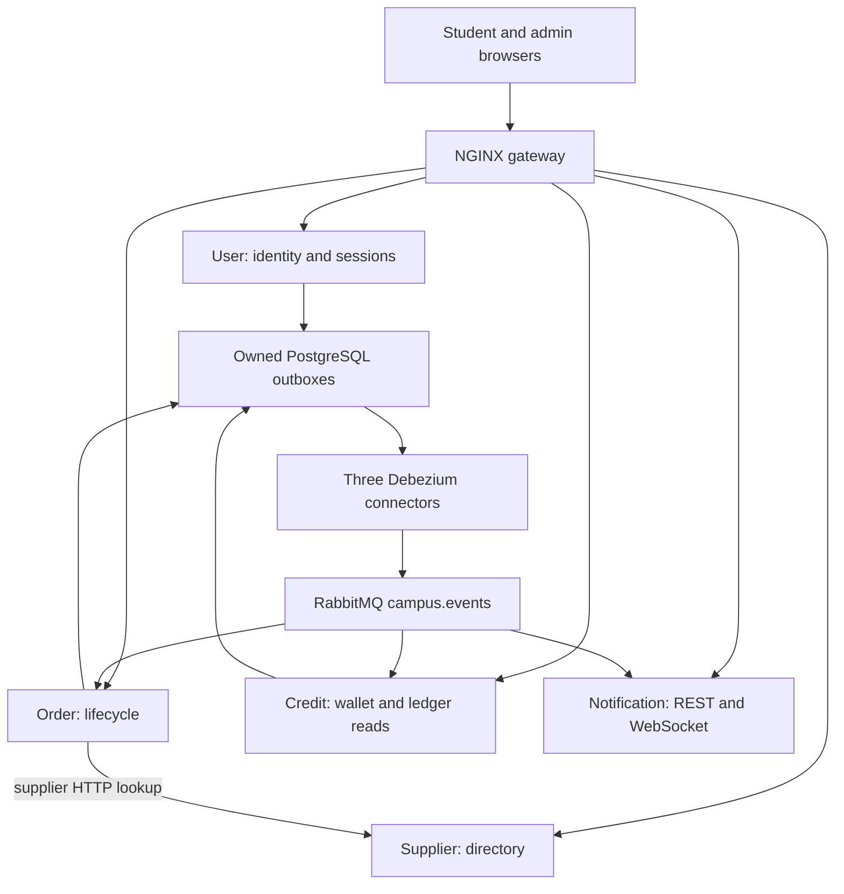

<!--
AI Assistance Disclosure:
Tool: Claude Code (model: Claude Fable 5.1), date: 2026-10-25
Scope: Added the Chat Service (F8, PR #148) row to the runtime table while merging main into that PR.
Author review: <to be completed by Reallyeasy1>

Tool: Codex (model: GPT-6), date: 2026-10-25
Scope: Source-linked implementation documentation and evidence review requested by Reallyeasy1.
Author review: <to be completed by Reallyeasy1>
-->

# System overview

Implementation baseline: [`52d791e`](https://github.com/AY2627S1-CS3219-P25/friend-on-campus/commit/52d791e4eea28ce7d817f025ef096f8d96bda467); inspected 2026-10-25 (SGT). Pending work is explicitly labelled.

This document maps the deployed local Compose implementation to its owning code. It describes behavior; architectural choices and their rationales remain human-owned in the Wiki and approved specifications.

The monorepo has ten npm workspaces: five Express/TypeScript services, two React/Vite applications and three shared packages. PostgreSQL 16 runs as one instance with five service-owned logical databases. This is logical data ownership, not five independent database servers. RabbitMQ 3.13 transports domain events; three Debezium Server connectors publish committed User, Order and Credit outbox records.

The shared outbox node groups three separate databases and connectors for readability; it is not one shared table. Solid diagram edges indicate dependency/flow, not exclusively HTTP.

| Runtime | Port | Persistence | Composition entry |
|---|---:|---|---|
| User | 8001 | user_db | services/user-service/src/index.ts |
| Supplier | 8002 | supplier_db | services/supplier-service/src/index.ts |
| Order | 8003 | order_db | services/order-service/src/index.ts |
| Credit | 8004 | credit_db | services/credit-service/src/index.ts |
| Notification | 8005 | notification_db | services/notification-service/src/index.ts |
| Chat | 8006 | chat_db | services/chat-service/src/index.ts |
| Student / Admin | 5173 / 5174 | Browser state; no service database | apps/*/src/main.tsx |
| Gateway | 80 | None | gateway/nginx.conf |

The gateway routes requests; services enforce authentication and authorization. Order's supplier lookup is the runtime synchronous service-to-service HTTP dependency. The Credit development seed also calls User login/logout, which is a startup operation rather than an order transaction.

No application polling outbox publisher runs at this baseline. Shared publisher utilities exist for tests and other callers; their existence does not imply that production services use them.

Start with [service boundaries](service-boundaries.md), [events](communication-and-events.md), [data](data-ownership.md), and [security](authentication-and-security.md). Local Compose is implemented. AWS and Chat Wiki plans are proposals; Chat is not a sixth service on this baseline. PR #184 is reviewed separately in [the pending-change audit](../audits/pr-184-review.md).

## Verification limits

The topology is established from composition/configuration and cross-checked with the Wiki. This documentation change does not establish production availability, cloud deployment, or measured NFR compliance. Runtime checks and unavailable infrastructure are recorded in the verification record.

## Source evidence and related reading

- [`package.json`](../../package.json)
- [`docker-compose.yml`](../../docker-compose.yml)
- [`gateway/nginx.conf`](../../gateway/nginx.conf)
- [`services/user-service/src/index.ts`](../../services/user-service/src/index.ts)
- [`services/order-service/src/index.ts`](../../services/order-service/src/index.ts)
- [`services/credit-service/src/index.ts`](../../services/credit-service/src/index.ts)
- [`services/notification-service/src/index.ts`](../../services/notification-service/src/index.ts)
- [Wiki: Architecture](https://github.com/AY2627S1-CS3219-P25/friend-on-campus/wiki/Architecture)
- [Documentation index](../README.md) · [Drift register](../audits/documentation-drift.md) · [Verification record](../audits/review-findings.md)
