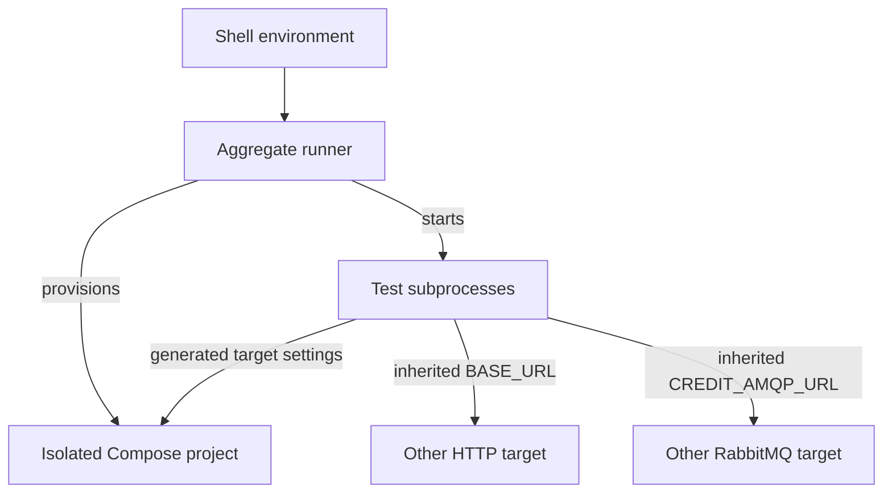

<!--
AI Assistance Disclosure:
Tool: Codex (model: GPT-6); Claude Code (model: Claude Fable 5.1), date: 2026-10-25 to 2026-11-09
Scope: Source-linked implementation documentation and evidence review requested by Reallyeasy1; updated across 7 AI-assisted revisions through D4 wrap-up (document aggregate target overrides and Compose minimum, explain direct API E2E database/fixture behavior, and diagram test provisioning boundaries).
Author review: I validated correctness, edited for style, and verified with automated tests.
-->

# Test the system and interpret the results

A unit test, a browser journey and a load run answer different questions. Start with the smallest test that exercises the changed behavior, then add the checks that cross the boundaries you changed. For example, changing Order's reservation handling needs its unit and Saga messaging tests; seeing `202 Accepted` in a browser is not enough to prove the wallet was reserved.

This guide explains the actual commands, resource requirements, CI coverage and evidence limits. The [documentation index](../README.md) records the inspected source revision. Follow [local setup](local-development.md) before running tests that need a stack.

## Choose the check for your change

All commands run from the repository root after `npm ci` has generated the six Prisma clients.

| What you need to establish | Command | Requires |
|---|---|---|
| TypeScript source/test compatibility | `npm run typecheck` | Twelve workspaces; includes service and messaging test tsconfigs |
| Lint / build output | `npm run lint` / `npm run build` | Installed dependencies; builds all workspaces |
| In-process rules, validation and UI helpers | `npm run test:unit` | Nine suites: six backends, two frontends, shared messaging |
| Database behavior and access guards | `npm run test:integration` | Four prepared PostgreSQL suites: User, Credit, Notification, Chat |
| Event handlers, broker transport and Saga behavior | `npm run test:messaging` | Four suites: Credit, Order, Notification, Chat; databases and RabbitMQ; Order also needs Credit CDC |
| Migration behavior | `npm run test:migration` | Dedicated Credit and Supplier test databases |
| Credit development seeding | `npm run test:seed` | A dedicated Credit test database |
| API, notification and CDC acceptance | `npm run test:acceptance` | Running seeded stack and direct broker access |
| User/Supplier API journey | `npm run test:e2e:api` | Seeded `user_db`/`supplier_db` on localhost with fixed development credentials and free selected service ports; [details below](#run-user-and-supplier-api-e2e-directly) |
| Main browser journeys | `npm run test:e2e:ui` | Running seeded stack, Playwright Chromium and direct broker access |
| Multiple browser clients and live updates | `npm run test:e2e:ui:realtime` | Running seeded stack and Chromium; registers a temporary courier |
| Unit coverage report | `npm run coverage` | Service unit suites; produces local coverage output, not a CI gate |

A focused edit does not require rerunning every unrelated suite immediately. For example, while working on Chat rules:

```bash
npm run test:unit -w @campus-errand/chat-service
npm run typecheck
```

Read the test output, including skipped and cancelled counts. A command that exits successfully after skipping database tests has not verified the database path. The [service guides](../README.md) explain what each service suite exercises and the behavior it does not cover.

## Let the aggregate runner provision an isolated stack

For broad local verification, the existing runner provisions a separate stack and prepares its test databases. It requires a functioning Docker daemon and **Compose 2.24.4+**: [`docker-compose.test.yml`](../../docker-compose.test.yml) uses the [`!override` feature](https://docs.docker.com/reference/compose-file/merge/#replace-value). Check `docker compose version` before starting.

First clear `BASE_URL` and `CREDIT_AMQP_URL` from the environment passed to the runner. It inherits shell variables and does not replace these two target overrides: CDC acceptance gives `BASE_URL` priority over the generated `GW`, and Notification acceptance uses an explicit `CREDIT_AMQP_URL` instead of the generated local broker. Leaving either set can send test mutations outside the new stack; its cleanup cannot remove those external fixtures.

On a POSIX shell, clear them for this invocation only:

```bash
env -u BASE_URL -u CREDIT_AMQP_URL npm test
```

In PowerShell, use `Remove-Item Env:BASE_URL, Env:CREDIT_AMQP_URL -ErrorAction SilentlyContinue` before `npm test`; that removes the overrides from the current shell. If you need them for later standalone tests, set them again explicitly for that target.

[`run-all-tests.mjs`](../../scripts/ci/run-all-tests.mjs) creates a uniquely named Compose project, selects free loopback ports, generates temporary JWT keys and prepares test databases. It runs unit/database categories, acceptance, API E2E and Chromium UAT, checks Chat/Notification socket shutdown, then removes **its own** containers and volumes. It may download Chromium; a browser binary download does not install missing Linux system libraries. On a Linux host that lacks them, install Playwright's Chromium system dependencies before the run, as the [CI browser job](../../.github/workflows/ci.yml) does with `npx playwright install --with-deps chromium`.

The provisioned resources and the destinations used by each test are separate concerns. The full aggregate's acceptance drivers can reach these targets before the two inherited overrides are cleared:



For just the runner's system portion:

```bash
env -u BASE_URL -u CREDIT_AMQP_URL npm run test:e2e
```

This uses `--system-only`: API E2E, main browser UAT and socket shutdown, omitting the unit/database categories and the acceptance chain.

Neither aggregate currently invokes `test:e2e:ui:realtime`. CI runs that command separately. k6 load campaigns, coverage generation and deployment-wrapper tests are also separate entry points. A passing `npm test` therefore does not mean every available check ran.

If a run fails, capture the first failing suite and its diagnostics before retrying. The runner prints its project name and selected ports; use those when distinguishing its resources from your normal Compose stack. Its cleanup is scoped to that project, not a reason to delete your development volumes.

## Run User and Supplier API E2E directly

The standalone `npm run test:e2e:api` command starts User and Supplier processes but **does not provision, migrate or seed PostgreSQL**. It also does not use `DATABASE_URL`, `USER_DATABASE_URL`, `SUPPLIER_DATABASE_URL` or service test-database URL overrides to select their databases. The [driver](../../scripts/test-d2-e2e.ts) constructs these connections itself:

| Setting | Actual target or requirement |
|---|---|
| PostgreSQL host / port | `localhost`; `TEST_POSTGRES_PORT`, default `5432` |
| Database identity | `postgres` / `postgres` development credentials |
| Database names | `user_db` and `supplier_db` |
| Existing data | Committed migrations, User seed accounts (including `admin@nus.edu.sg` with `Password123!`) and Supplier seed data; one assertion expects at least twenty suppliers |
| App listeners | `TEST_USER_PORT` / `TEST_SUPPLIER_PORT`, defaults `8001` / `8002`; both must be free |

Use this command only when that exact PostgreSQL instance is disposable and already prepared. For a fresh disposable default Compose project, follow [local setup](local-development.md#prepare-the-checkout), start PostgreSQL, wait for it to become healthy, then prepare just these services:

```bash
docker compose up -d postgres
docker compose ps
```

After PostgreSQL is healthy, confirm that the root `.env` contains the default localhost User/Supplier URLs and that no exported `DATABASE_URL` overrides them. Then run:

```bash
npm run db:deploy -w @campus-errand/user-service -w @campus-errand/supplier-service
npm run db:seed -w @campus-errand/user-service -w @campus-errand/supplier-service
npm run test:e2e:api
```

The expected result is the driver's passed/failed scenario summary; failures produce a nonzero exit. A connection/authentication failure points to the fixed PostgreSQL target above, while failed admin login or supplier-count assertions can indicate missing seeds. If User/Supplier are already running on the default ports, stop only those app processes first or give the driver unused `TEST_USER_PORT` and `TEST_SUPPLIER_PORT` values.

The driver registers a new user, changes that user's profile/status/role and creates/edits/deletes a test supplier. Its cleanup stops the spawned processes; it does not delete the registered user or reset the databases. Do not assume its fixtures disappear when the command ends. Use `npm test` or `npm run test:e2e` with the aggregate prerequisites above when you want automatic database provisioning and teardown.

## Run database or messaging suites directly

Use direct workspace commands when you already have isolated test resources. These suites do not all share the same environment variables or skip behavior.

| Suite | Resource settings and guard |
|---|---|
| User integration | `ADMIN_GUARD_TEST_DATABASE_URL`; creates/drops a random schema. `USER_TEST_DATABASE_URL` is not its opt-in setting |
| Credit integration, messaging, migration and seed | `CREDIT_TEST_DATABASE_URL` must name a database ending in `_test`; messaging also uses `CREDIT_TEST_RABBITMQ_URL` |
| Notification integration / messaging | `NOTIFICATION_TEST_DATABASE_URL`; messaging also needs `NOTIFICATION_TEST_RABBITMQ_URL`; suites skip when required settings are missing |
| Chat integration / messaging | `CHAT_TEST_DATABASE_URL`; messaging also needs `CHAT_TEST_RABBITMQ_URL`; suites skip when required settings are missing |
| Order messaging | `ORDER_TEST_DATABASE_URL` and `CREDIT_TEST_DATABASE_URL` ending in `_test`, `CREDIT_TEST_RABBITMQ_URL`, and dedicated Credit CDC with `SAGA_TEST_EXCHANGE` |
| Supplier migration | `DATABASE_URL` naming a `_test` database; the suite creates temporary schemas and exercises migration history |

Set these to dedicated test resources in your local environment before running a category. Do not substitute a production URL or remove the safety guard to make a test start. The [CI workflow](../../.github/workflows/ci.yml) and [aggregate runner](../../scripts/ci/run-all-tests.mjs) show how each database is created and migrated.

Order's messaging suite manually forwards Order outbox rows while exercising real Credit CDC. The separate [CDC UAT](../../scripts/uat/uat-cdc.mjs) tests the User/Order/Credit publication chain. These complement each other; neither covers every possible crash timing, duplicate or failure interleaving.

## Browser and acceptance drivers

These drivers were written for seeded, controlled test environments. They can sign in as an administrator, create/update/delete suppliers, create/cancel errands, spend virtual credits and publish broker events. They are not generic single-account UAT scripts for an arbitrary live website.

After starting an explicitly selected disposable local stack, the main browser command is:

```bash
npx playwright install chromium
GW=http://localhost npm run test:e2e:ui
```

The example uses POSIX environment syntax. On PowerShell, set the equivalent `$env:GW` before invoking npm. Installing browser binaries is separate from `npm ci`.

The realtime script uses two requester clients and courier clients to exercise consistency and races. Multiple tabs of the same account test session/UI synchronization; they are not distinct users. Without independent routing evidence, multiple browser clients also do not prove that different service replicas handled them.

The optional `UAT_RESTART_CHAT=1` case executes `docker restart` against the named Chat container. Leave it disabled unless the selected environment permits that interruption; a skipped restart case is not a passed recovery test.

### Driver environment matrix

Each driver reads its own settings. Setting `GW` does not retarget broker connections or every direct service request.

| Driver | Settings | Defaults / effect |
|---|---|---|
| [Main browser](../../scripts/uat/uat-d2-ui.mjs) | `GW`, `ADMIN_URL` | Gateway `http://localhost`; admin defaults to that gateway's `/admin/` |
| Main browser | `AMQP_URL`, `SHOTS`, `UAT_OUT` | Order publisher on localhost:5672/campus; screenshots in `test-results/screenshots`; JSON in `test-results/uat-d2-ui-results.json` |
| [Notification](../../scripts/uat/uat-notifications.mjs) | `GW`, `WS_URL` | Local gateway; equivalent `/ws/` socket URL |
| Notification | `AMQP_URL`, `CREDIT_AMQP_URL` | Order and Credit publisher identities; Credit default is derived by substituting the default identity in `AMQP_URL` |
| [API acceptance](../../scripts/uat/uat-d2-api.mjs) | `GW`, `SUP_DIRECT`, `USER_DIRECT`, `UAT_OUT` | Local gateway; direct Supplier/User on 8002/8001; JSON in `test-results/uat-d2-api-results.json` |
| [CDC acceptance](../../scripts/uat/uat-cdc.mjs) | `BASE_URL`, `GW`, `CDC_TIMEOUT_MS`, `UAT_OUT` | `BASE_URL` wins over `GW`, then localhost; default observation window 60 seconds |
| [Realtime browser](../../scripts/uat/uat-realtime.mjs) | `GW`, `UAT_OUT` | Local gateway; JSON and screenshots in `test-results/uat-realtime/` |
| Realtime browser | `UAT_RESTART_CHAT`, `UAT_CHAT_CONTAINER` | Restart is opt-in; default container is `campuserrand-chat-service` |
| [API E2E](../../scripts/test-d2-e2e.ts) | `TEST_USER_PORT`, `TEST_SUPPLIER_PORT`, `TEST_POSTGRES_PORT` | Defaults 8001, 8002 and 5432; starts User/Supplier itself against fixed `user_db` / `supplier_db` databases with `postgres:postgres` credentials |

Notification UAT reports to stdout and has no `UAT_OUT` or `SHOTS` setting. Browser socket addresses derive from the page origin; the standalone Notification driver's `WS_URL` does not change browser routing.

For a test broker mapped to host port 5673, set the actual publisher URL, identity and `/campus` vhost in `AMQP_URL`; set `CREDIT_AMQP_URL` explicitly when using custom identities. An `ACCESS_REFUSED` response on default port 5672 may mean the test reached a different native broker. Inspect listeners and mappings before changing broker permissions.

## What CI actually checks

[CI](../../.github/workflows/ci.yml) runs for pull requests and pushes to `main`, using Node 22. The required test gate combines these configured jobs:

| CI area | Coverage |
|---|---|
| Static/build checks | Lint, all workspace builds and twelve workspace typechecks |
| Test configuration | Static matrix validation, deployment-wrapper tests and nine k6 wrapper self-tests |
| Workspace tests | Nine unit, four integration, four messaging, two migration and one seed suite: twenty total |
| Acceptance | API → Notification → CDC drivers against isolated Compose; includes credential-exposure review |
| API E2E | Stops the stack's User/Supplier processes before the driver starts its own |
| Browser UAT | Main Chromium driver, then the separate multi-client realtime driver |

When adding, renaming or removing a workspace `test:*` script, update its static matrix entry and run:

```bash
npm run ci:validate-tests
node --test scripts/ci/deployment.test.mjs
node --test scripts/perf/test/harness.test.mjs
```

The validator currently accounts for twenty workspace suites and four root system-test commands. The two explicit wrapper commands test release/performance orchestration without deploying or generating real load. A green gate establishes only its executed checks, not live deployment, full accessibility compliance or original performance acceptance.

### Releases are separate manual workflows

| Workflow | When it runs / responsibility |
|---|---|
| [Deploy applications to ECS](../../.github/workflows/deploy-ecs.yml) | Manual, selected ref must be current `main`; normal release requires the latest push CI for that commit to succeed. Builds native ARM64 images with immutable release tags and optionally deploys selected application services |
| [Deploy ECS infrastructure](../../.github/workflows/deploy-infra.yml) | Manual on `main`; initializes shared Terraform state, validates and plans. Apply is an explicit input; applying also rolls task configuration with current images |
| [Performance (k6, manual)](../../.github/workflows/performance.yml) | Manual Compose or AWS-target performance run; not a PR load gate |
| [Claude PR review](../../.github/workflows/claude-pr-review.yml) | Eligible same-repository non-draft PRs unless disabled; depends on configured authentication. A skipped review is not approval |

Application and infrastructure releases share the non-cancelling `foc-ecs-release` concurrency group. Merging a PR does not automatically deploy it. AWS roles, state, migrations and rollout instructions belong to the [ECS runbook](../../infra/terraform/ecs/README.md).

## Use k6 to measure a controlled workload

k6 generates concurrent HTTP traffic through the gateway. The Node wrapper creates tagged fixtures, runs a workload, reconciles business outcomes and attempts cleanup. Start with a smoke profile on a disposable local stack to check the harness setup; it is not a performance claim:

```bash
npm run perf:k6 -- --target http://127.0.0.1 --profile smoke --workload discovery
```

The separate k6 binary is required; `npm ci` does not install it. The manual workflow pins k6 1.5.0. Use the [k6 runbook](../../tests/k6/README.md) for full commands, flags, profiles, run comparison and evidence files rather than bypassing its wrapper to improvise live load.

The configured load profile excludes a one-minute warm-up and measures five minutes, with a drain allowance. Stress increases load in bounded steps. The current [requirements configuration](../../tests/k6/requirements.json) enforces these altered limits:

| Operation | Original requirement retained in configuration | Current harness |
|---|---|---|
| Order discovery | p95 < 1000 ms at 100 VUs (#74) | p95 < 3200 ms at 100 VUs |
| Supplier search, first tier | p95 ≤ 2000 ms at 50 VUs (#29) | p95 ≤ 2000 ms at 50 VUs |
| Supplier search, second tier | p95 ≤ 4000 ms at 100 VUs (#33) | p95 ≤ 4000 ms at 100 VUs |
| Credit wallet read | p95 ≤ 500 ms at 100 concurrent requests (#43) | p95 ≤ 1900 ms with 100 VUs and a separate in-flight estimate |
| Order lifecycle operations | Each p95 ≤ 500 ms at 50 VUs (#36) | Each p95 ≤ 4000 ms at 50 VUs |

The author-approved relaxed values remain separate from `requirementP95Ms` and `requirementVus`. **A PASS against a relaxed threshold does not satisfy the original requirement** retained in [#236](https://github.com/AY2627S1-CS3219-P25/friend-on-campus/issues/236); `supplier_search` enforces the exact #29 (50 VUs, p95 ≤ 2000 ms) and #33 (100 VUs, p95 ≤ 4000 ms) requirements after pushing supplier sorting and pagination to PostgreSQL ([#253](https://github.com/AY2627S1-CS3219-P25/friend-on-campus/issues/253)).

A virtual user is a client repeatedly making requests; it is not proof that one request is continuously in flight. The report separately records configured VUs, requests per second and an estimated in-flight count. Its sustained-concurrency check can report `INCOMPLETE` even when latency thresholds pass; smoke reports concurrency as `NOT_ASSESSED`.

Order creation's HTTP latency and `PENDING` → `OPEN` time are measured separately. Neither demonstrates Credit mutation latency at the service boundary (#44). Likewise, the proposed C20/W100 concurrency/recovery Node harness in [issue #64](https://github.com/AY2627S1-CS3219-P25/friend-on-campus/issues/64) is not implemented here. The existing one-courier claim-race script and realtime browser race cover narrower scenarios.

### Existing harness limitations

The [four P2 findings on merged PR #252](https://github.com/AY2627S1-CS3219-P25/friend-on-campus/pull/252#pullrequestreview-5825829477) still apply at the inspected baseline:

| Trigger | Consequence for a tester |
|---|---|
| Workflow VU input is expanded as unquoted arguments | It can override the intended target; the dropdown choices are not a complete target restriction |
| Fixture creation fails while other workers remain in flight | Records may appear after cleanup has already run |
| Cleanup skips a `PENDING` order but deletes its owner | Later cleanup by run tag may no longer discover that order |
| Discovery returns an empty page despite expected matches | The workload can count that response as correct |

Do not infer complete fixture cleanup or response correctness from the overall verdict. Inspect `cleanup.json` for skipped orders and errors; cleanup is optional in the wrapper's overall verdict. Required preflight, fixture, workload and reconciliation failures still make the run fail, block or remain incomplete.

Remote targets need administrator environment credentials, and non-loopback load/stress requires `--acknowledge-remote-load`. Agree the target and bounds before execution. The AWS workflow uses `PERF_AWS_GATEWAY_URL` and its configured administrator secrets; the existence of its `performance-aws` environment does not prove required reviewers are configured.

Generated test-account credentials temporarily live in the run's `.secrets` directory. Normal cleanup removes them, but interruption can leave the file; artifact upload excludes that directory. Administrator credentials come from environment variables. Retain sanitized evidence, not credentials or bearer tokens.

## Decide what the run actually proved

A useful test report states the source revision, target, exact command, fixture ownership, timing/observation window, executed/skipped cases and artifact paths. API, Notification, CDC and browser drivers now fail their process when checks fail, but always inspect the result counts and screenshots as well as the exit code.

For an asynchronous errand test, verify the sequence rather than just the first response:

1. Record the requester's wallet and create one identified test errand.
2. Observe `PENDING`, then the resulting Order state and Credit reservation outcome.
3. Verify the intended recipient's persisted notification and live update separately.
4. Cancel or complete that same test errand and wait for the corresponding financial effect.
5. Refresh both views and check that repeated observation did not create duplicate records or charges.

Use the driver's documented timing window; if none exists, state the observation window you chose instead of inventing an SLA. After a timeout, inspect the existing record before retrying the mutation. An unresolved transition is not proof of data loss, and an HTTP `202` is not proof of eventual completion.

When diagnosing failure, separate the layers: a connection refusal suggests target/process setup; `401` suggests identity or token configuration; a missing relation suggests migrations; an unread socket update with correct REST history suggests live delivery. Use [messaging and recovery](../infrastructure/cdc-and-broker.md) for event-path diagnosis and the service guide for its actual invariant.

Runtime results belong with the tested revision. Historical wiki demonstrations, a locally passing unit suite and configured AWS scaling policies cannot substitute for a measured cloud recovery or load test. Record unavailable checks honestly and keep the original acceptance criteria visible.
