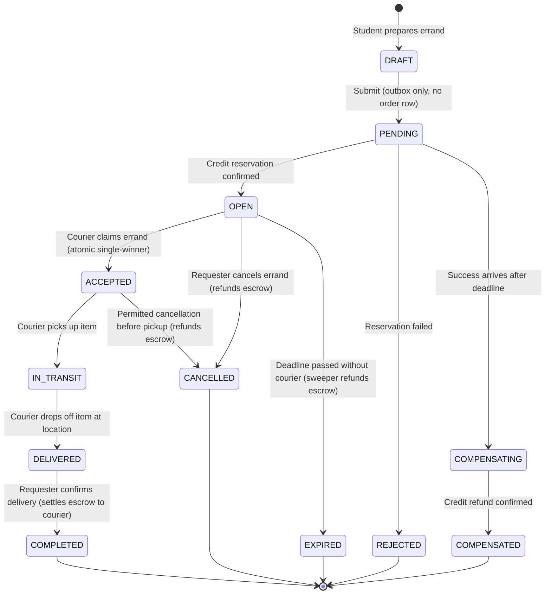
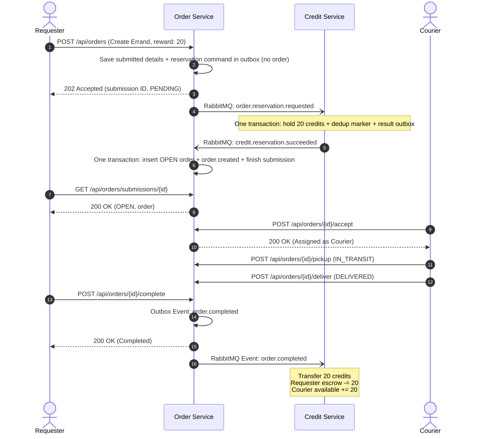
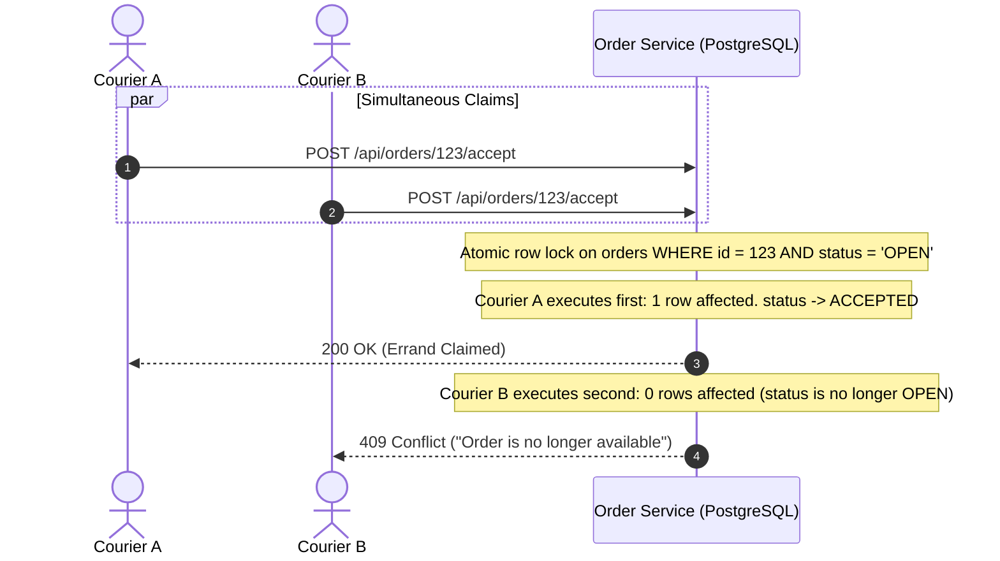

<!--
AI Assistance Disclosure:
Tool: Codex (model: GPT-6), date: 2026-10-19
Scope: Document infrastructure and event retry policies and manual DLQ recovery.
Author review: <to be completed by huangjiaxi1111>

Tool: Codex (model: GPT-6), date: 2026-10-18
Scope: Document outbox-only submissions, reservation results, receipt polling, and late-success compensation.
Author review: <to be completed by huangjiaxi1111>

Tool: Google Antigravity Agent, date: 2026-10-11
Scope: Authored unified Errand Lifecycle & Credit Economy domain specification, formalizing the state machine, escrow interactions, atomic concurrency rules, and event choreography.
Author review: <to be completed by author after review>
-->

# Errand Lifecycle & Credit Economy Specification

This document provides the formal business specification for errand management, credit escrow operations, concurrent order claiming, and event choreography in Friend of Campus.

---

## 1. Errand Lifecycle State Machine

An errand progresses through a deterministic series of states from creation to final fulfillment, cancellation, or expiration.



### Asynchronous submission contract

`POST /api/orders` returns HTTP `202` with `data: { id, status: "PENDING" }` and `Location: /api/orders/submissions/{id}`. The ID identifies the outbox submission and the future order. Only its requester may poll the Location endpoint. No `orders` row exists while pending, so couriers cannot discover or accept it and order cancellation endpoints do not apply yet. The student app posts through this endpoint, displays pending/rejection/refund outcomes, and polls until a terminal result. It retains the pending submission ID per signed-in user in session storage so a tab reload resumes polling without another POST. Confirmed orders and wallet balances are fetched from the services.

The existing Order `outbox_events` row stores the full submission in `payload.submission`. The RabbitMQ request contains only `eventId`, `eventType`, `timestamp`, `correlationId`, `orderId`, `requesterId`, `rewardCredits`, and `expiresAt`; item and contact details stay local. Credit results carry the same IDs/amount, a new event ID/timestamp, and `reason` on failure.

| Submission result | Persisted behavior |
| --- | --- |
| `PENDING` | Request is awaiting confirmed Credit outcome; only the outbox row exists. |
| `OPEN` | Credit succeeded; one transaction inserts the order and `order.created` outbox event and marks the submission `COMPLETED`. Polling also returns the order, including its current lifecycle status. |
| `REJECTED` | Credit refused the reservation, including insufficient funds or an already expired request. No order is inserted; a reason is returned. |
| `COMPENSATING` | Credit succeeded but the deadline passed before Order handled the result. Order atomically writes `order.reservation.release_requested` and records compensation in progress. |
| `COMPENSATED` | Credit refunded the hold and returned `credit.reservation.released`. No order is inserted. |

Credit commits the processed-event marker, balance/escrow/ledger changes, and a result in `credit_outbox_events` in one transaction. A business rejection rolls attempted reservation writes back to a savepoint and commits the failure result with the marker. An infrastructure error rolls back the entire transaction for retry. Order locks the submission row when handling results; duplicate confirmations cannot insert duplicate orders or compensation commands. Both relays use persistent messages, mandatory routing, and publisher confirms; delivery remains at least once.

Consumer failures use the existing retry queues and dead-letter queues (`credit-service.events.dlq` and `order-service.events.dlq`).

Recognized infrastructure failures (database connectivity, connection-pool exhaustion, transient transaction availability and wrapped network errors) retry indefinitely with a five-second delay, without consuming the event retry budget. Unknown processing failures receive five retries after the initial attempt, also five seconds apart; invalid events and permanent business conflicts go directly to the DLQ. `ORDER_RETRY_DELAY_MS` / `CREDIT_RETRY_DELAY_MS` override the delay for both categories; `ORDER_RETRY_LIMIT` / `CREDIT_RETRY_LIMIT` apply only to bounded event retries. Logs and message headers track infrastructure and event retry counts separately.

Messages already in the DLQ stay there after infrastructure recovers. Exhausted or invalid messages need operator investigation. Replay valid messages after repairing their processing failure (preserve the original payload, event ID and routing key; reset the bounded retry count only after repair, and acknowledge the DLQ delivery only after confirmed republishing); pending submissions are not automatically marked rejected on transport failure. Retain submission outbox rows, including delivered/completed rows: they hold recovery data and the durable result consumed by polling. There is no automated DLQ replay or pending-submission cancellation endpoint in this change.

### State Definitions

| State | Description | Active Actor |
|---|---|---|
| `DRAFT` | Errand parameters (items, location, reward credits, deadline) are being authored. Not visible to couriers. | Requester |
| `OPEN` | Errand is publicly posted and listed on the student feed. Awaiting a courier. | Open to Couriers |
| `ACCEPTED` | An available student courier has claimed the errand. Courier is assigned. | Courier |
| `IN_TRANSIT` | Courier has collected the item(s) from the supplier and is en route. | Courier |
| `DELIVERED` | Courier has reached the drop-off location and marked the errand delivered. | Courier |
| `COMPLETED` | Delivery verified and confirmed by the requester. Terminal success state. | Requester / System |
| `CANCELLED` | Errand aborted before pickup. Terminal cancellation state. | Requester |
| `EXPIRED` | Errand deadline elapsed while remaining unaccepted in `OPEN` state. Terminal failure state. | Sweeper Daemon |

---

## 2. State Transition Matrix & Credit Actions

Every state transition enforces strict authorization, credit financial rules, and outbox event publishing:

| Transition | Allowed Caller | Preconditions & Validation | Credit Service Action | Domain Event Emitted |
|---|---|---|---|---|
| Submission &rarr; `OPEN` | Requester submits; Credit result completes creation | Valid submission; reservation succeeds before the deadline is processed by Order. | `order.reservation.requested` holds credits; `credit.reservation.succeeded` permits Order insertion. | `order.created` after confirmation |
| `OPEN` &rarr; `ACCEPTED` | Any Student (except Requester) | Order status is `OPEN`; caller $\ne$ requester; caller is active student. | None (credits remain held in escrow). | `order.accepted` |
| `ACCEPTED` &rarr; `IN_TRANSIT` | Assigned Courier | Order status is `ACCEPTED`; caller equals assigned `courierId`. | None. | `order.in_transit` |
| `IN_TRANSIT` &rarr; `DELIVERED` | Assigned Courier | Order status is `IN_TRANSIT`; caller equals assigned `courierId`. | None. | `order.delivered` |
| `DELIVERED` &rarr; `COMPLETED` | Requester (or auto-confirm) | Order status is `DELIVERED`; caller equals `requesterId`. | Asynchronous event triggers Credit Service to transfer escrow credits to courier's available balance. | `order.completed` |
| `OPEN` &rarr; `CANCELLED` | Requester | Order status is `OPEN`; caller equals `requesterId`. | Asynchronous event triggers Credit Service to refund escrow credits back to requester. | `order.cancelled` |
| `OPEN` &rarr; `EXPIRED` | Background Sweeper | Order status is `OPEN`; `current_time > deadline`. | Asynchronous event triggers Credit Service to refund escrow credits back to requester. | `order.expired` |

---

## 3. Credit Economy & Escrow Model

Friend of Campus operates a closed credit economy where credits represent platform utility:

1. **Initial Welcome Grant**:
   - When a new student registers (`user-service`), a `user.registered` event is emitted.
   - Credit Service consumes this event and initializes the student's wallet with an initial balance of **100 credits**.
2. **Escrow Hold (Pessimistic Locking)**:
   - When creating an errand with reward $C$, Credit Service verifies: $\text{available\_credits} \ge C$.
   - $\text{available\_credits} \leftarrow \text{available\_credits} - C$
   - $\text{escrow\_credits} \leftarrow \text{escrow\_credits} + C$
   - This guarantees a requester cannot double-spend the same credits across multiple simultaneous errands.
3. **Escrow Settlement**:
   - Upon receiving `order.completed`, Credit Service transfers the held credits:
   - Requester: $\text{escrow\_credits} \leftarrow \text{escrow\_credits} - C$
   - Courier: $\text{available\_credits} \leftarrow \text{available\_credits} + C$, $\text{total\_earned\_credits} \leftarrow \text{total\_earned\_credits} + C$
4. **Escrow Refund**:
   - Upon receiving `order.cancelled` or `order.expired`, Credit Service refunds the requester:
   - Requester: $\text{escrow\_credits} \leftarrow \text{escrow\_credits} - C$, $\text{available\_credits} \leftarrow \text{available\_credits} + C$



---

## 4. Concurrency & Atomic Claiming

A critical challenge in peer-to-peer delivery is handling concurrent claims when multiple students tap "Accept" on an errand at the exact same millisecond.

### Single-Winner Atomic Claim Strategy
To prevent double-assignment without slow global distributed locks, `order-service` executes a single atomic PostgreSQL conditional update:

```sql
UPDATE orders
SET status = 'ACCEPTED',
    courier_id = :courier_id,
    updated_at = NOW()
WHERE id = :order_id
  AND status = 'OPEN'
  AND requester_id <> :courier_id;
```



- **Winning Courier**: Database returns `affected_rows == 1`. The transaction succeeds, records `order.accepted` in the outbox, and returns `200 OK`.
- **Losing Couriers**: Database returns `affected_rows == 0`. The transaction immediately returns `409 CONFLICT` with an explanatory message. No state corruption or race condition can occur.
- **Requester Protection**: The condition `requester_id <> :courier_id` ensures students can never accept their own errands.

---

## 5. Domain Events Choreography (RabbitMQ)

All events are published to the durable topic exchange `campus.events` using the Transactional Outbox pattern.

| Routing Key | Event Type | Publisher | Consumers | Business Purpose |
|---|---|---|---|---|
| `user.registered` | `UserRegisteredEvent` | `user-service` | `credit-service` | Grants initial 100 credits upon account registration. |
| `order.created` | `OrderCreatedEvent` | `order-service` | `notification-service` | Logs new errand and alerts potential couriers. |
| `order.accepted` | `OrderAcceptedEvent` | `order-service` | `notification-service` | Notifies requester that a courier has accepted the errand. |
| `order.in_transit` | `OrderInTransitEvent` | `order-service` | `notification-service` | Notifies requester that item has been picked up. |
| `order.delivered` | `OrderDeliveredEvent` | `order-service` | `notification-service` | Notifies requester to inspect and confirm drop-off. |
| `order.completed` | `OrderCompletedEvent` | `order-service` | `credit-service`, `notification-service` | Settles escrow reward to courier; sends confirmation notification. |
| `order.cancelled` | `OrderCancelledEvent` | `order-service` | `credit-service`, `notification-service` | Releases escrow refund to requester; alerts participants of cancellation. |
| `order.expired` | `OrderExpiredEvent` | `order-service` | `credit-service`, `notification-service` | Releases escrow refund to requester; cleans up open feed. |

### Deduplication & Idempotency
- Every event includes a unique UUID `eventId`.
- Consuming services check their local tables (`processed_credit_events`, `notifications`) inside their database transactions. If an `eventId` was already processed, the consumer acknowledges RabbitMQ and skips execution.
- If processing fails due to an unexpected error, RabbitMQ retries up to 5 times with exponential backoff before sending the poison message to `campus.events.dlx` (Dead-Letter Queue).
