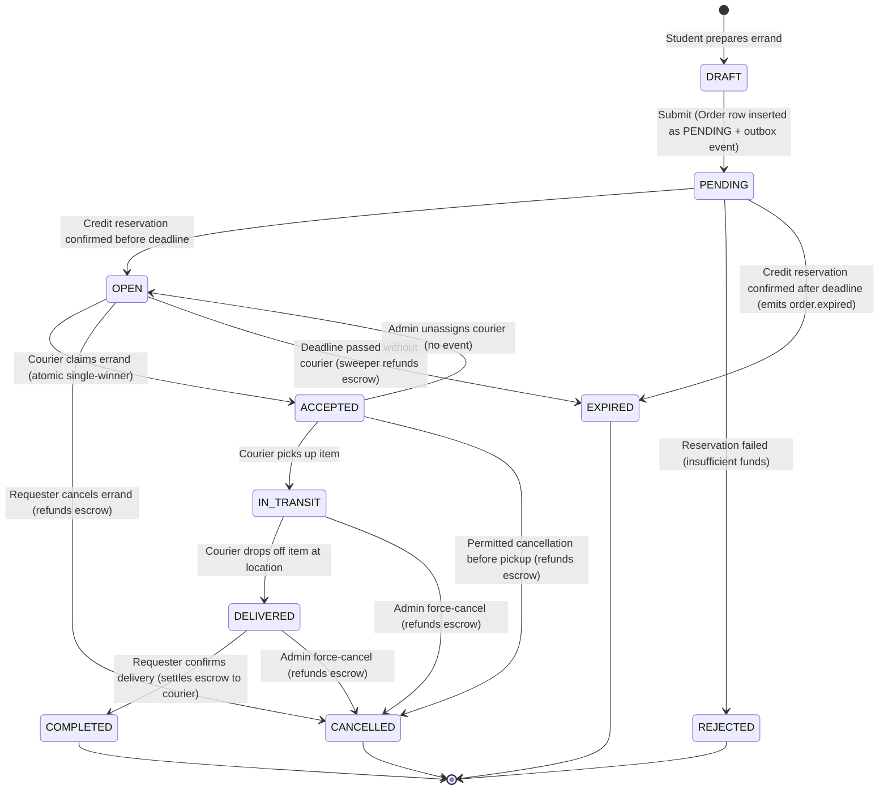
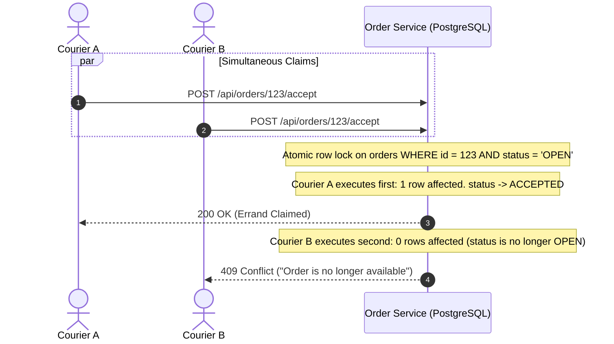

<!--
AI Assistance Disclosure:
Tool: Google Antigravity Agent, date: 2026-10-19
Scope: Updated Errand Lifecycle specification for Approach B2 Order Reservation Saga (PENDING/REJECTED Order rows, GET /api/orders/{id} polling, late-success order.expired reuse, and removal of COMPENSATING/COMPENSATED).
Author review: Validated against order-service and credit-service implementation by yanhwee

Tool: Codex (model: GPT-6), date: 2026-10-19
Scope: Document infrastructure and event retry policies and manual DLQ recovery.
Author review: <to be completed by huangjiaxi1111>

Tool: Codex (model: GPT-6), date: 2026-10-18
Scope: Document outbox-only submissions, reservation results, receipt polling, and late-success compensation.
Author review: <to be completed by huangjiaxi1111>
Tool: Claude Code (model: Claude Opus 5.5 subagent, Claude Fable 5.1 session), date: 2026-10-18
Scope: Verified against order-service (order.service.ts, order.repository.ts, expiry.sweeper.ts), credit-service and notification-service on main @ 7f2d972: marked DRAFT as client-side, added the ACCEPTED -> CANCELLED and admin override rows, corrected the claim SQL, error codes, sweeper and retry facts, and replaced the event table with the real payload fields (incl. optional courierUsername) and per-consumer handling.
Author review: <to be completed by Reallyeasy1>

Tool: Google Antigravity Agent, date: 2026-10-11
Scope: Authored unified Errand Lifecycle & Credit Economy domain specification, formalizing the state machine, escrow interactions, atomic concurrency rules, and event choreography.
Author review: <to be completed by author after review>
-->

# Errand Lifecycle & Credit Economy Specification

This document provides the formal business specification for errand management, credit escrow operations, concurrent order claiming, and event choreography in Friend of Campus.

---

## 1. Errand Lifecycle State Machine

An errand progresses through a deterministic series of states from creation to final fulfillment, cancellation, or expiration.



### Asynchronous submission contract (Approach B2 Choreography Saga)

`POST /api/orders` atomically inserts the `Order` row with `status = 'PENDING'` and an `order.reservation.requested` row in `outbox_events`, returning HTTP `202 Accepted` with the `OrderDTO` (`status: "PENDING"`) and `Location: /api/orders/{id}`. Because the order is in `PENDING` status (and default feed queries filter by `status = 'OPEN'`), couriers cannot discover or accept it until credit reservation succeeds. The student app posts through this endpoint, displays pending/rejection/expiration outcomes, and polls `GET /api/orders/{id}` until a non-`PENDING` status is reached. It retains the pending order ID per signed-in user in session storage so a tab reload resumes polling without another POST.

The RabbitMQ `order.reservation.requested` event contains `eventId`, `eventType`, `timestamp`, `correlationId`, `orderId`, `requesterId`, and `rewardCredits`. Credit reservation result events (`credit.reservation.succeeded` or `credit.reservation.failed`) carry the same IDs/amount, a new event ID/timestamp, and `reason` on failure.

| Order status after submission | Persisted behavior |
| --- | --- |
| `PENDING` | Order row is persisted in `orders` with `status = 'PENDING'`; awaiting Credit Service reservation result. |
| `OPEN` | Credit reservation succeeded before `expiresAt`; one transaction transitions the `Order` row from `PENDING` &rarr; `OPEN` and writes `order.created` to `outbox_events`. |
| `REJECTED` | Credit refused the reservation (e.g., insufficient funds). The `Order` row transitions from `PENDING` &rarr; `REJECTED` with `rejectionReason` populated. |
| `EXPIRED` | Credit reservation succeeded, but `expiresAt` had already elapsed when Order Service processed the confirmation. Order Service atomically transitions `PENDING` &rarr; `EXPIRED` and emits `order.expired`, reusing Credit Service's existing `order.expired` refund handler to release the escrow hold. |

Credit commits the processed-event marker, balance/escrow/ledger changes, and a result in `credit_outbox_events` in one transaction. A business rejection rolls attempted reservation writes back to a savepoint and commits the failure result with the marker. An infrastructure error rolls back the entire transaction for retry. Order Service uses conditional `WHERE id = :id AND status = 'PENDING'` transitions when handling results; duplicate confirmations are idempotent no-ops. Both relays use persistent messages, mandatory routing, and publisher confirms; delivery remains at least once.

Consumer failures use native RabbitMQ quorum-queue redelivery (`x-delivery-count` via `ConsumerStatus.REQUEUE`) and dead-letter exchanges routing to `credit-service.events.dlq` and `order-service.events.dlq` (`ConsumerStatus.DROP`).

Recognized infrastructure failures (database connectivity, connection-pool exhaustion, transient transaction availability and wrapped network errors) wait `retryDelayMs` (five seconds by default) and requeue (`ConsumerStatus.REQUEUE`) regardless of `retryLimit`. Unknown transient processing failures wait `retryDelayMs` and requeue while native `x-delivery-count < retryLimit` (five retries after the initial attempt by default), after which they return `ConsumerStatus.DROP` and are dead-lettered to the DLQ; invalid events and permanent business conflicts return `ConsumerStatus.DROP` immediately. `ORDER_RETRY_DELAY_MS` / `CREDIT_RETRY_DELAY_MS` override the delay for both categories; `ORDER_RETRY_LIMIT` / `CREDIT_RETRY_LIMIT` set the `x-delivery-count` ceiling for transient processing failures (noting that RabbitMQ quorum queues increment `x-delivery-count` on every requeue and enforce a default broker delivery limit of 20 unless overridden).

Messages already in the DLQ stay there after infrastructure recovers. Exhausted or invalid messages need operator investigation. Replay valid messages after repairing their processing failure (preserve the original payload, event ID and routing key; reset the bounded retry count only after repair, and acknowledge the DLQ delivery only after confirmed republishing).

### State Definitions

| State | Description | Active Actor |
|---|---|---|
| `DRAFT` | Errand parameters (items, location, reward credits, deadline) are being authored. Not visible to couriers. Exists only in the student app's form. | Requester |
| `PENDING` | Errand row is created by `POST /api/orders` (`202 Accepted`) while asynchronous credit escrow reservation is in flight. Hidden from the open courier feed. | Order / Credit Saga |
| `REJECTED` | Credit reservation was declined (e.g., insufficient available credits). `rejectionReason` records the cause. Terminal failure state. | Credit Service |
| `OPEN` | Credit reservation confirmed; errand is publicly posted and listed on the student feed. Awaiting a courier. | Open to Couriers |
| `ACCEPTED` | An available student courier has claimed the errand. Courier is assigned. | Courier |
| `IN_TRANSIT` | Courier has collected the item(s) from the supplier and is en route. | Courier |
| `DELIVERED` | Courier has reached the drop-off location and marked the errand delivered. | Courier |
| `COMPLETED` | Delivery verified and confirmed by the requester. Terminal success state. | Requester / System |
| `CANCELLED` | Errand aborted before pickup (requester), or at any non-terminal state by an administrator. Terminal cancellation state. | Requester / Admin |
| `EXPIRED` | Errand deadline elapsed while remaining unaccepted in `OPEN` state (or before credit reservation confirmation arrived). Terminal failure state. | Sweeper Daemon / Saga |

`OrderStatus` in `packages/common-dtos` also lists `DISPUTED`; no order-service route sets it. The order row stores `status` as a string, `rejectionReason`, `expiresAt`, `acceptedAt`, `pickedUpAt`, `deliveredAt`, `completedAt` and an integer `version` that every transition increments.

---

## 2. State Transition Matrix & Credit Actions

Every state transition enforces strict authorization, credit financial rules, and outbox event publishing:

| Transition | Allowed Caller | Preconditions & Validation | Credit Service Action | Domain Event Emitted |
|---|---|---|---|---|
| `DRAFT` &rarr; `PENDING` (`POST /api/orders`) | Requester (any authenticated user) | Valid body: `supplierId` UUID of an existing, active supplier; `itemDescription` (≤ 1000), `dropoffLocation` (≤ 255); `rewardCredits` positive integer; `durationMinutes` 30–1440 (default 30) sets `expiresAt`. | Asynchronous event triggers Credit Service to reserve credits in escrow and reply with `credit.reservation.succeeded` or `credit.reservation.failed`. | `order.reservation.requested` |
| `PENDING` &rarr; `OPEN` (Saga confirmation) | Order Reservation Consumer | `credit.reservation.succeeded` received and `expiresAt > now`. | Escrow already held by Credit Service. | `order.created` |
| `PENDING` &rarr; `REJECTED` (Saga rejection) | Order Reservation Consumer | `credit.reservation.failed` received. Sets `rejectionReason`. | None (no hold was created). | none |
| `PENDING` &rarr; `EXPIRED` (Late confirmation) | Order Reservation Consumer | `credit.reservation.succeeded` received after `expiresAt <= now`. | Asynchronous `order.expired` event triggers Credit Service to refund the escrow hold. | `order.expired` |
| `OPEN` &rarr; `ACCEPTED` (`/:id/accept`) | Any authenticated user except the requester (no role check) | Caller $\ne$ requester (`400`); status is `OPEN` and `expiresAt` in the future (`409` otherwise); conditional update on `status = OPEN` and `version` (`409` on a lost race). Optional `courierContactNote` (≤ 255). | None (credits remain held in escrow). | `order.accepted` |
| `ACCEPTED` &rarr; `IN_TRANSIT` (`/:id/pickup`) | Assigned Courier | Caller equals `courierId` (`403` otherwise); status is `ACCEPTED` (`409` otherwise). | None. | `order.in_transit` |
| `IN_TRANSIT` &rarr; `DELIVERED` (`/:id/deliver`) | Assigned Courier | Caller equals `courierId` (`403`); status is `IN_TRANSIT` (`409`). | None. | `order.delivered` |
| `DELIVERED` &rarr; `COMPLETED` (`/:id/complete`) | Requester | Caller equals `requesterId` (`403`); status is `DELIVERED` (`409`). | Asynchronous event triggers Credit Service to transfer escrow credits to courier's available balance. | `order.completed` |
| `OPEN` &rarr; `CANCELLED` (`/:id/cancel`) | Requester | Caller equals `requesterId` (`403`); status is `OPEN`. | Asynchronous event triggers Credit Service to refund escrow credits back to requester. | `order.cancelled` |
| `ACCEPTED` &rarr; `CANCELLED` (`/:id/cancel`) | Requester | Caller equals `requesterId`; status is `ACCEPTED`. The courier is cleared. `PENDING`, `REJECTED`, `IN_TRANSIT`, `DELIVERED`, `COMPLETED`, `CANCELLED`, `EXPIRED` return `409`. | Refund, as above. | `order.cancelled` |
| `OPEN` &rarr; `EXPIRED` | Background Sweeper | Status is `OPEN` and `expiresAt <= now`; conditional update on `status = OPEN`. | Asynchronous event triggers Credit Service to refund escrow credits back to requester. | `order.expired` |
| any non-terminal &rarr; `CANCELLED` (`/:id/admin/cancel`) | Admin | Role `ADMIN` (`403` otherwise); required `reason` (≤ 500); optional `expectedVersion` (`409` on mismatch); status not `PENDING`, `REJECTED`, `COMPLETED`, `CANCELLED`, `EXPIRED`. Reason appended to `specialNotes`. | Refund, as above. | `order.cancelled` |
| `DELIVERED` &rarr; `COMPLETED` (`/:id/admin/complete`) | Admin | Role `ADMIN`; required `reason`; optional `expectedVersion`; status is `DELIVERED`. | Settlement, as above. | `order.completed` |
| `ACCEPTED` &rarr; `OPEN` (`/:id/admin/unassign`) | Admin | Role `ADMIN`; required `reason`; optional `expectedVersion`; status is `ACCEPTED`. Clears `courierId`, `acceptedAt`, `courierContactNote`. | None. | none (no outbox event is written) |

Every route transition runs in one database transaction that reads the row, checks the rules above, applies a conditional `updateMany` on the expected `status` and `version`, increments `version`, and (except unassign) inserts the outbox event. The expiry sweeper matches on `status = OPEN` only (its row above). Unknown order → `404`. `GET /api/orders/:id` accepts either the UUID or the `orderCode` (`ORD-` + 8 hex characters); `PENDING` and `REJECTED` orders are visible only to the requester or an `ADMIN` (`403` otherwise).

Read routes: `GET /api/orders` (default: `OPEN` and not yet expired, newest first; optional `status` (`ALL` for every status), `campusZone`, `requesterId` and `courierId` (`ADMIN` or the matching user only; `403` otherwise), `search` over code, item, drop-off, supplier name, and requester/courier UUID, `page`, `limit` ≤ 100, default 50; non-admin queries only include the caller's own `PENDING` and `REJECTED` rows) and `GET /api/orders/user/activity` (the caller's `requested`, `delivering` and `history` lists). All order routes require an access token.

---

## 3. Credit Economy & Escrow Model

Friend of Campus operates a closed credit economy where credits represent platform utility:

1. **Initial Welcome Grant**:
   - When a new student registers (`user-service`), a `user.registered` event is emitted.
   - Credit Service consumes this event and initializes the student's wallet with an initial balance of **100 credits** (`initialGrant: 100`, recorded once per user in `credit_grants`). The credit seed initializes wallets for the three seeded accounts.
2. **Escrow Hold (Serializable transaction)**:
   - Consuming `order.reservation.requested` with `{ orderId, requesterId, amount }` invokes `CreditService.reserve()`, which creates one `credit_escrows` row per `orderId` (state `RESERVED`) and moves the amount in a `Serializable` transaction; an identical replay returns the wallet unchanged, a conflicting one returns `409`. (The legacy `/api/credits/escrow/*` HTTP endpoints are removed on the service and blocked with `403` at the gateway.)
   - When creating an errand with reward $C$, Credit Service verifies: $\text{available\_credits} \ge C$.
   - $\text{available\_credits} \leftarrow \text{available\_credits} - C$
   - $\text{escrow\_credits} \leftarrow \text{escrow\_credits} + C$
   - This guarantees a requester cannot double-spend the same credits across multiple simultaneous errands.
3. **Escrow Settlement**:
   - Upon receiving `order.completed`, Credit Service transfers the held credits:
   - Requester: $\text{escrow\_credits} \leftarrow \text{escrow\_credits} - C$
   - Courier: $\text{available\_credits} \leftarrow \text{available\_credits} + C$, $\text{total\_earned\_credits} \leftarrow \text{total\_earned\_credits} + C$
4. **Escrow Refund**:
   - Upon receiving `order.cancelled` or `order.expired`, Credit Service refunds the requester:
   - Requester: $\text{escrow\_credits} \leftarrow \text{escrow\_credits} - C$, $\text{available\_credits} \leftarrow \text{available\_credits} + C$
5. **Escrow states**: `RESERVED` &rarr; `SETTLED` (on `order.completed`) or `REFUNDED` (on `order.cancelled` / `order.expired`). A settle after a refund, or a refund after a settle, is a permanent conflict and goes to the dead-letter queue. Each movement is recorded in `credit_transactions` (`GET /api/credits/ledger`).


---

## 4. Concurrency & Atomic Claiming

A critical challenge in peer-to-peer delivery is handling concurrent claims when multiple students tap "Accept" on an errand at the exact same millisecond.

### Single-Winner Atomic Claim Strategy
To prevent double-assignment without slow global distributed locks, `order-service` executes a single atomic PostgreSQL conditional update (Prisma `updateMany` in `order.repository.ts`, inside a transaction that first reads the row and rejects self-accept and expired orders):

```sql
UPDATE orders
SET status = 'ACCEPTED',
    courier_id = :courier_id,
    courier_contact_note = :courier_contact_note,
    accepted_at = NOW(),
    version = version + 1
WHERE id = :order_id
  AND status = 'OPEN'
  AND version = :version_read;
```



- **Winning Courier**: Database returns `affected_rows == 1`. The transaction succeeds, records `order.accepted` in the outbox, and returns `200 OK`.
- **Losing Couriers**: Database returns `affected_rows == 0`. The transaction immediately returns `409 CONFLICT` with an explanatory message. No state corruption or race condition can occur.
- **Requester Protection**: Before the update, the same transaction compares `requesterId` with the caller and returns `400` ("You cannot accept your own errand request"), so students can never accept their own errands.
- **Other transitions** (pickup, deliver, complete, cancel, admin overrides) use the same pattern: conditional update on the expected `status` and `version`, `409` when no row matches.

---

## 5. Domain Events Choreography (RabbitMQ)

All events are published to the durable topic exchange `campus.events` using the Transactional Outbox pattern. The routing key equals `eventType`. Every event carries `eventId` (UUID), `eventType` and `timestamp` (ISO-8601 UTC); the table lists the remaining fields as defined in `packages/common-dtos/src/index.ts` §5 (`?` = optional).

| Routing Key | Event Type | Publisher (trigger) | Payload fields | `order-service` | `credit-service` | `notification-service` |
|---|---|---|---|---|---|---|
| `user.registered` | `UserRegisteredEvent` | `user-service` (registration) | `userId`, `email`, `initialGrant` (100) | not bound | Creates the wallet with the grant | not bound |
| `order.reservation.requested` | `CreditReservationRequestEvent` | `order-service` (`POST /api/orders`) | `correlationId`, `orderId`, `requesterId`, `rewardCredits` | not bound | Reserves escrow and emits `credit.reservation.succeeded` or `credit.reservation.failed` | not bound |
| `credit.reservation.succeeded` | `CreditReservationSucceededEvent` | `credit-service` (reservation succeeded) | `correlationId`, `orderId`, `requesterId`, `rewardCredits` | Transitions `PENDING` &rarr; `OPEN` (or `EXPIRED` if past deadline) | not bound | not bound |
| `credit.reservation.failed` | `CreditReservationFailedEvent` | `credit-service` (reservation failed) | `correlationId`, `orderId`, `requesterId`, `rewardCredits`, `reason` | Transitions `PENDING` &rarr; `REJECTED` | not bound | not bound |
| `order.created` | `OrderCreatedEvent` | `order-service` (reservation confirmed) | `orderId`, `orderCode`, `requesterId`, `rewardCredits`, `campusZone`, `expiresAt` | not bound | not bound | Acknowledged, no notification |
| `order.accepted` | `OrderAcceptedEvent` | `order-service` (accept) | `orderId`, `orderCode`, `requesterId`, `courierId`, `courierUsername?` | not bound | not bound | `ORDER_ACCEPTED` to the requester |
| `order.in_transit` | `OrderInTransitEvent` | `order-service` (pickup) | `orderId`, `orderCode?`, `requesterId`, `courierId`, `courierUsername?` | not bound | not bound | `ORDER_PICKED_UP` to the requester |
| `order.delivered` | `OrderDeliveredEvent` | `order-service` (deliver) | `orderId`, `orderCode`, `requesterId`, `courierId`, `courierUsername?` | not bound | not bound | `ORDER_DELIVERED` to the requester |
| `order.completed` | `OrderCompletedEvent` | `order-service` (complete, admin complete) | `orderId`, `orderCode?`, `requesterId`, `courierId`, `rewardCredits` | not bound | Settles the escrow to the courier | Acknowledged, no notification |
| `order.cancelled` | `OrderCancelledEvent` | `order-service` (cancel, admin cancel) | `orderId`, `orderCode?`, `requesterId`, `rewardCredits` | not bound | Refunds the escrow to the requester | Acknowledged, no notification |
| `order.expired` | `OrderExpiredEvent` | `order-service` (expiry sweeper, late reservation) | `orderId`, `orderCode?`, `requesterId`, `rewardCredits` | not bound | Refunds the escrow to the requester | Acknowledged, no notification |

- `courierUsername` is the courier's `username` claim from the access token used for accept / pickup / deliver (1–50 characters); it is omitted when the token predates that claim. The order service always sets `orderCode` on its lifecycle events.
- Admin unassign (`ACCEPTED` &rarr; `OPEN`) publishes no event.
- Notification copy (title / body), stored as rendered:
  - `ORDER_ACCEPTED`: "Your errand `<orderCode>` was accepted" / "`<courierUsername>` accepted your errand and will pick the items up next." (without `courierUsername`: "A courier has been assigned to your errand.")
  - `ORDER_PICKED_UP`: "Your errand `<orderCode>` was picked up" / "Your courier has the items and is on the way."
  - `ORDER_DELIVERED`: "Your errand `<orderCode>` was delivered" / "Review the delivery and confirm it."
- **Expiry sweeper** (`expiry.sweeper.ts`): runs once at start and then every 30 s (`EXPIRY_SWEEPER_INTERVAL_MS`, minimum 5000); each run expires up to 50 `OPEN` orders with `expiresAt <= now`, one transaction per order, writing `order.expired` to `outbox_events` (tailed by Debezium CDC). `GET /api/orders` already hides expired `OPEN` orders, and accept rejects them with `409`, before the sweeper runs.

### Deduplication & Idempotency
- Every event includes a unique UUID `eventId`.
- Consuming services check their local tables (`processed_credit_events`, `notifications`) or conditional `status = 'PENDING'` state (`order-service`) inside their database transactions. If an event was already processed, the consumer acknowledges RabbitMQ and skips execution.
- If processing fails with a transient error and native `x-delivery-count < retryLimit`, the quorum-queue consumer sleeps `retryDelayMs` in-place and returns `ConsumerStatus.REQUEUE`: `order-service` 5 s, up to 5 retries, then `order-service.events.dlq` &rarr; `order-service.events.dlq`; `credit-service` 5 s, up to 5 retries, then `campus.events.dlx` &rarr; `credit-service.events.dlq`; `notification-service` 2 s, up to 30 retries, then `notification-service.events.dlx` &rarr; `notification-service.events.dlq`. Permanent failures (invalid event, business conflict such as a refund after settlement, constraint violations) return `ConsumerStatus.DROP` and go to the dead-letter queue without retry. See `docs/architecture.md` §3 C.
