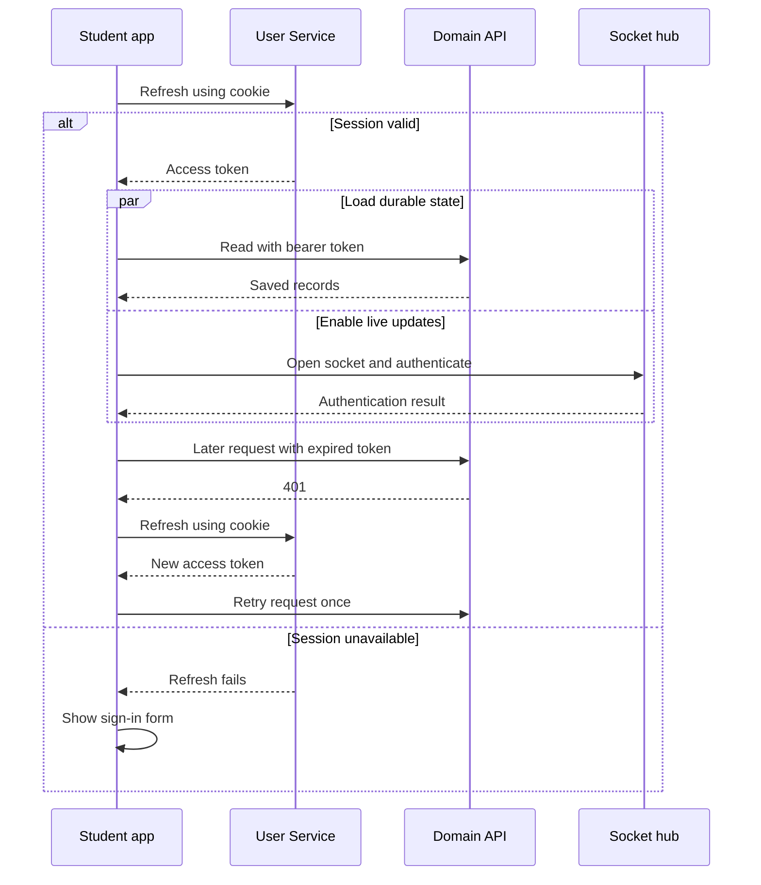
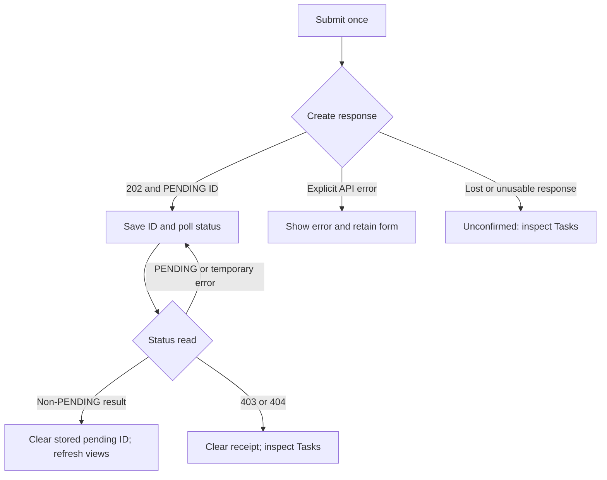
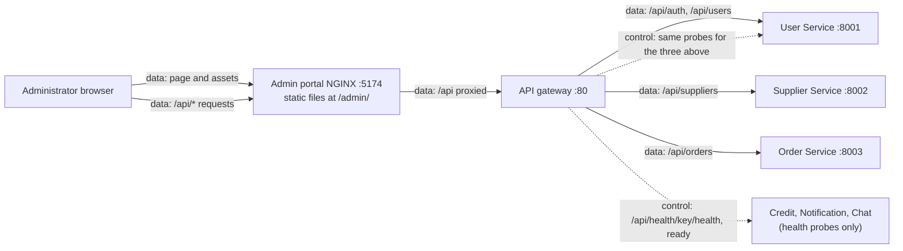
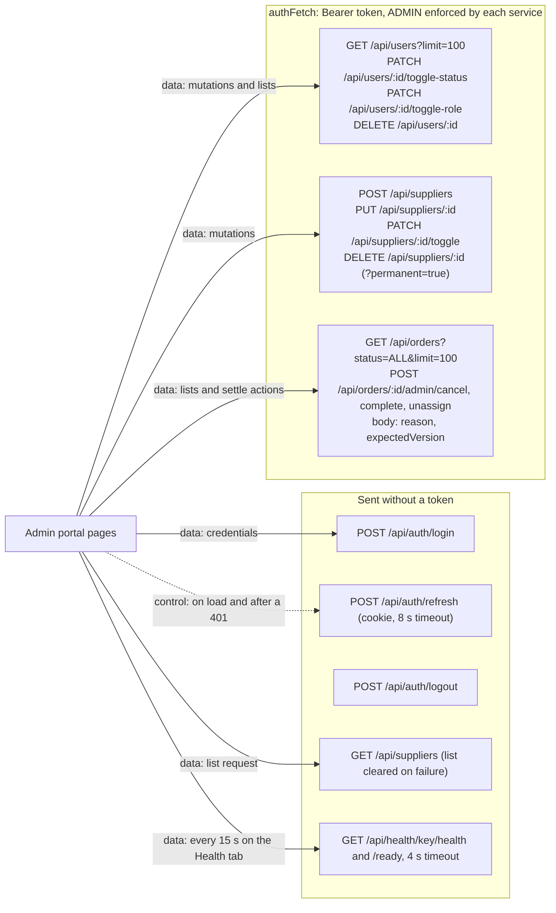
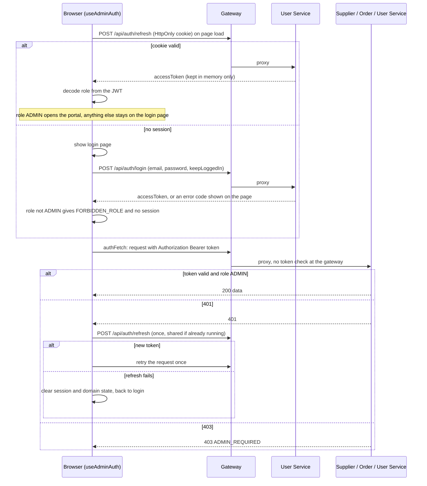
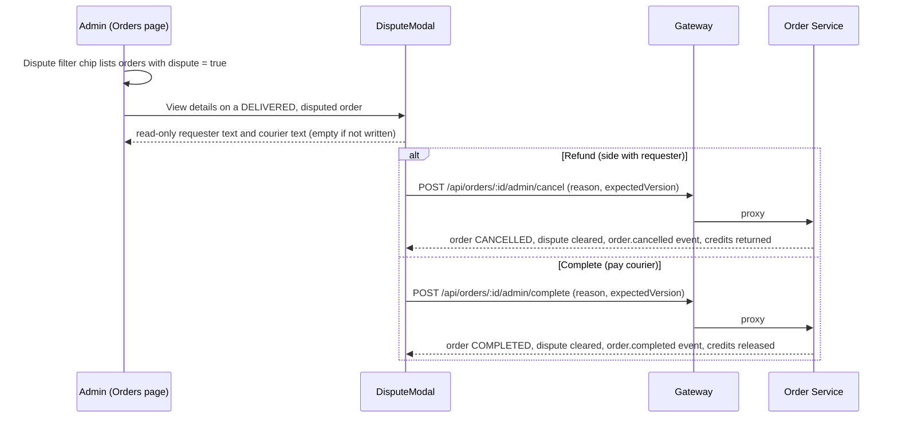

<!--
AI Assistance Disclosure:
Tool: Google Antigravity Agent, date: 2026-11-10
Scope: Integrated the Supplier coordinates and OpenStreetMap tile/route flow diagram from PR #250 (`docs_update`) into the consolidated frontend developer guide, and updated Admin Supplier fetch failure behavior after removing FALLBACK_SUPPLIERS (#201).
Author review: I validated correctness, edited for style, and verified with automated tests.

Tool: Codex (model: GPT-6), date: 2026-11-09
Scope: Explain browser state and pending-submission recovery with a focused diagram and debugging walkthrough; clarify the bounded toast cache and supplier presentation.
Author review: <to be completed by Reallyeasy1>

Tool: Codex (model: GPT-6), date: 2026-11-09
Scope: Consolidate both frontend references into one developer guide with concrete journeys, session/recovery explanations, operational limits and troubleshooting.
Author review: <to be completed by Reallyeasy1>

Tool: Codex (model: GPT-6), date: 2026-11-09
Scope: Reconcile implementation guidance with current source, simplify duplication and preserve historical attribution.
Author review: <to be completed by the author>

Tool: Codex (model: GPT-6), date: 2026-10-25
Scope: Source-linked implementation documentation and evidence review requested by Reallyeasy1.
Author review: <to be completed by Reallyeasy1>
-->

# Frontend developer guide

The student app is the everyday interface for finding pickup spots, posting and delivering errands, checking credits, receiving alerts and chatting. The admin portal manages suppliers, users and order disputes. Both are React/Vite applications; the backend services enforce permissions and own the saved data.

This guide follows the implementation at documentation head [`bc0efa4`](https://github.com/AY2627S1-CS3219-P25/friend-on-campus/commit/bc0efa46e9385ddb482cd3b56dbeea86badedce2), rechecked on 9 November 2026; its application baseline is `b989758`. Start with [local development](../development/local-development.md) to bring up the dependencies. This page explains how the browser pieces fit together and where to investigate an incorrect screen.

## Run the frontends

From the repository root, with the backend services and their dependencies running, start each app in its own terminal:

```sh
npm run dev -w @campus-errand/student-app
npm run dev -w @campus-errand/admin-portal
```

Vite prints the listening URLs. The defaults are `http://localhost:5173/` for students and `http://localhost:5174/admin/` for administrators. Starting Vite does not start a database, run migrations or start a backend service. A rendered login form therefore does not establish that sign-in will work.

The browser uses relative URLs such as `/api/orders`; the proxy decides which backend receives them. There are two useful development arrangements:

| Arrangement | How requests reach the services | What to open |
|---|---|---|
| Host Vite and local services | Vite sends each API/socket path to its service's localhost port | Vite URLs above |
| Host Vite with the gateway | Set `GATEWAY_URL` in the Vite process environment; API and socket targets use that gateway | Vite URLs above |
| Container stack or AWS | Built static assets are served by NGINX; the gateway routes the public API and socket paths | Gateway `/` or `/admin/` |

For example, with the local gateway already listening on port 80, this POSIX-shell command starts the student app against it:

```sh
GATEWAY_URL=http://localhost npm run dev -w @campus-errand/student-app
```

Vite's proxy settings are development-server settings, not instructions baked into the static JavaScript bundle. For production routing, use the [cloud guide](../new-cloud-architecture-guide.md).

| Setting | Meaning |
|---|---|
| `GATEWAY_URL` | Takes priority over the per-service targets in both Vite configs |
| `USER_SERVICE_URL`, `SUPPLIER_SERVICE_URL`, `ORDER_SERVICE_URL`, `CREDIT_SERVICE_URL` | Direct local API targets when there is no gateway override; defaults use ports 8001–8004 |
| `NOTIFICATION_SERVICE_URL`, `CHAT_SERVICE_URL` | Student HTTP/WebSocket targets; defaults use ports 8005/8006. HTTP targets are derived from a `ws` URL when needed |
| `ADMIN_PORTAL_URL` | Student Vite proxy destination for `/admin`; defaults to port 5174 |
| `VITE_SHOW_WS_STATUS=false` | Hides the student's socket-status display. It does not disable either socket |

These target variables are read through `process.env` by the [student](../../apps/student-app/vite.config.ts) and [admin](../../apps/admin-portal/vite.config.ts) Vite configs. Make them available to the process; do not assume that adding a variable to an arbitrary environment file changes a running proxy. Restart Vite after a proxy change. `VITE_SHOW_WS_STATUS` is a client/build-time setting, so a built image must be rebuilt to change it.

## Follow a feature from the screen to its owner

Each app's `main.tsx` mounts `App.tsx`. The app coordinates shared state and passes props to pages and components. API modules translate browser actions into HTTP calls; hooks manage longer-lived behavior such as authentication, pending submissions and socket recovery. Shared TypeScript DTOs describe the payload shapes, but they do not replace runtime validation by the service.

The student app uses tabs plus query-string navigation, rather than a general route library. An errand link has the form `/?tab=tasks&orderId=<uuid>`. Opening details pushes a history entry, tab selection updates the current entry, and `popstate` restores the selected tab/detail. Test refresh and Back/Forward when changing navigation; changing React state alone is insufficient. The admin app selects its sections in component state beneath `/admin/`.

| Feature | Browser code to start with | Service responsible for the result |
|---|---|---|
| Sign-in and session recovery | [`useAuthSession`](../../apps/student-app/src/hooks/useAuthSession.ts), [`useAdminAuth`](../../apps/admin-portal/src/hooks/useAdminAuth.ts) | [User](../services/user-service/README.md) |
| Feed, tasks and errand details | [`App.tsx`](../../apps/student-app/src/App.tsx), [`ErrandDetailsPage`](../../apps/student-app/src/errand/ErrandDetailsPage.tsx), [`api/orders`](../../apps/student-app/src/api/orders.ts) | [Order](../services/order-service/README.md) |
| Posting and assistant draft | [`PostErrandPage`](../../apps/student-app/src/pages/PostErrandPage.tsx), [`useOrderSubmission`](../../apps/student-app/src/orders/useOrderSubmission.ts) | Order; Credit later decides the reservation |
| Spots and pickup/drop-off maps | [`SpotsPage`](../../apps/student-app/src/pages/SpotsPage.tsx), [`supplierLocations`](../../apps/student-app/src/map/supplierLocations.ts), [`DropoffPicker`](../../apps/student-app/src/map/DropoffPicker.tsx) | [Supplier](../services/supplier-service/README.md) supplies pickup records; Order validates the submitted errand |
| Wallet and profile | [`ProfileWalletPage`](../../apps/student-app/src/pages/ProfileWalletPage.tsx), [`api/credits`](../../apps/student-app/src/api/credits.ts), [`api/users`](../../apps/student-app/src/api/users.ts) | [Credit](../services/credit-service/README.md) for funds/history; User for profile changes |
| Alerts and unread count | [`useNotifications`](../../apps/student-app/src/notifications/useNotifications.ts), [`inbox`](../../apps/student-app/src/notifications/inbox.ts) | [Notification](../services/notification-service/README.md) |
| Chat, moderation feedback and translation | [`useChat`](../../apps/student-app/src/chat/useChat.ts), [`ChatPanel`](../../apps/student-app/src/chat/ChatPanel.tsx) | [Chat](../services/chat-service/README.md) |
| Admin forms, disputes and health | [`Admin App`](../../apps/admin-portal/src/App.tsx), [`admin pages`](../../apps/admin-portal/src/pages) | Supplier, User and Order enforce their own rules; health probes call all six services |

Keep business authorization in the service. For example, hiding a courier action from a requester is useful presentation, but the Order API must still reject an unauthorized direct request.

## How a browser session works

The access token lives in React memory. A refresh-token cookie is HttpOnly, so the browser sends it to User Service without the frontend reading its value. On startup, each app attempts a refresh before deciding whether to show the signed-in interface. Reloading the page therefore rebuilds the in-memory session rather than retrieving a saved access token from local storage.

The student flow below shows why loading data and opening a socket are separate operations:



A useful way to debug a refresh is to separate three places where state lives:

| State | Where it lives | What a reload means |
|---|---|---|
| Access token and displayed rows | Memory in this app instance | Rebuild the session, then fetch the rows again |
| Refresh credential | Browser-managed HttpOnly cookie | User Service can issue a new access token if the session is still valid |
| Pending order ID | `sessionStorage`, keyed by user ID | The same tab can resume polling after session recovery, if browser storage is available |

The cookie does not contain the current wallet or order state. Likewise, a remembered order ID is a receipt to query, not proof that posting succeeded. Two tabs can share cookie storage while keeping different in-memory tokens and displayed rows; test their behavior separately when investigating logout or stale UI.

The refresh hook shares one in-flight refresh within that app instance. This avoids concurrent requests independently refreshing the same session. The student startup refresh has an eight-second timeout; a failure returns to the sign-in path rather than keeping startup waiting indefinitely.

The student request wrapper also has a bounded read-retry policy:

- GET/HEAD requests without a caller-supplied signal have a ten-second per-attempt deadline and up to three attempts for network, timeout or 5xx failures, with jittered pauses. Total waiting can exceed ten seconds.
- A 401 gets a refresh-and-retry path. This is distinct from replaying a write after a lost network response.
- POST/PATCH/DELETE requests are not automatically replayed for network failures. Their response may have been lost after the server committed the change.
- Default-policy requests are tied to the current session's abort signal. A caller supplying its own signal owns its deadline/cancellation policy. The pending-submission hook additionally guards state by user and generation.

The admin wrapper shares refresh and retries after a 401, but does **not** implement the student's general deadline/read-retry/session-abort policy. Do not assume a fix to one wrapper changes the other.

The admin portal decodes the token's role to decide whether to display its interface; backend middleware separately verifies the token and permission. Role changes or disabling a user do not immediately invalidate an already-issued token checked offline by another service. See [User Service](../services/user-service/README.md) for the precise session and authorization boundaries.

Logout clears local state after the logout request settles, including a rejected network request. A successful local logout display is not evidence that another tab has cleared its own memory or that every existing access token has been revoked.

## Example: posting an errand is a pending operation

Suppose a student posts “Buy a sandwich” with a valid pickup spot, delivery location, duration and reward. The form is only the beginning of the operation:

1. `useOrderSubmission` sends the create request with a fifteen-second deadline. It expects HTTP `202` with a `PENDING` order identifier, not an immediately completed posting.
2. It saves that identifier in `sessionStorage`, scoped to the signed-in user. Refreshing the same tab can resume checking it; this is not cross-device persistence.
3. It reads `/api/orders/:id` again about one second after each completed poll, with a ten-second deadline per read. Errors keep the receipt and continue checking. A 403/404 clears the stored receipt and tells the user to inspect Tasks before resubmitting.
4. An observed non-PENDING result ends the poll. On `OPEN`, the app reloads orders and credits, resets the posting fields and displays the posted result. `REJECTED`, `CANCELLED` and `EXPIRED` have different feedback.

The diagram describes the **browser's knowledge**, not a second backend order lifecycle. The important fork is whether the browser learned an order ID before the connection failed.



While a known receipt remains PENDING, the hook blocks another submission from that instance. A reload can restore the receipt and continue checking; if storage is unavailable, that recovery aid is lost even though the order may still exist. There is no browser deadline that automatically cancels a PENDING order. Keep the order ID when reporting a stuck submission so the backend can be inspected without creating another one.

Behind those screens, Order and Credit coordinate asynchronously. The browser observes the Order result and separately refreshes the wallet; it does not perform the reservation itself. The [Order guide](../services/order-service/README.md) explains the full Saga.

If the initial response is lost before the browser learns the order ID, it cannot resume that particular poll. The UI reports an unconfirmed result. Inspect Tasks before trying again: an error message or timeout does not establish that no order was created.

The same distinction matters later. Confirming delivery initiates the courier payout. Cancelling an order initiates a refund. Some current success copy—particularly the cancellation toast—sounds like the money has already returned; validate the wallet/ledger or financial receipt instead of treating that copy as proof of completion.

### Drafting, maps and reordering

The natural-language assistant fills a draft for review; it does not bypass the form or post an errand. Its frontend request uses a twenty-second deadline so the backend's supplier lookup and AI timeout/fallback can finish. Report a failed draft separately from a failed order submission.

Pickup markers come from live Supplier records with usable coordinates. A legacy supplier can appear in the directory but have no map marker if its coordinates are missing. Drop-off selection, route display and reward estimates assist the student; they do not override service validation. [Supplier Service](../services/supplier-service/README.md) covers safe coordinate upgrades.

```mermaid
%% AI-generated (edited by jagdeepsh)
flowchart LR
  AD["Admin: Add / Edit Supplier<br/>latitude, longitude"]
  SS["Supplier Service<br/>validate and store"]
  DB[("supplier_db")]
  SA["Student app<br/>GET /api/suppliers"]
  PM["Pickup map<br/>pins grouped by exact coordinates"]
  DP["Drop-off picker<br/>NUS building list or clicked point"]
  EST["Reward suggestion in the browser<br/>straight-line distance, pickup to drop-off"]
  OS["Order Service<br/>stores dropoffLatitude, dropoffLongitude, estimatedRewardCredits"]
  RM["Errand route map<br/>pickup and drop-off pins"]
  OSM["OpenStreetMap tile server<br/>tile.openstreetmap.org"]

  AD -->|"data: POST / PUT with coordinates"| SS
  SS -->|"data: row"| DB
  DB -->|"data: supplier list with coordinates"| SA
  SA -->|"data: pickup coordinates"| PM
  SA -->|"data: pickup coordinates"| EST
  DP -->|"data: drop-off point"| EST
  EST -->|"data: suggested reward and drop-off point"| OS
  OS -->|"data: dropoff coordinates in the order"| RM
  PM -.->|"control: browser requests tiles z/x/y"| OSM
  DP -.->|"control: browser requests tiles z/x/y"| OSM
  RM -.->|"control: browser requests tiles z/x/y"| OSM
  OSM -->|"data: PNG map tiles"| PM
```



Each Leaflet map (pickup map, drop-off picker and errand route map in `apps/student-app/src/map/`) loads `https://{s}.tile.openstreetmap.org/{z}/{x}/{y}.png` directly from the browser without an API key and outside the gateway.

“Order again” creates a new posting flow from a completed errand. It is not a retry of the old order and should be tested with current supplier availability, reward and wallet state.

## Receiving updates and recovering missed state

The page combines HTTP reads, WebSocket signals and polling. These serve different purposes: a socket reduces how long the user waits for a change, while a later HTTP read recovers saved state after a disconnect.

| Screen | Live behavior and recovery |
|---|---|
| Feed | Fetches up to 100 OPEN orders and the user's activity, merging by order ID. While the feed is visible and details are closed, it polls every fifteen seconds; new postings do not have a general courier push |
| Inbox | Loads through REST even if the socket never connects. `NOTIFICATION` and `INBOX_CHANGED` trigger reconciliation. Visible-page checks begin at thirty seconds and back off on failure, with additional refresh on focus, visibility, reconnect and online events |
| Inbox read state | Unread counts come from the server. Read/read-all update persisted state; refreshing reloads all currently loaded pages. Failed refreshes keep old rows with a stale indicator |
| Chat | Merges messages by ID and orders them by sequence. A contiguous history cursor prevents a later live message from hiding a gap; reconnect/focus/visible-panel checks fetch missed history |
| Pending Chat send | Waits for an echo or rejection. A missing echo triggers history reconciliation before an unconfirmed-delivery result; matching by sender/text/time is not server-side idempotency |

The inbox offers All, Action needed and Important views with load-more pagination. Opening an order notification reloads the current order before deciding which action is available; wallet notifications open the wallet. The socket hook remembers the 1,000 most recent notification IDs in a session-local [cache](../../apps/student-app/src/hooks/recentIds.ts) to suppress repeated toast callbacks. An ID can produce another toast after eviction or after that cache is recreated; this bounded display cache is separate from merging inbox rows by ID.

Chat's translation toggle changes displayed text, not stored messages. The panel requests translations for messages in the selected language, shows a translation error separately and ignores responses for a language that is no longer selected. A failed translation is not automatically retried until the toggle is reset. Moderation rejections belong to the send result and must not appear as successfully delivered messages.

For server-side fanout, queue failure and reconnect guarantees, see [messaging and recovery](../infrastructure/cdc-and-broker.md). Two browser tabs receiving updates do not by themselves prove those tabs were connected to different service replicas.

## Profile and administration

The student profile supports displaying account details, editing the username, signing out and deleting the account. It does not currently offer email or password changes. Wallet and ledger state remain in memory during quiet refreshes to avoid flicker; failures need to be shown without inventing a new balance.

The admin portal provides these operational views:

| View | Behavior to preserve when editing it |
|---|---|
| Suppliers | Search/filter/sort, create/edit coordinates, toggle availability and delete. Client validation assists the form; server rules decide validity and conflicts |
| Users | List accounts and change role/status or delete. User Service enforces last-admin protections |
| Orders and disputes | Filter orders, inspect both parties' reports, and perform administrative cancel/complete/unassign actions. The dispute filter uses the `dispute` flag, not a transition to `DISPUTED` |
| Health | Poll liveness/readiness for six services every fifteen seconds while the Health page is selected; each probe has a four-second timeout |

On a failed Supplier, User or Order fetch, the admin app clears that view's list and displays a service-specific connectivity warning banner rather than substituting static placeholder rows.

The Health page combines `/health` and `/ready` into ONLINE, DEGRADED or OFFLINE. Its latency is the elapsed time for the pair of HTTP probes. It is not an NFR benchmark, a persistent monitoring dashboard, an alerting service or proof that an asynchronous order completed.

In default host-Vite mode, the admin config has no dedicated Chat health proxy. `/api/health/chat/...` therefore falls through to the generic Supplier target and can misleadingly show Chat offline. Test these probes through the gateway, or use `GATEWAY_URL` for the admin Vite process. This limitation does not apply to the gateway's configured Chat health route.

### Admin portal diagrams

Legend: solid `->` is data flow, dashed `-.-.-.-` is control flow.

**Where it sits**



**API calls**



**Login, session and authorization**



**Settling a delivery dispute**



**Supplier coordinates and the map**


## Tests and a useful manual check

These commands run against the repository; they do not require a live browser session:

```sh
npm run typecheck -w @campus-errand/student-app
npm run typecheck -w @campus-errand/admin-portal
npm run test:unit -w @campus-errand/student-app
npm run test:unit -w @campus-errand/admin-portal
```

A successful typecheck exits without TypeScript errors. The Node test runner prints pass/fail totals and returns nonzero for a failure. Student unit tests exercise helpers for inbox, Chat, details, assistant, HTTP recovery, maps, estimates, reorder and feed zones. Admin unit tests currently exercise supplier-form helpers. These are not complete rendering, navigation or accessibility coverage.

For a UI change, use an isolated development/test stack and check the affected journey at desktop and mobile widths. A useful posting check is: submit once, observe PENDING then OPEN, inspect wallet reservation, refresh the same tab, open the new errand through Tasks, and cancel only that test errand while checking the eventual refund. Require a separately authorized courier account for the full delivery/Chat journey.

The [testing guide](../development/testing-strategy.md) describes API, browser and realtime scripts and their account/infrastructure prerequisites. Read them before running: some create accounts, mutate records or optionally restart a container. A helper-test pass does not replace these journeys.

## Trace one incorrect screen

Use the browser Network panel on a local/test stack and follow one operation through its response and subsequent reads. For example, after posting an errand, inspect the `POST /api/orders` status and returned ID, then the `GET /api/orders/:id` results, then the wallet refresh. If Order returns OPEN but the wallet request fails, investigate the wallet read or presentation; do not assume that the original creation failed.

For a missing live update, compare the REST response with the WebSocket frames. A row present in REST but absent from the screen points toward browser reconciliation or rendering. A row missing from REST requires checking its owning service and upstream processing. A connected socket alone proves neither that a particular event arrived nor that the durable state is current.

Record the page, action, record ID, HTTP status and observed state. Remove authorization headers, cookies and personal message content before sharing evidence. Start with the feature's API module or hook in the ownership table above, then follow its caller in `App.tsx`; this keeps a rendering problem distinct from a failed business operation.

## Troubleshooting by symptom

| Symptom | First checks |
|---|---|
| Vite renders, but login returns HTML/502 | Inspect the request path and selected Vite target; check User Service and the gateway. Do not debug the login form before confirming that JSON reaches it |
| A direct errand link returns to the wrong tab | Inspect `tab`/`orderId`, `readDeepLink`, `replaceState`/`pushState` and the `popstate` handler in Student App; test Back/Forward as well as refresh |
| Posting stays PENDING | Retain the receipt ID, inspect Order detail and then the Order/Credit/CDC path. Reposting can create another order |
| Cancellation toast appears but balance is unchanged | Check the persisted Order state, Credit ledger and eventual receipt; the business effect is asynchronous |
| Inbox shows stale data or Chat has a gap | Compare REST history with the socket state, then inspect reconnect/reconciliation. Do not clear saved rows merely because a socket disconnected |
| Chat send times out | Read persisted history before sending again; `clientId` does not provide persistent server deduplication |
| A pickup spot has no marker | Check coordinates in the Supplier response and map-coordinate filtering; directory presence alone is insufficient |
| Admin Supplier, User or Order list is empty with a banner | Inspect the failing `/api/suppliers`, `/api/users` or `/api/orders` network response and upstream service readiness |
| Only Chat is offline in local admin Health | Check whether direct Vite mode sent the probe to Supplier; compare the same route through the gateway |

[Documentation index](../README.md) · [System overview](../architecture/system-overview.md) · [Local development](../development/local-development.md) · [Testing](../development/testing-strategy.md)
