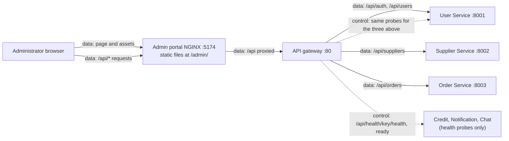
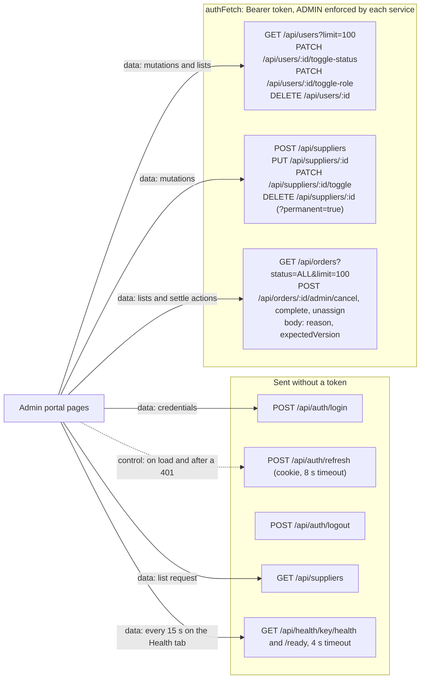
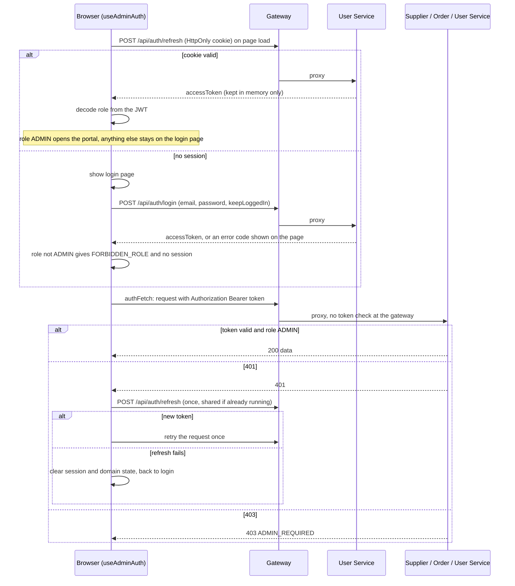
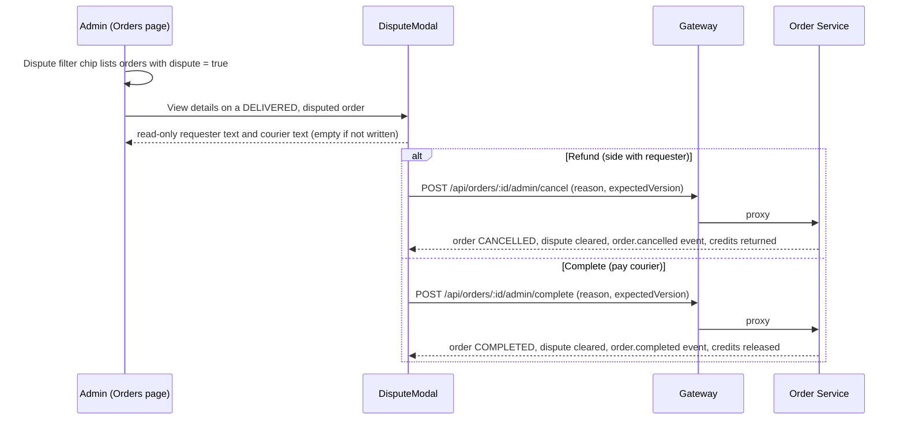

<!--
AI Assistance Disclosure:
Tool: Codex (model: GPT-6), date: 2026-10-25
Scope: Source-linked implementation documentation and evidence review requested by Reallyeasy1.
Author review: <to be completed by Reallyeasy1>
-->

# Admin application

Baseline: branch `order_dispute`, HEAD `d49e883`, inspected 2026-11-09 (SGT).

React/Vite app (dev port 5174, served under `/admin/`) for administrators: manage suppliers, users and orders, settle delivery disputes, and watch service health. `App.tsx` switches between four sections with local state: `suppliers` (default), `orders`, `users`, `health`. It has no backend of its own; every call goes through the gateway to the services.

| Module | Responsibility |
|---|---|
| `hooks/useAdminAuth.ts`, `api/auth.ts` | Login, session restore, in-memory token, `authFetch` with one refresh-and-retry |
| `pages/SuppliersPage.tsx`, `components/SupplierModals.tsx`, `api/suppliers.ts` | Directory filter and sort; create, edit, toggle, delete |
| `pages/UsersPage.tsx`, `components/UserModals.tsx`, `api/users.ts` | List users; toggle status or role; delete |
| `pages/OrdersPage.tsx`, `components/OrderActionModal.tsx`, `api/orders.ts` | List orders; admin cancel, complete, unassign with a reason |
| `components/DisputeModal.tsx` | Read both dispute texts; Refund or Complete |
| `pages/HealthPage.tsx`, `api/health.ts` | Poll each service's `/health` and `/ready` |
| `components/AdminHeader.tsx`, `AdminSidebar.tsx` | Shell and navigation |

## Diagrams

**Arrows:** `->` (solid) is **data flow**: a body, query or rows move along it. `-.-.-.-` (dashed) is **control flow**: a call, check or trigger. In sequence diagrams, a solid arrow is a call and a dashed arrow is a return.

### 1. Where it sits

### 2. API calls

### 3. Login, session and authorization

The role check in the browser only decides what to show. The services verify the signature and claims and enforce ADMIN themselves, so editing browser state grants nothing. A token stays usable until it expires.

### 4. Settling a delivery dispute

## Supplier coordinates and the map

Administrators set where pickup pins appear through the **Latitude** and **Longitude** number fields in Add Supplier and Edit Supplier. The student app plots those values. Arrows follow the legend under [Diagrams](#diagrams).

- **Add Supplier:** both coordinates are required finite numbers.
- **Edit Supplier:** a legacy supplier with no coordinates may stay blank ("Not recorded yet") while other fields are saved; once a coordinate is recorded it cannot be blanked.
- **Supplier Service** checks they are finite numbers (no range check) and stores them on the supplier. See [coordinate upgrades](../services/supplier-service/coordinate-upgrades.md) for legacy records.
- **Student app** reads the coordinates from the public supplier list. A supplier without both coordinates is left off the pickup map.

```mermaid
flowchart LR
  AD["Admin: Add / Edit Supplier<br/>latitude, longitude"]
  SS["Supplier Service<br/>validate and store"]
  DB[("supplier_db")]
  SA["Student app<br/>GET /api/suppliers"]
  PM["Pickup map<br/>pins grouped by exact coordinates"]
  DP["Drop-off picker<br/>NUS building list or clicked point"]
  EST["Reward suggestion in the browser<br/>straight-line distance, pickup to drop-off"]
  OS["Order Service<br/>stores dropoffLatitude, dropoffLongitude, estimatedRewardCredits"]
  RM["Errand route map<br/>pickup and drop-off pins"]
  OSM["OpenStreetMap tile server<br/>tile.openstreetmap.org"]

  AD -->|"data: POST / PUT with coordinates"| SS
  SS -->|"data: row"| DB
  DB -->|"data: supplier list with coordinates"| SA
  SA -->|"data: pickup coordinates"| PM
  SA -->|"data: pickup coordinates"| EST
  DP -->|"data: drop-off point"| EST
  EST -->|"data: suggested reward and drop-off point"| OS
  OS -->|"data: dropoff coordinates in the order"| RM
  PM -.->|"control: browser requests tiles z/x/y"| OSM
  DP -.->|"control: browser requests tiles z/x/y"| OSM
  RM -.->|"control: browser requests tiles z/x/y"| OSM
  OSM -->|"data: PNG map tiles"| PM
```

**Map tiles.** Each Leaflet map (pickup map, drop-off picker, errand route map in `apps/student-app/src/map/`) loads `https://{s}.tile.openstreetmap.org/{z}/{x}/{y}.png` from the browser, without a key and outside the gateway. Pins, the NUS building list and the distance calculation are computed locally.

## Behaviour to know

- **Order row actions by status:** OPEN gives Force Cancel; ACCEPTED gives Unassign Courier and Cancel; IN_TRANSIT gives Dispute Cancel; DELIVERED without a dispute gives Force Complete and Dispute Cancel; DELIVERED with a dispute gives View details (the modal above). Every action asks for an audit reason. `expectedVersion` makes a stale list return a conflict, which the modal shows.
- **After a mutation** the list is fetched again. Validation in the modals runs first, but the server's answer is final (duplicates, last-admin rules, order state conflicts).
- **Failed fetches:** suppliers fall back to the static `FALLBACK_SUPPLIERS` list with a warning (not live data); users and orders clear their lists and show an error.
- **Health:** each service is liveness UP/DOWN plus readiness READY/NOT_READY, shown as ONLINE, DEGRADED or OFFLINE, with the request time. Chat also shows its WebSocket client count and RabbitMQ state. The time is a single HTTP round trip, not a benchmark, and ONLINE does not prove CDC or event delivery works.
- **Admins cannot change their own role** (User Service refuses with `SELF_ACTION_FORBIDDEN`).

## Serving and tests

The gateway forwards `/admin/` to the admin-portal container (NGINX :5174), which serves the build and proxies `/api` back to the gateway. In host development Vite uses base `/admin/` and proxies to local services.

`npm run test:unit -w @campus-errand/admin-portal` runs `test/supplier-form.test.ts` (supplier coordinate form rules). Everything else is covered by root typecheck and lint and the browser/API UAT scripts; there are no component tests.

## Source

[`App.tsx`](../../apps/admin-portal/src/App.tsx) · [`useAdminAuth.ts`](../../apps/admin-portal/src/hooks/useAdminAuth.ts) · [`api/`](../../apps/admin-portal/src/api) · [`OrdersPage.tsx`](../../apps/admin-portal/src/pages/OrdersPage.tsx) · [`DisputeModal.tsx`](../../apps/admin-portal/src/components/DisputeModal.tsx) · [`nginx.conf`](../../apps/admin-portal/nginx.conf) · [`vite.config.ts`](../../apps/admin-portal/vite.config.ts) · [Wiki](https://github.com/AY2627S1-CS3219-P25/friend-on-campus/wiki/Frontend-Apps) · [Docs index](../README.md) · [Drift register](../audits/documentation-drift.md)
