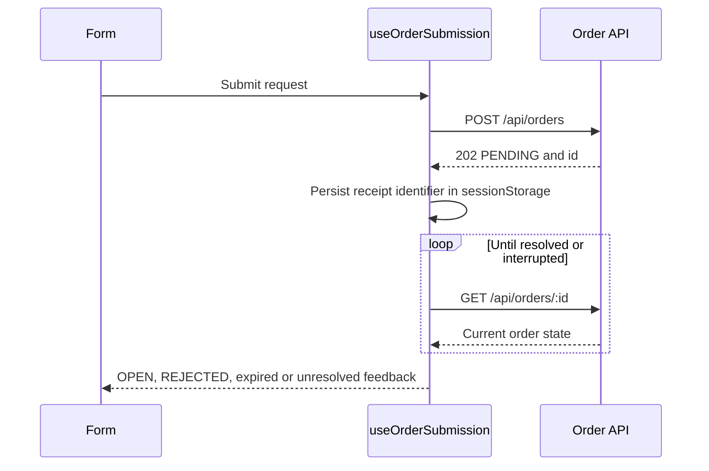

<!--
AI Assistance Disclosure:
Tool: Codex (model: GPT-6), date: 2026-10-25
Scope: Source-linked implementation documentation and evidence review requested by Reallyeasy1.
Author review: <to be completed by Reallyeasy1>
-->

# Student application

Implementation baseline: [`52d791e`](https://github.com/AY2627S1-CS3219-P25/friend-on-campus/commit/52d791e4eea28ce7d817f025ef096f8d96bda467); inspected 2026-10-25 (SGT). Pending work is explicitly labelled.

The student React/Vite app implements authentication, supplier discovery, posting and executing errands, wallet history and requester notifications. Main.tsx mounts App; App selects screens using React state rather than a general route registry.

| Source area | Responsibility and service dependency |
|---|---|
| hooks/useAuthSession.ts; api/auth.ts | In-memory access token, refresh session, registration/login/logout and authenticated fetch |
| pages/AuthGatePage.tsx | Login/signup forms and errors |
| pages/FeedPage.tsx; components/ErrandCard.tsx | Open errands and acceptance through Order |
| pages/PostErrandPage.tsx; orders/useOrderSubmission.ts | Supplier selection, request validation and asynchronous submission polling |
| pages/SpotsPage.tsx; components/SpotCard.tsx | Supplier directory and pickup preselection |
| pages/TasksPage.tsx | Requested/accepted/history groups, pickup/deliver/confirm/cancel/unassign actions |
| pages/ProfileWalletPage.tsx | User profile, wallet/ledger, username edit, logout/account deletion controls |
| notifications/useNotifications.ts; NotificationBell.tsx; pages/AlertsPage.tsx | Socket/REST state, unread badge, requester-stage alerts |
| api/orders.ts, credits.ts, suppliers.ts, users.ts | Per-service HTTP wrappers |

## Authentication and requests

The access token lives in memory. Refresh uses the HttpOnly cookie, shares an in-flight promise to avoid concurrent rotation, and authenticated fetch retries once after 401. The browser's role/UI state does not replace server authorization. Registration creates an account then logs in; wallet creation occurs later through CDC/Credit, so a first wallet read may return 404.

## Order submission

`useOrderSubmission` accepts 202/PENDING, persists the pending identifier in per-user sessionStorage and polls ordinary order detail until resolution. A lost submission response is represented as unconfirmed instead of blindly declaring failure. Backend state decides allowed actions and errors; UI controls surface 400/403/409 outcomes. Duration input maps to the Order service contract.

## Current notification behavior

After login the hook connects to /ws/, sends AUTH and fetches REST history after AUTH_OK. It handles NOTIFICATION frames, read/read-all and reconnect backoff capped at 30 seconds. The bell and Alerts board understand the three requester lifecycle kinds. Current mark-read does not broadcast to another tab; socket state is process-local on the service.

Main does not have PR #184's filtered multi-recipient inbox, financial receipts or INBOX_CHANGED protocol. Those pending changes and reproduced browser-state defects are documented in [the PR audit](../audits/pr-184-review.md).

## Operations and evidence

Host Vite and container NGINX have separate proxy paths; see [gateway](../infrastructure/api-gateway.md). Root typecheck covers the app source. Main has no student-app unit script; browser UAT contains 40 checks including notification and six order lifecycle checks. It does not establish exhaustive component-state/concurrency coverage. Existing issues include stale supplier availability, repeated navigation fetches and initial wallet timing; documentation does not resolve them.

## Source evidence and related reading

- [`apps/student-app/src/App.tsx`](../../apps/student-app/src/App.tsx)
- [`apps/student-app/src/hooks/useAuthSession.ts`](../../apps/student-app/src/hooks/useAuthSession.ts)
- [`apps/student-app/src/orders/useOrderSubmission.ts`](../../apps/student-app/src/orders/useOrderSubmission.ts)
- [`apps/student-app/src/notifications/useNotifications.ts`](../../apps/student-app/src/notifications/useNotifications.ts)
- [`apps/student-app/src/pages/TasksPage.tsx`](../../apps/student-app/src/pages/TasksPage.tsx)
- [`apps/student-app/package.json`](../../apps/student-app/package.json)
- [`scripts/uat/uat-d2-ui.mjs`](../../scripts/uat/uat-d2-ui.mjs)
- [Wiki: Frontend Apps](https://github.com/AY2627S1-CS3219-P25/friend-on-campus/wiki/Frontend-Apps)
- [Documentation index](../README.md) · [Drift register](../audits/documentation-drift.md) · [Verification record](../audits/review-findings.md)
