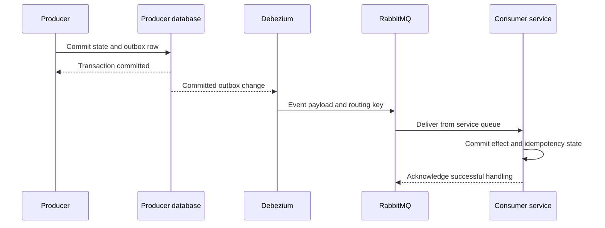
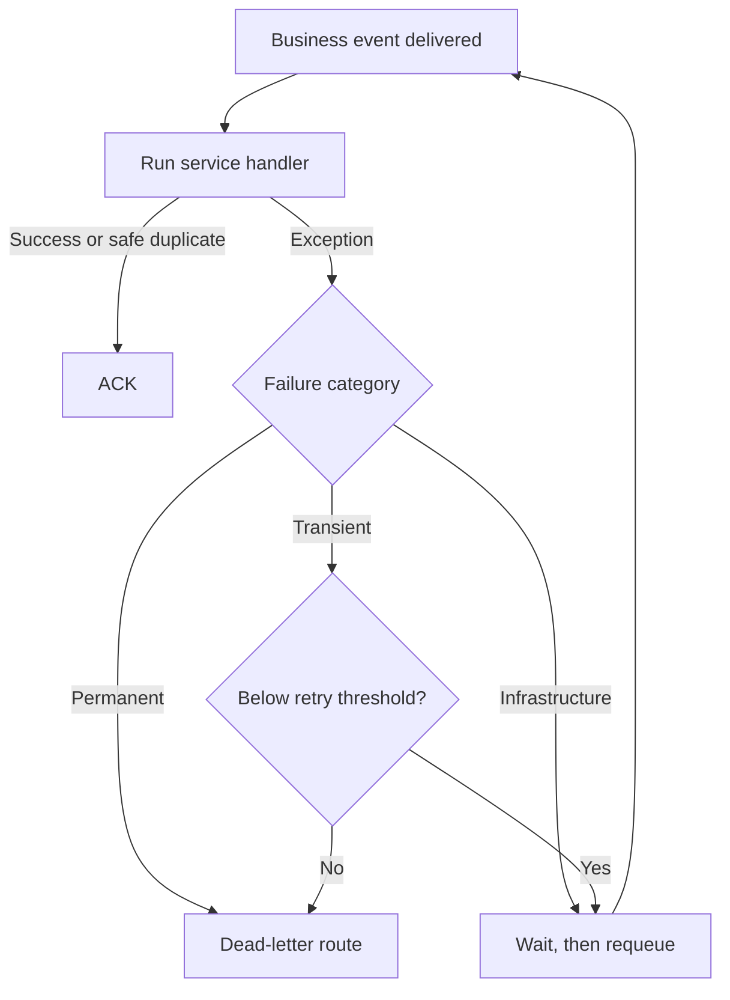
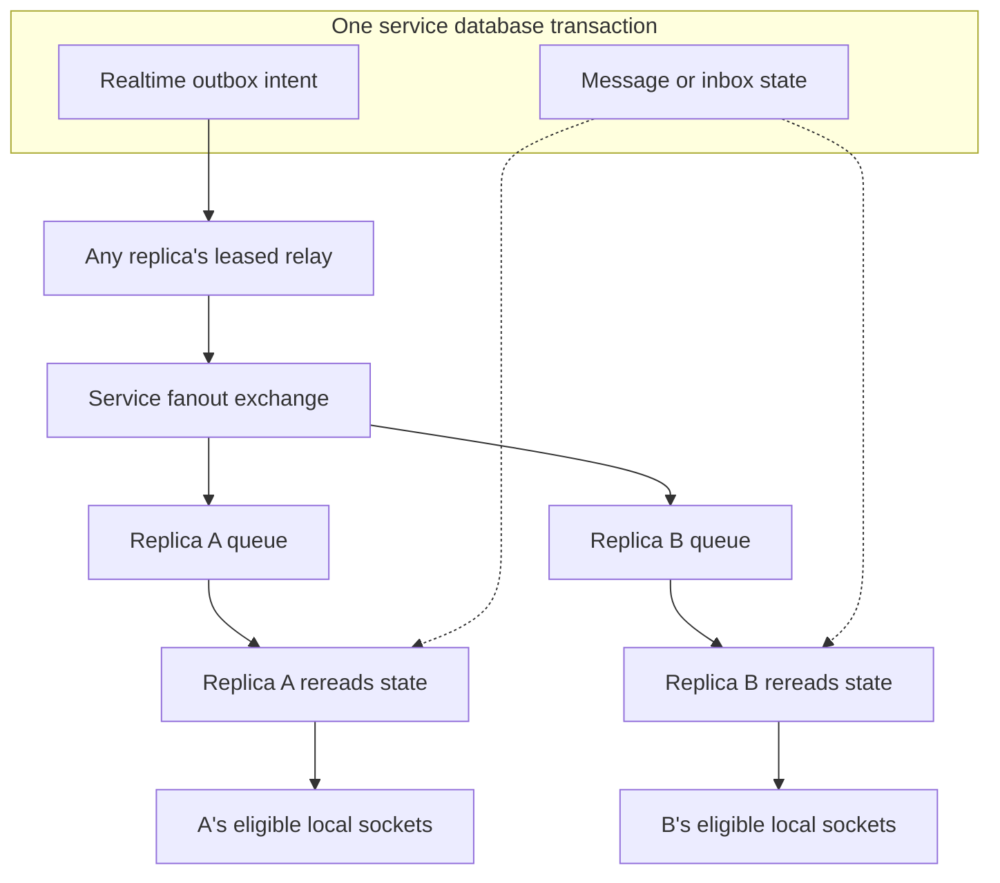

<!--
AI Assistance Disclosure:
Tool: Codex (model: GPT-6), date: 2026-10-25 to 2026-11-09
Scope: Source-linked implementation documentation and evidence review requested by Reallyeasy1; updated across 6 AI-assisted revisions through D4 wrap-up (clarify realtime message expiry and add concrete persisted-data, delivery-intent and crash-recovery examples).
Author review: I validated correctness, edited for style, and verified with automated tests.
-->

# Messaging and asynchronous recovery

Use this guide when a request succeeded but its wallet effect, order transition, notification or chat update has not appeared. The system has two different message paths: **business events** advance service-owned state, while **realtime hints** tell connected clients that persisted state changed.

Implementation was checked against main [`b989758`](https://github.com/AY2627S1-CS3219-P25/friend-on-campus/commit/b989758e766cb593c3b8c94102eb6dfb5c7d8491) on 9 November 2026. Read the [Order](../services/order-service/README.md) and [Credit](../services/credit-service/README.md) guides for the Saga itself; this page explains the common transport and recovery mechanisms.

## First identify which path is late

An **outbox** is a database table of work to publish, written in the same transaction as the change it describes. It avoids committing a business change and then forgetting to publish its event when the process crashes. It does not make all services one transaction.

| Path | Example | Publication mechanism | Recovery source |
|---|---|---|---|
| Business event | Order requests credit reservation; Credit publishes the result | PostgreSQL outbox → Debezium → `campus.events` → consumer queue | Committed producer state, durable queue, consumer idempotency and any dead letters |
| Realtime hint | A new chat message or a notification read-state change | Service SQL realtime outbox → application relay → service fanout exchange | Persisted Chat history or Notification inbox, recovered through authenticated REST |

A missing wallet reservation is a business-processing problem. A message visible after refresh but absent from an already-open chat panel is more likely a live-delivery/reconciliation problem. Check persisted state before deciding which transport failed.

## Business events: from transaction to consumer

**Change data capture (CDC)** reads committed PostgreSQL changes through logical replication. Debezium Server 2.7 watches the three business outboxes and routes their event payloads to RabbitMQ. It does not poll an application HTTP endpoint.

The producer's database transaction finishes before another service handles the event. In this example, “consumer transaction” means work in the receiving service's own database.



If the producer process stops after its database commit, the outbox row still exists. If a consumer stops before acknowledging, the event can be delivered again. This is why consumers need their own transaction/idempotency rules; “the message was delivered once in a test” is not an exactly-once guarantee.

### Connector ownership

All three connectors publish bare JSON payloads to the durable `campus.events` topic exchange in the `campus` vhost. The outbox's event type determines the routing key; consumers also validate the routing key and event contract.

| Producer | Business outbox | Connector configuration |
|---|---|---|
| User | `user_db.public.outbox_events` | [user.properties](../../docker/debezium/user.properties) |
| Order | `order_db.public.outbox_events` | [application.properties](../../docker/debezium/application.properties) |
| Credit | `credit_db.public.credit_outbox_events` | [credit.properties](../../docker/debezium/credit.properties) |

The older polling publishers are not the runtime business-event path. User/Credit connector snapshots filter the legacy outbox `status = 'PENDING'` during initial handover. CDC does not update that old status column after publication, so a row remaining `PENDING` is not proof that delivery failed. Diagnose checkpoint progress, queues and the consumer's resulting state instead.

Each connector has independent replication/offset state:

| Environment | Lifecycle and checkpoint storage |
|---|---|
| Docker Compose | Three containers, each with a separate named volume at `/debezium/data`; startup waits for PostgreSQL, RabbitMQ and the matching service |
| ECS | Three singleton services, enabled only in `phase = "live"`; separate EFS access points and explicitly created publications |

ECS overrides database/broker endpoints and credentials, requires database TLS and uses the `foc_cdc` role. EFS uses UID 185/GID 0. An ordinary connector restart, a lost offset file and a lost replication slot are different incidents. Resetting a checkpoint or deleting a slot can change replay behavior and is not a safe generic fix for delayed events.

## Business queue ownership and failures

A **topic exchange** routes an event to queues whose bindings match its routing key. Each consuming service owns a durable **quorum queue**; replicas of that service share the queue's work. A **dead-letter exchange (DLX)** routes rejected/exhausted messages into a **dead-letter queue (DLQ)** for investigation.

[Broker definitions](../../docker/rabbitmq/definitions.json) establish the vhost, identities, permissions and baseline topology. [The shared consumer](../../packages/messaging/src/index.ts) declares its main queue, DLX, DLQ and service-supplied bindings. A DTO type alone does not subscribe a service to an event.

The main queues explicitly request quorum type. The DLQ declaration is durable but does not explicitly request quorum type. Prefetch and handler concurrency are both **one per consumer**, which limits how much unfinished work each consumer holds.

The service handler classifies a failure before the shared consumer decides what to do:



An invalid event should not be treated like an unavailable database. Recognized database/network failures requeue outside the application's transient retry threshold. Unexpected transient handler errors consume that threshold; permanent errors go straight to the dead-letter route. Broker delivery limits/policies are separate and can still apply.

| Consumer defaults | Retry delay | Transient threshold | DLX | DLQ |
|---|---:|---:|---|---|
| Order | 5000 ms | 5 | `order-service.events.dlq` | `order-service.events.dlq` |
| Credit | 5000 ms | 5 | `campus.events.dlx` | `credit-service.events.dlq` |
| Notification | 2000 ms | 5 | `notification-service.events.dlx` | `notification-service.events.dlq` |
| Chat | 2000 ms | 30 | `chat-service.events.dlx` | `chat-service.events.dlq` |

The same Order DLX/DLQ name identifies two different RabbitMQ object types. Service configuration can override the relevant defaults. The counter used is broker `x-delivery-count`, with absent initial count interpreted as zero; a threshold is not a promised total number of attempts.

Retry delay happens inside the handler and holds that consumer's only prefetch slot. There is no separate delayed retry queue in this path. This is useful when interpreting a growing backlog during an outage: the consumer can exist but spend its time waiting and requeuing. On shutdown/fatal interruption, unfinished handling is requeued; the close path aborts a retry delay.

`isInfrastructureFailure` recognizes selected Prisma, PostgreSQL and network codes. Service-specific classifiers decide domain/validation failures, and each service owns the transactional checks that make duplicate handling safe. Read its guide before assuming a replay is harmless for a particular event.

### Existing queues cannot change type in place

A classic queue cannot be redeclared as quorum with the same name. An older Chat deployment may still have a classic main queue and retired retry exchange/queue. Startup does not silently convert or remove them.

An operator must preserve the messages and choose a controlled drain/recreate or queue-handover procedure. Queue declarations, bindings, permissions and consumer version must agree before resuming. Deleting RabbitMQ volumes, purging a DLQ or renaming a queue without an agreed migration is not routine troubleshooting.

## Realtime delivery

Business queues divide work between service replicas. Realtime delivery has a different goal: **every running replica must hear about a change**, because each owns only its local WebSocket connections.

For example, a message may be written through Chat replica A while its recipient is connected to replica B. Chat stores the message and a realtime intent in one transaction. A relay publishes the intent to a fanout exchange; both replicas receive a hint, reread the persisted message and deliver to eligible local sockets.



Chat owns `realtime_outbox`; Notification owns `notification_realtime_outbox`. Their default exchanges are `chat-service.events.realtime` and `notification-service.events.realtime`, configurable with `RABBITMQ_REALTIME_EXCHANGE`. These outboxes are published by application relays, **not** by the three business Debezium connectors.

The durable record and the hint contain different information:

| Example | Persisted service state | Realtime intent / signal | What a reconnect reads |
|---|---|---|---|
| A student sends “Meet me at the library entrance” | Chat stores the original text, sender, message ID and conversation sequence | Message ID and original recipient IDs tell each replica which stored message to reread; the sender's optional `clientId` accompanies this intent | Authenticated history returns the original message and sequence; it does not return `clientId` |
| Credit settles a 12-credit errand | Notification stores a receipt inbox row for the courier after consuming the Credit event | Created notification IDs, recipient IDs and a stale flag guide live delivery | The receipt remains in the inbox even if no socket was connected |
| A student marks that receipt read | Notification stores its `readAt` with an inbox-change intent | A user-scoped `INBOX_CHANGED` hint carries no unread count | REST returns the current read state and unread count |

The payload builders and reread checks are in [Chat delivery](../../services/chat-service/src/realtime/delivery.ts) and [Notification delivery](../../services/notification-service/src/notifications/realtime.ts). Deleting a successfully published outbox intent does not delete its message or inbox row.

### Claim, publish and complete

The [SQL store](../../packages/messaging/src/outbox-sql.ts) claims due intents using `FOR UPDATE SKIP LOCKED` and a lease. The database lock is held for the claim statement, not during network publication. Multiple replicas can therefore relay work from the same service table.

The [relay](../../packages/messaging/src/realtime.ts) publishes the hint and deletes the intent only while it still owns the lease. Failed publication reschedules the row and increments its attempts. A dead relay's lease eventually expires so another replica can claim the work. There is no outbox attempt cap or realtime dead-letter table.

A crash after publish but before deletion can publish the same intent again. Lease ownership prevents an old worker from deleting a newly claimed intent; it does not make publication exactly once or make a client's repeated SEND operation idempotent.

For the chat message above, the failure point determines what recovery can do:

| Failure point | State left behind | Recovery behavior |
|---|---|---|
| The append transaction rolls back | Neither the message nor its intent commits | That attempt contributes no message to history |
| Commit succeeds, but publication has not succeeded | The message and pending or leased intent remain | History can already return the message; the relay retries publication, or another relay claims an expired lease |
| Publication succeeds, then the relay dies before deleting the intent | The message remains and the intent may be claimed again | A duplicate hint is possible; subscriber caching and client merging suppress duplicates within their respective limits |
| Publication completes, but the recipient's browser is offline | The message remains; the intent can already be deleted | The browser recovers the message from history after reconnecting |

The last row is why a missing realtime outbox row does not prove a browser saw the message. Conversely, an uncertain client response does not establish that the first row's rollback occurred: inspect history before sending the same text again.

### Why a live hint can still be missed

The exchange is durable, but each subscriber queue is classic, exclusive to a replica, auto-delete and nondurable. Hints are nonpersistent. That combination is deliberate in the implementation: durable service rows are the recovery source, not a permanent queue for each browser.

| Default | Consequence |
|---|---|
| Relay polls every 250 ms; claims up to 20 intents; lease 30 seconds | Publication is asynchronous; another relay can recover expired work |
| Failed publication rescheduled after 1 second | Unpublished SQL intents remain retryable |
| Subscriber message TTL 60 seconds; maximum 10,000 hints; drop oldest on overflow | Waiting hints expire; the queue itself has no configured 60-second expiry |
| Subscriber prefetch 20; handler concurrency 1 | A replica processes hints serially with a bounded backlog |
| Three handler attempts, each bounded to 5 seconds | Exhaustion logs and ACKs the dropped hint; no requeue or DLQ |
| Cache of 10,000 successful event IDs in process memory | Recent duplicates are suppressed, but the cache is neither permanent nor shared |
| Reconnect starts at 1 second, capped at 10 seconds | A reconnect creates a new replica queue |

Malformed envelopes are dropped. The fanout publisher does not require a matching queue: with no subscribers, RabbitMQ can confirm publication and the relay can delete its intent. Confirmation means the broker accepted the publication, not that a browser received or read it.

Chat and Notification include their realtime subscriber in readiness and close local sockets when the subscription is lost. Clients reconnect and reload authenticated persisted history/inbox state. If data appears after refresh, it was not necessarily lost; establish whether the durable row exists before diagnosing a missing realtime hint. Moderation peer notices are transient fanout signals without a persisted message/outbox row, so do not promise history recovery for those notices.

Service-specific eligibility, authorization and frontend reconciliation are in the [Chat guide](../services/chat-service/README.md) and [Notification guide](../services/notification-service/README.md).

## Trace a delayed operation

Start with one affected record and a time window. Inspect before retrying an ambiguous write: the operation may already have committed.

1. **Find the last durable fact.** Check the order, wallet, message or inbox through its authorized API. Distinguish “request accepted” from “business transition completed.”
2. **Find the next owner.** For business processing, identify the producer outbox, expected event type and consuming service. For a live update, identify its service realtime outbox and subscriber.
3. **Check publication.** Inspect connector replication/checkpoint errors or relay publish-confirm/lease errors. In ECS, verify the stack reached `live` for business CDC.
4. **Check consumption.** Inspect bindings, ready/unacknowledged counts, consumers, failure category and DLQ counts. A service process being alive does not prove it handled this event.
5. **Verify the persisted result.** Then inspect refresh/reconnect behavior. A queue ACK, log line or toast alone is not the final business result.

For a local Compose stack, these commands inspect status and recent logs without changing data:

```bash
docker compose ps
docker compose logs --tail=100 debezium-user debezium-order debezium-credit
docker compose logs --tail=100 order-service credit-service notification-service chat-service
docker compose exec rabbitmq su-exec rabbitmq rabbitmqctl list_queues -p campus name messages_ready messages_unacknowledged consumers
```

A rising ready count with no consumers points toward startup/readiness or binding/connection configuration. A growing unacknowledged count or repeating failure log points toward work that was received but has not finished. Interpret counts with the per-consumer prefetch limit and multiple replicas in mind. Keep credentials and sensitive message bodies out of shared incident evidence.

| Symptom | Most useful next evidence |
|---|---|
| Registration succeeds, but no wallet appears | User outbox/`cdc-user` progress, Credit queue and consumer result |
| Order remains pending | Reservation event/result and both services' persisted state; there is no general PENDING watchdog |
| Cancel/complete returns before credit balance changes | Financial processing and the eventual Credit receipt; Order state commits separately |
| `rabbitmq_consumer_failure` repeats | `category`, `reason`, `deliveryCount` and whether the action is retry or DLQ |
| Business DLQ has entries | Original event contract/version, handler failure and whether the business effect already committed |
| Realtime outbox grows | `realtime_outbox_publish_failed`, lease/release failures and broker reachability |
| History is correct but a socket missed an update | `realtime_handler_failure` / `realtime_signal_dropped`, readiness, token expiry and client catch-up |

No general automated business DLQ inspection/replay worker or operational alert loop is implemented here. The [failed-message recovery design](https://github.com/AY2627S1-CS3219-P25/friend-on-campus/wiki/Failed-Asynchronous-Message-Recovery-Design) contains proposals and older topology assumptions. Replaying a message requires an operator to establish ownership, idempotency and current business state first; it is not a blanket “retry everything” command.

## Tests and source entry points

The shared transport's unit tests do not need a running database or broker:

```bash
npm run test:unit -w @campus-errand/messaging
```

The expected outcome is a successful Node test run. [realtime.test.ts](../../packages/messaging/test/realtime.test.ts) exercises relay ownership/completion/retry, bounded handler attempts, caches and a loopback fake. It does not establish behavior during a real broker failure.

Chat and Notification messaging suites add real PostgreSQL/RabbitMQ two-replica scenarios. Order/Credit suites exercise the business path; the Order Saga test manually publishes the Order side and uses Credit CDC for the response. The [CDC UAT driver](../../scripts/uat/uat-cdc.mjs) exercises registration credits, reservation/publication and refunds. Consult [testing](../development/testing-strategy.md) for required infrastructure, test URLs, scope and skip behavior before running them.

For code changes, start with [business consumer/publisher primitives](../../packages/messaging/src/index.ts), [realtime transport](../../packages/messaging/src/realtime.ts), [SQL leases](../../packages/messaging/src/outbox-sql.ts), and the owning service's handler/configuration. `createRabbitPublisher`, used by tests/utilities, uses publisher confirms, mandatory routing and durable messages; its default confirm timeout is five seconds. Those helper semantics must not be silently attributed to the separate Debezium publisher.

[Documentation index](../README.md) · [Cloud operations](../architecture/cloud-architecture.md)
