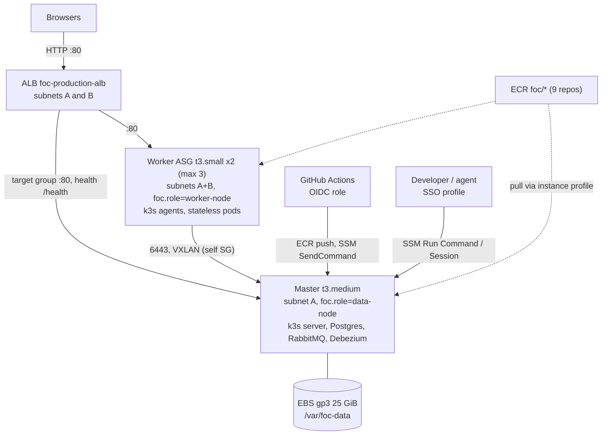

<!--
AI Assistance Disclosure:
Tool: Claude Code (model: Claude Fable 5.1), date: 2026-11-07
Scope: Wrote this as-built description of the AWS infrastructure from infra/terraform/*.tf, with a dated live-state check made through the AWS CLI. No rationale or trade-off is authored here; those sections are marked for the author.
Author review: <to be completed by Reallyeasy1>
-->

# Cloud infrastructure (AWS, as built)

Implementation baseline: [`83db3e4`](https://github.com/AY2627S1-CS3219-P25/friend-on-campus/commit/83db3e4) on `main` (the `infra/` tree and `deploy.yml` last changed in `06ae5e8`, 2026-10-28); inspected 2026-11-07 (SGT). Live account state in the last section was observed the same day and is dated evidence, not a property of the code.

This document describes what `infra/terraform/` provisions and how the pieces connect. It describes behavior. The reasons behind each choice are human-owned; the team's own narrative, including cost and sizing reasoning, is in the [cloud deployment guide](../cloud-deployment-and-devops-guide.md). Where that guide and the Terraform disagree, the difference is recorded in the [drift register](../audits/documentation-drift.md) (D34, D35), not resolved here.

Companion documents: [Kubernetes workloads](kubernetes-workloads.md) (what runs on the nodes) and [continuous deployment](continuous-deployment.md) (how images reach them).

## Topology

## Network

| Resource | Definition | Source |
|---|---|---|
| VPC | `10.0.0.0/16`, DNS hostnames and support enabled | `vpc.tf` 2-10 |
| Subnet A | `10.0.1.0/24` in the first available AZ, public IPs on launch | `vpc.tf` 18-28 |
| Subnet B | `10.0.2.0/24` in the second AZ, public IPs on launch | `vpc.tf` 31-41 |
| Routing | One Internet Gateway; one public route table (`0.0.0.0/0` to the IGW) associated with both subnets | `vpc.tf` 44-74 |

There are no private subnets and no NAT gateway: every node has a public IP and reaches the internet directly.

Security groups (`security_groups.tf`):

| Group | Inbound | Outbound |
|---|---|---|
| `foc-production-alb-sg` | 80 and 443 from `0.0.0.0/0` | all |
| `foc-production-cluster-sg` (master and workers) | 80, 443 and 30000-32767 only from the ALB group; all protocols from members of the same group | all |

No rule admits port 22 or the Kubernetes API port 6443 from outside the cluster group, so the only inbound paths are the ALB on port 80 and AWS Systems Manager (outbound agent connection). The 443 rules are present but unused unless the optional HTTPS listener below is enabled.

## Identity and access

| Principal | Trust | Permissions | Source |
|---|---|---|---|
| `foc-production-ec2-node-role` (instance profile on every node) | `ec2.amazonaws.com` | `AmazonSSMManagedInstanceCore`, `AmazonEC2ContainerRegistryReadOnly` | `iam.tf` 5-46 |
| `foc-production-github-actions-cd-role` | GitHub OIDC provider, `aud = sts.amazonaws.com`, `sub` like `repo:<github_repository>:*` | Inline: ECR auth/push/describe on `*`; `ec2:DescribeInstances`, `ssm:SendCommand`, `ssm:GetCommandInvocation`, `ssm:DescribeInstanceInformation`, `ssm:ListCommands`, `ssm:ListCommandInvocations` on `*` | `iam.tf` 53-133 |

`github_repository` defaults to `*` in `variables.tf` 68-72 and is also `*` in `terraform.tfvars.example` line 13, which makes the trust condition `repo:*`. Narrowing it is a human decision listed in the drift register's open questions.

Human access does not go through Terraform. Developers authenticate with an IAM Identity Center profile (the permission set observed on 2026-11-07 carries `AdministratorAccess`) and reach nodes through Systems Manager. The agent-side procedure is in [`.claude/skills/cloud-access/SKILL.md`](../../.claude/skills/cloud-access/SKILL.md); the human runbook is guide section 6.

## Compute

### Master and data node

`aws_instance.k3s_master` (`ec2.tf` 24-106): Ubuntu 24.04 amd64 AMI resolved from the public SSM parameter (`ec2.tf` 6-8), `t3.medium` by default, subnet A, cluster security group, node instance profile, 30 GiB encrypted gp3 root volume. Tags: `Name=foc-production-k3s-master`, `Role=k3s-master-and-database`, `NodeType=data-plane`. The deploy workflow finds this instance by the `Role` tag; the agent skill uses the `Name` tag.

Its user data (`ec2.tf` 44-99) runs once at first boot and, in order:

1. installs `git`, `curl`, `e2fsprogs`, `nvme-cli`, `net-tools`;
2. looks for the attached data volume at `/dev/nvme1n1`, `/dev/xvdf` or `/dev/sdf`, formats it ext4 only if no ext4 signature exists, mounts it at `/var/foc-data` through `/etc/fstab` with `nofail`, creates `postgres/`, `rabbitmq/`, `debezium/` beneath it and sets mode 777 recursively;
3. reads the private IP from IMDSv2;
4. installs k3s in server mode with the cluster token, `--tls-san <private ip>`, `--node-label foc.role=data-node`, `--write-kubeconfig-mode 644`. No `--disable` flags are passed, so k3s's bundled Traefik, ServiceLB (Klipper) and metrics-server are present;
5. clones the repository to `/opt/friend-on-campus`, checks out `feat/cloud-and-k6` and falls back to `main`, then applies manifests `00` to `03` (namespace, config and secrets, storage, stateful data). Workload manifests `04` to `07` are not applied at boot.

The cluster token is `var.k3s_token` when set, otherwise a 32-character random password generated by Terraform (`ec2.tf` 11-18); it is Terraform state, not a repository value.

### Worker tier

`aws_launch_template.k3s_worker` (`ec2.tf` 113-181): same AMI, `t3.small`, public IP, cluster security group, node instance profile, 20 GiB encrypted gp3 root. User data waits until the master's private IP answers on 6443, then installs k3s in agent mode against `https://<master private ip>:6443` with `--node-label foc.role=worker-node`. Instance tags: `Name=foc-production-k3s-worker`, `Role=k3s-worker`, `NodeType=stateless-compute`.

`aws_autoscaling_group.k3s_workers` (`ec2.tf` 184-233):

| Setting | Value |
|---|---|
| min / desired / max | 2 / 2 / 3 (`variables.tf` 31-47; same in `terraform.tfvars.example`) |
| Subnets | A and B |
| Target group | the ALB HTTP target group (workers register automatically) |
| Health check | `EC2`, 300 s grace |
| Launch template version | `$Latest` |
| Instance refresh | rolling, minimum 50 % healthy |
| Lifecycle | `create_before_destroy`; `desired_capacity` ignored after creation, so scaling activity is not reverted by later applies |
| Propagated tags | `Name=foc-production-k3s-worker-asg`, `Role=k3s-worker`, `NodeType=stateless-compute` (these override the launch template's `Name`; live workers show the ASG value) |

Scaling policy `foc-production-worker-cpu-target` (`ec2.tf` 236-248): target tracking on `ASGAverageCPUUtilization` at 75 % (`var.worker_cpu_target`), scale-in enabled. This is the node-level tier; pod-level scaling is the HPA set described in [Kubernetes workloads](kubernetes-workloads.md#horizontal-pod-autoscalers-07-hpayaml).

## Persistent storage

`aws_ebs_volume.data_volume` (`ebs.tf`): gp3, 25 GiB (`var.ebs_volume_size`), 3000 IOPS, 125 MiB/s, encrypted, created in the first AZ (the master's AZ) and attached to the master as `/dev/sdf`. It is the only persistent store: Postgres, RabbitMQ and the three Debezium offset files all live under `/var/foc-data` through the hostPath PersistentVolume in `02-storage.yaml`. Worker root disks are ephemeral (`delete_on_termination = true`). Nothing in the Terraform snapshots this volume.

## Load balancer

`alb.tf`:

| Resource | Definition |
|---|---|
| `aws_lb.main` | internet-facing application load balancer `foc-production-alb`, ALB security group, subnets A and B, deletion protection off |
| `aws_lb_target_group.http` | HTTP on instance port 80, `target_type = instance`; health check `GET /health` every 15 s, 5 s timeout, healthy after 2, unhealthy after 3, accepted codes `200,301,302,404` |
| Targets | master attached explicitly (`alb.tf` 43-47); workers through the ASG |
| Listener :80 | forward to the target group |
| Listener :443 | created only when `var.certificate_arn` is non-empty; TLS policy `ELBSecurityPolicy-TLS13-1-2-2021-06`; forwards to the same HTTP target group. The example tfvars leaves it commented out, so the deployed entry point is plain HTTP |

On each node, port 80 is served by k3s's ServiceLB daemonset for Traefik (a k3s default not altered by user data), which forwards to Traefik, whose single Ingress rule sends `/` to the `api-gateway` Service. The gateway's own `/health` location answers the ALB health check directly (`gateway/nginx.conf` line 68), so target health does not depend on the SPAs or services behind it. The 404 in the accepted-code list means a node whose Traefik is up but whose Ingress is missing also counts as healthy.

## Container registry

`ecr.tf` creates nine repositories: `foc/user-service`, `foc/supplier-service`, `foc/order-service`, `foc/credit-service`, `foc/notification-service`, `foc/chat-service`, `foc/gateway`, `foc/student-app`, `foc/admin-portal`. Tags are mutable and images are scanned on push. The lifecycle policy expires untagged images after 3 days and keeps at most 10 tagged images per repository, so a commit SHA tag older than the last ten pushes is no longer pullable.

Nodes are granted read access to ECR through the instance profile, but k3s's containerd does not use the instance profile by itself. The deploy workflow calls a `/usr/local/bin/refresh-ecr.sh` on the master that is not in the repository; see D34.

## Terraform runtime

`versions.tf`: Terraform 1.5 or later, AWS provider 5.x, random provider 3.5.x. Default tags on every resource: `Project=friend-on-campus`, `Environment=production`, `ManagedBy=Terraform`, `Course=CS3219`, `Milestone=D4`. There is no `backend` block, so state is the local `terraform.tfstate` of whoever ran `apply`; the guide's section 2.5 describes this as intended. Outputs (`outputs.tf`) expose the ALB DNS name and URL, master instance ID and IPs, worker ASG name and capacity, EBS volume ID, GitHub Actions role ARN, the ECR URL map, and two pre-formatted SSM commands.

## Live state observed 2026-11-07

Read-only AWS CLI calls with the team's SSO profile returned the following. Instance IDs for workers change whenever the ASG replaces an instance.

| Instance | Tag `Name` | Type | AZ subnet | Public IP | EC2 | SSM agent |
|---|---|---|---|---|---|---|
| `i-0e3fd00fa2fdb1477` | `foc-production-k3s-master` | t3.medium | A | 47.128.71.190 | running | Online |
| `i-0c903d46f1e60f016` | `foc-production-k3s-worker-asg` | t3.small | one of A/B | 54.251.178.191 | running | Online |
| `i-071cbf7a8ada2e0ad` | `foc-production-k3s-worker-asg` | t3.small | one of A/B | 13.212.202.89 | running | Online |

ALB `foc-production-alb` was `active` at `foc-production-alb-144589427.ap-southeast-1.elb.amazonaws.com`. No ECS clusters, Elastic Beanstalk environments, Lightsail instances or RDS instances exist in the region. The SSM agent version on all three nodes was 3.3.4793.0.

## Verification limits

- `terraform plan` was not run against the live state; drift between the `.tf` files and the account (for example manual console changes) is not excluded.
- No command was executed on a node. The session's permission gate denied the `ssm send-command` check, so Kubernetes-level node readiness, the ServiceLB port binding and the ECR credential helper were not observed.
- The location and freshness of `terraform.tfstate` are unknown to this document.
- Cost figures in the guide were not recomputed.

## Source evidence and related reading

- [`infra/terraform/versions.tf`](../../infra/terraform/versions.tf) · [`variables.tf`](../../infra/terraform/variables.tf) · [`terraform.tfvars.example`](../../infra/terraform/terraform.tfvars.example)
- [`vpc.tf`](../../infra/terraform/vpc.tf) · [`security_groups.tf`](../../infra/terraform/security_groups.tf) · [`iam.tf`](../../infra/terraform/iam.tf)
- [`ec2.tf`](../../infra/terraform/ec2.tf) · [`ebs.tf`](../../infra/terraform/ebs.tf) · [`alb.tf`](../../infra/terraform/alb.tf) · [`ecr.tf`](../../infra/terraform/ecr.tf) · [`outputs.tf`](../../infra/terraform/outputs.tf)
- [`gateway/nginx.conf`](../../gateway/nginx.conf) (the `/health` location the ALB probes)
- [Cloud deployment guide](../cloud-deployment-and-devops-guide.md) (team narrative and runbook) · [`.claude/skills/cloud-access/SKILL.md`](../../.claude/skills/cloud-access/SKILL.md)
- [Kubernetes workloads](kubernetes-workloads.md) · [Continuous deployment](continuous-deployment.md) · [Containers and local deployment](docker-and-deployment.md)
- [Documentation index](../README.md) · [Drift register](../audits/documentation-drift.md) · [Verification record](../audits/review-findings.md)
