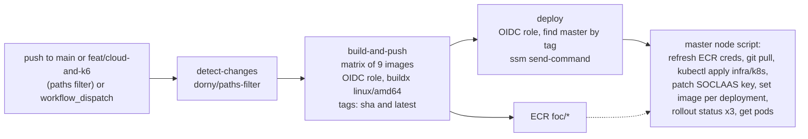

<!--
AI Assistance Disclosure:
Tool: Claude Code (model: Claude Fable 5.1), date: 2026-11-07
Scope: Wrote this as-built description of .github/workflows/deploy.yml and the manual deployment paths it coexists with. Behavioral statements are traced to lines; nothing was executed. No rationale is authored here.
Author review: <to be completed by Reallyeasy1>
-->

# Continuous deployment to the k3s cluster (as built)

Implementation baseline: [`83db3e4`](https://github.com/AY2627S1-CS3219-P25/friend-on-campus/commit/83db3e4) on `main` (`deploy.yml` last changed in `c3b7479`, 2026-10-28); inspected 2026-11-07 (SGT). No workflow run was inspected for this document; statements describe what the workflow file does when it runs.

This document describes `.github/workflows/deploy.yml` and the two manual paths that reach the same cluster. It is separate from [CI and pull-request checks](ci-cd.md): the deployment workflow has no dependency on `ci.yml`, and a push to `main` starts both independently. Reasons for the pipeline shape are human-owned (see the [cloud deployment guide](../cloud-deployment-and-devops-guide.md) section 4). Factual differences between that guide, `infra/k8s/README.md` and the workflow are recorded as D37 to D39 in the [drift register](../audits/documentation-drift.md).

## Triggers and guards

| Trigger | Condition | Source |
|---|---|---|
| `push` | branches `main` or `feat/cloud-and-k6`; only when a path under `services/`, `apps/`, `packages/`, `gateway/`, `data/images/`, `infra/k8s/` or the workflow file itself changed | `deploy.yml` 3-15 |
| `workflow_dispatch` | input `service`: `all` or one of the nine image names; input `run_migrations` (boolean, default true) | 16-38 |

Permissions are `id-token: write` (for OIDC) and `contents: read`. Concurrency group `cd-production` with `cancel-in-progress: false` serialises runs without aborting one in flight (40-46). Region, account, role ARN and ECR registry are fixed in `env` (48-52).

The branch `feat/cloud-and-k6` still exists on the remote at inspection time, so pushes to it deploy to the same production cluster as `main` (D37).

## Job 1: detect changed workloads

`dorny/paths-filter@v3` runs only for `push` events (69-99) and maps paths to image names:

| Image | Paths |
|---|---|
| each of the six services | `services/<name>/**` and `packages/**` |
| `gateway` | `gateway/**`, `data/images/**` |
| `student-app`, `admin-portal` | `apps/<name>/**` |

A change under `packages/` therefore rebuilds all six services. A change under `infra/k8s/` only starts the workflow and builds nothing; the deploy job still runs and re-applies the manifests. On `workflow_dispatch` the filter is skipped and the `service` input decides.

## Job 2: build and push images

A nine-way matrix with `fail-fast: false` (108-121). Each leg first decides whether it should build (123-140): on dispatch, when `service` is `all` or equals the leg; on push, when the leg's name appears in the filter output. Legs that should not build skip every remaining step but still count as successful.

Building legs: checkout, QEMU and Buildx setup, `aws-actions/configure-aws-credentials@v4` assuming `foc-production-github-actions-cd-role` with audience `sts.amazonaws.com` (no stored AWS keys), `amazon-ecr-login@v2`, Dockerfile resolution (`gateway/Dockerfile`, `apps/<name>/Dockerfile` or `services/<name>/Dockerfile`, always with repository root as context, 167-181), then `docker/build-push-action@v6` for `linux/amd64` only, pushing two tags per image: `foc/<name>:<commit sha>` and `foc/<name>:latest`, with the GitHub Actions layer cache (183-195).

## Job 3: deploy

Runs after both jobs when nothing failed and the run was not cancelled (`always() && !cancelled() && !contains(needs.*.result, 'failure')`, 203), so a push that built nothing still deploys. Steps:

1. Assume the same OIDC role (206-211).
2. Find the master: `ec2 describe-instances` filtered on `tag:Role=k3s-master-and-database` and state `running`; fail the job if none (213-227).
3. Compose a shell script, JSON-encode it with `jq`, send it with `ssm send-command` (document `AWS-RunShellScript`) to that instance, poll `get-command-invocation` up to 60 times at 5 s intervals until the status is terminal, then print the remote standard output (229-325). The GitHub secret `SOCLAAS_API_KEY` is interpolated into the script when set.

### What the remote script does

Executed as root on the master through the SSM agent, with `set -e` and `KUBECONFIG=/etc/rancher/k3s/k3s.yaml` (241-242):

| Step | Action | Lines | Failure handling |
|---|---|---|---|
| 0 | run `/usr/local/bin/refresh-ecr.sh` if executable | 244-247 | ignored (`|| true`) |
| 1 | `cd /opt/friend-on-campus`; if it is a git checkout: fetch, `checkout -f <pushed ref>` falling back to `main`, pull; then `kubectl apply -f infra/k8s/` | 249-254 | git errors ignored; `kubectl apply` failure aborts the script |
| 1b | if `SOCLAAS_API_KEY` is set, `kubectl patch secret foc-secrets` to add it | 256-259 | ignored |
| 2 | for each of the nine deployments (`api-gateway` maps to repository `foc/gateway`): if the deployment exists and `aws ecr describe-images` finds the commit SHA tag, `kubectl set image deployment/<d> <d>=<registry>/<repo>:<sha>`; otherwise print "skipping" | 261-275 | ignored |
| 3 | `kubectl rollout status` for `order-service`, `credit-service`, `api-gateway` with 120 s timeouts, then `kubectl get pods -n foc -o wide` | 277-283 | ignored |

Consequences that follow from these lines:

- `/usr/local/bin/refresh-ecr.sh` and `/usr/local/bin/aws` are expected on the master but are not installed by `ec2.tf` user data or any repository file (D34).
- Step 1 re-applies every manifest before step 2 sets images. The manifests declare `:latest`, so a deployment that was previously running a SHA tag is first changed back to `:latest` by the apply; step 2 then moves it to the new SHA only if that image was built in this run. Deployments whose image was not built in the run are left on `:latest` after the apply, with `imagePullPolicy: IfNotPresent` deciding per node whether a cached `latest` or a fresh pull is used (D39). Whether this triggers a rollout for unchanged services depends on the live spec at that moment and was not observed.
- Only three rollouts are awaited, and all awaits are `|| true`; the SSM command reports `Success` as long as `kubectl apply` succeeded. The GitHub step itself does not evaluate the remote status: it breaks out of the polling loop on any terminal status and succeeds unless the final `get-command-invocation` call errors. A remote `Failed` or `TimedOut` therefore produces a green workflow with the failure visible only in the printed output (322-325).
- The `run_migrations` input is captured into `RUN_MIGRATIONS` (235) but never referenced in the remote script, and the step name "Pre-Deploy Migrations" has no corresponding command. Prisma migrations run inside each service container at start-up, as documented in [containers and local deployment](docker-and-deployment.md) (D38).
- Images are built for `linux/amd64` only, matching the `t3` instance family; the guide's section 4.5 describes multi-architecture builds.

## Manual paths to the same cluster

| Path | When | Mechanism | Source |
|---|---|---|---|
| First boot | once per master instance | user data clones the repository and applies manifests `00`-`03` only | `infra/terraform/ec2.tf` 86-98 |
| Day-1 bootstrap | once, by a developer | loop sending each manifest base64-encoded through `ssm send-command` to `k3s kubectl apply -f -` | `infra/k8s/README.md` 93-110 |
| Manifest or ad-hoc change | as needed | `aws ssm start-session` (needs the Session Manager plugin and a terminal) or Run Command; the agent uses the Run Command helper | guide section 6; [`.claude/skills/cloud-access/SKILL.md`](../../.claude/skills/cloud-access/SKILL.md) |
| Re-deploy without a code change | as needed | `workflow_dispatch` with `service=all`; builds all nine images for the current head and rolls them out | `deploy.yml` 16-33 |

Secrets: the only value injected at deploy time is `SOCLAAS_API_KEY`. Database, broker and JWT material remain whatever `01-configmaps-secrets.yaml` declares unless changed by hand on the cluster.

## Verification limits

- No run of `deploy.yml` was opened; durations, cache behaviour and the actual text printed by the remote script were not observed.
- The existence and content of `/usr/local/bin/refresh-ecr.sh` and the AWS CLI on the master were not checked (node access was denied by the session's permission gate).
- Whether the repository checkout at `/opt/friend-on-campus` tracks `main` or `feat/cloud-and-k6` at this moment is unknown; it depends on the last pushed ref.
- The D39 re-apply behaviour is read from the files; a live `kubectl rollout history` would show whether unchanged services actually restart on each run.

## Source evidence and related reading

- [`.github/workflows/deploy.yml`](../../.github/workflows/deploy.yml) · [`.github/workflows/ci.yml`](../../.github/workflows/ci.yml)
- [`infra/terraform/iam.tf`](../../infra/terraform/iam.tf) (OIDC provider and role) · [`infra/terraform/ecr.tf`](../../infra/terraform/ecr.tf) · [`infra/terraform/ec2.tf`](../../infra/terraform/ec2.tf)
- [`infra/k8s/README.md`](../../infra/k8s/README.md) · [`infra/k8s/04-stateless-services.yaml`](../../infra/k8s/04-stateless-services.yaml) (image tags and pull policy)
- [Cloud infrastructure](cloud-infrastructure.md) · [Kubernetes workloads](kubernetes-workloads.md) · [CI and pull-request checks](ci-cd.md) · [Containers and local deployment](docker-and-deployment.md)
- [Documentation index](../README.md) · [Drift register](../audits/documentation-drift.md) · [Verification record](../audits/review-findings.md)
