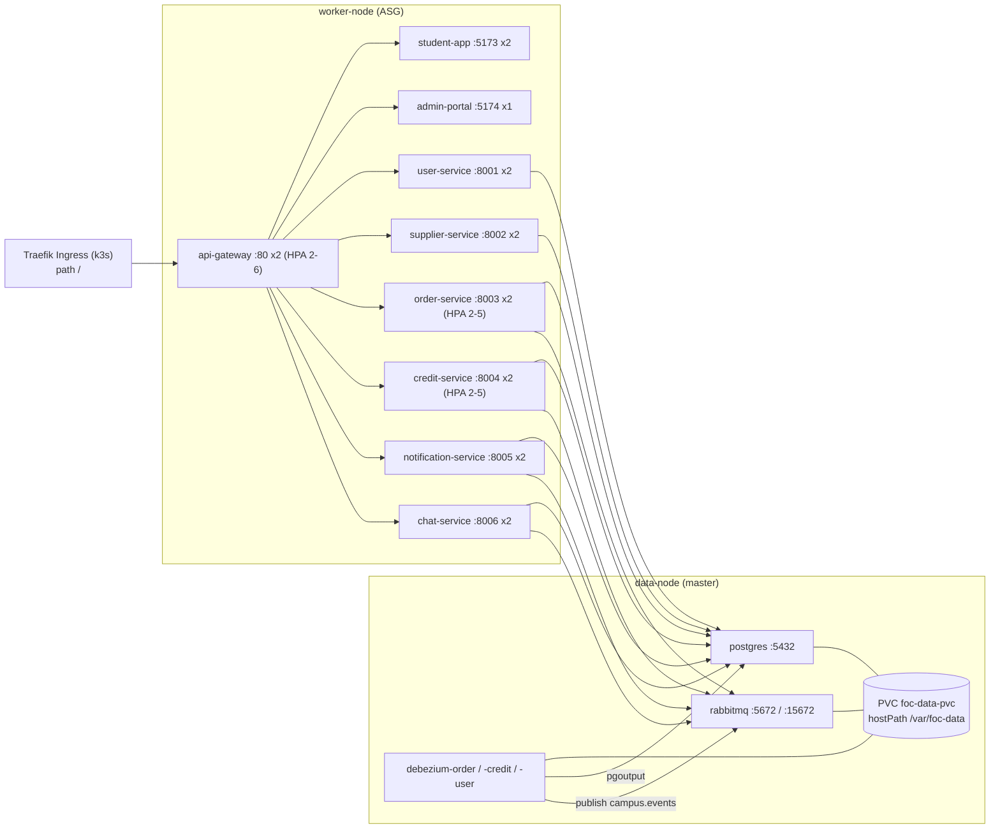

<!--
AI Assistance Disclosure:
Tool: Claude Code (model: Claude Fable 5.1), date: 2026-11-07
Scope: Wrote this as-built description of the k3s workload manifests from infra/k8s/*.yaml and gateway/entrypoint.sh. Secret values are named, never reproduced. No rationale is authored here.
Author review: <to be completed by Reallyeasy1>
-->

# Kubernetes workloads (k3s, as built)

Implementation baseline: [`83db3e4`](https://github.com/AY2627S1-CS3219-P25/friend-on-campus/commit/83db3e4) on `main`; inspected 2026-11-07 (SGT). The manifests were not applied or compared against the live cluster during this inspection; see the verification limits.

This document describes what the eight manifests in `infra/k8s/` declare and how the objects relate. The reasons behind the layout are human-owned (see the [cloud deployment guide](../cloud-deployment-and-devops-guide.md) section 3 and [`infra/k8s/README.md`](../../infra/k8s/README.md)). Where the README's summary differs from the manifests, the difference is recorded as D36 in the [drift register](../audits/documentation-drift.md).

Nodes, network and storage underneath these objects are in [cloud infrastructure](cloud-infrastructure.md); how images and manifests reach the cluster is in [continuous deployment](continuous-deployment.md).

## Apply order and placement

Files are numbered `00` to `07` and applied in name order. Everything lives in namespace `foc` (`00-namespace.yaml`). Placement is by node label:

| Label (set by k3s install flags in `ec2.tf`) | Workloads pinned there |
|---|---|
| `foc.role=data-node` (the master) | `postgres`, `rabbitmq`, `debezium-order`, `debezium-credit`, `debezium-user`, and the hostPath PersistentVolume |
| `foc.role=worker-node` (ASG instances) | six backend services, `student-app`, `admin-portal`, `api-gateway` |

## Configuration objects (`01-configmaps-secrets.yaml`)

| Object | Kind | Contents | Consumers |
|---|---|---|---|
| `foc-common-config` | ConfigMap | `NODE_ENV=production`, Postgres and RabbitMQ in-cluster hostnames and ports, `USER_SERVICE_URL`, `SUPPLIER_SERVICE_URL`, `ORDER_SERVICE_URL` (`http://<service>:<port>`), `JWT_ISSUER`, `JWT_AUDIENCE`, the three JWT TTLs (15m / 1d / 30d), `SEED_SAMPLE_ORDERS=false`, `SOCLAAS_BASE_URL`, `SOCLAAS_MODEL` (lines 1-23) | backend services, per key |
| `foc-secrets` | Secret (`stringData`) | `POSTGRES_USER`, `POSTGRES_PASSWORD`, six `*_DATABASE_URL`, four `*_RABBITMQ_URL` (order, credit, notification, chat), `JWT_PUBLIC_KEY`, `JWT_PRIVATE_KEY` (lines 26-47). The committed values are the repository's development defaults; the file's own comment calls the key pair the "default development key pair". `SOCLAAS_API_KEY` is not in the file and is patched in by the deploy workflow when a GitHub secret is set | `postgres`, backend services |
| `postgres-init-sql` | ConfigMap | one SQL file creating six roles (`user_svc` … `chat_svc`) and six databases (`user_db`, `supplier_db`, `order_db`, `credit_db`, `notification_db`, `chat_db`) owned by them, then revoking `CONNECT` from `PUBLIC` on each (lines 50-76). Runs only on first initialisation of an empty data directory | `postgres` via `/docker-entrypoint-initdb.d` |
| `rabbitmq-definitions` | ConfigMap | `rabbitmq.conf` pointing the definitions importer at `definitions.json` (skip if unchanged), and the definitions: seven users (`campus_admin` administrator, `user_service`, `order_service`, `credit_service`, `notification_service`, `credit_test`, `chat_service`), vhost `campus`, exchanges `campus.events` (topic) and `campus.events.dlx` (direct), per-user configure/write/read regexes, topic permissions on `campus.events`, two pre-declared quorum queues and seven bindings (lines 79-326) | `rabbitmq` |
| `debezium-configs` | ConfigMap | `order.properties`, `credit.properties`, `user.properties` (lines 331-458) | the three Debezium deployments |

Pre-declared queues and bindings (the Notification and Chat consumers are not declared here and therefore create their own queues at runtime through the shared messaging package):

| Queue | Type | Dead-letter | Bound routing keys |
|---|---|---|---|
| `credit-service.events` | quorum | exchange `campus.events.dlx`, key `credit-service.events.dlq` | `user.registered`, `order.completed`, `order.cancelled`, `order.expired`, `order.reservation.requested` |
| `order-service.events` | quorum | exchange `order-service.events.dlq`, key `order-service.events.dlq` | `credit.reservation.succeeded`, `credit.reservation.failed` |

Topic permissions restrict which routing keys each user may publish or subscribe to on `campus.events`: `user_service` writes only `user.registered`; `order_service` writes the ten `order.*` keys and reads the two `credit.reservation.*` keys; `credit_service` writes `credit.reservation.*` and `credit.escrow.*` and reads `user.registered` plus four `order.*` keys; `notification_service` writes nothing and reads nine `order.*` keys plus `credit.escrow.*` (lines 214-243). `chat_service` has vhost permissions but no topic-permission row.

Debezium property sets share: sink `rabbitmq` at host `rabbitmq`, vhost `campus`, exchange `campus.events`, routing key taken from the routed topic name; JSON key and value without schemas; Postgres connector with `pgoutput`, file offset storage under `/debezium/data/offsets.dat`, flush interval 0; source user `postgres` (the superuser, not the per-service role); the outbox `EventRouter` transform routing by `event_type` with JSON payload expansion. Differences:

| Connector | Database and table | Slot / publication | Snapshot filter | Key field |
|---|---|---|---|---|
| order | `order_db`, `public.outbox_events`, topic prefix `campus` | defaults (none set) | none | `aggregate_id` |
| credit | `credit_db`, `public.credit_outbox_events`, prefix `campus_credit` | `debezium_credit` / `dbz_credit_publication` | rows with `status = 'PENDING'` | `aggregate_id` |
| user | `user_db`, `public.outbox_events`, prefix `campus_user` | `debezium_user` / `dbz_user_publication` | rows with `status = 'PENDING'` | `id` |

The order connector's topic replacement is `\${routedByValue}` while the other two use regex `(.*)` with replacement `$1`; both forms yield the raw `event_type` as the routing key. Outbox table shapes and the producing code are documented per service under [`docs/services/`](../README.md#service-coverage).

## Storage (`02-storage.yaml`)

`PersistentVolume foc-ebs-pv`: 25Gi, `ReadWriteOnce`, reclaim `Retain`, `storageClassName: local-storage`, `hostPath /var/foc-data` (`DirectoryOrCreate`), required node affinity `foc.role in [data-node]`. `PersistentVolumeClaim foc-data-pvc` in `foc` requests 25Gi of the same class. No `StorageClass` object is declared; the name is used only to match claim to volume (D36). Pods mount sub-paths: `postgres`, `rabbitmq`, `debezium/order`, `debezium/credit`, `debezium/user`.

## Stateful tier (`03-stateful-data.yaml`)

All five deployments: one replica, strategy `Recreate`, `nodeSelector foc.role=data-node`, volume from `foc-data-pvc`.

| Deployment | Image | Ports | Notable configuration | Probes | Requests / limits |
|---|---|---|---|---|---|
| `postgres` | `postgres:16.15-alpine` | 5432 | args `wal_level=logical`, `max_replication_slots=10`, `max_wal_senders=10`; user and password from `foc-secrets`; init SQL mounted | readiness and liveness `pg_isready -U postgres` (5 s / 10 s periods) | 250m, 512Mi / 1000m, 1536Mi |
| `rabbitmq` | `rabbitmq:3.13-management-alpine` | 5672, 15672 | `RABBITMQ_DEFAULT_USER=guest`, `RABBITMQ_DEFAULT_PASS=guest`, `RABBITMQ_DEFAULT_VHOST=campus` as literals; `rabbitmq.conf` and `definitions.json` mounted from the ConfigMap | TCP 5672 (5 s / 15 s) | 200m, 256Mi / 800m, 1024Mi |
| `debezium-order`, `debezium-credit`, `debezium-user` | `quay.io/debezium/server:2.7` | none | one `application.properties` each from `debezium-configs`; offsets under the PVC sub-path | none | 100m, 256Mi / 500m, 512Mi each |

ClusterIP Services `postgres` (5432) and `rabbitmq` (5672 `amqp`, 15672 `management`) expose them inside the namespace. The management port is not reachable from outside the cluster (no Ingress rule, no NodePort).

## Stateless services (`04-stateless-services.yaml`)

Common to all six: 2 replicas, `nodeSelector foc.role=worker-node`, preferred (weight 100) pod anti-affinity on `kubernetes.io/hostname` against the same `app`, image `891498120071.dkr.ecr.ap-southeast-1.amazonaws.com/foc/<name>:latest` with `imagePullPolicy: IfNotPresent`, requests 100m / 128Mi, a ClusterIP Service on the same port, and `DATABASE_URL`, `JWT_ISSUER`, `JWT_AUDIENCE`, `JWT_PUBLIC_KEY` from the config objects. Readiness and liveness use the same path (10 s / 20 s initial delay, 5 s / 10 s period).

| Deployment | Port | Extra environment | Probe path | Memory limit |
|---|---|---|---|---|
| `user-service` | 8001 | `JWT_PRIVATE_KEY` | `/ready` | 384Mi |
| `supplier-service` | 8002 | none | `/ready` | 384Mi |
| `order-service` | 8003 | `RABBITMQ_URL` (`ORDER_RABBITMQ_URL`), `SUPPLIER_SERVICE_URL`, `SEED_SAMPLE_ORDERS`, optional `SOCLAAS_BASE_URL`, `SOCLAAS_MODEL`, `SOCLAAS_API_KEY` | `/health` | 512Mi |
| `credit-service` | 8004 | `RABBITMQ_URL` (`CREDIT_RABBITMQ_URL`), `USER_SERVICE_URL` | `/health` | 512Mi |
| `notification-service` | 8005 | `RABBITMQ_URL` (`NOTIFICATION_RABBITMQ_URL`) | `/ready` | 384Mi |
| `chat-service` | 8006 | `RABBITMQ_URL` (`CHAT_RABBITMQ_URL`), `ORDER_SERVICE_URL` | `/ready` | 384Mi |

CPU limit is 500m for all six. The `:latest` tag in the manifest is what `kubectl apply` sets; the deploy workflow then replaces it with a commit SHA tag for images that were built in that run (see [continuous deployment](continuous-deployment.md#what-the-remote-script-does)). Which route each probe path hits is documented in the service references.

## Presentation tier (`05-frontends-gateway.yaml`)

| Deployment | Image | Port | Replicas | Probes | Requests / limits |
|---|---|---|---|---|---|
| `student-app` | `foc/student-app:latest` | 5173 | 2 | none | 50m, 64Mi / 200m, 128Mi |
| `admin-portal` | `foc/admin-portal:latest` | 5174 | 1 | none | 50m, 64Mi / 200m, 128Mi |
| `api-gateway` | `foc/gateway:latest` | 80 | 2 | `GET /health` on 80 (5 s / 15 s initial, 5 s / 10 s period) | 100m, 128Mi / 500m, 256Mi |

These three carry `nodeSelector foc.role=worker-node` but no anti-affinity rule. The gateway image is the same NGINX configuration used by Compose ([gateway and proxy routing](api-gateway.md)); inside the cluster its entrypoint rewrites the config at start: it replaces the `resolver` address with the first `nameserver` from `/etc/resolv.conf` (CoreDNS) and appends the first `search` domain (`foc.svc.cluster.local`) to every upstream reference on ports 5173, 5174 and 800x, so names such as `order-service` resolve through NGINX's own resolver (`gateway/entrypoint.sh` 6-19). Path routing (`/api/*`, `/ws/`, `/ws/chat/`, `/admin/`, `/`) is therefore identical to the local gateway.

## Ingress (`06-ingress.yaml`)

One `Ingress foc-ingress` for k3s's bundled Traefik: entrypoint `web`, `ssl-redirect: "false"`, a single rule with no host, path `/` (`Prefix`) to Service `api-gateway` port 80. All external traffic, including WebSocket upgrades, passes Traefik then the NGINX gateway. There is no TLS configuration at this layer; the ALB in front is also HTTP-only unless a certificate is supplied.

## Horizontal Pod Autoscalers (`07-hpa.yaml`)

| HPA | Target | Min / max | Metric |
|---|---|---|---|
| `order-service-hpa` | `order-service` | 2 / 5 | CPU utilisation 60 % |
| `credit-service-hpa` | `credit-service` | 2 / 5 | CPU utilisation 60 % |
| `api-gateway-hpa` | `api-gateway` | 2 / 6 | CPU utilisation 70 % |

`autoscaling/v2` resource metrics require the metrics API, which k3s provides through its bundled metrics-server (not disabled in the install flags). Utilisation is relative to each container's CPU request (100m). Pod scale-out beyond what two workers can hold is what drives the node-level target-tracking policy in Terraform; the two tiers are independent controllers with their own thresholds (60-70 % pod CPU against requests; 75 % average instance CPU).

## Baseline resource requests

Summing the manifests at their declared replica counts (before any HPA scale-out) gives the scheduling footprint on the worker tier:

| Tier | CPU requests | Memory requests | CPU limits | Memory limits |
|---|---|---|---|---|
| Six backend services, 12 pods | 1200m | 1536Mi | 6000m | 5120Mi |
| Gateway, SPAs, 5 pods | 350m | 448Mi | 1400Mi-equivalent: 1400m | 768Mi |
| Worker tier total, 17 pods | 1550m | 1984Mi | 7400m | 5888Mi |
| Data node, 5 pods | 750m | 1536Mi | 3300m | 4096Mi |

Two `t3.small` workers offer 4 vCPU and about 4 GiB in total before system reservations; the data node `t3.medium` offers 2 vCPU and 4 GiB. These are arithmetic from the manifests, not measurements.

## Verification limits

- No `kubectl` command was run against the cluster for this document; actual replica counts, image tags, pod placement and HPA state were not observed.
- Whether the live `foc-secrets` still holds the committed development values, or has been patched or rotated by hand, is unknown.
- Runtime queue declarations by the Notification and Chat consumers are documented in the [messaging package](../packages/messaging.md) and service references, not re-derived here.
- The ServiceLB port-80 binding and Traefik presence are k3s defaults inferred from the install flags, not observed.

## Source evidence and related reading

- [`infra/k8s/00-namespace.yaml`](../../infra/k8s/00-namespace.yaml) · [`01-configmaps-secrets.yaml`](../../infra/k8s/01-configmaps-secrets.yaml) · [`02-storage.yaml`](../../infra/k8s/02-storage.yaml) · [`03-stateful-data.yaml`](../../infra/k8s/03-stateful-data.yaml)
- [`04-stateless-services.yaml`](../../infra/k8s/04-stateless-services.yaml) · [`05-frontends-gateway.yaml`](../../infra/k8s/05-frontends-gateway.yaml) · [`06-ingress.yaml`](../../infra/k8s/06-ingress.yaml) · [`07-hpa.yaml`](../../infra/k8s/07-hpa.yaml)
- [`infra/k8s/README.md`](../../infra/k8s/README.md) · [`gateway/entrypoint.sh`](../../gateway/entrypoint.sh) · [`gateway/nginx.conf`](../../gateway/nginx.conf)
- [Cloud infrastructure](cloud-infrastructure.md) · [Continuous deployment](continuous-deployment.md) · [CDC and broker](cdc-and-broker.md) · [Gateway and proxy routing](api-gateway.md) · [Communication and events](../architecture/communication-and-events.md)
- [Documentation index](../README.md) · [Drift register](../audits/documentation-drift.md) · [Verification record](../audits/review-findings.md)
