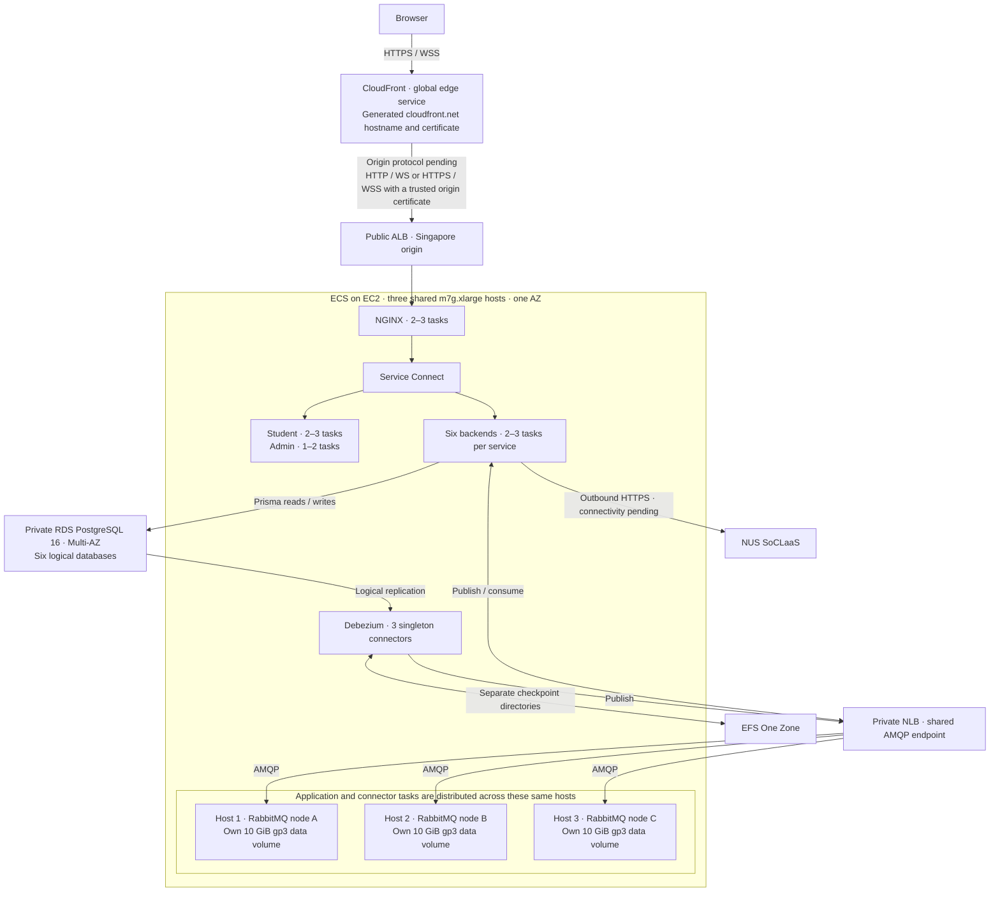

<!--
AI Assistance Disclosure:
Tool: Codex (model: GPT-6), date: 2026-11-08
Scope: Add the author-requested CloudFront entry point, distinguish viewer and origin TLS, and document deployment requirements and incremental pricing.
Author review: <to be completed by the author>

Tool: Codex (model: GPT-6), date: 2026-11-08
Scope: Record the author's confirmed three shared application/RabbitMQ hosts, add the placement diagram and verified cost breakdown, and identify pending implementation decisions.
Author review: <to be completed by the author>

Tool: Codex (model: GPT-6), date: 2026-11-08
Scope: Remove links and reading dependencies on the team's private infrastructure decision reference.
Author review: <to be completed by the author>

Tool: Codex (model: GPT-6), date: 2026-11-07
Scope: Expanded cloud and networking acronyms in the beginner glossary.
Author review: <to be completed by the author>

Tool: Codex (model: GPT-6), date: 2026-11-07
Scope: Expanded the team's existing infrastructure write-up into an educational companion with deployment details, cost assumptions, and a glossary.
Author review: <to be completed by the author>
-->

# Friend on Campus cloud architecture guide

This guide explains how the selected cloud components work together, how the listed alternatives behave, and what needs to be tested before evaluation. If you're new to AWS, the [beginner glossary](#beginner-glossary) at the end explains the services and terms used here.

**Target architecture confirmed by the author on 8 November 2026, including CloudFront.** The CloudFront/ECS infrastructure and deployment workflow still need implementation; the checked-in Terraform and cloud deployment workflow currently describe K3s. This migration preserves business logic, schemas, authorization and public APIs. The application remains runnable and testable locally with Docker Compose.

## Contents

1. [Architecture at a glance](#architecture-at-a-glance)
2. [Public entry point and frontend hosting](#public-entry-point-and-frontend-hosting)
3. [Backend compute and scaling](#backend-compute-and-scaling)
4. [RabbitMQ and message delivery](#rabbitmq-and-message-delivery)
5. [Debezium and checkpoint storage](#debezium-and-checkpoint-storage)
6. [PostgreSQL on RDS](#postgresql-on-rds)
7. [Demo schedule and cost](#demo-schedule-and-cost)
8. [What to verify before the demo](#what-to-verify-before-the-demo)
9. [Beginner glossary](#beginner-glossary)

## Architecture at a glance

The regional origin resources are in **AWS Singapore (`ap-southeast-1`)**. **Amazon CloudFront** is a global service in front of the Singapore ALB; its creation permissions and compatibility with the course/sandbox's regional restrictions still need confirmation. Host and replica counts are listed below. Two paths explain most of it:

- **Browser traffic.** Browser → CloudFront over HTTPS/WSS → public ALB → NGINX → ECS Service Connect → frontend or backend task. CloudFront provides the generated public HTTPS hostname. The CloudFront-to-ALB protocol remains pending as described below. NGINX selects the service based on the URL. Service Connect selects a replica of that service.
- **Order and credit events.** A backend commits a database change and an outbox event to PostgreSQL. Debezium reads the committed event and publishes it to RabbitMQ. RabbitMQ routes it to the appropriate queues. Backend consumers process those events and update their own databases.

The baseline is **three shared `m7g.xlarge` EC2 hosts**, providing **12 vCPU and 48 GiB RAM in total**. Backend services, both frontends, NGINX, Debezium and RabbitMQ run on this same fleet. Each host runs **one RabbitMQ node** with its own data volume; there are no additional dedicated broker instances. The baseline keeps three shared hosts online; the maximum host count above three remains an author decision. A host failure temporarily leaves two surviving hosts until replacement.

The demo places the shared fleet and EFS in one AZ because a full AZ outage is out of scope. The public ALB still uses two AZ subnets, and RDS has a standby in another AZ for database failover. An ALB with two subnets does not make application tasks in a single AZ resilient to losing that AZ.

The application boxes show logical services, not extra hosts. The three RabbitMQ nodes share the hosts on which ECS places the application and connector tasks.

## Public entry point and frontend hosting

**CloudFront is the public entry point** for both portals, APIs and WebSockets. Use its generated `https://<distribution>.cloudfront.net` hostname and AWS-provided viewer certificate; no team-owned domain, DNS validation or separately requested viewer ACM certificate is needed for that address. The frontends remain ECS services behind NGINX; adding CloudFront does not move them to S3. [CloudFront-provided viewer HTTPS](https://docs.aws.amazon.com/AmazonCloudFront/latest/DeveloperGuide/using-https-viewers-to-cloudfront.html)

The **public Application Load Balancer (ALB)** is CloudFront's origin and forwards traffic to healthy NGINX tasks. Two gateway tasks on different hosts let the ALB continue sending new connections to the other gateway when one host fails. Existing WebSocket connections to the failed task may drop and need to reconnect.

**Viewer TLS and origin TLS are separate connections.** CloudFront supports both HTTP and HTTPS to the ALB. The author has accepted HTTP for the demo, but has not yet confirmed the origin protocol after adding CloudFront:

| CloudFront-to-ALB connection | What it requires |
| --- | --- |
| **HTTP / WS** | ALB HTTP listener and forwarding configuration. No origin certificate is needed. Browser-to-CloudFront traffic remains HTTPS/WSS; this origin connection is unencrypted. |
| **HTTPS / WSS** | ALB HTTPS listener with a certificate from a publicly trusted CA, covering the configured origin hostname or the forwarded `Host` name. An ACM origin certificate for the Singapore ALB must be in Singapore. CloudFront's generated viewer certificate does not supply a certificate for the ALB. |

For origin HTTPS, CloudFront validates the certificate's name, chain and validity. It rejects self-signed or invalid origin certificates with a 502 response. The team's own ACM request cannot cover AWS-owned `amazonaws.com` or `cloudfront.net` names. A validated origin hostname and matching trusted certificate are therefore still needed before using ALB origin HTTPS; changing the origin protocol setting alone is insufficient. [Origin HTTPS requirements](https://docs.aws.amazon.com/AmazonCloudFront/latest/DeveloperGuide/using-https-cloudfront-to-custom-origin.html) · [AWS-owned certificate names](https://docs.aws.amazon.com/acm/latest/userguide/troubleshooting-cert-requests.html)

CloudFront configuration must permit the HTTP methods used by the APIs and forward the required authorization headers, cookies, query strings and WebSocket handshake headers. Authenticated responses and `Set-Cookie` responses must not be shared through caching. Set and verify the cache/origin request policies for API/authentication and WebSocket paths; verify static-content caching separately. Keep NGINX's public block on internal escrow routes. CloudFront supports WebSockets, but does not solve cross-replica socket delivery. [CloudFront WebSockets](https://docs.aws.amazon.com/AmazonCloudFront/latest/DeveloperGuide/distribution-working-with.websockets.html) · [Cache policy settings](https://docs.aws.amazon.com/AmazonCloudFront/latest/DeveloperGuide/using-managed-cache-policies.html)

Configure the application's public origin for the CloudFront HTTPS address. The existing production `Secure` refresh-cookie setting can remain when the browser uses that address, including when the origin connection is HTTP. Both portals already use relative API paths, and the Student app chooses WSS for an HTTPS page. Verify cookie forwarding, refresh/logout and both socket connections through CloudFront. Local Docker Compose continues to use its existing local configuration.

**NGINX** keeps the app's routing and access rules. It sends the root path to the student app, `/admin/` to the admin portal, and API and WebSocket paths to the corresponding backend. It also blocks public access to internal credit escrow routes. The routes carry over, but the deployed NGINX configuration must use ECS service endpoints rather than relying on the Docker Compose resolver. Check that CloudFront, ALB, NGINX and Service Connect timeouts work together for WebSockets. [Current gateway configuration](../gateway/nginx.conf) · [ALB integration with ECS](https://docs.aws.amazon.com/AmazonECS/latest/developerguide/alb.html) · [Service Connect configuration](https://docs.aws.amazon.com/AmazonECS/latest/developerguide/service-connect-concepts-deploy.html)

Each portal already builds to static files served by its own NGINX container. Run them as **separate ECS services** so they can deploy and scale independently, while keeping the same browser hostname for frontend, API, and WebSocket traffic. The student app starts at two replicas because it serves the main user flows. The admin portal starts at one and can scale to two. At one replica, its availability after host failure depends on task replacement.

| Alternative | Trade-off |
| --- | --- |
| **Expose NGINX directly** | NGINX can serve HTTPS itself. Pointing public DNS at one host is simpler to set up, but a second replica does not automatically take over that address. The ALB provides a shared endpoint and health-based routing. |
| **Amazon API Gateway** | Useful if the team needs managed API features such as per-route throttling. Replacing NGINX would mean recreating route and access rules and handling frontend serving separately. Moving the WebSockets to API Gateway's WebSocket API also changes how the app manages connections and sends messages. If API Gateway is added while keeping existing ingress, it adds request charges. [WebSocket API model](https://docs.aws.amazon.com/apigateway/latest/developerguide/apigateway-websocket-api-overview.html) · [Pricing](https://aws.amazon.com/api-gateway/pricing/) |

## Backend compute and scaling

**ECS on EC2** runs each backend as its own ECS service. Scaling Order Service adds Order tasks without changing the other services. Service Auto Scaling adjusts the task count when configured. The EC2 Auto Scaling group maintains the shared hosts and replaces failed instances. Scaling above the three-host baseline requires a confirmed maximum and updated capacity and cost calculations. Normal scale-in must retain at least three shared hosts for the three broker placements. If existing hosts have spare room, extra tasks can run without another EC2 instance charge. Running EC2 hosts are billed even while idle. The ECS control plane adds no separate charge for this launch model. Storage, networking, and other services still have their own charges. [ECS pricing](https://aws.amazon.com/ecs/pricing/) · [Service Auto Scaling](https://docs.aws.amazon.com/AmazonECS/latest/developerguide/service-auto-scaling.html) · [Capacity providers](https://docs.aws.amazon.com/AmazonECS/latest/developerguide/clusters.html)

| What scales | Target range |
| --- | --- |
| Shared EC2 fleet | **Three `m7g.xlarge` hosts** at baseline, each with 4 vCPU and 16 GiB RAM; maximum above three pending |
| NGINX, student frontend, User, Supplier, Order, Credit, Chat, Notification | **2–3 tasks per service**, with replicas on different hosts where possible |
| Admin frontend | **1–2 tasks** |
| Debezium | **3 fixed tasks**, one active task per connector |
| RabbitMQ | **3 fixed broker tasks**, one on each of the same three shared hosts, each with a retained **10 GiB gp3 data volume** |

These are **per-service targets**, not a guarantee that every service can reach its maximum simultaneously. The earlier sizing model estimated **29 application/connector tasks and 11.25 vCPU** at all current maxima, using 0.125 vCPU per frontend, backend or gateway task, 0.25 vCPU per Service Connect proxy, and 0.5 vCPU per Debezium task. **That estimate excludes the three RabbitMQ tasks and host overhead** and must not be treated as a complete reservation plan for the shared fleet. Broker and application CPU/memory reservations and operating-system headroom still need to be set and measured. Losing one shared host leaves **8 vCPU and 32 GiB RAM** for the surviving application tasks and two broker nodes until replacement. Verify task placement, startup time and the required user flows under that condition before claiming host-failure recovery. [Service Connect proxy resources](https://docs.aws.amazon.com/AmazonECS/latest/developerguide/service-connect-concepts-deploy.html)

Chat and Notification need a separate correctness check when scaled. A live socket belongs to the process that accepted it. A queue consumer on another replica may handle the event without having that socket. Load balancing incoming connections does not deliver those events across replicas. Verify cross-replica delivery before relying on the two-task production minimum. [Chat socket hub](../services/chat-service/src/ws/hub.ts) · [Notification delivery](../services/notification-service/src/notifications/events.ts)

**Secrets and local execution.** Store application credentials and keys in **AWS Secrets Manager** and reference the required values in ECS task definitions. ECS retrieves them at task startup using the execution role and supplies the existing application environment variables. Updated values require new tasks. Local Docker Compose continues to supply local environment configuration without requiring Secrets Manager access. [ECS secret injection](https://docs.aws.amazon.com/AmazonECS/latest/developerguide/secrets-envvar-secrets-manager.html)

**Pending author decisions:** maximum host count above three, ECS task network mode and outbound connectivity, the Chat/Notification cross-replica live-delivery mechanism, CloudFront's origin protocol (with origin hostname/certificate if HTTPS is selected), and CloudFront pricing plan. Confirm account permissions, applicable pricing allowances and whether the global service is permitted under the course/sandbox's regional restrictions. CloudFront's generated hostname resolves the viewer-domain prerequisite. Cloud runtime configuration and the deployment workflow still need implementation.

| Alternative | Trade-off |
| --- | --- |
| **ECS on Fargate** | AWS manages the hosts. You pay for requested CPU and RAM for each task while it runs, including quiet periods. Smaller tasks and scaling out can save money if the workload fits, but scaling adds tasks rather than making one task larger. A cluster can use EC2 for some services and Fargate for others. A single service's capacity provider strategy cannot mix the two, so EC2 tasks do not automatically spill over onto Fargate. [Fargate pricing](https://aws.amazon.com/fargate/pricing/) · [ECS compute options](https://docs.aws.amazon.com/AmazonECS/latest/developerguide/capacity-launch-type-comparison.html) |
| **Run containers directly on EC2** | A single host can run different replica counts for each service, but they share one machine's capacity and failure risk. Across hosts, the team would own more of task placement, discovery, replacement, and deployment. |
| **Kubernetes on EKS or k3s** | Both can manage and scale containers. Kubernetes isn't required for this evaluation, so the extra cluster configuration and operational work would need a separate justification. |
| **AWS Lambda** | Lambda scales automatically and supports container images. The migration cost comes from changing how persistent HTTP servers, RabbitMQ consumers, and WebSocket connections run. Lambda can discard idle environments, so some requests wait for initialization. ECS can keep replicas ready, although adding a new task still takes time. [Lambda container images](https://docs.aws.amazon.com/lambda/latest/dg/images-create.html) · [Lambda execution lifecycle](https://docs.aws.amazon.com/lambda/latest/dg/lambda-runtime-environment.html) |

## RabbitMQ and message delivery

Run **three RabbitMQ broker tasks**, **one on each of the three shared `m7g.xlarge` EC2 hosts**, alongside application and connector tasks. Each broker has its own retained **10 GiB gp3 EBS data volume**. There is no separate broker EC2 fleet. A three-member quorum queue has one leader and two followers. RabbitMQ routes operations to that queue's leader and replicates its state. Different queues can have leaders on different nodes. With two members online, the queue can still operate. With only one survivor, it cannot form a majority. The normal baseline therefore has three shared hosts and three broker nodes; after a host failure, two brokers can continue while the failed node is recovered. [RabbitMQ quorum queues](https://www.rabbitmq.com/docs/quorum-queues)

Clients can connect to any broker in the cluster. The **private NLB** gives the backends and Debezium one AMQP address for new connections to healthy brokers. It serves internal messaging rather than public browser traffic. If a broker connection drops, the client still has to reconnect. Scaling an application service changes its task count, not the three-node broker count. Broker CPU and memory usage are part of the shared fleet's capacity. If broker load becomes the bottleneck, first check whether consumers, disk throughput, or a busy queue leader are limiting throughput. Adding broker nodes requires managing queue placement and does not automatically speed up one busy queue.

Each broker writes to its own data directory. Separate EBS volumes keep the disks independent. If a broker task restarts on its original host, it can reuse its mount. If the host fails, ECS does not automatically reattach that existing disk. Recover the node by mounting the retained disk on a replacement in the same AZ, or replace the node and rebuild its queue replicas from the surviving members. During repair, the other two members can continue serving quorum queues. Confirmed publishes and consumer acknowledgements help protect delivery. A retried event can still reach a consumer twice, so credit settlement must handle duplicates safely. [RabbitMQ reliability](https://www.rabbitmq.com/docs/reliability) · [EBS attachment rules](https://docs.aws.amazon.com/ebs/latest/userguide/ebs-attaching-volume.html)

| Alternative | Trade-off |
| --- | --- |
| **One RabbitMQ task on EC2** | Lowest operational complexity and disk cost. If its host fails, all messaging waits for recovery. EBS can preserve data but cannot serve it while the broker is down. Two broker nodes also do not solve that problem when both are needed for quorum. |
| **Amazon MQ for RabbitMQ** | AWS operates the broker infrastructure and provides an endpoint. A single broker still has an outage during replacement. A three-node cluster is the like-for-like availability comparison. At the earlier Singapore rates, 14 days of `mq.m7g.medium` compute was about S$80 for one broker or S$240 for three. AWS no longer offers `mq.t3.micro` for new RabbitMQ brokers. [Broker sizes](https://docs.aws.amazon.com/amazon-mq/latest/developer-guide/rmq-broker-instance-types.html) · [Deployment options](https://docs.aws.amazon.com/amazon-mq/latest/developer-guide/rabbitmq-broker-architecture.html) |
| **Amazon SNS and SQS** | SNS distributes events to subscribed queues, and SQS holds events for consumers. They remove broker host management, but replacing RabbitMQ would mean adapting publishers, consumers, routing, retries, and the Debezium delivery path. SQS Standard can deliver duplicates or out of order, so the application still needs safe credit retries. [SNS delivery](https://docs.aws.amazon.com/sns/latest/dg/fifo-message-delivery.html) · [SQS Standard](https://docs.aws.amazon.com/AWSSimpleQueueService/latest/SQSDeveloperGuide/standard-queues.html) |

## Debezium and checkpoint storage

There are **three Debezium Server tasks**, one each for the Order, User, and Credit databases. Each reads its configured PostgreSQL outbox and publishes to the `campus.events` exchange. The count follows the configured connectors, not the number of RabbitMQ nodes or queues. All three use the same broker endpoint. Each connector has its own replication slot and checkpoint directory. Run one active task per connector. Two copies sharing a slot and checkpoint do not divide the work. [Current connector settings](../docker/debezium/) · [Debezium PostgreSQL connector](https://debezium.io/documentation/reference/connectors/postgresql.html)

**One EFS One Zone filesystem** gives the three connectors separate directories that any eligible ECS host in the demo AZ can mount. If a host fails, the replacement reads the latest stored checkpoint without moving a disk. EBS could also hold these files, but a standard gp3 volume attaches to one host at a time. Moving it to another host would require a same-AZ detach, attach, and mount procedure. The small amount of checkpoint data makes ease of recovery more important than the difference in storage price. EFS alone does not guarantee recovery. PostgreSQL still needs the relevant slot and WAL, and the broker must be reachable. Watch for retained WAL if a connector falls behind. [ECS EFS support](https://docs.aws.amazon.com/AmazonECS/latest/developerguide/efs-volumes.html) · [RDS logical replication](https://docs.aws.amazon.com/AmazonRDS/latest/UserGuide/PostgreSQL.Concepts.General.FeatureSupport.LogicalReplication.html)

## PostgreSQL on RDS

Use a **private RDS PostgreSQL 16 Multi-AZ DB instance** with a starting size of **`db.t4g.small` and 20 GiB gp3**. The six services keep separate logical databases and credentials on the same instance. The primary handles application reads and writes. A synchronous standby takes over if the primary fails. AWS reports typical database failover of **60–120 seconds**. Application reconnects and Debezium catch-up can extend the full workflow recovery time. Storage can grow automatically if configured. To add compute, resize the instance. A separate read replica can serve suitable queries if needed, but the standby itself does not serve reads. [RDS Multi-AZ](https://aws.amazon.com/rds/features/multi-az/) · [Failover timing](https://docs.aws.amazon.com/AmazonRDS/latest/UserGuide/Concepts.MultiAZ.Failover.html)

For a fresh evaluation environment, keep the Prisma schemas and migrations. Provision the six databases and roles, update connection URLs and TLS settings, run the existing migrations and seed commands, and enable logical replication in the RDS parameter group. Configure the three connectors with the appropriate replication and table permissions. Start them with fresh checkpoints for the fresh databases. No business logic change is expected from the RDS move itself. [Database bootstrap](../docker/postgres-init/01-init-databases.sql) · [RDS TLS](https://docs.aws.amazon.com/AmazonRDS/latest/UserGuide/PostgreSQL.Concepts.General.SSL.html)

**PostgreSQL on EC2 with EBS** can cost less if it fits on a host the team already pays for. A single instance would still interrupt reads and writes when that host fails. The team would also own backups, restore testing, and patching, and the database would compete for host capacity. RDS moves those operational responsibilities off the shared hosts and provides the standby used in this design.

## Demo schedule and cost

The estimate uses **three shared `m7g.xlarge` hosts** and **144 total active hours** for setup, the **Thursday, 12 November 2026 demo**, and requested verification. The stack can be stopped and resumed after the demo, with data retained for verification through **28 November**. **504 hours** is the retained-resource allowance; align actual creation/deletion times with the verification window. It is not 504 hours of running EC2 or RDS compute.

The following Singapore On-Demand rates were checked against AWS's public catalogues on **8 November 2026**. Storage is prorated with the earlier **730-hour month approximation**. Figures are USD before tax, with no Free Tier or account credits deducted.

| Item | Basis | Estimated USD before tax |
| --- | --- | ---: |
| Shared EC2 compute | 3 × `m7g.xlarge` × 144 h × US$0.204/h | 88.13 |
| Additional broker EC2 instances | None; RabbitMQ shares those three hosts | 0.00 |
| RDS PostgreSQL Multi-AZ compute | `db.t4g.small` × 144 h × US$0.102/h; rate includes the standby | 14.69 |
| RDS storage | 20 GiB × US$0.276/GB-month × 504/730; Multi-AZ rate | 3.81 |
| EC2 root and broker disks | 3 × 30 GiB root + 3 × 10 GiB broker gp3, at US$0.096/GB-month × 504/730 | 7.95 |
| Public ALB and private NLB | 2 × 504 h × US$0.0252/h | 25.40 |
| Load-balancer traffic allowance | Very light LCU/NLCU usage; unmeasured allowance | 0.79 |
| Public IPv4 | 2 ALB addresses × 504 h + 3 host addresses × 144 h, at US$0.005/address-h | 7.20 |
| Other usage allowance | EFS, ECR, logs, secrets, modest data transfer and short RDS restarts; unmeasured allowance | 10.00 |
| **Base subtotal, excluding CloudFront** | Calculated before rounding individual rows | **157.97** |

At the retained assumptions of **US$1 = S$1.28** and **9% GST**, the base estimate is **S$220.40**, approximately **S$220–221**, before CloudFront usage. Using a 720-hour storage month gives **S$220.63**. This is the shared-host estimate; the previous separate-broker-host totals no longer describe the selected deployment. Exchange rate, tax treatment, usage allowances and operating hours remain assumptions rather than a verified account bill.

The base estimate assumes light traffic and host public-IP egress. CloudFront supplies the viewer hostname and certificate without a domain purchase. A custom origin hostname/certificate, if selected for origin HTTPS, is not provisioned or included here. The estimate excludes NAT gateways, paid interface endpoints, additional hosts, excess backup/storage usage, unexpected RDS burst CPU charges and heavier traffic. The task network mode and egress path remain pending; update the estimate when those are confirmed. Retained Elastic IPs are charged even while idle; the host IPv4 row assumes charges only for the listed active hours. The US$10 allowance does not establish the actual cost of its included services.

### Incremental CloudFront pricing

The pricing plan remains pending. AWS's published **pay-as-you-go** monthly allowances are **1 TB of viewer data transfer and 10 million HTTP/HTTPS requests**, subject to account/billing eligibility and remaining allowance. Do not assume that the NUS sandbox has unused allowances. For Singapore delivery after the allowances, the next transfer tier is **US$0.120/GB**, and HTTPS requests are **US$0.012 per 10,000**. WebSockets have no separate protocol surcharge; traffic and request charges still apply.

As a usage illustration, **10 GB of billable viewer delivery plus 100,000 billable HTTPS requests**, without deducting free allowances, costs **US$1.32**, or **S$1.84** at the retained exchange-rate/GST assumptions. The base estimate plus that example is **S$222.24**. This is not a measured usage forecast. Viewer-to-origin data transfer, such as request bodies and client-to-server WebSocket traffic, is separately priced (currently **US$0.060/GB** for Singapore); logging and optional features can also add charges and are excluded from this illustration. The generated viewer hostname/certificate does not require a domain purchase. ALB, EC2 and the other origin resources remain billable. [CloudFront pay-as-you-go pricing](https://aws.amazon.com/cloudfront/pricing/pay-as-you-go/)

AWS also publishes a **US$0/month Free flat-rate plan** with **100 GB and 1 million requests**, but it has account and configuration restrictions, including limits on custom caching controls. Its applicability to this app's API/cookie/WebSocket configuration has not been verified. Do not substitute a guaranteed zero CloudFront cost without confirming the selected plan and eligibility. [Flat-rate pricing](https://aws.amazon.com/cloudfront/pricing/) · [Plan restrictions](https://docs.aws.amazon.com/AmazonCloudFront/latest/DeveloperGuide/flat-rate-pricing-plan.html)

The author reports **S$249 remaining** in the sandbox allowance. The S$222.24 example would leave **S$26.76**, before excluded charges and deviations from the assumptions. Reconcile this with the actual account tracker during deployment.

The author reports the old K3s instances are **stopped** and will be terminated only after the replacement infrastructure is verified. This estimate excludes their running compute, prior account spending, and charges for their retained disks, snapshots or allocated Elastic IPs. Those retained-resource charges still count against the total **S$250 project allowance**. This document does not instruct their termination.

EBS, EFS, and retained load balancers still cost money while compute is stopped. RDS automatically restarts after seven consecutive days stopped, so check it before the exam and stop it again when appropriate. Use the EC2 Auto Scaling group's standby procedure when stopping managed hosts so it does not launch replacements unexpectedly. [RDS stop behavior](https://docs.aws.amazon.com/AmazonRDS/latest/UserGuide/USER_StopInstance.html) · [EC2 Auto Scaling standby](https://docs.aws.amazon.com/autoscaling/ec2/userguide/as-enter-exit-standby.html)

Rate sources: [Singapore EC2 Linux catalogue](https://b0.p.awsstatic.com/pricing/2.0/meteredUnitMaps/ec2/USD/current/ec2-ondemand-without-sec-sel/Asia%20Pacific%20%28Singapore%29/Linux/index.json) · [Singapore RDS catalogue](https://pricing.us-east-1.amazonaws.com/offers/v1.0/aws/AmazonRDS/current/ap-southeast-1/index.json) · [Singapore load-balancer catalogue](https://pricing.us-east-1.amazonaws.com/offers/v1.0/aws/AWSELB/current/ap-southeast-1/index.json) · [EBS pricing](https://aws.amazon.com/ebs/pricing/) · [Public IPv4 pricing](https://aws.amazon.com/vpc/pricing/)

## What to verify before the demo

1. **Build and start.** Verify the deployed images on ARM64, inject secrets, run migrations and seeding, and check CloudFront-to-ALB-to-gateway connectivity and access to all service endpoints. Confirm the selected origin protocol; if HTTPS, verify its trusted certificate and hostname match.
2. **Try the user flows through CloudFront.** Check both portals, login, refresh/logout, isolation of different users' responses, live chat/notifications, translation and the order assistant through SoCLaaS, and the internal escrow route's public block. Verify API methods, cookie/header forwarding, cache behaviour and WSS reconnects. Chat and Order need outbound HTTPS from the deployment.
3. **Lose one shared host at a time.** Its application/connector tasks and one RabbitMQ node fail together. Check task placement on the two surviving hosts, connector checkpoint recovery, RabbitMQ reconnects, recovery of the third broker and whether the surviving capacity is enough.
4. **Force RDS failover.** Confirm the app reconnects and all three connectors resume. Submit a transaction around the interruption and verify the order and credit workflow settles within the target, with no missing or duplicate credit movement.
5. **Stop and resume the stack.** Retain the broker data disks and connector checkpoints. Bring the database, brokers, and applications back and run the key user flows again before depending on on-demand verification.

## Beginner glossary

| Term | What it means here |
| --- | --- |
| **Amazon Web Services (AWS), region, and Availability Zone (AZ)** | AWS is the cloud provider. A region is a geographic AWS location. Singapore hosts the regional origin resources; CloudFront is global. An AZ is an isolated location within a region. Separate hosts protect against a machine failure. Separate AZs protect against losing a whole location when the rest of the design also spans AZs. |
| **Virtual Private Cloud (VPC) and security group** | A VPC is the deployment's private network. A security group controls which connections can reach a resource. For example, the database accepts connections from the deployed application rather than the public internet. |
| **Amazon Elastic Compute Cloud (EC2)** | Provides the virtual machines that host the application's containers and the RabbitMQ brokers. |
| **Amazon Elastic Container Service (ECS), Fargate, task, and service** | ECS schedules containers. A **task** is a running unit of one or more containers. An ECS **service** keeps the desired number of tasks running. Fargate runs ECS tasks without the team managing the underlying hosts. |
| **Amazon CloudFront, content delivery network (CDN), viewer and origin** | CloudFront is the public HTTPS/WSS entry point, using an AWS-provided hostname/certificate. A viewer is the browser connecting to CloudFront. The origin is the ALB from which CloudFront fetches responses. Viewer TLS and origin TLS are separate connections. |
| **Application Load Balancer (ALB), NGINX, and Service Connect** | The public ALB receives origin requests from CloudFront and chooses a healthy gateway. NGINX chooses a service based on the request path. Service Connect chooses a replica of that service. |
| **AWS Certificate Manager (ACM)** | Can manage an ALB origin certificate if origin HTTPS is selected. The certificate must match a validated hostname. CloudFront's generated viewer hostname already has an AWS-provided certificate; it does not supply the ALB's origin certificate. |
| **Network Load Balancer (NLB) and Advanced Message Queuing Protocol (AMQP)** | The private NLB gives the app one broker address. AMQP is the protocol the app and Debezium use to talk to RabbitMQ. |
| **Load Balancer Capacity Unit (LCU) and Network Load Balancer Capacity Unit (NLCU)** | Usage-based billing units for ALB and NLB traffic, charged in addition to each load balancer's hourly fee. The cost table carries an allowance rather than measured usage. |
| **Amazon Elastic Block Store (EBS) and Amazon Elastic File System (EFS)** | EBS provides virtual disks. A **General Purpose SSD (gp3)** volume normally attaches to one host at a time. EFS is a network filesystem that multiple hosts can mount. We use separate broker disks and shared access to connector checkpoints. |
| **RabbitMQ node, exchange, and queue** | A node is a running broker. An exchange routes published messages to queues using routing rules. A queue holds messages for consumers. |
| **Quorum queue** | A queue replicated across broker nodes. With three members, two must be available for the queue to keep working. Each queue has its own leader. |
| **Amazon Relational Database Service (RDS), primary, and standby** | RDS manages the database instance. The primary serves reads and writes. The standby is a ready copy that takes over after failure. |
| **Outbox, CDC, WAL, and offset** | An **outbox** stores events alongside application changes in a database transaction. **Change data capture (CDC)** reads committed changes. PostgreSQL's **write-ahead log (WAL)** records them. An **offset** is Debezium's checkpoint for where to resume. |
| **Amazon Elastic Container Registry (ECR), Secrets Manager, and CloudWatch** | ECR stores container images. Secrets Manager holds credentials. CloudWatch collects logs and metrics for debugging and monitoring. |
| **Amazon Elastic Kubernetes Service (EKS)** | An AWS service for running Kubernetes, which schedules containers across machines. |
| **Amazon Simple Notification Service (SNS) and Amazon Simple Queue Service (SQS)** | SNS distributes an event to subscribers. SQS holds events until a consumer can process them. |
| **Application Programming Interface (API), Uniform Resource Locator (URL), and Domain Name System (DNS)** | An API defines how software calls a service. A URL identifies a resource, such as an API endpoint. DNS resolves the hostname in a URL so the caller can reach it. |
| **Hypertext Transfer Protocol (HTTP), HTTP Secure (HTTPS), and Transport Layer Security (TLS)** | HTTP carries web requests and responses. HTTPS uses TLS to encrypt that traffic. |
| **Egress, WebSocket, and WSS** | Egress is outbound traffic. A WebSocket is a long-lived connection the backend can use to push messages to the browser. The `wss://` scheme denotes a WebSocket secured with TLS. |
| **SoCLaaS (School of Computing Large Language Model as a Service)** | The National University of Singapore (NUS) service that Chat and Order call for translation and the order assistant. [SoCLaaS workshop](https://tg.me/nuswit/514) |
| **Virtual central processing unit (vCPU), random-access memory (RAM), and gibibyte (GiB)** | A vCPU is a unit of compute capacity. RAM is working memory. GiB measures memory or storage. **ARM64** is the 64-bit processor architecture used by the planned Graviton hosts. |
| **Goods and Services Tax (GST)** | The Singapore tax included in the guide's cost estimates. |
| **Idempotency** | Handling the same event twice has the same effect as handling it once. For credits, a retried delivery must not apply a second ledger movement. |
