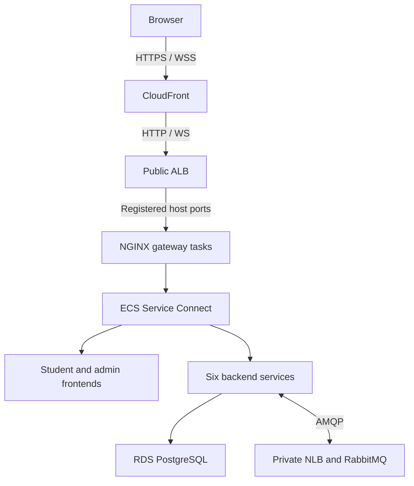
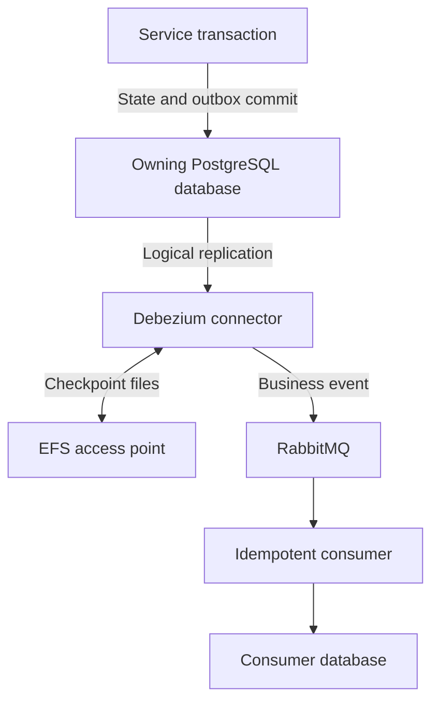

<!--
AI Assistance Disclosure:
Tool: Codex (model: GPT-6), date: 2026-11-09
Scope: Replace mixed proposal/current guidance with a source-verified ECS overview; preserve the previous explanatory guide in the archive.
Author review: <to be completed by Reallyeasy1>

Tool: Codex (model: GPT-6), date: 2026-11-09
Scope: Record manually triggered main-branch delivery and shared Terraform state requirements.
Author review: <to be completed by the author>

Tool: Codex (model: GPT-6), date: 2026-11-08
Scope: Retire K3s deployment references and record the manually triggered ECS deployment workflow.
Author review: <to be completed by the author>

Tool: Codex (model: GPT-6), date: 2026-11-08
Scope: Record confirmed HTTP origin, bridge networking, three-host ceiling, pay-as-you-go, fresh seed data, accepted trial resource budgets, deferred fanout and legacy retirement approval.
Author review: <to be completed by the author>

Tool: Codex (model: GPT-6), date: 2026-11-08
Scope: Add the author-requested CloudFront entry point, distinguish viewer and origin TLS, and document deployment requirements and incremental pricing.
Author review: <to be completed by the author>

Tool: Codex (model: GPT-6), date: 2026-11-08
Scope: Record the author's confirmed three shared application/RabbitMQ hosts, add the placement diagram and verified cost breakdown, and identify pending implementation decisions.
Author review: <to be completed by the author>

Tool: Codex (model: GPT-6), date: 2026-11-08
Scope: Remove links and reading dependencies on the team's private infrastructure decision reference.
Author review: <to be completed by the author>

Tool: Codex (model: GPT-6), date: 2026-11-07
Scope: Expanded cloud and networking acronyms in the beginner glossary.
Author review: <to be completed by the author>

Tool: Codex (model: GPT-6), date: 2026-11-07
Scope: Expanded the team's existing infrastructure write-up into an educational companion with deployment details, cost assumptions, and a glossary.
Author review: <to be completed by the author>
-->

# Cloud architecture: ECS on EC2

Implementation checked against [`b989758`](https://github.com/AY2627S1-CS3219-P25/friend-on-campus/commit/b989758e766cb593c3b8c94102eb6dfb5c7d8491) on 9 November 2026 (SGT). This is a source review, not a verification of the running AWS deployment.

Use the [ECS Terraform runbook](../infra/terraform/ecs/README.md) for provisioning, secrets, migrations, delivery and stop/resume steps. This page explains the checked-in configuration. Local development continues to use [Docker Compose](infrastructure/docker-and-deployment.md).

## Architecture at a glance

The frontends, gateway, backend services, three RabbitMQ nodes and three Debezium connectors share the same EC2 fleet. Service Connect provides service-to-service connectivity; RabbitMQ carries business events and realtime signals. There is no K3s, Traefik or EKS layer in the current Terraform root.

## Public entry point and frontend hosting

[Edge configuration](../infra/terraform/ecs/edge.tf) defines one CloudFront distribution in front of the public Application Load Balancer (ALB):

- Browsers use the generated CloudFront hostname and its default certificate; HTTP viewers redirect to HTTPS.
- CloudFront connects to the ALB over **HTTP**, so browser HTTPS does not mean end-to-end TLS to the origin.
- Caching is disabled for all paths. The origin request policy forwards viewer data except the viewer `Host` header; all seven configured HTTP methods are permitted.
- The ALB security group allows inbound port 80 from the CloudFront origin-facing prefix list. Its listener returns 403 unless the configured `X-Foc-Origin` header matches.
- ECS registers gateway tasks with an **instance** target group using dynamically assigned host ports. The ALB checks gateway `/health`, which tests NGINX liveness rather than the full application.

NGINX routes `/` to the student frontend, `/admin/` to the admin frontend, and API/WebSocket paths to their services. The two frontends are separate ECS services serving static assets from their own NGINX images; CloudFront does not move these files into S3. See the [gateway route table](infrastructure/api-gateway.md).

## Backend compute and scaling

[Host configuration](../infra/terraform/ecs/hosts.tf) defines **three single-instance Auto Scaling groups**, each with maximum capacity one. Each slot uses an ARM64 `m7g.xlarge`, a 30 GiB root disk and a separate 10 GiB encrypted RabbitMQ data disk. With `hosts_running = true`, the fleet totals three hosts. These groups replace hosts; they do not expand the fleet beyond three.

[Application services](../infra/terraform/ecs/applications.tf) use EC2 launch type, bridge networking, dynamic host ports and spread placement by instance. Task scaling is separate from host replacement:

| ECS service | Minimum when applications are enabled | Maximum tasks |
|---|---:|---:|
| Each of the six backends | 2 | 3 |
| Student frontend | 2 | 3 |
| Admin frontend | 1 | 2 |
| Gateway | 2 | 3 |

The target-tracking policy uses average service CPU at 65%, with 60-second scale-out and 180-second scale-in cooldowns. These configured ceilings do not prove that every service can reach its maximum simultaneously: the task CPU ceilings exceed the fixed fleet when all services scale fully. Placement and recovery need workload evidence.

Hosts occupy one public subnet in one Availability Zone (AZ), use public IPv4 egress and have no NAT gateway. Inbound application ports are restricted to the ALB and internal host traffic; RDS and the broker NLB are private. The ALB spans two public subnets, but that does not make the single-AZ application fleet resilient to an AZ outage.

## RabbitMQ and message delivery

[Broker configuration](../infra/terraform/ecs/brokers.tf) pins one RabbitMQ task to each host slot. A private Network Load Balancer (NLB) supplies the AMQP endpoint. Each node keeps a stable RabbitMQ node name and its own EBS disk.

The [host bootstrap](../infra/terraform/ecs/host-bootstrap.sh.tftpl) waits for the retained disk to become available, attaches and mounts it, and updates private DNS before ECS starts. It does not force-detach an unavailable disk. Broker replacement, cluster membership and quorum recovery therefore need verification; retaining a volume is not a measured recovery-time guarantee.

Business consumers use shared quorum queues. Chat and Notification also have implemented RabbitMQ fanout delivery and SQL realtime outboxes; this is no longer merely proposed application work. A replica sends to the sockets it owns, and reconnecting clients recover persisted data through the APIs. See [messaging](packages/messaging.md), [Chat](services/chat-service/README.md) and [Notification](services/notification-service/README.md) for the delivery and failure boundaries.

## Debezium and checkpoint storage

[CDC task configuration](../infra/terraform/ecs/data-tasks.tf) runs one connector each for User, Order and Credit. Their service counts become one only in `phase = "live"`. The earlier `applications` phase leaves CDC stopped, so successful registration or an HTTP response does not establish that welcome credits or order events have propagated.

Each connector has its own checkpoint directory on encrypted EFS One Zone. Access points use UID 185 and GID 0, matching the configured Debezium image. Connector rollout permits zero healthy tasks while replacing the singleton; events may wait during restart. See [CDC and broker operations](infrastructure/cdc-and-broker.md).

## PostgreSQL on RDS

[Storage configuration](../infra/terraform/ecs/main.tf) defines private RDS PostgreSQL 16, class `db.t4g.small`, 20 GiB encrypted gp3 storage, Multi-AZ enabled and one day of backup retention. There are six logical databases with per-service roles. Multi-AZ supplies database failover; this configuration does not add read replicas or multiple writable database primaries.

Database roles/publications and per-service migrations are separate one-off ECS tasks. Backend images start the application without seeding. Follow the canonical runbook for initial setup and release migrations; do not use a fresh-environment seed procedure as a routine update or recovery procedure.

## Logging, health and alerts

| Checked-in capability | Scope and limit |
|---|---|
| ECS `awslogs` driver | Application, broker, CDC and database jobs send logs to `/ecs/foc-ecs`, retained for seven days |
| ECS container health checks | Backend `/ready`; static frontend HTTP checks; gateway `/health`; broker process check |
| ALB target health | Gateway liveness, not business-flow correctness |
| Admin health page | Browser-driven service health/readiness polling; see [frontend documentation](frontend/admin-portal.md) |
| ECS CPU target tracking | Controls task counts; it is not the proposed operational alerting system |

The Terraform root does not provision the proposed monitoring dashboards, SNS operational alerts, Prometheus/Grafana deployment or OpenTelemetry tracing pipeline. The wiki monitoring design remains design context. Do not describe those capabilities as deployed without separate evidence.

## Deployment and verification

The [ECS runbook](../infra/terraform/ecs/README.md) owns executable instructions. Its rollout phases are `foundation` → `brokers` → `applications` → `live`; they control workload availability, not completion of acceptance testing.

Application and infrastructure delivery are manually dispatched from `main`. Application delivery builds ARM64 images, runs release migrations before rollout and pins deployed images by digest. Infrastructure delivery uses shared S3 state and rolls application configuration with the existing images. See [CI and delivery](infrastructure/ci-cd.md) for workflow behavior and failure limits.

Before claiming a deployment works, record its commit/image digests and verify login/refresh, both WebSockets, the complete order/credit flow, connector progress and recovery after a controlled host replacement. These checks were **not executed** during this documentation cleanup.

## Budget and historical material

The project constraint in [CLAUDE.md](../CLAUDE.md) is AWS Singapore and **S$250 total**. The fleet is intended to remain available for verification through 28 November 2026; after the 12 November demo it may be stopped and resumed on request. The runbook explains the phase-based stop/resume procedure while retaining state. No fresh AWS cost estimate or billing inspection was performed here.

The [previous explanatory guide](archive/infrastructure/2026-11-09-cloud-architecture-guide.md) preserves dated decisions, alternatives and cost estimates. The [retired K3s guide](archive/infrastructure/cloud-deployment-and-devops-guide.md) is historical. Neither is a current deployment checklist.

## Beginner glossary

| Term | Role here |
|---|---|
| EC2 | Virtual machines on which ECS places containers |
| ECS service/task | Service maintains a task count; each task runs the defined containers |
| ALB / NLB | HTTP routing to gateway tasks / private TCP endpoint for RabbitMQ |
| Service Connect | Connectivity and naming between ECS services |
| RDS / EBS / EFS | Managed PostgreSQL / per-broker disk / shared connector checkpoint storage |
| CDC | Change data capture: outbox changes delivered from PostgreSQL through Debezium |

[Documentation index](README.md) · [Known discrepancies](audits/documentation-drift.md)
