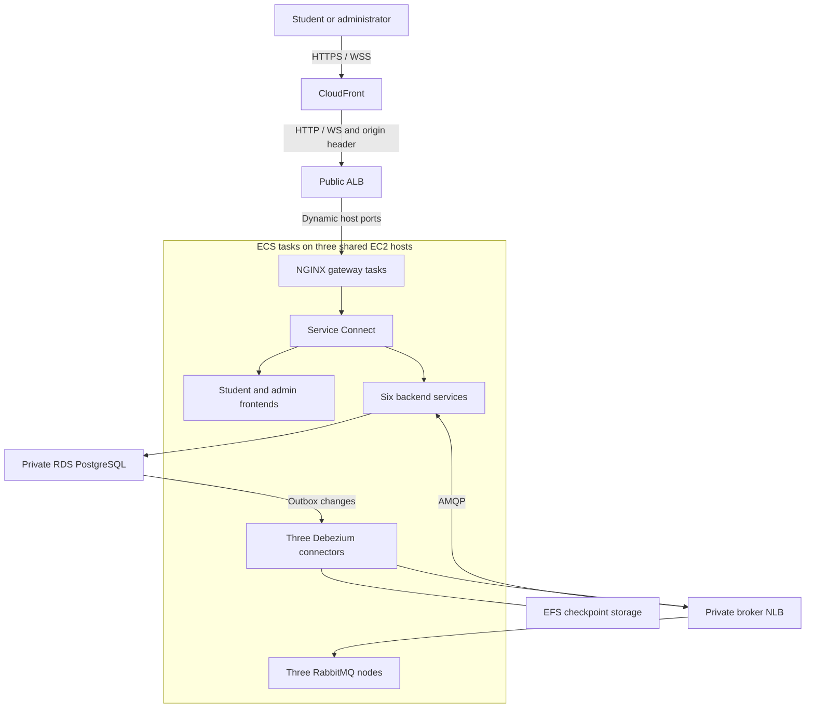

<!--
AI Assistance Disclosure:
Tool: Codex (model: GPT-6), date: 2026-11-09
Scope: Consolidate cloud, gateway and container operations into one source-verified guide with request routing, scaling, state, probes and troubleshooting; retain decision history through pinned links.
Author review: <to be completed by Reallyeasy1>

Tool: Codex (model: GPT-6), date: 2026-11-09
Scope: Replace mixed proposal/current guidance with a source-verified ECS overview; preserve the previous explanatory guide in the archive.
Author review: <to be completed by Reallyeasy1>

Tool: Codex (model: GPT-6), date: 2026-11-09
Scope: Record manually triggered main-branch delivery and shared Terraform state requirements.
Author review: <to be completed by the author>

Tool: Codex (model: GPT-6), date: 2026-11-08
Scope: Retire K3s deployment references and record the manually triggered ECS deployment workflow.
Author review: <to be completed by the author>

Tool: Codex (model: GPT-6), date: 2026-11-08
Scope: Record confirmed HTTP origin, bridge networking, three-host ceiling, pay-as-you-go, fresh seed data, accepted trial resource budgets, deferred fanout and legacy retirement approval.
Author review: <to be completed by the author>

Tool: Codex (model: GPT-6), date: 2026-11-08
Scope: Add the author-requested CloudFront entry point, distinguish viewer and origin TLS, and document deployment requirements and incremental pricing.
Author review: <to be completed by the author>

Tool: Codex (model: GPT-6), date: 2026-11-08
Scope: Record the author's confirmed three shared application/RabbitMQ hosts, add the placement diagram and verified cost breakdown, and identify pending implementation decisions.
Author review: <to be completed by the author>

Tool: Codex (model: GPT-6), date: 2026-11-08
Scope: Remove links and reading dependencies on the team's private infrastructure decision reference.
Author review: <to be completed by the author>

Tool: Codex (model: GPT-6), date: 2026-11-07
Scope: Expanded cloud and networking acronyms in the beginner glossary.
Author review: <to be completed by the author>

Tool: Codex (model: GPT-6), date: 2026-11-07
Scope: Expanded the team's existing infrastructure write-up into an educational companion with deployment details, cost assumptions, and a glossary.
Author review: <to be completed by the author>

Tool: Codex (model: GPT-6), date: 2026-11-09
Scope: Verify gateway routes and distinguish Compose DNS, Vite proxying and ECS Service Connect at the current baseline.
Author review: <to be completed by Reallyeasy1>

Tool: Claude Code (model: Claude Fable 5.1), date: 2026-10-27
Scope: Issues #173/#169/#206: upstreams resolved per request through Docker DNS (variables, 10 s TTL), 3 s connect timeout, Chat health routes; diagnostics paragraph updated accordingly.
Author review: <to be completed by Reallyeasy1>

Tool: Claude Code (model: Claude Fable 5.1), date: 2026-10-25
Scope: Added the /api/chat and /ws/chat/ routes of the Chat Service (F8, PR #148) while merging main into that PR.
Author review: <to be completed by Reallyeasy1>

Tool: Codex (model: GPT-6), date: 2026-10-25
Scope: Source-linked implementation documentation and evidence review requested by Reallyeasy1.
Author review: <to be completed by Reallyeasy1>

Tool: Codex (model: GPT-6), date: 2026-11-09
Scope: Refresh container startup, local/cloud probe differences and current realtime shutdown; preserve the actual runtime-version and gateway-user distinctions.
Author review: <to be completed by Reallyeasy1>

Tool: Codex (model: GPT-6), date: 2026-11-08
Scope: Document application-only image startup, preserved Compose bootstrap, and graceful socket-service shutdown.
Author review: <to be completed by the author>

Tool: Codex (model: GPT-6), date: 2026-11-09
Scope: Replace the retired K3s guide with navigation to its preserved archive and the current ECS documentation.
Author review: <to be completed by Reallyeasy1>

Tool: Codex (model: GPT-6), date: 2026-11-08
Scope: Mark the retired K3s guide as historical and link the current rollout.
Author review: <to be completed by the author>

Tool: Codex (model: GPT-6), date: 2026-11-09
Scope: Archive the previous guide without treating its commands, decisions or prices as current; relocate source links.
Author review: <to be completed by Reallyeasy1>
-->

# Cloud deployment and operations

This guide explains how an HTTP request, a container and persisted data move through the current AWS deployment. Use it to understand a failure before changing infrastructure. The [ECS Terraform runbook](../infra/terraform/ecs/README.md) contains the provisioning, migration, release and stop/resume commands; [local development](development/local-development.md) covers Docker Compose.

Implementation was checked against main [`b989758`](https://github.com/AY2627S1-CS3219-P25/friend-on-campus/commit/b989758e766cb593c3b8c94102eb6dfb5c7d8491) on 9 November 2026. The configuration described here is not evidence that a particular image or resource is currently running in AWS.

## Follow a browser request

Suppose a student opens the app and then requests `/api/orders`. CloudFront is the public HTTPS entry point. The Application Load Balancer (ALB) selects a healthy gateway task, and NGINX selects the destination service from the URL path. ECS Service Connect supplies connectivity between the gateway and that service.

The diagram separates public ingress from the application fleet and private state. Each service is a group of tasks, not a dedicated EC2 machine.



CloudFront, ALB and NGINX serve different purposes:

| Component | What it decides | What it does not establish |
|---|---|---|
| CloudFront | Public TLS termination and forwarding to the configured origin | Whether an order or wallet operation completed |
| ALB | Which healthy gateway task receives the connection | Which backend owns `/api/orders` or whether its dependencies work |
| NGINX gateway | Which frontend, backend or socket endpoint matches the path | Whether the caller is authorized to use that operation |
| Service Connect | Connectivity/naming for ECS services | Cross-replica delivery of Chat or Notification updates |
| Backend middleware and handlers | Authentication, authorization and business processing | Completion of downstream asynchronous work merely because HTTP succeeded |

For example, a `202` from Order means the request was accepted. The gateway does not reserve credits or wait for the Saga to finish. Follow the persisted state described in the [Order guide](services/order-service/README.md).

### Routes that matter when debugging

These routes come from [gateway/nginx.conf](../gateway/nginx.conf). API paths retain their URI unless noted.

| Browser path | Destination |
|---|---|
| `/` | Student frontend, container port 5173 |
| `/admin` / `/admin/` | Redirect to `/admin/`, then the admin frontend on 5174 |
| `/api/auth/`, `/api/users` | User Service on 8001 |
| `/api/suppliers` | Supplier Service on 8002 |
| `/api/orders` | Order Service on 8003 |
| `/api/credits` | Credit Service on 8004 |
| `/api/notifications` | Notification Service on 8005 |
| `/api/chat` | Chat Service on 8006 |
| `/ws/chat/` | Upgrade to Chat's root WebSocket endpoint |
| `/ws/` | Upgrade to Notification's root WebSocket endpoint |
| `/api/health/{service}/{health,ready}` | Probe for `user`, `supplier`, `order`, `credit`, `notification` or `chat` |
| `/health` | Gateway liveness only |
| `/images/` | Supplier images served by the gateway |

Unknown `/api` paths return 404. The `/api/credits/escrow` prefix returns 403 at the gateway; there is no public HTTP escrow mutation API. Authentication and business authorization remain inside the services.

The two frontend containers serve Vite-built static assets through NGINX. They are separate ECS services: CloudFront is not serving these files from S3. Admin uses the `/admin/` base path. See the [frontend guide](frontend/README.md) for browser behavior.

### Why local routing differs from AWS

On host development, Vite normally proxies to individual service ports; `GATEWAY_URL` selects a gateway instead. In Compose, NGINX resolves service names through Docker DNS at `127.0.0.11`, with a ten-second cache. This lets it find a replaced container without restarting the gateway.

ECS overrides the gateway's startup command. [gateway-start.sh](../infra/terraform/ecs/gateway-start.sh) reads **IPv4 Service Connect aliases from `/etc/hosts`**, substitutes them in the NGINX configuration, then starts NGINX. Do not diagnose an ECS failure by assuming Docker's DNS server or a Kubernetes service is involved. The current Terraform root contains no K3s, Traefik or EKS layer.

ECS registers gateway tasks in the ALB's **instance target group** using dynamically allocated host ports. ALB traffic reaches a host/port mapping; it does not discover or route to Kubernetes pod IPs.

## Network and security boundaries

[edge.tf](../infra/terraform/ecs/edge.tf) configures HTTPS/WSS between browsers and CloudFront, with HTTP viewers redirected to HTTPS. CloudFront's connection to the ALB is **HTTP/WS**. Browser HTTPS therefore does not establish end-to-end TLS to the origin.

The ALB security group accepts port 80 from the AWS CloudFront origin-facing prefix list. Its default listener action returns 403; forwarding requires the configured `X-Foc-Origin` header. The header is private configuration stored in Terraform state. These restrictions control origin access, but do not encrypt the origin hop or replace application authentication.

Caching is disabled for all paths. The origin request policy forwards viewer data except the viewer `Host` header, and all seven configured HTTP methods are allowed. A stale business view should first be investigated as application state, asynchronous processing or client reconciliation, rather than attributed to an enabled CloudFront cache.

The EC2 hosts occupy one public subnet in one Availability Zone (AZ). They use public IPv4 for outbound traffic, with no NAT gateway. Their application ports are restricted to the ALB and internal host traffic; RDS and the broker Network Load Balancer (NLB) are private. The ALB uses two public subnets, but the application fleet is still single-AZ.

Runtime JWT keys and service credentials are referenced from Secrets Manager. Keep secret values, Terraform state and saved plans out of reports. The [runbook](../infra/terraform/ecs/README.md) documents initial secret provisioning and the separate deployment-role permissions.

## What scales, and what stays fixed

An **ECS task** is an instance of a container definition; an **ECS service** maintains its desired number of tasks. EC2 hosts provide the CPU and memory on which those tasks can run. Increasing a task count does not create additional hardware in this configuration.

[hosts.tf](../infra/terraform/ecs/hosts.tf) defines three Auto Scaling groups, each with a maximum of **one** EC2 instance. With `hosts_running = true`, there are three ARM64 `m7g.xlarge` host slots. Each has a 30 GiB root disk and a separate retained 10 GiB RabbitMQ disk. The groups replace hosts but cannot expand beyond the three-host ceiling.

Application tasks use bridge networking, dynamic host ports and spread placement by instance. [applications.tf](../infra/terraform/ecs/applications.tf) configures independent task scaling:

| Service | Minimum tasks when enabled | Maximum tasks |
|---|---:|---:|
| Each backend | 2 | 3 |
| Student frontend | 2 | 3 |
| Admin frontend | 1 | 2 |
| Gateway | 2 | 3 |

The target is 65% average service CPU, with a 60-second scale-out cooldown and a 180-second scale-in cooldown. If Order is busy, its desired count can rise while another service remains at its minimum. That is independent service scaling within a shared fleet.

Actual placement still needs free host resources. The configured task CPU ceilings exceed the trial fleet budget if all services reach their maxima simultaneously. An increased desired count with tasks stuck pending is a capacity/placement problem, not evidence that another EC2 instance will automatically appear. Rolling updates also need spare capacity because application deployment permits up to twice the desired task count while retaining the healthy minimum.

## Where state lives

Restarting a task and recovering its data are separate concerns. These are the checked-in persistence boundaries:

| State | Storage and configuration | Operational implication |
|---|---|---|
| Six service databases | Private RDS PostgreSQL 16; `db.t4g.small`, encrypted 20 GiB gp3, Multi-AZ, one-day backup retention | Application tasks can be replaced without moving their database. Multi-AZ is configured failover, not read scaling or multiple writable primaries |
| RabbitMQ node data | One encrypted 10 GiB EBS disk per host slot; stable broker node names | Replacement must attach the correct retained disk and restore cluster membership |
| Debezium checkpoints | Separate access points/directories on encrypted EFS One Zone | A connector restarts from its checkpoint; losing the checkpoint or replication slot needs separate investigation |
| Application process memory | The task itself | WebSocket connections disappear on replacement; clients must reconnect and recover persisted state |

A private NLB provides the AMQP endpoint for the three RabbitMQ nodes. Each broker task is constrained to its host slot. [Host bootstrap](../infra/terraform/ecs/host-bootstrap.sh.tftpl) waits for the retained disk, attaches/mounts it and publishes private DNS before ECS starts. It does not force-detach a disk that is still unavailable. This protects the storage handover, but can delay replacement; retaining a disk is not proof of a particular recovery time.

On a host failure, ECS has application tasks to replace, the Auto Scaling group has a host slot to replace, and RabbitMQ has a member to recover. Available capacity, disk attachment and quorum health determine the outcome. RDS Multi-AZ does not fix an application-AZ outage, and EFS One Zone is another single-AZ dependency. The team’s recorded demo constraint excludes a complete AZ outage; it still requires recovery of the main order/credit workflow within minutes of a host failure. That is a requirement to demonstrate, not a result established by these files.

## Deploy, stop and resume safely

Use the [ECS Terraform runbook](../infra/terraform/ecs/README.md) rather than copying commands from an old cloud plan. Its phases intentionally separate infrastructure from working event delivery:

| Phase | Workloads enabled | What a successful phase does not prove |
|---|---|---|
| `foundation` | Infrastructure and task definitions; workload services at zero | Schemas, secrets or seeded data are ready |
| `brokers` | Three RabbitMQ services | Consumers/queues have formed correctly |
| `applications` | Frontends, gateway and backend tasks | CDC is delivering events; its services are still at zero |
| `live` | Three Debezium connectors as well | A full user journey, scaling or failure recovery passed |

Each connector has one task and its own EFS checkpoint path. The access points use UID 185/GID 0 to match the configured Debezium image. A mount ownership failure can prevent container creation before connector logs exist. Connector rollout may temporarily have zero healthy tasks; business events can wait during that interval.

Database roles/publications and migrations run as separate one-off jobs. Default backend images only start the application. Seeds are explicit fresh-environment operations, not a routine repair for a failed rollout. In particular, normal release migrations must not be confused with rerunning the demo account seed.

[Deploy applications to ECS](../.github/workflows/deploy-ecs.yml) is manually dispatched from a tested `main` commit. It builds ARM64 images, runs selected backend migrations before updates, pins images by digest and rolls services sequentially. If a later rollout fails, earlier successful updates and committed migrations remain; this is not an all-or-nothing release.

[Deploy ECS infrastructure](../.github/workflows/deploy-infra.yml) is also manually dispatched from `main`. It uses shared S3 Terraform state and rolls application configuration while preserving deployed image digests. It does not run application migrations. A local Terraform apply does not by itself switch application services to newly registered task revisions, because their selected revisions are workflow-owned.

For stop/resume, reverse the workload phases before stopping hosts, retain disks/checkpoints/database state, then resume in order without reseeding. The runbook owns the exact procedure. The [project constraints](../CLAUDE.md#cloud-deployment-and-evaluation-constraints) specify AWS Singapore, S$250 total, verification availability through 28 November 2026, and permission to stop/resume after the 12 November demo. This guide does not provide a fresh cost quote or billing check.

## Health, logs and monitoring

A health indicator answers a particular question. Check the narrowest failing layer instead of treating every green light as proof the application works.

| Signal | What it tells you | What to check next |
|---|---|---|
| Gateway `/health` / ALB target health | NGINX can answer its liveness endpoint | Relevant service `/ready` |
| Backend `/health` | Process liveness | `/ready` and the business operation |
| Backend `/ready` | That service’s configured dependencies/readiness conditions | Persisted state and downstream processing |
| ECS task health | Configured container probe result | Task logs, service events, desired/running/pending counts |
| Admin health page | Browser-driven polling of the service probes | It is not an independent monitoring service or alert destination |
| Successful HTTP response | The endpoint reached its own success condition | For asynchronous work, final order/wallet/inbox state |

ECS uses backend `/ready` checks. Compose currently uses `/health` for Order/Credit and `/ready` for User/Supplier/Chat/Notification. Compose also has no Debezium health check, and gateway startup does not wait for CDC progress. A healthy local stack can therefore still have a broken event path.

ECS task definitions send application, broker, connector and database-job logs through the `awslogs` driver into `/ecs/foc-ecs`, retained for seven days. That is centralized logging. The checked-in Terraform does **not** provision the proposed operational dashboards, SNS health alerts, Prometheus/Grafana stack or OpenTelemetry tracing pipeline. CPU target-tracking policies support scaling; they are not the proposed application alerting system.

With an authorized AWS profile and the required read permissions, these commands inspect the current deployment without changing it:

```bash
# AI-generated (edited by Reallyeasy1)
aws ecs describe-services --cluster foc-ecs --services gateway order-service --region ap-southeast-1
aws logs tail /ecs/foc-ecs --since 10m --region ap-southeast-1
```

Compare desired/running/pending counts and recent service events with the task logs. Record the failing service, task revision, time and affected record IDs; sanitize logs before sharing them. No end-to-end distributed trace is established merely by collecting logs in one group.

## Troubleshoot by symptom

| Symptom | Start here | Avoid this mistaken conclusion |
|---|---|---|
| Direct ALB URL returns 403 | Verify the intended CloudFront URL and origin-header configuration | That a denied direct-origin request means the app is down |
| CloudFront responds but an API returns 502 | ALB target health, gateway logs, service `/ready`, Service Connect aliases | That healthy gateway liveness proves healthy backends |
| Desired task count exceeds running count | ECS placement events and available CPU/memory | That the fixed host groups will grow beyond three |
| Registration works but wallet is missing | `live` phase, `cdc-user`, broker queues and Credit consumer | That a successful registration means welcome credits already arrived |
| Errand remains pending or refund is late | [Messaging diagnosis](infrastructure/cdc-and-broker.md#trace-a-delayed-operation), then Order/Credit persisted state | That retrying the browser request is automatically safe |
| Chat/inbox updates arrive only after refresh | Subscriber/relay readiness, outbox backlog and socket reconnect behavior | That a gateway or sticky session can replace fanout |
| WebSockets disconnect | Service readiness/token expiry, ALB idle timeout and client reconnect logs | That NGINX's long timeout overrides every other hop |
| CDC task never starts | ECS stopped-task reason, EFS mount/access-point ownership and secrets | That an absence of connector logs proves the database is the cause |
| Replacement host never joins ECS | Retained disk state, bootstrap/mount and host permissions | That deleting the disk or force-detaching it is routine recovery |

NGINX uses a three-second connect timeout and 60-second ordinary read/send timeouts. Its socket routes use 86400 seconds, while the ALB idle timeout is 120 seconds. These values describe different hops; none overrides service-side token expiry. After an ambiguous write timeout, inspect whether the operation committed before submitting it again.

## Source map and historical decisions

For a routing change, start with [gateway/nginx.conf](../gateway/nginx.conf), [edge.tf](../infra/terraform/ecs/edge.tf) and [applications.tf](../infra/terraform/ecs/applications.tf). For state or replacement behavior, read [main.tf](../infra/terraform/ecs/main.tf), [hosts.tf](../infra/terraform/ecs/hosts.tf), [brokers.tf](../infra/terraform/ecs/brokers.tf) and [data-tasks.tf](../infra/terraform/ecs/data-tasks.tf). [Messaging and recovery](infrastructure/cdc-and-broker.md) explains how those dependencies affect asynchronous outcomes.

The [recorded cloud decisions and dated cost estimates](https://github.com/AY2627S1-CS3219-P25/friend-on-campus/blob/c45f9ed0eb46a54ac68937393e0355da34dd9f9d/docs/archive/infrastructure/2026-11-09-cloud-architecture-guide.md) and [retired K3s guide](https://github.com/AY2627S1-CS3219-P25/friend-on-campus/blob/c45f9ed0eb46a54ac68937393e0355da34dd9f9d/docs/archive/infrastructure/cloud-deployment-and-devops-guide.md) remain in Git history. Their dates and assumptions remain intact; neither is a current deployment runbook.

[Documentation index](README.md) · [Testing and evidence](development/testing-strategy.md)
