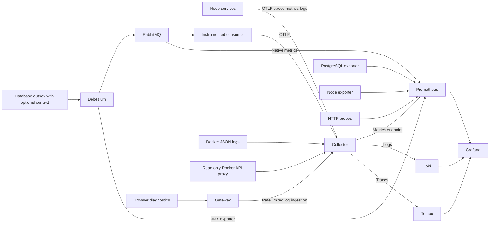

<!--
AI Assistance Disclosure:
Tool: Codex (model: GPT-6), date: 2026-11-09
Scope: Explain setup, data flow, operation, verification and approved AWS preparation.
Author review: <to be completed by yanhwee>
-->

# Self hosted observability runbook

This stack collects application and infrastructure telemetry using OpenTelemetry, Prometheus, Loki, Tempo and Grafana. The standard application startup remains usable without it. Local collection runs in an optional Compose overlay. AWS configuration is prepared behind `observability_enabled = false`; no cloud deployment is part of this change.

For implementation status and continuation instructions, read [the implementation plan](implementation-plan.md). The worktree is `/Users/yanhwee/Downloads/CS3219 Student Project/friend-on-campus-observability`, branch `codex/self-hosted-observability`.

## What each component does

| Component | Responsibility |
|---|---|
| Shared Node SDK | HTTP/Express/fetch tracing, runtime metrics, request metrics and structured event logs |
| Shared manual instrumentation | Prisma operations, RabbitMQ processing/publication, acknowledgement/retry/DLQ decisions and active WebSockets |
| OpenTelemetry Collector | OTLP ingestion, container log reading, Docker/nginx metrics, privacy filtering, batching and forwarding |
| Prometheus | Scrapes metrics, retains time series and evaluates alert rules |
| Loki | Stores application, gateway, browser and infrastructure logs |
| Tempo | Stores sampled distributed traces |
| Grafana | Provisioned dashboards, log exploration and trace lookup |
| RabbitMQ plugin | Native per-queue and broker metrics |
| JMX Java agent | Exposes connector metrics from each Debezium Server 2.7 process |
| PostgreSQL exporter | Database statistics, replication-slot retained WAL and current order workflow state |
| Node exporter | Linux host resources; on Docker Desktop this describes its Linux VM |
| Blackbox exporter | Probes service readiness and gateway availability over HTTP |
| Docker API proxy | Allows the collector limited read access to Docker stats without a directly mounted socket in the collector |

The Docker API proxy blocks write methods and has no published host port locally. Its read endpoints still expose container metadata, so it stays on an internal network shared only with the collector. The collector also reads the Docker log directory. These are host monitoring capabilities, not ordinary application permissions.

## Data flow



The diagram's metric arrows mean Prometheus scrapes the source. No application sends business requests through the collector.

## Start locally

From the worktree root, install dependencies and prepare the checksum-verified JMX exporter:

```sh
npm ci
npm run observability:prepare
```

Use the normal application environment setup in the repository README. Keep JWT keys private. The observability overlay does not require a hosted telemetry account.

```sh
docker compose -f docker-compose.yml -f compose.observability.yml up --build -d
```

The monitoring SQL runs in a one-off container after the Order Service schema exists. It creates an idempotent local-only `observability` role, grants `pg_monitor`, and grants access to only the two order columns used by workflow metrics. It works with existing local volumes too. The example monitoring password is for local Compose only. AWS uses a separate generated secret.

Open:

- Grafana: http://localhost:13000 — anonymous Viewer access, bound to loopback. Open **Dashboards → CampusErrand → CampusErrand observability**.
- Prometheus: http://localhost:19090 — **Status → Targets**, query browser and **Alerts**.
- OTLP/HTTP for host development: http://localhost:14318.

`OBS_GRAFANA_PORT`, `OBS_PROMETHEUS_PORT` and `OBS_OTLP_PORT` override these ports. Exporter, Loki and Tempo ports stay inside the Compose network. Grafana anonymous Viewer access is intended for loopback access, not a public deployment.

Inspect or stop this overlay using the same file pair:

```sh
docker compose -f docker-compose.yml -f compose.observability.yml logs --tail 100 otel-collector
docker compose -f docker-compose.yml -f compose.observability.yml down
```

`down` retains volumes. Avoid adding `--volumes` to a real application stack: it would also remove application data. To switch back to the normal stack without telemetry, rebuild frontends with their default flag and recreate services using the original Compose file.

## Host development

The six backend images use Node 22.23.4, pinned by digest on Alpine 3.23. The current SDK 0.301 / 3.1 uses API 1.10 and requires Node >=22.15.0 for host development. SDK startup must precede Express, HTTP and database imports. Each service entrypoint imports the bootstrap first. Export settings into the process environment before starting host services; the bootstrap runs before the existing dotenv configuration.

```sh
OTEL_ENABLED=true \
OTEL_SERVICE_NAME=order-service \
OTEL_EXPORTER_OTLP_ENDPOINT=http://localhost:14318 \
npm run dev -w @campus-errand/order-service
```

Choose the appropriate service name for each process. SDK startup assigns a distinct `service.instance.id` unless one is already supplied in `OTEL_RESOURCE_ATTRIBUTES`, preventing counters from different replicas overwriting one another. Tests and ordinary startup remain disabled unless `OTEL_ENABLED=true` is explicitly set.

## Follow an asynchronous order

1. An HTTP trace starts when a request reaches a Node service. Incoming W3C `traceparent` context can connect it to an upstream trace.
2. Outbox serialization adds optional `traceContext.traceparent` and `traceContext.tracestate` fields to the event JSON inside the existing transaction.
3. Debezium's existing bare JSON route carries this payload to RabbitMQ. This implementation does not depend on Kafka-style headers surviving the RabbitMQ sink.
4. The shared `rabbitmq-client` consumer extracts that context before calling the business handler and creates a consumer processing span.
5. A downstream outbox event inherits the active processing context. The Credit result and Order update can therefore appear in the original trace.

Legacy events with no metadata continue to work. The business parsers normalize fields before computing their existing idempotency fingerprints; optional trace metadata does not become business identity. `eventId` identifies one event, while `correlationId` identifies related order activity. These identifiers belong in logs and traces, not metric labels.

Debezium connector metrics and logs describe the CDC stage. This change does not claim to create Debezium-internal processing spans or directly measure every moment of broker waiting time. Consumer spans measure handler execution; the workflow state/age metric covers outstanding work. Traces are sampled at 10% by default using parent-based sampling; metrics count independently of trace sampling. Use `OTEL_TRACES_SAMPLER_ARG=1` only when complete traces are needed for an isolated demonstration.

In Grafana **Explore**, choose Tempo and look up a trace ID. Choose Loki and search for a correlation/order ID or a structured `app.orderId` attribute. HTTP logs carry trace identity, and consumer logs include event/correlation IDs when present. Unsampled requests can still produce logs and metrics, while their trace will not be stored.

## Metrics and dashboards

Useful queries include:

```promql
sum by (service_name) (rate(app_http_requests_total[5m]))
histogram_quantile(0.95, sum by (le, service_name) (rate(app_http_duration_seconds_bucket[5m])))
rabbitmq_queue_messages_ready
rabbitmq_queue_consumers
debezium_streaming_connected
pg_up
pg_replication_slots_retained_wal_bytes
pg_order_workflow_oldest_pending_seconds{status="PENDING"}
container_restarts_total
```

`app_outbox_events_total` counts serialization attempts, not committed rows or successful publications. A surrounding transaction can still roll back. RabbitMQ processing success means the handler returned successfully; a duplicate ignored by an idempotent handler also succeeds. A business rejection is not necessarily an infrastructure failure. Use event type, order status and the relevant logs to interpret it.

Outbox row `status = PENDING` is not a delivery backlog: CDC does not update it. Debezium's timestamp lag can be negative/uninitialized, affected by clock skew, or stale during quiet traffic. Watch database connectivity and retained WAL alongside it. Exporter `up = 1` only means an HTTP scrape succeeded; `pg_up` establishes whether database collection succeeded.

Gateway request logs use bounded route categories instead of raw URLs. Query them with LogQL, for example:

```logql
{service_name="api-gateway"} | json | event="gateway.request" | status >= 500
```

## Alerts and investigation

Prometheus evaluates the versioned rules in `docker/observability/alerts.yaml`. Its Alerts page shows pending/firing states; the Grafana dashboard also queries firing alerts. Rules cover unavailable targets/readiness, high server error rate, dead letters, queues without consumers, disconnected CDC, retained WAL, database collection failure, stalled reservations, collector refusal/export failure and low disk space.

No email, Slack or webhook destination has been supplied. External alert notifications are therefore not configured and no messages have been sent. Evaluation and dashboard visibility are implemented; notification routing needs an author-selected destination and credentials.

When an alert fires:

- **Readiness failure:** inspect the affected service and its dependency logs; check PostgreSQL and RabbitMQ metrics.
- **Queue backlog/no consumers:** check consumer readiness, errors and retry/DLQ action logs. A consumer count above zero alone does not establish progress.
- **CDC disconnected/retained WAL:** check connector logs, database connectivity and replication slots. Do not delete a replication slot to silence the alert.
- **Pending reservation:** follow the order correlation ID through Order and Credit events, inspect the Credit queue and both CDC connectors.
- **Collector failure:** check its own metrics/logs and destination health. An application can remain healthy while telemetry is missing.

## Verification

```sh
npm run typecheck
npm run lint
npm run ci:validate-tests
npm run test:unit
npm run build
npm run observability:verify -- --browser
npm run observability:validate-cloud
```

The last command creates its own Compose project, chooses available loopback ports, uses fresh in-memory JWT keys, builds production images, sends SDK telemetry, creates an actual order and verifies trace continuity through CDC and the consumers. It checks real PostgreSQL/connector metrics and can verify browser error ingestion. It removes only its own disposable project and volumes by default. Chromium must be installed for `--browser` using the project's existing Playwright setup.

For a deliberate failure exercise:

```sh
npm run observability:verify -- --browser --keep
npm run observability:failure-exercise
```

The exercise validates the project name, stops only that disposable project's Credit Service, detects failed readiness, queued messages and a pending order, then restarts the consumer and verifies recovery to `OPEN`. Run it against a disposable project only. `test-results/observability/latest.json` records the project/ports and check outcome without private keys. `--resume --keep` continues checks against the retained project without changing its authentication configuration. Cleanup uses the recorded project name and the original, overlay and test Compose files; never substitute your normal project name.

Alert behavior can be tested without waiting for a real outage:

```sh
docker run --rm --entrypoint /bin/promtool -w /config \
  -v "$PWD/docker/observability:/config:ro" \
  prom/prometheus:v3.8.0 test rules /config/alerts.test.yaml
```

`npm test` runs the repository's existing isolated application/database/messaging/browser regression suite. The observability overlay has its own verification command because its dependencies, assertions and disposable ports differ from the normal stack.

## Resource limits and persistence

Local Prometheus, Loki and Tempo retain 72 hours. Prometheus additionally limits its TSDB to 512 MB. Loki/Tempo retention is time-based, not a hard disk quota; watch disk usage. Docker application logs rotate at 10 MB with three files per container. SDK buffers, collector memory and persistent export queues are bounded. SDK shutdown flushes after application draining, and unavailable telemetry backends do not block business requests.

The additional local monitoring containers have approximately 1.9 GiB of combined memory limits. In a short idle verification on the development Docker VM they used roughly 370 MiB combined; this is a single observation, not a production sizing result. The three Java CDC processes already existed and remain additional application infrastructure.

Named local volumes hold Prometheus, Loki, Tempo, Grafana and collector checkpoints/queues. Docker Desktop host statistics describe its Linux VM, not macOS resource totals. Rootless Docker, nonstandard Docker log paths and engines without the configured API version require collection adjustments.

## Prepared AWS configuration

The author approved one persistent backend stack on the existing ECS fleet and one collection agent per host. `infra/terraform/ecs/observability.tf` prepares:

- A singleton backend task on `broker-slot == 1` with `observability-storage == ready`: Prometheus, Loki, Tempo, Grafana, blackbox, PostgreSQL exporter and ECS target discovery.
- One host-network collection task per ECS host: Collector, read API proxy and node exporter.
- A separate encrypted 20 GiB gp3 volume for monitoring on slot 1. It follows host replacement through the existing slot model. Application/broker data is not stored on it.
- Private self-security-group rules for ingestion and scrapes. Grafana binds to slot 1 loopback and is reached through Systems Manager port forwarding.
- ECS task discovery that translates bridge-network dynamic ports into readiness and Debezium scrape targets, without copying task environment variables into target files.
- Optional JSON-file logs for application/broker/CDC containers, native RabbitMQ metrics, CDC JMX init containers, and SDK endpoint settings.

The backend reserves 512 CPU units and 1792 MiB task memory; each host agent reserves 256 CPU units and 512 MiB. Each instrumented CDC task adds 64 CPU units and 64 MiB to fit its init container. Recheck placement and remaining fleet capacity before enabling. Existing application autoscaling ceilings can already exceed the fleet CPU budget. No load-based cloud sizing or price verification has been performed.

Preparation sequence, for later human-reviewed deployment:

1. Run `npm run observability:prepare`, then build `docker/observability/Dockerfile` for ARM64 and publish it to an approved image registry. Set `observability_bundle_image` to its digest. This session does not publish images.
2. Preserve the existing runtime secret values and add one new generated `db_observability` password. The generator includes it for fresh deployments; never regenerate all production credentials merely to add this field.
3. Keep `phase = foundation`, set `observability_enabled = true`, inspect a Terraform plan and the existing rollout procedure. Enabling changes launch-template bootstrap; existing instances do not automatically acquire the new mount. The backend placement constraint requires the storage-ready attribute set only after the bootstrap has mounted the disk, preventing accidental use of an unmounted root-directory path. Plan the slot-1 mount/host replacement explicitly while preserving broker storage and quorum. No automatic instance refresh was added.
4. After the Order schema exists, run the existing database setup task with command `monitoring` to provision the password-backed monitoring role and column grants.
5. Advance phases only after checking the new disk is mounted and private agents/backends are healthy. Inspect the plan before each apply. Run the application deployment workflow to select the latest task templates; Terraform intentionally does not own deployed application revisions.
6. Rebuild frontend images with `browser_observability = true` in the manual workflow only when the gateway telemetry route is active. Backend instrumentation is controlled by the task environment.
7. Verify every replica target, all three connector metrics, actual workflow trace continuity, disk persistence after replacement and capacity under representative load. Keep Grafana private.

The slot-1 bootstrap also enables host-network task IAM credentials for the scoped discovery task role. See [AWS task IAM configuration](https://docs.aws.amazon.com/AmazonECS/latest/developerguide/task-iam-roles.html).

The configuration bundle reuses the local configurations and renders cloud addresses at init time. It carries the verified JMX agent, avoiding runtime network downloads in CDC containers. The cloud collector omits the Compose-only nginx stub-status receiver; gateway request/status/latency logs and HTTP probes remain available. ECS service discovery is AWS-specific deployment glue; application instrumentation and telemetry protocols remain portable.

The monitoring volume has `prevent_destroy`. To stop the demo, leave `observability_enabled = true`, drain through phases and stop hosts using the existing procedure. Setting the flag false would try to remove the retained disk and is intentionally blocked until its retention/deletion is explicitly handled. A monitoring host outage interrupts dashboards until slot 1 and its volume recover; the monitoring backend is not a highly available cluster.

## Privacy and collection limits

New request telemetry records method, route template, status and duration. It does not record request/response bodies, credentials, chat content or SQL text. Collector filtering removes URL/query text, SQL statements, exception message/stack attributes and process command arguments from exported resource data. Legacy container stdout still contains whatever existing application log statements emit; the bearer-token redaction is not a general-purpose secret detector.

Browser diagnostics are opt-in at build time. They report generic runtime/rejection events, failed same-origin API requests and WebSocket open/close/error events. They omit error messages, stacks, page URLs, request paths and user identities, and are bounded to 30 records/minute per page. The gateway limits body size and request rate and forwards no cookies or authorization header. Browser records are untrusted client telemetry. No session replay, full browser tracing or browser performance profiling is implemented.

This stack provides the discussed operational coverage. Profiling, synthetic authenticated user journeys, external alert delivery, backup/restore validation of telemetry data and cloud availability/load verification are separate work; they are not implied by installing the tool images.

## Sources

- [OpenTelemetry Node.js](https://opentelemetry.io/docs/languages/js/getting-started/nodejs/)
- [OpenTelemetry Collector](https://opentelemetry.io/docs/collector/)
- [RabbitMQ Prometheus integration](https://www.rabbitmq.com/docs/prometheus)
- [Debezium 2.7 PostgreSQL monitoring](https://debezium.io/documentation/reference/2.7/connectors/postgresql.html#postgresql-monitoring)
- [Prometheus JMX exporter](https://prometheus.github.io/jmx_exporter/)
- [Loki OTLP ingestion](https://grafana.com/docs/loki/latest/send-data/otel/)
