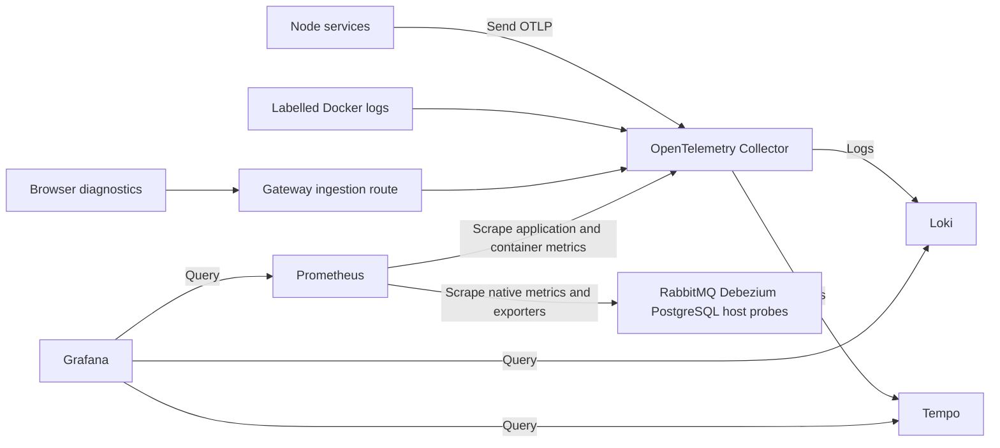

<!--
AI Assistance Disclosure:
Tool: Codex (model: GPT-6), date: 2026-11-09
Scope: Explain the implemented observability changes for students, with verified clickable code references beside explanations and throughout the file map.
Author review: <to be completed by yanhwee>
-->

# Understanding the observability changes

This guide explains the observability work in Friend on Campus: what changed, what each change does, and how to understand it by following an errand through the application. It assumes you know roughly what an HTTP request, a database and a Docker container are. New terms are introduced as they become useful.

The implementation is in the separate `friend-on-campus-observability` worktree on branch `codex/self-hosted-observability`. It adds the self-hosted stack you selected and the optional event metadata and AWS layout you approved. The six backend services now use Node 22.23.4 and the current OpenTelemetry SDK. The branch is prepared for team review, and no AWS deployment has been performed.

For commands and operation, use the [runbook](runbook.md). For exact continuation state and outstanding work, use the [implementation plan](implementation-plan.md). This guide explains the code and behavior behind those documents.

## Contents

1. [The problem the changes address](#the-problem-the-changes-address)
2. [The tools and their jobs](#the-tools-and-their-jobs)
3. [Following one errand](#following-one-errand)
4. [Changes inside the backend services](#changes-inside-the-backend-services)
5. [Keeping a trace across the outbox](#keeping-a-trace-across-the-outbox)
6. [Observing the supporting infrastructure](#observing-the-supporting-infrastructure)
7. [Gateway and browser changes](#gateway-and-browser-changes)
8. [Dashboards and alerts](#dashboards-and-alerts)
9. [Docker and dependency changes](#docker-and-dependency-changes)
10. [AWS preparation](#aws-preparation)
11. [What was verified](#what-was-verified)
12. [File map and learning exercises](#file-map-and-learning-exercises)

## The problem the changes address

Consider a student posting an errand. The API returns an accepted response, but the errand stays `PENDING`.

Several explanations are possible: the database transaction failed, Debezium stopped reading changes, RabbitMQ has no available consumer, Credit Service rejected the reservation, or the result has not reached Order Service. A running container or a successful health check cannot answer all of these questions.

Observability gives you evidence from several places so you can locate the failure.

| Signal | Meaning | Example question |
|---|---|---|
| Log | A record of an event | What happened while this event was processed? |
| Metric | A numerical measurement over time | Is the queue growing? Are errors increasing? |
| Trace | A connected collection of timed operations | Which services and database calls handled this operation? |

An individual timed operation inside a trace is called a **span**. A trace can contain an HTTP request span, database spans and message-processing spans.

For this project, there are two connected subjects to observe:

- **The components:** whether the database, connector, broker and service processes are functioning.
- **The workflow:** whether a student's errand progresses through the expected states.

A broker can be healthy while an order is stuck. A service can answer HTTP requests while its consumer is unavailable. The changes collect both component and workflow evidence.

## The tools and their jobs

The stack has several tools because collecting, storing and displaying information are different jobs.

| Tool | Job in this implementation | What it does not establish by itself |
|---|---|---|
| OpenTelemetry SDK | Runs inside a Node service and produces telemetry | That the data reached storage |
| OpenTelemetry Collector | Receives telemetry, processes it and forwards it | That the application workflow succeeded |
| Prometheus | Collects and stores metrics, evaluates alert rules | Which individual order caused a numerical change |
| Loki | Stores and queries logs | A complete distributed trace |
| Tempo | Stores distributed traces | Measurements for every request when sampling is enabled |
| Grafana | Queries these backends and displays dashboards | Collection or storage merely because a dashboard exists |

**OTLP** means OpenTelemetry Protocol. It is the format/protocol used here to send application telemetry. Application settings point to a collector endpoint rather than embedding a particular storage vendor's API throughout the business code.

Other containers adapt existing infrastructure to these tools. An **exporter** exposes measurements in a form a monitoring system can collect. For example, the PostgreSQL exporter reads database statistics and exposes them to Prometheus.

Prometheus usually **scrapes** a source: it periodically requests that source's metrics endpoint. Application OTLP export works in the other direction: the SDK sends information to the collector.



The business request still travels through your existing application services. It is not routed through the monitoring stack.

## Following one errand

Here is an illustrative reservation flow:

```text
Student sends POST /api/orders
  → Order Service starts handling the HTTP request
  → The order and its outbox event are stored in one database transaction
  → The API returns 202 with the order still PENDING
  → Debezium reads the committed outbox change
  → RabbitMQ routes the reservation request to Credit Service
  → Credit Service processes it and stores a result event
  → Credit's Debezium connector publishes the result
  → Order Service processes the result and updates the order
  → An order event can then reach Notification Service
```

The changes make different parts of that story visible:

| Observation | What it tells you |
|---|---|
| HTTP request count, status and duration | Whether the initial request was handled and how long that handling took |
| Prisma spans | Which model operations ran and how long they took |
| Connector connectivity and lag | Whether CDC is connected and processing changes |
| Queue depth and consumer counts | Whether messages are waiting and whether consumers exist |
| Consumer spans and outcome counters | Whether handlers ran successfully or failed |
| Order state and pending-age metrics | Whether the business workflow has outstanding work |
| Correlated logs and traces | Which records belong to the same operation or order |

Notice that the HTTP response can finish before the reservation finishes. HTTP response time and time spent waiting for asynchronous work are different quantities.

## Changes inside the backend services

### One shared package supplies the instrumentation

A new [`packages/observability`](../../packages/observability/) workspace contains the reusable SDK setup and instrumentation helpers. All six services depend on it: User, Supplier, Order, Credit, Notification and Chat.

There are two main entry points:

- [`bootstrap.ts`](../../packages/observability/src/bootstrap.ts) starts the SDK when enabled.
- [`index.ts`](../../packages/observability/src/index.ts) provides middleware and helpers used by application code.

This gives the services a common implementation for their telemetry fields and behavior. For example, changing the shared HTTP duration instrumentation updates the helper used by all six services.

### SDK startup happens before application library imports

**Code to inspect:** [SDK construction and early imports](../../packages/observability/src/bootstrap.ts) · [Example service entrypoint](../../services/order-service/src/index.ts).

Each service entrypoint imports the bootstrap before Express and other application libraries load.

Automatic instrumentation works by wrapping library operations. If a library has already loaded and its functions have been captured elsewhere, starting instrumentation afterwards can miss those operations. Import order is therefore part of making the instrumentation work.

The bootstrap configures HTTP, Express, fetch/undici and Node runtime instrumentation. Custom helpers add information for parts of this project that those automatic integrations do not cover adequately.

### Telemetry is opt in

**Code to inspect:** [Enable flag, sampling and bounded export settings](../../packages/observability/src/bootstrap.ts) · [Overlay environment settings](../../compose.observability.yml) · [Documented environment variables](../../.env.example).

The SDK starts when `OTEL_ENABLED=true`. The Compose observability overlay supplies this setting. Normal startup and ordinary tests can run without the monitoring containers.

The bootstrap also configures bounded export queues and timeouts. Export runs in the background; a business handler does not wait for a dashboard or telemetry storage service to accept its records. SDK shutdown is triggered after application draining when the process reaches its normal exit stage.

These mechanisms do not guarantee that every telemetry record survives an outage. Buffers are finite, and records can be lost. They keep telemetry export separate from confirming a business transaction.

### HTTP middleware records completed requests

**Code to inspect:** [requestTelemetry implementation](../../packages/observability/src/index.ts) · [Order Service middleware registration](../../services/order-service/src/app.ts).

Each service's Express application uses `requestTelemetry`.

For completed non-probe requests it records:

- HTTP method;
- route template;
- response status;
- elapsed time;
- a structured completion log, marked as an error for server-error responses.

A route template such as `/:id` groups similar operations. A raw URL such as `/api/orders/individual-order-id?private=value` would introduce user-specific values and many distinct metric labels. The new request metrics use templates, and collector filtering removes URL/query attributes from exported traces.

Health and readiness probes are excluded from the custom request metrics. Probes run repeatedly even when no student is using the app; otherwise the request charts would mix those checks into user traffic.

### Each service instance has an identity

**Code to inspect:** [service.instance.id setup](../../packages/observability/src/bootstrap.ts).

Two replicas of Order Service have the same `service.name`. Their counters must still be distinguishable. If both publish an identically labelled cumulative counter, the receiving system cannot reliably treat them as two independent sources.

The bootstrap supplies `service.instance.id` from the process's hostname and PID unless one has already been configured. Grafana queries can then combine measurements from the individual instances by service name.

### Duration histograms use boundaries expressed in seconds

**Code to inspect:** [Histogram views and boundaries](../../packages/observability/src/bootstrap.ts) · [Metric instruments and labels](../../packages/observability/src/index.ts).

A **histogram** counts observations in duration ranges. This lets Prometheus estimate values such as p95: the duration below which approximately 95% of observations fall.

The custom HTTP, message-processing and database histograms have explicit boundaries from milliseconds to tens of seconds. Their units are seconds. Boundaries must match the expected scale: a set with only large, multi-second buckets cannot describe short requests precisely.

The configured histograms also limit attribute combinations. This is related to **cardinality**, the number of distinct labelled time series. Order IDs and user IDs belong in logs or traces, not in metric labels. Every new unique order ID would otherwise create another series.

### Prisma operations are instrumented explicitly

**Code to inspect:** [instrumentDatabase implementation](../../packages/observability/src/index.ts) · [Order Prisma client wiring](../../services/order-service/src/database/client.ts).

The database client modules wrap their service-local Prisma clients with `instrumentDatabase` when telemetry is enabled.

The extension measures operations and creates database spans containing the model/operation, duration and error status. It does not add SQL text or query arguments.

This explicit extension matters because Prisma's native query engine does not necessarily execute queries through the Node `pg` library. Installing instrumentation for `pg` alone would not prove that the actual Prisma operations are visible.

The wrapper returns query results and rethrows failures. It does not change the business query, transaction boundary or retry policy. With telemetry disabled, it returns the original client.

### WebSocket and runtime measurements cover long-lived connections

**Code to inspect:** [observeSocket implementation](../../packages/observability/src/index.ts) · [Chat connection wiring](../../services/chat-service/src/index.ts) · [Notification connection wiring](../../services/notification-service/src/index.ts).

Chat and Notification service wiring records active WebSocket connections and connection/error/close events. These connections can outlive individual HTTP requests, so ordinary request-duration metrics do not describe them fully.

Node runtime instrumentation also supplies process/runtime measurements. Together with host and container metrics, these can help distinguish a slow dependency from a resource-constrained process.

## Keeping a trace across the outbox

This is one of the most important changes to understand.

### Normal in-memory context ends at a persistence boundary

During an HTTP request, OpenTelemetry can keep the current trace context in the process's asynchronous execution context. That context is not automatically stored when Prisma writes an outbox row.

Debezium is another process, and the consumer may run later on another machine. They cannot recover the original context from Order Service's memory.

The context therefore has to travel with the persisted event.

### Optional metadata is stored inside the existing JSON payload

**Code to inspect:** [BaseEvent.traceContext contract](../../packages/common-dtos/src/index.ts) · [serializeOutboxEvent helper](../../packages/observability/src/index.ts) · [Order outbox writes](../../services/order-service/src/repositories/order.repository.ts) · [Credit outbox writes](../../services/credit-service/src/credits/store.ts) · [Registration outbox write](../../services/user-service/src/auth/auth-module.ts).

The shared `BaseEvent` contract now permits an optional `traceContext` property. The outbox-writing code in User, Order and Credit uses `serializeOutboxEvent`.

An illustrative event shape is:

```json
{
  "eventId": "a-unique-event-id",
  "eventType": "order.reservation.requested",
  "orderId": "an-order-id",
  "correlationId": "an-order-id",
  "traceContext": {
    "traceparent": "00-4bf92f3577b34da6a3ce929d0e0e4736-00f067aa0ba902b7-01"
  }
}
```

This example shows the structure; it is not a complete valid business-event fixture. Actual events keep their required business fields and UUIDs.

`traceparent` contains a trace ID, parent span ID and trace flags. Optional `tracestate` can carry additional tracing state.

The metadata is persisted within the existing outbox transaction. No new database column or migration was needed. Debezium already routes the JSON payload to RabbitMQ, so the context travels with that payload rather than depending on transport headers being preserved by the sink.

### The shared RabbitMQ client creates processing spans

**Code to inspect:** [Client calls to the telemetry wrappers](../../packages/messaging/src/index.ts) · [observeDelivery and observePublish](../../packages/observability/src/index.ts).

The project uses `rabbitmq-client`, so instrumentation for a different library such as `amqplib` is not enough.

The shared messaging package now wraps publication and processing. For a delivery, it extracts the optional context before calling the handler, creates a processing span and records the handler's duration and outcome. It also records acknowledgement, retry and dead-letter decisions.

If the handler writes a new outbox event, serialization can capture that active processing context. The next event can therefore continue the same trace.

The existing handler validation, failure classification and retry decisions still own message behavior. Telemetry does not turn a business rejection into a different result or replace idempotency checks.

### Three identifiers answer different questions

| Identifier | Scope | Typical use |
|---|---|---|
| `eventId` | One business event | Recognizing a redelivery or duplicate |
| `correlationId` / `orderId` | Related order activity | Finding records throughout an order's lifecycle |
| `traceId` | A connected execution trace | Viewing timed operations and their relationships |

The same order can be acted on by several later HTTP requests and therefore appear in multiple traces. A retried event can also have multiple delivery attempts. These identifiers are related, but they are not interchangeable.

Legacy events without trace metadata remain valid. Existing business parsers normalize fields before calculating their fingerprints, keeping optional telemetry metadata outside business identity.

### Sampling and timing still matter

The default root trace sampling ratio is 10%, with parent sampling decisions respected. Metrics count independently of that sampling. You can see activity in a request counter without having a stored trace for every request.

A consumer span measures handler execution. It does not automatically measure every millisecond the event waited in PostgreSQL, CDC or RabbitMQ. Debezium metrics and pending-order age provide additional evidence about those gaps.

The implementation connects application spans across CDC; it does not claim to add internal Debezium execution spans.

## Observing the supporting infrastructure

### RabbitMQ exposes its own metrics

**Code to inspect:** [Plugin list](../../docker/observability/rabbitmq-enabled-plugins) · [Per-queue scrape job](../../docker/observability/prometheus.yaml) · [Local container wiring](../../compose.observability.yml).

The optional configuration enables `rabbitmq_prometheus` while retaining the management plugin. Prometheus collects broker and per-queue measurements from it.

Per-queue measurements let you distinguish the Credit queue from the Notification queue and identify messages in a particular dead-letter queue. Broker-wide totals alone would hide that distinction.

Important terms:

- **Ready messages:** waiting for a consumer to receive them.
- **Unacknowledged messages:** delivered but not yet acknowledged.
- **Consumer count:** consumers attached to a queue.
- **Redelivery:** another delivery attempt for a message.
- **Dead-letter queue:** where the configured broker routing sends rejected/dead-lettered messages.

A consumer count above zero does not prove that work is progressing. Read it alongside queue depth, processing results and workflow state.

### Debezium uses a Java metrics adapter

**Code to inspect:** [JMX metric mappings](../../docker/observability/debezium-jmx.yaml) · [Download and checksum verification](../../scripts/observability/prepare.mjs) · [Connector mount and startup options](../../compose.observability.yml).

The three Debezium Server 2.7 processes run in Java. Their connector measurements are available through **JMX**, Java's management interface.

A Java-agent JMX exporter exposes selected measurements in Prometheus format. The configuration includes connectivity, processing lag, event counts, queue capacity and snapshot completion. Each connector is scraped separately.

The preparation script downloads a pinned exporter JAR, verifies its checksum and keeps the downloaded binary out of Git. The cloud configuration image includes that verified JAR so a CDC task does not need to download it during startup.

Debezium's lag measurement concerns its connector stage. It can be uninitialized, affected by clock differences or stale during quiet traffic. It is not the same as end-to-end reservation latency.

### PostgreSQL has a dedicated monitoring account

**Code to inspect:** [Local role and column grants](../../docker/observability/postgres-monitor.sql) · [Workflow and WAL queries](../../docker/observability/postgres-queries.yaml) · [Cloud monitoring-role setup](../../infra/terraform/ecs/db-setup.sh).

A PostgreSQL exporter collects database statistics and custom queries. Local setup creates a monitoring role with `pg_monitor`, permission to connect to `order_db`, and access to the order columns needed for workflow measurements.

This account does not need the business service's write permissions. In AWS, its password comes from a dedicated field in the existing runtime secret rather than the local example password.

The custom queries expose:

- order counts by current status;
- the age of the oldest pending order;
- replication-slot activity and retained WAL bytes.

**WAL**, the write-ahead log, records database changes used by replication and CDC. If a connector falls behind, its replication slot can require PostgreSQL to retain older WAL. Monitoring retained bytes makes this database-side accumulation visible.

The exporter has two health concepts: Prometheus `up` means the HTTP scrape worked, while `pg_up` indicates whether database collection worked. Verification checks both the endpoint and actual database/workflow measurements.

### Outbox status is not publication confirmation

In this project, CDC does not update the outbox row's `status` after publishing. Counting rows marked `PENDING` would therefore not establish how many events remain undelivered.

Likewise, `app_outbox_events_total` counts serialization attempts. The surrounding transaction can subsequently roll back. It is not a committed-event counter or a successful-publication counter.

These distinctions prevent charts from answering a different question from the one you intended to ask.

### Hosts and containers supply resource measurements

**Code to inspect:** [Docker stats and filelog receivers](../../docker/observability/collector.yaml) · [Proxy, host exporter and mounts](../../compose.observability.yml).

Node exporter collects Linux host measurements such as memory and filesystem space. On Docker Desktop, these describe the Linux VM running Docker, not the whole macOS machine.

The collector reads container CPU, memory, network and restart measurements through a Docker API proxy. A read-only socket mount alone does not make Docker API operations read-only. The proxy restricts operations and is kept on an internal network locally, without a published host port.

The collector also reads labelled Docker JSON log files, adds service/container identity and forwards those logs to Loki. Creating a Loki container by itself would not make existing stdout logs appear there; the file-reading path is the actual collection mechanism.

## Gateway and browser changes

### Gateway requests have structured logs

**Code to inspect:** [Log format, route categories and stub status](../../docker/observability/nginx/http/observability.conf) · [HTTP probe settings](../../docker/observability/blackbox.yaml) · [Probe targets](../../docker/observability/prometheus.yaml).

Optional NGINX includes add structured request logs containing method, status, duration, upstream duration and a bounded route category. They avoid putting raw URLs and query strings into these new access records.

The local stack also exposes internal NGINX stub-status measurements. Stub status supplies connection/request totals; it does not supply per-route latency or error breakdowns. Those details are available in the structured access logs.

Blackbox exporter probes HTTP readiness and gateway availability. A **probe** actively tries an endpoint and records the result, giving evidence beyond whether the container process exists.

### Browser diagnostics cover failures before or outside a service response

**Code to inspect:** [Browser hooks and rate cap](../../packages/browser-observability/src/index.ts) · [Student initialization](../../apps/student-app/src/main.tsx) · [Admin initialization](../../apps/admin-portal/src/main.tsx) · [Gateway ingestion limits](../../docker/observability/nginx/server/observability.conf).

Both React applications can enable the new `browser-observability` package at build time.

It reports generic runtime errors, unhandled promise rejections, failed same-origin API requests, network failures, and WebSocket open/close/error events. These help explain situations in which the server is healthy but the student's browser cannot complete an interaction.

The records omit error text, stacks, page URLs, request paths, bodies and user identities. They are capped at 30 records per minute per page. A gateway route forwards them to the collector with body-size/rate limits and without forwarding cookies or authorization headers.

The browser helper keeps a reference to the original fetch function when sending its own diagnostics. This avoids treating the telemetry request itself as another application request to report recursively.

The build flag is necessary because Vite creates static browser assets: changing a runtime container variable does not rewrite JavaScript that has already been built. The deployment workflow exposes this flag for future frontend releases.

These are limited browser diagnostics. Session replay, full browser tracing and performance profiling were not added. Client-supplied telemetry is also not authoritative evidence of a business transaction.

## Dashboards and alerts

**Code to inspect:** [Grafana data sources](../../docker/observability/grafana/datasources.yaml) · [Dashboard panel queries](../../docker/observability/grafana/overview.json) · [All alert expressions](../../docker/observability/alerts.yaml) · [Alert behavior fixtures](../../docker/observability/alerts.test.yaml).

Grafana data sources and a project dashboard are provisioned from files. This makes their configuration part of the worktree instead of requiring someone to recreate it by clicking through the UI.

The dashboard includes requests, latency, errors, readiness, queues, consumer outcomes, CDC connectivity/lag, retained WAL, pending age, database durations, WebSockets, host/container resources, logs and firing alerts.

Prometheus evaluates these 12 alert rules:

| Rule | Condition it makes visible |
|---|---|
| `TelemetryTargetDown` | A scrape target is unavailable |
| `ServiceNotReady` | An HTTP readiness probe fails |
| `HighServerErrorRate` | The configured server-error ratio is exceeded |
| `DeadLetterMessages` | Messages are waiting in a dead-letter queue |
| `QueueWithoutConsumers` | A non-dead-letter queue has waiting messages and no consumers |
| `DebeziumDisconnected` | Connector connectivity reports disconnected |
| `RetainedReplicationWal` | A replication slot retains more than the configured WAL threshold |
| `CollectorRefusingTelemetry` | The collector refuses incoming telemetry |
| `HostDiskNearlyFull` | A monitored filesystem has less than the configured free-space ratio |
| `PostgreSQLUnavailable` | The exporter cannot collect from PostgreSQL |
| `OrderReservationStalled` | The oldest pending order exceeds the age threshold |
| `CollectorExportFailures` | The collector cannot export some telemetry |

A threshold and an alert's `for` duration have different meanings. For example, the pending-order rule requires age above 120 seconds, then requires that condition to hold for two minutes. It does not necessarily fire exactly two minutes after creation.

Alert rules and dashboard visibility are implemented. External email, chat or webhook delivery has not been configured because no destination was supplied. A firing alert in Prometheus is not evidence that a notification was sent.

## Docker and dependency changes

### The monitoring stack is an optional overlay

**Code to inspect:** [Compose services and volumes](../../compose.observability.yml) · [Prometheus retention flags](../../compose.observability.yml) · [Loki retention](../../docker/observability/loki.yaml) · [Tempo retention](../../docker/observability/tempo.yaml).

`compose.observability.yml` adds the monitoring components and the necessary settings/mounts to the existing Compose stack. The ordinary application Compose file remains a valid startup path.

Prometheus, Loki, Tempo, Grafana and collector state have named volumes. Prometheus/Loki/Tempo retain 72 hours; Prometheus also has a 512 MB storage-size setting. Application JSON logs rotate. The additional monitoring containers have explicit memory limits.

Time-based retention is not a hard disk-size quota. Persistent volumes preserve data across ordinary container recreation, but they do not by themselves prove recovery after a machine failure.

Grafana and Prometheus are published on loopback locally. Loki, Tempo and exporter endpoints remain internal. Their default local access and startup commands are in the runbook.

### Backend images now use Node 22

**Code to inspect:** [Representative backend Dockerfile](../../services/order-service/Dockerfile) · [Current SDK package versions](../../packages/observability/package.json) · [Root minimum Node version](../../package.json).

You explicitly approved this runtime update. All six backend Dockerfiles now pin Node 22.23.4 on Alpine 3.23 in all three stages: build, production dependencies and runtime. These are 18 stage declarations in total.

The current SDK requires Node >=22.15.0. The root project and telemetry package declare this requirement for host development too. Frontend build images and the independent cloud configuration bundle were not included in the six-backend runtime change.

The telemetry package uses SDK 0.301 / 3.1 and stable API 1.10. Logging now comes from the stable API, metrics use the current `metricReaders` configuration, and trace tests use the unified tracing package. Legacy logging/tracing packages were removed.

Compatible patches to existing Express, body-parser and qs dependencies were also applied while resolving the dependency audit. These changes stay within their declared compatible ranges; they do not change Express's major version. The final production dependency audit reported zero known advisories at verification time.

### Production packaging includes the shared workspace correctly

**Code to inspect:** [Build, production dependencies and runtime exports](../../services/order-service/Dockerfile) · [Development package exports](../../packages/observability/package.json).

A host development process can load workspace TypeScript through `tsx`. A production container runs compiled JavaScript and installs production dependencies only. The Dockerfiles must support both forms.

They now copy the shared package's manifest, build its output, include that output in the runtime image and point its runtime exports at the compiled files. They also copy its nested production dependencies: npm can install some dependencies inside a workspace rather than hoisting all of them into the repository's top-level `node_modules`.

A successful host test would not catch a missing dependency in the final runtime image. The production-container verification specifically exercised this packaging.

## AWS preparation

**Code to inspect:** [Backend, agent and storage resources](../../infra/terraform/ecs/observability.tf) · [Disk mount and storage-ready attribute](../../infra/terraform/ecs/host-bootstrap.sh.tftpl) · [Bridge-port discovery](../../docker/observability/cloud/discover.sh) · [Cloud configuration renderer](../../docker/observability/cloud/render.mjs).

The local Compose network gives containers service names such as `tempo` and `rabbitmq`. The existing ECS deployment uses bridge networking and dynamically assigned host ports. Those are different connection/discovery mechanisms.

The approved AWS layout is prepared in Terraform:

| Part | Prepared behavior |
|---|---|
| Shared backend | One backend task on existing slot 1, containing the storage/UI/exporter/discovery components |
| Host collection | One collection task per existing host, using ECS's daemon scheduling |
| Monitoring storage | A separate encrypted 20 GiB gp3 volume attached to slot 1 |
| Placement guard | The backend requires a storage-ready attribute set after the disk is mounted |
| Dynamic discovery | ECS/EC2 metadata is translated into connector/readiness target files |
| Database monitoring | A dedicated secret-backed role is provisioned with the setup task's `monitoring` command |
| Access | Private ingestion/scrapes; Grafana is reached through Systems Manager port forwarding |
| Activation | Disabled by default through `observability_enabled` |

The storage-ready guard matters because a host directory can exist even when its intended persistent disk is not mounted. Scheduling the backend into that directory would otherwise allow it to write to the root disk. The attribute ties placement to completed bootstrap mounting.

The backend volume uses `prevent_destroy`. Turning off the resource flag is therefore different from temporarily stopping workloads; the runbook explains the existing phase/host shutdown procedure.

The discovery task has scoped read permissions, and slot-1 bootstrap enables host-network task-role support. The configuration bundle renders addresses for this environment, carries the JMX agent and supplies versioned settings to tasks. The cloud collector omits the Compose-only NGINX stub-status receiver; gateway access logs and readiness probes remain available.

This preserves the approved three-host ceiling. It does not establish that the existing fleet has sufficient capacity under every load or that all autoscaling ceilings can run simultaneously. Images have not been published for this rollout, secrets have not been changed in AWS, and Terraform has not been applied. Live permissions, networking, resource capacity, costs and disk recovery still require verification before rollout.

## What was verified

**Code to inspect:** [Focused context tests](../../packages/observability/test/context.test.ts) · [Real order and browser assertions](../../scripts/observability/verify.mjs) · [Consumer outage assertions](../../scripts/observability/failure-exercise.mjs) · [Cloud fixture assertions](../../scripts/observability/validate-cloud.mjs) · [CI wiring](../../.github/workflows/ci.yml).

The verification covered code behavior, actual service integration and deployment artifacts.

| Check | What the passing result establishes |
|---|---|
| Typecheck, lint and matrix validation | Workspace code checks pass and test scripts are represented in the existing CI matrix |
| Telemetry unit tests | Persisted context survives a round trip; legacy events work; errors retain identity; sensitive error text/SQL is not added by the custom helpers |
| Complete `npm test` | Existing unit, integration, messaging, migration, seed, acceptance, API E2E and Chromium UI checks pass on the updated implementation |
| Fresh observability verification | Real SDK metrics/logs/traces reach their backends; an actual order trace connects CDC and consumers; expected infrastructure measurements exist |
| Browser ingestion check | A browser error reaches Loki without exporting the deliberately supplied private error text |
| Consumer failure exercise | Stopping the disposable Credit consumer produces detectable readiness failure, backlog and pending work; restarting it recovers the order |
| Image inspection | All six built backend images actually contain Node 22.23.4 and SDK 0.301.0 |
| Alert fixtures | Selected healthy/failure inputs produce the expected alert behavior |
| Cloud configuration fixtures | Rendering and bridge-port discovery work against fake AWS responses; generated collector/Prometheus configurations validate |
| Terraform and bootstrap checks | Configuration validates; enabled/disabled bootstrap scripts have valid syntax and fit the user-data limit |
| Dependency audit | Zero known production dependency advisories were reported for the verified lockfile |

The isolated verification uses fresh in-memory JWT keys, separate Docker project names and temporary ports/volumes. It does not reset the original application's data. The temporary stacks were cleaned up afterwards.

Remote CI has not been triggered, and locally validating cloud configuration is not a live AWS rollout test. A short idle resource observation is also not a load test. The implementation plan records the exact local verification evidence.

## Privacy and failure boundaries

**Code to inspect:** [Collector filtering](../../docker/observability/collector.yaml) · [Controlled telemetry fields](../../packages/observability/src/index.ts) · [Browser fields and limits](../../packages/browser-observability/src/index.ts).

Several implementation details are useful to recognize when reading telemetry:

- New custom request/Prisma/browser instrumentation omits request bodies, credentials, chat content and SQL arguments.
- Collector transforms remove URL/query text, SQL statement attributes, exception messages/stacks and unnecessary resource attributes such as process command arguments.
- Existing stdout still contains what the application's existing logging statements emit. Bearer-token redaction is not a universal secret detector.
- A successful consumer handler can be an idempotently ignored duplicate; it does not prove that every downstream step finished.
- A missing trace may result from sampling or telemetry loss. It does not establish that the request never happened.
- A dashboard depends on its data sources and collection pipeline. Monitoring their failures is part of interpreting the dashboard.

These boundaries tell you which conclusions the collected evidence can support.

## File map and learning exercises

### Where the changes live

Every entry below links to a real file in this worktree. Links are relative to this guide so they also work when the worktree moves or the files are committed. Rows covering all six services list each service separately.

| Files | What changed and what to look for |
|---|---|
| [SDK bootstrap](../../packages/observability/src/bootstrap.ts) | SDK startup order, exporters, sampling, instance identity, histograms, limits and shutdown |
| [Shared instrumentation helpers](../../packages/observability/src/index.ts) | HTTP middleware, database wrapper, context serialization and message/socket measurements |
| [Context and failure tests](../../packages/observability/test/context.test.ts) | Focused behavior tests for context, legacy compatibility and failure preservation |
| [Package manifest](../../packages/observability/package.json) · [TypeScript configuration](../../packages/observability/tsconfig.json) | Dependencies, current API versions, package exports and build configuration |
| [User](../../services/user-service/src/index.ts) · [Supplier](../../services/supplier-service/src/index.ts) · [Order](../../services/order-service/src/index.ts) · [Credit](../../services/credit-service/src/index.ts) · [Notification](../../services/notification-service/src/index.ts) · [Chat](../../services/chat-service/src/index.ts) | Early SDK import; socket instrumentation where applicable |
| [User](../../services/user-service/src/app.ts) · [Supplier](../../services/supplier-service/src/app.ts) · [Order](../../services/order-service/src/app.ts) · [Credit](../../services/credit-service/src/app.ts) · [Notification](../../services/notification-service/src/app.ts) · [Chat](../../services/chat-service/src/app.ts) | Request telemetry middleware |
| [User](../../services/user-service/src/database/client.ts) · [Supplier](../../services/supplier-service/src/database/client.ts) · [Order](../../services/order-service/src/database/client.ts) · [Credit](../../services/credit-service/src/database/client.ts) · [Notification](../../services/notification-service/src/database/client.ts) · [Chat](../../services/chat-service/src/database/client.ts) | Opt-in instrumentation around the existing local Prisma client |
| Manifests: [User](../../services/user-service/package.json) · [Supplier](../../services/supplier-service/package.json) · [Order](../../services/order-service/package.json) · [Credit](../../services/credit-service/package.json) · [Notification](../../services/notification-service/package.json) · [Chat](../../services/chat-service/package.json)<br>Dockerfiles: [User](../../services/user-service/Dockerfile) · [Supplier](../../services/supplier-service/Dockerfile) · [Order](../../services/order-service/Dockerfile) · [Credit](../../services/credit-service/Dockerfile) · [Notification](../../services/notification-service/Dockerfile) · [Chat](../../services/chat-service/Dockerfile) | Shared dependency and complete compiled-container packaging on Node 22 |
| [Shared event contracts](../../packages/common-dtos/src/index.ts) | Optional event trace metadata |
| [Messaging manifest](../../packages/messaging/package.json) · [Publisher and consumer implementation](../../packages/messaging/src/index.ts) | Native RabbitMQ client instrumentation and processing decisions |
| [Order repository](../../services/order-service/src/repositories/order.repository.ts) | Context added when order events are serialized into the outbox |
| [Credit store](../../services/credit-service/src/credits/store.ts) | Context added to credit outbox payloads |
| [User authentication module](../../services/user-service/src/auth/auth-module.ts) | Context added to registration outbox payloads |
| [Browser implementation](../../packages/browser-observability/src/index.ts) · [Manifest](../../packages/browser-observability/package.json) · [TypeScript configuration](../../packages/browser-observability/tsconfig.json) | Limited browser runtime/network/WebSocket diagnostic collection |
| [Student: manifest](../../apps/student-app/package.json) · [Student: Dockerfile](../../apps/student-app/Dockerfile) · [Student: entrypoint](../../apps/student-app/src/main.tsx) · [Admin: manifest](../../apps/admin-portal/package.json) · [Admin: Dockerfile](../../apps/admin-portal/Dockerfile) · [Admin: entrypoint](../../apps/admin-portal/src/main.tsx) | Browser helper dependency, build flag and initialization |
| [Admin Vite environment types](../../apps/admin-portal/src/vite-env.d.ts) | Vite environment-setting types |
| [Observability Compose overlay](../../compose.observability.yml) | Optional local containers, wiring, ports, limits and persistence |
| [Collector pipelines](../../docker/observability/collector.yaml) | Receivers, filtering, processing, queues and destinations |
| [Prometheus](../../docker/observability/prometheus.yaml) · [Loki](../../docker/observability/loki.yaml) · [Tempo](../../docker/observability/tempo.yaml) · [Blackbox](../../docker/observability/blackbox.yaml) | Backend collection/storage/probe configuration |
| [JMX mappings](../../docker/observability/debezium-jmx.yaml) · [Database queries](../../docker/observability/postgres-queries.yaml) | Connector and custom database measurements |
| [Local monitoring-role SQL](../../docker/observability/postgres-monitor.sql) | Idempotent local monitoring-role setup and grants |
| [RabbitMQ enabled plugins](../../docker/observability/rabbitmq-enabled-plugins) | Native metrics plugin alongside management |
| [HTTP logging/status configuration](../../docker/observability/nginx/http/observability.conf) · [Browser ingestion route](../../docker/observability/nginx/server/observability.conf) · [Gateway image](../../gateway/Dockerfile) · [Gateway configuration](../../gateway/nginx.conf) | Optional gateway logs, internal status and browser-ingestion route |
| [Data sources](../../docker/observability/grafana/datasources.yaml) · [Dashboard provider](../../docker/observability/grafana/dashboards.yaml) · [Dashboard panels](../../docker/observability/grafana/overview.json) | Versioned data sources, dashboard provider and dashboard JSON |
| [Alert rules](../../docker/observability/alerts.yaml) · [Alert fixtures](../../docker/observability/alerts.test.yaml) | Alert expressions and behavior fixtures |
| [Bundle image](../../docker/observability/Dockerfile) · [Configuration renderer](../../docker/observability/cloud/render.mjs) · [ECS target discovery](../../docker/observability/cloud/discover.sh) | Cloud configuration image, renderer and target discovery |
| [Observability Terraform resources](../../infra/terraform/ecs/observability.tf) | Optional backend/agent tasks, persistent disk, role and placement |
| [Applications](../../infra/terraform/ecs/applications.tf) · [Brokers](../../infra/terraform/ecs/brokers.tf) · [CDC tasks](../../infra/terraform/ecs/data-tasks.tf) · [Hosts](../../infra/terraform/ecs/hosts.tf) · [Network](../../infra/terraform/ecs/main.tf) · [Host bootstrap](../../infra/terraform/ecs/host-bootstrap.sh.tftpl) · [Broker startup](../../infra/terraform/ecs/rabbitmq-start.sh) · [Gateway startup](../../infra/terraform/ecs/gateway-start.sh) | Optional settings, exporter/init wiring, mount readiness and private access |
| [Database setup](../../infra/terraform/ecs/db-setup.sh) · [Secret generator](../../infra/terraform/ecs/generate-runtime-secrets.cjs) · [Example variables](../../infra/terraform/ecs/terraform.tfvars.example) | Monitoring-role command, new secret field for fresh deployments and activation settings |
| [Provider dependency lock](../../infra/terraform/ecs/.terraform.lock.hcl) | An additional local-platform checksum for the same provider version |
| [JMX preparation script](../../scripts/observability/prepare.mjs) | Fetch and checksum-verify the JMX JAR |
| [SDK smoke check](../../scripts/observability/smoke.mjs) | Send SDK telemetry and query all three storage backends |
| [Full-stack verification](../../scripts/observability/verify.mjs) | Build an isolated full stack and check a real order plus infrastructure/browser data |
| [Failure and recovery exercise](../../scripts/observability/failure-exercise.mjs) | Controlled consumer outage and recovery in a disposable project |
| [Cloud fixture validation](../../scripts/observability/validate-cloud.mjs) | Render/validate cloud settings and test discovery without AWS access |
| [CI workflow](../../.github/workflows/ci.yml) | Telemetry unit/integration/configuration checks and required test-gate wiring |
| [Deployment workflow](../../.github/workflows/deploy-ecs.yml) | Optional browser diagnostics build input |
| [Root manifest](../../package.json) · [Dependency lockfile](../../package-lock.json) | Commands, reproducible dependencies and Node minimum |
| [Example settings](../../.env.example) · [Ignore rules](../../.gitignore) | Documented settings and exclusion of the downloaded JMX binary |
| [Repository README](../../README.md) · [Documentation index](../../docs/README.md) · [Local development](../../docs/development/local-development.md) · [Docker/deployment](../../docs/infrastructure/docker-and-deployment.md) · [Runbook](runbook.md) · [Continuation plan](implementation-plan.md) | Navigation, current requirements, operation and continuation state |
| [AI usage log](../../ai/usage-log.md) | Required course bookkeeping and pending author review |

### A useful reading order

Start with [requestTelemetry in the shared helpers](../../packages/observability/src/index.ts), then find [where Order Service installs it](../../services/order-service/src/app.ts). This is the smallest complete example of shared instrumentation being used by application code.

Next, follow [the Order outbox writes](../../services/order-service/src/repositories/order.repository.ts) into [serializeOutboxEvent](../../packages/observability/src/index.ts), then follow [the shared consumer call](../../packages/messaging/src/index.ts) into `observeDelivery` in that helper file. Ask where the current context exists in memory and where it must be persisted.

After that, read [the collector's three pipelines](../../docker/observability/collector.yaml) and match each exporter to its destination. Finally, inspect [a dashboard query](../../docker/observability/grafana/overview.json) and [an alert expression](../../docker/observability/alerts.yaml) against the measurements the code actually produces.

### Exercises for a disposable environment

1. Run the documented observability verification. Find a request metric, a log record and a trace. Explain what each tells you that the others do not.
2. Compare HTTP response duration with the time an order spends pending. Explain why they can differ.
3. Run the supplied consumer failure exercise. Before restarting the consumer, identify the failed readiness probe, growing queue and pending workflow measurement.
4. Inspect `app_outbox_events_total`. Explain why its value cannot be treated as a count of published events.
5. Find a high-cardinality identifier in a trace, then confirm it is not a label on the custom message metric.
6. Read the AWS discovery fixture. Explain why a Compose hostname is insufficient to identify a bridge-network container on another ECS host.

Use the supplied disposable commands and the [runbook](runbook.md), rather than stopping a real project service or deleting its volumes. You can understand most of the implementation by completing the first three exercises and then tracing their evidence back to the code.
