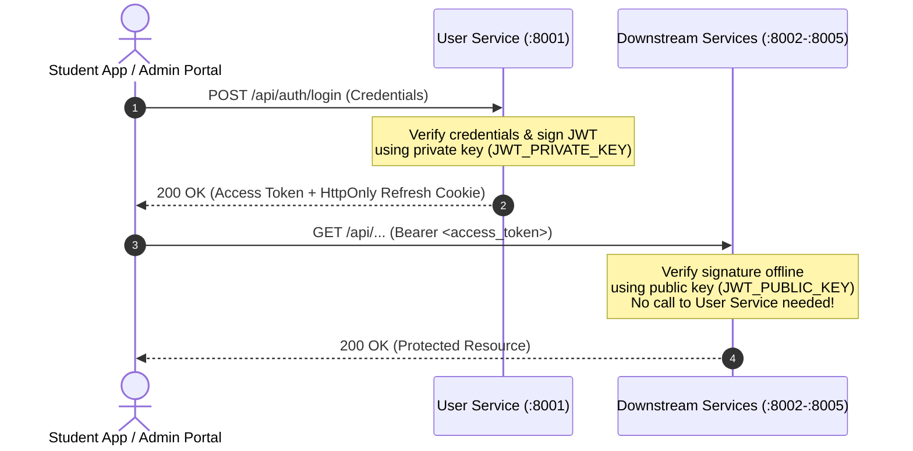
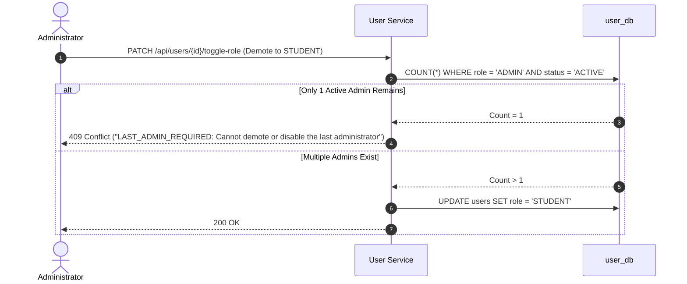

<!--
AI Assistance Disclosure:
Tool: Claude Code (model: Claude Fable 5.1), date: 2026-10-17
Scope: Access-token claims example: replaced the never-issued `email` claim with the optional `username` claim (F5.1.1).
Author review: <to be completed by Reallyeasy1>

Tool: Google Antigravity Agent, date: 2026-10-11
Scope: Authored unified Security & Access Control specification, documenting Ed25519 asymmetric authentication, refresh token session lifecycle, RBAC enforcement, and last-admin guards.
Author review: <to be completed by author after review>
-->

# Security & Access Control Specification

Friend of Campus enforces zero-trust service communication and fine-grained Role-Based Access Control (RBAC) using asymmetric cryptography and database-backed session management.

---

## 1. Authentication Architecture (Asymmetric Ed25519)

Rather than forcing every downstream service to make a synchronous HTTP call back to User Service on every request (which creates a massive latency bottleneck and single point of failure), the platform uses **asymmetric Ed25519 signing**:



### Access Token Characteristics
- **Algorithm**: Ed25519 (EdDSA). Compact signatures, highly efficient cryptographic verification.
- **Lifetime**: 15 minutes (`exp = iat + 900`). Short-lived to minimize damage from leaked tokens.
- **Payload Claims**:
  ```json
  {
    "sub": "b2c9a1d4-8392-4f11-9a74-9fbb34e12345",
    "username": "alice",
    "role": "STUDENT",
    "sid": "e81f5c6b-3129-4d6a-8b29-123456789abc",
    "iss": "friend-on-campus-user-service",
    "aud": "friend-on-campus-services",
    "iat": 1728000000,
    "exp": 1728000900
  }
  ```

---

## 2. Refresh Token & Session Management

To provide a seamless user experience while maintaining security, longer-lived sessions are managed through opaque refresh tokens:

1. **HttpOnly Cookie**:
   - The refresh token is transmitted in an `HttpOnly`, `SameSite=Strict` cookie scoped to `Path=/api/auth`.
   - JavaScript running in the browser cannot access the refresh cookie, eliminating XSS token theft risks.
2. **Hashed Session Persistence**:
   - User Service never stores plaintext refresh tokens. Only `SHA-256` hashes are stored in `user_db.sessions`.
   - If the database is compromised, active refresh tokens cannot be reversed.
3. **Sliding Idle Expiration**:
   - Non-persistent sessions: Expire after 1 day of inactivity.
   - Persistent sessions (`keepLoggedIn = true`): Expire after 30 days of inactivity.
   - Every refresh call rotates the token and advances `last_used_at`.
4. **Instant Logout & Revocation**:
   - Calling `POST /api/auth/logout` deletes the session from `user_db.sessions`.
   - The deleted session immediately blocks any future token refresh attempts.

---

## 3. Role-Based Access Control (RBAC)

The platform defines two principal roles:

| Role | Target Users | Allowed Operations | Forbidden Operations |
|---|---|---|---|
| `STUDENT` | Verified NUS Students (`@u.nus.edu`) | Post errands, browse directory, accept errands as courier, manage profile, view own credit wallet and notifications. | Cannot create, update, or delete campus suppliers; cannot view system-wide user listings or toggle user roles. |
| `ADMIN` | Authorized Staff (`@nus.edu.sg`) | Full CRUD on campus suppliers/merchants, toggle student roles, manage system settings, view platform analytics. | Cannot accept student errands as a courier. |

### Enforcement in Code
Every service imports `@campus-errand/auth`, ensuring identical access control across all endpoints:
- `authMiddleware()`: Extracts the Bearer token, verifies the Ed25519 signature with `JWT_PUBLIC_KEY`, validates `iss`/`aud`, and attaches the decoded user payload to `req.user`.
- `requireAdmin()`: Verifies that `req.user.role === 'ADMIN'`. If a `STUDENT` attempts access, returns `403 FORBIDDEN` immediately.

---

## 4. Resource-Level Authorization

Beyond static roles, domain endpoints verify **resource ownership**:
- **Accepting an Errand**:
  - `req.user.id !== order.requesterId` (Students cannot accept their own errand).
  - Status must be `OPEN`.
- **Advancing an Errand (Pickup / Deliver)**:
  - `req.user.id === order.courierId` (Only the assigned courier can mark items picked up or delivered).
- **Completing an Errand**:
  - `req.user.id === order.requesterId` (Only the requester can confirm delivery and release payment).

---

## 5. Last-Administrator Safety Guard

To prevent accidental lockouts where the system is left without an administrator, `user-service` implements an atomic last-admin guard:



Any attempt to demote, disable, or delete the last remaining active administrator is rejected with `409 Conflict (LAST_ADMIN_REQUIRED)` inside a database transaction.
