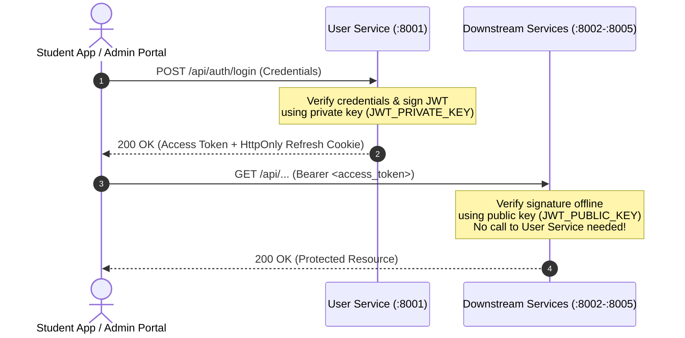
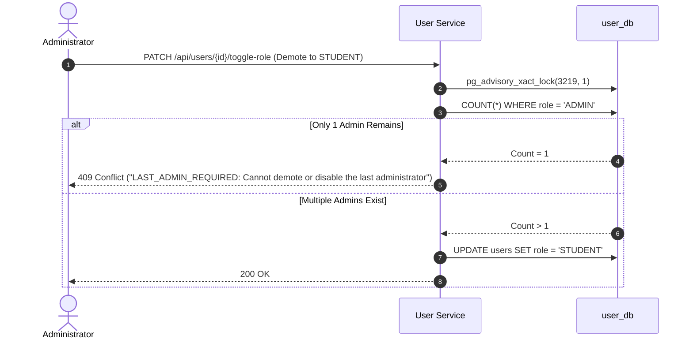

<!--
AI Assistance Disclosure:
Tool: Google Antigravity Agent, date: 2026-10-19
Scope: Updated per-route rules after removing unauthenticated POST /api/credits/escrow/reserve (Issue #42) and added least-privilege PostgreSQL database role isolation documentation.
Author review: Verified by yanhwee

Tool: Claude Code (model: Claude Opus 5.5 subagent, Claude Fable 5.1 session), date: 2026-10-18
Scope: Verified against packages/auth and the services on main @ 7f2d972: cookie SameSite value, principal shape and error codes, RBAC table (admins can accept errands; no settings/analytics features), per-route ownership rules for users, orders, credits and notifications, refresh/logout facts, and the last-admin guard as built including the known gap #109.
Author review: <to be completed by Reallyeasy1>

Tool: Claude Code (model: Claude Fable 5.1), date: 2026-10-17
Scope: Access-token claims example: replaced the never-issued `email` claim with the optional `username` claim (F5.1.1).
Author review: <to be completed by Reallyeasy1>

Tool: Google Antigravity Agent, date: 2026-10-11
Scope: Authored unified Security & Access Control specification, documenting Ed25519 asymmetric authentication, refresh token session lifecycle, RBAC enforcement, and last-admin guards.
Author review: <to be completed by author after review>
-->

# Security & Access Control Specification

Friend of Campus enforces zero-trust service communication and fine-grained Role-Based Access Control (RBAC) using asymmetric cryptography and database-backed session management.

---

## 1. Authentication Architecture (Asymmetric Ed25519)

Rather than forcing every downstream service to make a synchronous HTTP call back to User Service on every request (which creates a massive latency bottleneck and single point of failure), the platform uses **asymmetric Ed25519 signing**:



### Access Token Characteristics
- **Algorithm**: Ed25519 (EdDSA). Compact signatures, highly efficient cryptographic verification.
- **Lifetime**: 15 minutes (`exp = iat + 900`). Short-lived to minimize damage from leaked tokens.
- **Payload Claims**:
  ```json
  {
    "sub": "b2c9a1d4-8392-4f11-9a74-9fbb34e12345",
    "username": "alice",
    "role": "STUDENT",
    "sid": "e81f5c6b-3129-4d6a-8b29-123456789abc",
    "iss": "friend-on-campus-user-service",
    "aud": "friend-on-campus-services",
    "iat": 1728000000,
    "exp": 1728000900
  }
  ```
- `username` is optional (1–50 characters); tokens issued before it was added carry none. The lifetime comes from `JWT_ACCESS_TOKEN_TTL` (Compose default `15m`).
- **Verification**: `@campus-errand/auth` verifies the token offline with `JWT_PUBLIC_KEY`, `JWT_ISSUER` and `JWT_AUDIENCE` (header `alg: EdDSA`), and exposes the principal `{ userId, sessionId, role, username? }`. user-, supplier-, order-, credit- and notification-service all use it; the notification WebSocket verifies the token sent in its `AUTH` frame with the same function.

---

## 2. Refresh Token & Session Management

To provide a seamless user experience while maintaining security, longer-lived sessions are managed through opaque refresh tokens:

1. **HttpOnly Cookie**:
   - The refresh token is transmitted in an `HttpOnly`, `SameSite=Lax` cookie scoped to `Path=/api/auth` (`Secure` when the User Service is configured for secure cookies).
   - JavaScript running in the browser cannot access the refresh cookie, eliminating XSS token theft risks.
2. **Hashed Session Persistence**:
   - User Service never stores plaintext refresh tokens. Only `SHA-256` hashes are stored in `user_db.sessions`.
   - If the database is compromised, active refresh tokens cannot be reversed.
3. **Sliding Idle Expiration**:
   - Non-persistent sessions: Expire after 1 day of inactivity.
   - Persistent sessions (`keepLoggedIn = true`): Expire after 30 days of inactivity.
   - Every refresh call rotates the token and advances `last_used_at`.
   - A previously rotated token is rejected (`INVALID_SESSION`); the replay does not revoke the active session.
   - Refresh is refused when the account is disabled; login of a disabled account returns `ACCOUNT_DISABLED` (checked after the password).
4. **Instant Logout & Revocation**:
   - Calling `POST /api/auth/logout` deletes the session from `user_db.sessions`.
   - The deleted session immediately blocks any future token refresh attempts.
   - Deleting a user cascades to all of that user's sessions.
   - Access tokens already issued stay valid until they expire. `PUT /api/users/me/password` does not revoke the user's other sessions (open issue #79).

---

## 3. Role-Based Access Control (RBAC)

The platform defines two principal roles:

| Role | Target Users | Allowed Operations | Forbidden Operations |
|---|---|---|---|
| `STUDENT` | Verified NUS Students (`@u.nus.edu`) | Post errands, browse directory, accept errands as courier, manage profile, view own credit wallet and notifications. | Cannot create, update, or delete campus suppliers; cannot view system-wide user listings or toggle user roles; cannot use the order admin overrides. |
| `ADMIN` | Authorized Staff (`@nus.edu.sg`) | Full CRUD on campus suppliers/merchants; list users, enable/disable accounts, toggle roles, delete users; admin cancel / complete / unassign on orders. | No order route checks the role for the errand lifecycle, so an admin can also post and accept errands like a student. |

Registration accepts any syntactically valid email (no domain check) and every new account is `STUDENT`; the email domains above describe the seeded accounts, not an enforced rule. Roles change only through `PATCH /api/users/:id/toggle-role`.

### Enforcement in Code
Every service imports `@campus-errand/auth`, ensuring identical access control across all endpoints:
- `authMiddleware(options)`: Extracts the Bearer token, verifies the Ed25519 signature with `JWT_PUBLIC_KEY`, validates `iss`/`aud`, and attaches the principal `{ userId, sessionId, role, username? }` to `res.locals.auth`. Failures return `401` with `MISSING_TOKEN`, `TOKEN_EXPIRED` or `INVALID_TOKEN`.
- `requireAdmin`: Verifies that `res.locals.auth.role === 'ADMIN'`. If a `STUDENT` attempts access, returns `403` with code `ADMIN_REQUIRED` immediately. Used by user-service and supplier-service; order-service has its own equivalent check on the `/admin/*` routes (`403`, "Administrator access is required").
- order-service has a development fallback only when `JWT_PUBLIC_KEY` is unset **and** `ORDER_DEV_AUTH=1`: it then trusts an `x-user-id` (and `x-user-role`) header. Without `ORDER_DEV_AUTH` it refuses to start.

---

## 4. Resource-Level Authorization

Beyond static roles, domain endpoints verify **resource ownership** (`userId` below is `res.locals.auth.userId`):
- **Accepting an Errand**:
  - `userId !== order.requesterId` (Students cannot accept their own errand; `400`).
  - Status must be `OPEN` and not expired (`409`).
- **Advancing an Errand (Pickup / Deliver)**:
  - `userId === order.courierId` (Only the assigned courier can mark items picked up or delivered; `403`).
- **Completing an Errand**:
  - `userId === order.requesterId` (Only the requester can confirm delivery and release payment; `403`).

### Per-route rules

| Service | Route | Who may call |
|---|---|---|
| order | `GET /api/orders`, `GET /api/orders/:id` | any authenticated user (no ownership filter) |
| order | `GET /api/orders/user/activity` | any authenticated user; returns only orders where the caller is requester or courier |
| order | `POST /api/orders` | any authenticated user; the caller becomes `requesterId` |
| order | `POST /:id/accept` | any authenticated user except the order's requester |
| order | `POST /:id/pickup`, `POST /:id/deliver` | the order's courier |
| order | `POST /:id/complete`, `POST /:id/cancel` | the order's requester |
| order | `POST /:id/admin/cancel`, `/admin/complete`, `/admin/unassign` | `ADMIN` |
| credit | `GET /api/credits/wallet`, `GET /api/credits/ledger` | authenticated; always the caller's own wallet / ledger (user id from the token) |
| credit | `/api/credits/escrow/*` | not exposed over HTTP (`404` on service, `403` at gateway); escrow reservations, settlements, and refunds execute exclusively via authenticated RabbitMQ domain events (resolved issue #42) |
| notification | `GET /api/notifications`, `PATCH /:id/read`, `POST /read-all` | authenticated; every query is scoped to the caller's `userId`. Another user's notification id answers `404`, like a missing one |
| notification | WebSocket `/ws/` | the token's user receives only their own notifications |
| user | `GET /api/users/me`, `PATCH /api/users/me`, `PUT /api/users/me/password` | authenticated; the caller's own account |
| user | `DELETE /api/users/:id` | the account owner or an `ADMIN` (`403` otherwise) |
| user | `GET /api/users`, `PATCH /:id/toggle-status`, `PATCH /:id/toggle-role` | `ADMIN`; an admin cannot toggle their own role (`403 SELF_ACTION_FORBIDDEN`) |
| supplier | `GET /api/suppliers`, `GET /api/suppliers/:id` | public (no token required) |
| supplier | `POST`, `PUT /:id`, `PATCH /:id/toggle`, `DELETE /:id` | `ADMIN` |

### Database-per-Service Role Isolation
In addition to HTTP/RabbitMQ access controls, PostgreSQL database boundaries are enforced via least-privilege roles provisioned in `docker/postgres-init/01-init-databases.sql`:
- Each service connects with its own PostgreSQL role (`user_svc`, `supplier_svc`, `order_svc`, `credit_svc`, `notification_svc`).
- `REVOKE CONNECT ON DATABASE <db> FROM PUBLIC` prevents any service role from connecting to or querying another microservice's database.
- **Upgrading Existing Local Volumes**: Because PostgreSQL executes `/docker-entrypoint-initdb.d/01-init-databases.sql` only when initializing an empty data directory, developers pulling this change onto an existing `postgres_data` Docker volume should run a one-time `docker compose down -v && docker compose up --build -d` (or apply the role grants manually via `docker compose exec -T postgres psql -U postgres < docker/postgres-init/01-init-databases.sql`).

---

## 5. Last-Administrator Safety Guard

To prevent accidental lockouts where the system is left without an administrator, `user-service` implements an atomic last-admin guard:



Any attempt to demote, disable, or delete the last remaining active administrator is rejected with `409 Conflict (LAST_ADMIN_REQUIRED)` inside a database transaction.

As built (`services/user-service/src/persistence/user-repository.ts`):
- Role toggles, status toggles and deletions each run in a `ReadCommitted` transaction that first takes the PostgreSQL advisory lock `pg_advisory_xact_lock(3219, 1)`, so they serialize across service instances.
- `PATCH /:id/toggle-status`: disabling an enabled admin is rejected when no **other enabled** admin exists.
- `PATCH /:id/toggle-role` (demote) and `DELETE /:id`: rejected when the target is an admin and the count of users with `role = 'ADMIN'` is 1 or less. This count includes disabled admins, so an enabled admin can be demoted or deleted while only a disabled admin remains (known gap, open issue #109).
- An admin cannot toggle their own role (`403 SELF_ACTION_FORBIDDEN`).
