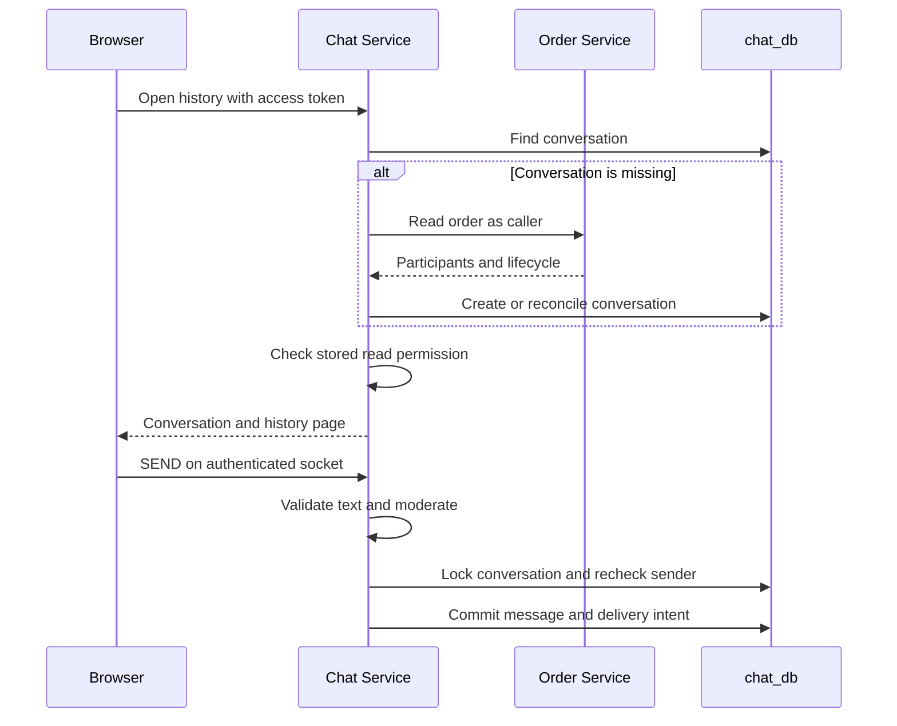
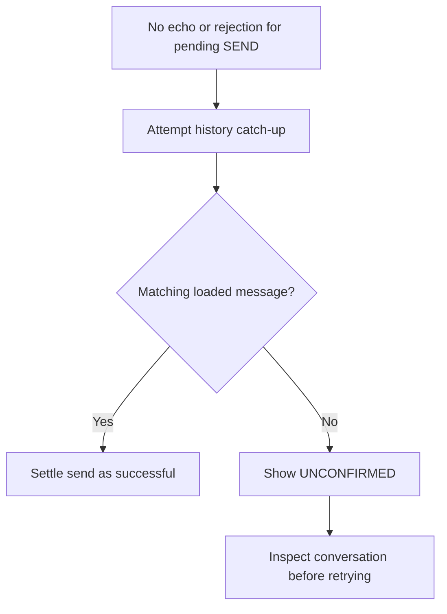

<!--
AI Assistance Disclosure:
Tool: Codex (model: GPT-6); Claude Code (model: Claude Fable 5.1), date: 2026-10-25 to 2026-11-09
Scope: Proposed D4 specification for the remaining Chat Service work: reconciliation of fixes already on PR #148 head f39ab1f, remaining limitations with source..; updated across 6 AI-assisted revisions through D4 wrap-up (clarify missing-conversation event handling and send-recovery tolerance).
Author review: I validated correctness, edited for style, and verified with automated tests.
-->

# Chat Service

Chat lets an errand's requester and courier coordinate a delivery. It stores one conversation per errand, keeps messages in a stable order and serves history after a browser disconnects. The gateway exposes its HTTP API at `/api/chat` and its WebSocket at `/ws/chat/`; the service listens on port **8006** locally.

For example, after a courier accepts an errand, the requester can send “Meet me at the library entrance.” The message is committed to `chat_db` before live delivery is attempted. The courier can recover it from history even if their browser was offline. Chat does not decide whether the errand was accepted or completed: [Order](../order-service/README.md) owns that lifecycle.

## Opening a conversation and checking access

An `order.accepted` event normally creates the conversation. If the event has not arrived yet, the history endpoint can create it from an Order lookup using the caller's access token. That lookup has a four-second timeout and requires an order with a courier. It is a fallback for a **missing** conversation, not a fresh authorization lookup on every request.

For an existing conversation, access is decided from Chat's stored participant IDs and `closedAt`:

| Caller | Read history / translate | Send |
|---|---|---|
| Stored requester or courier | Yes, including closed conversations | Yes while `closedAt` is null |
| Administrator who is not a participant | Yes | No |
| Any other user | No | No |

For example, if Mira requested the errand and Jun is its stored courier, both can load its history. A third student's valid token still gets 403. Once Chat records completion, Mira and Jun can read the earlier messages but cannot send another one. For an open conversation, if a newer acceptance replaces Jun with another courier, that courier can read the same earlier history; Jun no longer passes the stored participant check.

The fallback treats `ACCEPTED`, `IN_TRANSIT` and `DELIVERED` as open. The event projection consumes `order.accepted`, `order.in_transit`, `order.delivered`, `order.completed`, `order.cancelled` and `order.expired`. The last three close an **existing** conversation; accepted events update its courier only when newer than `courierSince`.

The other valid subscribed events are acknowledged and ignored when the conversation is missing. For example, if `order.completed` is handled before `order.accepted` creates the row, the later accepted event can create an open conversation without the earlier closure. Draining the queue does not restore the discarded event, and opening that existing row does not rerun the Order fallback. This behavior is explicit in the [projection](../../../services/chat-service/src/conversations/events.ts) and its [missing-row tests](../../../services/chat-service/test/events.test.ts).

**Current limitation:** `order.unassigned` is not consumed. A removed courier can still read and send while the old local row remains open; a newer accepted event replaces that courier. Existing-row checks can also lag an Order completion. The Order client drops `version`; assignment replay checks use `courierSince`, not the Order version. The append lock below protects against concurrent changes **inside Chat**, not against an Order change that has not reached Chat.

This diagram shows why the two boundaries differ:

*Legend: solid arrows are requests or calls, dashed arrows are replies; `alt` marks a conditional branch.*



If a newer local assignment or closure commits before the append obtains its lock, the send is rejected. Order is not queried again during that send. The API behavior is implemented in [`conversations/service.ts`](../../../services/chat-service/src/conversations/service.ts), the [Order client](../../../services/chat-service/src/clients/order.client.ts) and [`conversations/store.ts`](../../../services/chat-service/src/conversations/store.ts).

## Sending, ordering and persistence

A `SEND` contains the errand ID, text and an optional `clientId`. Chat trims the text and rejects an empty message, a nonparticipant, a closed conversation or a token without a username. Sender ID, name and role come from the verified token, not from client-supplied identity fields.

The append transaction locks the conversation, repeats the participant/closure checks, assigns the next per-conversation sequence number, and inserts both the message and its realtime delivery intent. Either both writes commit or neither does. A unique `(conversation_id, sequence)` constraint backs up the lock-based sequence allocation.

| Stored table | What it owns |
|---|---|
| `conversations` | Unique `order_id`, requester/courier IDs, `courier_since` and creation/pickup/delivery/closure timestamps |
| `messages` | Message ID, conversation, sequence, sender identity, original text and server receive time |
| `realtime_outbox` | Unique delivery event, payload, retry time and lease owner/expiry |

The [schema](../../../services/chat-service/prisma/schema.prisma) and [migrations](../../../services/chat-service/prisma/migrations) define the exact columns. There is no message edit/delete API, and a replacement courier reads the same conversation's earlier messages.

A committed send is delivered through the shared [outbox and per-replica fanout mechanism](../../infrastructure/cdc-and-broker.md). Each replica rereads the message and current local conversation before pushing to its sockets. A recipient must appear in the original delivery intent **and** still be a participant in that local conversation. `SEND` does not also push a second success message directly from its handler.

The sender's tabs receive a `MESSAGE` carrying the original `clientId`; the other participant receives the message without that correlation field. **`clientId` is not a stored idempotency key.** Sending the same text and ID again can create another message. A broker confirmation establishes publication, not that the courier read or even received the message.

## HTTP and WebSocket contracts

HTTP endpoints require `Authorization: Bearer <access-token>`. The [route implementation](../../../services/chat-service/src/chat/routes.ts) and [shared DTOs](../../../packages/common-dtos/src/index.ts) are the contract references.

| HTTP operation | Input and result |
|---|---|
| `GET /api/chat/:orderId` | UUID errand ID; returns `data: {conversation,messages}` with `success: true` |
| History query | `afterSequence` is exclusive, defaults to 0 and clamps to 0–2147483647; `limit` defaults to 50 and clamps to 1–100. Results are ascending by sequence |
| `POST /api/chat/:orderId/translate` | Body `{language,messageIds}`; language is a 2–40 character plain Latin-letter name allowing spaces, parentheses and hyphens; at most 200 UUID IDs. Returns `data: {translations}` keyed by found message IDs |

History query parsing uses integer conversion and clamping; it is not strict rejection of every malformed numeric string. Invalid order/translation inputs return 400, absent conversations return 404, forbidden access returns 403, and mapped Order/translation availability failures return 503. Translation operates on an already stored conversation; it does not run the Order fallback.

The socket protocol starts with `AUTH` within five seconds:

```json
{"type":"AUTH","token":"<access-token>"}
{"type":"SEND","orderId":"<errand-uuid>","text":"Meet me at the library entrance.","clientId":"send-1"}
```

These are illustrative frames; replace the placeholders with a valid test session and an errand belonging to that session. Do not store real tokens in scripts or reports.

| Frame / closure | Meaning |
|---|---|
| `AUTH_OK` | Socket authenticated; the client should catch up from persisted history |
| `MESSAGE` | Persisted message with sender, timestamp and sequence; sender copies may also carry `clientId` |
| `ERROR` | `BAD_FRAME`, `NOT_FOUND`, `FORBIDDEN`, `CLOSED`, `EMPTY`, `NO_USERNAME` or moderation outcome; send errors carry `clientId` when supplied |
| Close 4401 | Authentication failed or the socket's access token expired; reconnect with a fresh token |
| Close 1013 before authentication | Realtime subscription is not ready; retry after recovery |
| Close 1012 after subscription loss | Reconnect and reload history; the former replica queue is unavailable |

The hub pings every 30 seconds and terminates a socket that did not answer the previous ping. It accepts one `AUTH`; subsequent client messages must be `SEND`. Unexpected send failures close the socket with 1011. There is no application-level text length, send-rate or outgoing-buffer limit; the WebSocket library's default payload limit still applies. See [`ws/hub.ts`](../../../services/chat-service/src/ws/hub.ts).

## Reconnects and uncertain sends

The browser does not treat the largest live sequence as proof that all earlier messages were loaded. [`useChat.ts`](../../../apps/student-app/src/chat/useChat.ts) keeps a contiguous history cursor, loads pages until a short page, and merges messages by ID. Every `AUTH_OK`, including the first, catches up loaded threads. Visible open threads also reconcile periodically and on focus; offline/online handling reconnects the socket.

This matters when history contains messages 1–100 and live message 105 arrives: the next history request must still recover 101–104. Deduplicating by message ID makes an overlapping history page and live frame safe to display together.

If a send loses its echo, the client attempts to catch up from history before reporting the outcome. It looks in the loaded messages for the same sender/text at or after the attempted send time, allowing **one second before that time** for clock skew. An earlier identical message inside that tolerance can satisfy the match. This is a recovery heuristic, not a durable server receipt or exactly-once guarantee.

For example, “Meet me at the library entrance” may commit just before the sender loses Wi-Fi. A history catch-up can find the stored copy and settle the pending send successfully even though its socket echo never arrived. Without a matching loaded copy, the UI reports `UNCONFIRMED`; this can also happen when the catch-up request fails. The client does not automatically resend the text.

*Legend: each arrow is the next step, and arrow labels name the condition; the diamond is a decision.*



The match uses sender, text and the time tolerance above; `clientId` is unavailable in stored history. If the UI reports `UNCONFIRMED`, inspect the conversation before retrying: a manual retry can duplicate a message that committed before disconnection. The [client implementation](../../../apps/student-app/src/chat/useChat.ts) defines the catch-up and pending-send checks.

## Translation and moderation

Both features call the configured SoCLaaS model through [`@campus-errand/llm`](../../../packages/llm/src/index.ts). They have different failure behavior:

| Feature | Behavior and boundary |
|---|---|
| Translation | Display-only: originals are unchanged. Needs an API key, processes at most 30 texts per model call, with a 20-second timeout per batch. Missing credentials, failed calls or invalid responses produce an unavailable result, surfaced as 503 |
| English translation | A heuristic skips text considered already English; it is not a language-detection guarantee |
| Moderation | Runs before append with an eight-second model timeout. A positive verdict stores no message and returns `MODERATED` to the sending socket |
| Moderation failure | Missing/unreadable model output is treated as not flagged: delivery fails open, rather than requiring the provider to be healthy |
| Peer notice | A blocked send attempts a transient `MODERATED_PEER` signal to the other current participant. It is not persisted history, and the sender's other tabs do not receive it |

Translation can scan history pages to find the requested IDs; requesting a late or missing ID is not a constant-cost lookup. Source: [translator](../../../services/chat-service/src/translation/translate.ts), [moderator](../../../services/chat-service/src/moderation/moderate.ts), [conversation service](../../../services/chat-service/src/conversations/service.ts).

## Running and configuring Chat

Follow [local development](../../development/local-development.md) first: install dependencies, provide JWT configuration, start PostgreSQL/RabbitMQ, apply migrations and start Order/CDC. From the repository root:

```bash
npm run db:deploy -w @campus-errand/chat-service
npm run dev -w @campus-errand/chat-service
```

`db:deploy` applies committed Chat migrations to the configured database; it is not a reset or a seed command. Use your development database only. The watcher then starts Chat on its configured port. Check `/health` and `/ready` on that port; `/ready` should succeed only when the database, business consumer and realtime subscriber are ready and shutdown has not begun.

| Configuration | Default / purpose |
|---|---|
| `PORT` / `CHAT_SERVICE_PORT` | 8006; `PORT` takes priority |
| `DATABASE_URL` / `CHAT_DATABASE_URL` | Chat database; direct `DATABASE_URL` takes priority |
| `ORDER_SERVICE_URL` | `http://localhost:8003` for host development |
| `JWT_PUBLIC_KEY`, `JWT_ISSUER`, `JWT_AUDIENCE` | Same token verification settings as the other services |
| `RABBITMQ_URL`, `CHAT_EXCHANGE`, `CHAT_QUEUE` | Broker credentials/address; `campus.events`; `chat-service.events` |
| `CHAT_DLX`, `CHAT_DLQ` | `<queue>.dlx`, `<queue>.dlq` by default |
| `CHAT_RETRY_DELAY_MS`, `CHAT_RETRY_LIMIT` | 2000 ms and 30 for transient business-event failures |
| `RABBITMQ_REALTIME_EXCHANGE` | `chat-service.events.realtime` |
| `SOCLAAS_BASE_URL`, `SOCLAAS_API_KEY`, `SOCLAAS_MODEL` | Shared model-provider configuration |

Use [`config.ts`](../../../services/chat-service/src/config.ts) and [`.env.example`](../../../.env.example) for complete settings; never copy credentials into documentation. A shared `RABBITMQ_REALTIME_EXCHANGE` override must be set deliberately per deployed service, rather than accidentally giving Chat and Notification the same exchange.

The business consumer uses prefetch/concurrency one. Invalid events are permanent failures; infrastructure failures retry outside the application's transient threshold; other failures use the configured budget and then dead-letter. Native broker delivery limits remain a separate boundary. Retry waits occupy the consumer slot. The realtime subscriber has its own bounded policy and no DLQ; details are in the [messaging guide](../../infrastructure/cdc-and-broker.md).

Loss of realtime subscription closes sockets and removes readiness. Fatal business-consumer/startup errors and termination signals trigger bounded shutdown: stop readiness, stop new work, drain in-flight sends and close HTTP, sockets, relay, consumer and database resources. A ten-second hard deadline bounds this process. See [`index.ts`](../../../services/chat-service/src/index.ts) and [`app.ts`](../../../services/chat-service/src/app.ts).

## Tests and troubleshooting

From the repository root, use the [testing guide](../../development/testing-strategy.md) to provision isolated dependencies:

```bash
npm run test:unit -w @campus-errand/chat-service
npm run test:integration -w @campus-errand/chat-service
npm run test:messaging -w @campus-errand/chat-service
```

Unit tests cover service/access rules, routes, sockets, moderation and translation. Integration requires `CHAT_TEST_DATABASE_URL`; messaging/realtime tests also require `CHAT_TEST_RABBITMQ_URL`. A skipped suite because either is missing is not a passing runtime check. [`realtime.integration.test.ts`](../../../services/chat-service/test/realtime.integration.test.ts) covers two replicas, committed-intent recovery, duplicate delivery, membership rereads and leases. [`uat-realtime.mjs`](../../../scripts/uat/uat-realtime.mjs) covers browser behavior but assumes test accounts and controlled infrastructure; inspect those prerequisites before running it.

| Symptom | Check next |
|---|---|
| Opening Chat returns 404 | Confirm the errand has had a courier; inspect the accepted-event projection and Order fallback result |
| Opening returns 503 | Check Order reachability and response, then the caller's token; the client maps non-success Order responses other than 400/404 to unavailable |
| A stored message appears after reload but not live | Inspect Chat realtime health and the pending delivery intent, then the receiving replica; do not resend merely to test sockets |
| `UNCONFIRMED` after send | Reload history and inspect persisted messages before retrying |
| Former courier can still access Chat | Check for an unassigned-but-not-reaccepted errand; this is the known local-projection limitation, not evidence of token impersonation |
| Completed errand still allows sending after the queue drains | Compare local `closedAt` with Order and the event order; a terminal event processed before the conversation existed was ignored, and the existing-row history path does not refresh it |
| Translation returns 503 but chat works | Check provider configuration/connectivity separately from message persistence |
| Socket repeatedly reconnects | Inspect close code, token expiry, `/ready` and realtime subscriber health |

## Requirement boundaries and historical decisions

The [original D4 decision register](https://github.com/AY2627S1-CS3219-P25/friend-on-campus/blob/c45f9ed0eb46a54ac68937393e0355da34dd9f9d/docs/archive/services/chat-service/d4-implementation-specification.md#22-decision-register) preserves unresolved policy discussions and original attribution. It is a proposal snapshot, not a checklist of current implementation.

Still requiring an explicit policy/implementation decision are immediate revocation on unassignment, administrator reads versus participant-only wording in [issue #56](https://github.com/AY2627S1-CS3219-P25/friend-on-campus/issues/56), replacement-courier access to earlier messages, authoritative authorization timing, terminal membership, and message/rate limits. No new ACK frame or protocol version is implied by this guide. The requirement's “failed” wording has no `FAILED` Order status or `order.failed` event; do not invent one when testing Chat.

Source checked against application commit [`b989758`](https://github.com/AY2627S1-CS3219-P25/friend-on-campus/commit/b989758e766cb593c3b8c94102eb6dfb5c7d8491), 9 November 2026. Runtime evidence and shared verification limits are recorded in the [documentation index](../../README.md).
