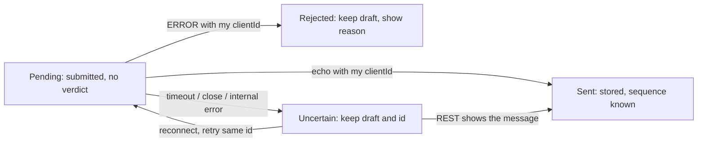

<!--
AI Assistance Disclosure:
Tool: Claude Code (model: Claude Fable 5.1), date: 2026-10-25
Scope: Proposed D4 specification for the remaining Chat Service work: reconciliation of fixes already on PR #148 head f39ab1f, remaining limitations with source references, F8 requirement register, the decision register with conflicting sources, conditional contract/persistence/frontend/operations sections restating the wiki proposal, verification map and implementation breakdown. No application change; no policy, schema or interface is decided here.
Author review: <to be completed by Reallyeasy1>
-->

# Chat Service: D4 implementation specification (proposal)

**Status: proposed D4 work, not implemented behavior.** Inspected: PR #148 head [`f39ab1f`](https://github.com/AY2627S1-CS3219-P25/friend-on-campus/commit/f39ab1f252414bca5c5ef7d08f3d45b9e16007a0) (`feature/chat-service`), `main` [`9a36146`](https://github.com/AY2627S1-CS3219-P25/friend-on-campus/commit/9a361461de0e8b3e5d237ebaa64f5b8197c97171), wiki revision `a463e3bd77dd0327414543dba62cd2feb9c9c2a9` ([design page](https://github.com/AY2627S1-CS3219-P25/friend-on-campus/wiki/Chat-Service-Design-and-Reliability-Plan), [AWS/D4 plan](https://github.com/AY2627S1-CS3219-P25/friend-on-campus/wiki/AWS-Deployment-and-D4-Delivery-Plan)), [issue #56](https://github.com/AY2627S1-CS3219-P25/friend-on-campus/issues/56), 2026-10-25 (SGT). CI on `f39ab1f`: every job green ([PR checks](https://github.com/AY2627S1-CS3219-P25/friend-on-campus/pull/148/checks)); the review threads were marked resolved on 2026-10-25 and the reconciliation below rechecks them against code rather than trusting that status.

**Policy boundary.** Under [CLAUDE.md](../../../CLAUDE.md) section 1 the AI may not choose schemas, interfaces, patterns or trade-offs. This document therefore separates four kinds of statement, each labelled: **[impl]** behavior read from code at `f39ab1f`; **[main]** behavior on `main` at `9a36146`; **[approved]** a human decision with a linked source; **[proposal]** the wiki design page's proposal, restated here for implementation planning, with its approval still pending (wiki section 3.3 and both disclosure blocks state that nothing in it is approved). Sections that depend on a pending decision are marked **conditional**. Nothing marked [proposal] was authored here; where the wiki is silent, the gap is named for the author rather than filled.

## 1. Baseline and remaining changes

### 1.1 Reconciliation of findings already addressed at `f39ab1f`

| Previous finding | Current implementation [impl] | Code / test references | Remaining limitation | Required D4 action |
|---|---|---|---|---|
| Replayed older `order.accepted` restored a former courier ([review](https://github.com/AY2627S1-CS3219-P25/friend-on-campus/pull/148#discussion_r4357291704)) | `upsertAccepted` updates `courierId` only where `courierSince < event.timestamp` and reports `created`/`recouriered`/`ignored`; the projection returns `ignored` for a replay | [`store.ts`](../../../services/chat-service/src/conversations/store.ts) `upsertAccepted`; [`events.ts`](../../../services/chat-service/src/conversations/events.ts) `createProjection`; tests: `events.test.ts` "P1", `service.test.ts` "P1", `store.integration.test.ts` "P1" (PostgreSQL) | Ordering is by event **timestamp**, not Order version; an equal timestamp with a different courier is ignored, not quarantined. The backfill sets `courier_since = created_at`, which equals the first accept, so a pre-existing row whose courier was replaced before this migration carries a `courier_since` older than its real reassignment | Keep the guard. Version-based ordering is a conditional change (section 3.4). Document the backfill limit in release notes; no rewrite of legacy rows (wiki 7.1 says not to synthesize versions) |
| `append` inserted without rechecking closure or membership under its lock ([review](https://github.com/AY2627S1-CS3219-P25/friend-on-campus/pull/148#discussion_r4357291713)) | `append` selects `requester_id, courier_id, closed_at ... FOR UPDATE`, applies `checkAppend`, returns `not_found`/`forbidden`/`closed`, recipients from the locked row; `service.send` keeps fast pre-checks and takes the store verdict | [`store.ts`](../../../services/chat-service/src/conversations/store.ts) `append`, `checkAppend`; [`service.ts`](../../../services/chat-service/src/conversations/service.ts) `send`; tests: `service.test.ts` "P2" (two, via `racingStore`), `store.integration.test.ts` "P2" | The recheck is against **local** state. It serializes a send with local closure/re-courier commits; it does not consult the Order Service, so an existing row that is stale against Order (for example after `order.unassigned`, which Chat does not consume) still authorizes | Section 3: authoritative Order lookup before the transaction, for existing rows too (conditional on decisions D1/D4) |
| Any `MESSAGE` settled every pending send ([review](https://github.com/AY2627S1-CS3219-P25/friend-on-campus/pull/148#discussion_r4327265331)) | Sender's sockets receive `MESSAGE` with `clientId`; other recipients receive it without; `useChat` calls `settle(frame.clientId, ...)` only | [`hub.ts`](../../../services/chat-service/src/ws/hub.ts) `handleSend`; [`common-dtos`](../../../packages/common-dtos/src/index.ts) `ChatServerFrame`; [`useChat.ts`](../../../apps/student-app/src/chat/useChat.ts) `onmessage`; test: `hub.test.ts` asserts `['c1','c1',undefined]` | Correlation is transport-level only. `clientId` is not persisted, so a retry after timeout/disconnect stores a second row. No frontend unit test exists for the settle rule (no student-app test suite covers `useChat`) | Section 4: persisted idempotency key (conditional); section 6: uncertain-outcome state |
| History fetched once with `limit=100` ([review](https://github.com/AY2627S1-CS3219-P25/friend-on-campus/pull/148#discussion_r4327267304)) | `load` loops `afterSequence` with `PAGE_SIZE = 100` until a short page; merges by id, sorts by sequence | [`useChat.ts`](../../../apps/student-app/src/chat/useChat.ts) `load` | The loop ends on a short page; it does not record a REST coverage cursor separate from the highest **displayed** sequence, so a live frame merged mid-load can leave the thread looking complete past the last fetched page | Section 5.3: coverage boundary and `throughSequence` (conditional, wiki 6.1) |
| No catch-up after reconnect (same review) | On `AUTH_OK` after a previous connection, every thread with a conversation reloads from `messages.at(-1)?.sequence ?? 0` | `useChat.ts` `onmessage` (`hadConnected`) | Starts from the highest displayed sequence, which may be a live frame ahead of REST coverage (same gap as above); no refresh on tab focus or timer | Section 5.3 and 6.3 |
| Open panel never learned the errand closed ([review](https://github.com/AY2627S1-CS3219-P25/friend-on-campus/pull/148#discussion_r4327268936)) | `ChatPanel` takes `status`; `useEffect(() => load(orderId), [load, orderId, status])`; `TasksPage` passes `task.status` | [`ChatPanel.tsx`](../../../apps/student-app/src/chat/ChatPanel.tsx); [`TasksPage.tsx`](../../../apps/student-app/src/pages/TasksPage.tsx) | The reload is triggered by the Tasks poll's status, which can arrive **before** the terminal event is projected onto `closedAt`; the panel then re-enables nothing new but may still show the composer until the next trigger. Unassignment produces no status change visible as closure | Section 6.2: treat the reload result, not the trigger, as authoritative; re-run after a bounded delay when status is terminal but `closedAt` is null (conditional) |
| `afterSequence` clamped to `MAX_SAFE_INTEGER` ([review](https://github.com/AY2627S1-CS3219-P25/friend-on-campus/pull/148#discussion_r4327268064)) | `clamp(req.query.afterSequence, 0, 0, 2147483647)`; test: `afterSequence=3000000000` → 200, `[]` | [`routes.ts`](../../../services/chat-service/src/chat/routes.ts); `routes.test.ts` | Clamping silently coerces fractional, negative and oversized values; `limit=abc` becomes 50. Not strict validation | Section 5.1: 400 `INVALID_INPUT` for malformed cursors (conditional, wiki 7.2) |
| Docs called the service a scaffold ([review](https://github.com/AY2627S1-CS3219-P25/friend-on-campus/pull/148#discussion_r4327272273)) | `docs/architecture.md` no longer exists; chat facts live in [communication-and-events](../../architecture/communication-and-events.md), [system-overview](../../architecture/system-overview.md), [api-gateway](../../infrastructure/api-gateway.md); CLAUDE.md map row reads "REST + ws hub + consumer (F8)" | merge commit `603edcb` | None | None |

Test labels: every test named above was **source-inspected** at `f39ab1f`; those **executed** for this document are listed in the [verification record](../../audits/review-findings.md) with commands and results.

### 1.2 Remaining limitations (facts) and the smallest change each needs

| # | Limitation [impl] | Where | Smallest change (conditional on the decision named) |
|---|---|---|---|
| L1 | Existing rows authorize from local membership only; Order is consulted only when no row exists | `service.ts` `open`, `history`, `send` | Fetch the Order snapshot before every open/history/send and compare participants (D4-A); the consumer stays advisory |
| L2 | `OrderClient` discards `version` although `main`'s `OrderDTO` carries it | `order.client.ts` `OrderDetails` | Retain `version` (and runtime-validate `status` against the known union) |
| L3 | Consumer binds six keys; `order.unassigned` (published on `main` by both unassign paths with `priorCourierId`) is not consumed | `events.ts` `chatRoutingKeys`; [`order.service.ts`](../../../services/order-service/src/orders/order.service.ts) | With D4-A in place no new binding is required for correctness; optional advisory binding is a later choice (Appendix A of the wiki) |
| L4 | Timestamp replay guard; same-timestamp different-courier accept ignored silently | `store.ts` `upsertAccepted` | Keep; log the ignored case with `eventId`; version ordering only with D4-A's `orderVersion` column |
| L5 | `clientId` not persisted; retry duplicates | schema, `store.append`, `hub.handleSend` | Idempotency key per wiki 5.1 (P2) |
| L6 | No uncertain-outcome state; disconnect settles pending sends as "not sent" | `useChat.ts` `onclose` | Pending/uncertain states per wiki 5.2 (P3) |
| L7 | Displayed max sequence doubles as the REST cursor | `useChat.ts` `load`, `AUTH_OK` | Separate coverage cursor and `throughSequence` (P4) |
| L8 | Status-triggered reload can run before closure projection | `ChatPanel.tsx` | Bounded re-run and server `canSend` field (P4/P5) |
| L9 | Lenient cursor coercion; no 400 for malformed input | `routes.ts` `clamp` | Strict validation (P5) |
| L10 | No text/payload/rate/buffer bounds; `WebSocketServer({ server })` uses `ws` default `maxPayload` | `index.ts`, `hub.ts`, `service.ts` | Bounds per wiki 8.1 (D6) |
| L11 | No signal handler; hub/consumer `close()` are implemented but not wired | `index.ts` | Graceful shutdown (P6) |
| L12 | `definitions.json` gives `chat_service` vhost permissions but no `topic_permissions`; queue/bindings are consumer-asserted | [`definitions.json`](../../../docker/rabbitmq/definitions.json) | Add a topic permission entry matching the other consumers (infrastructure, no code) |
| L13 | Admin reads allowed by `canRead` | `service.ts` | Decision D2 |
| L14 | No browser scenario exercises Chat | `scripts/uat/` | Verification section 8 |

## 2. Requirements and decisions

### 2.1 Requirement register

IDs are stable `CHAT-D4-*`; each maps to issue #56. "Status at `f39ab1f`" is what the code does; acceptance criteria describe the D4 target and are conditional where marked.

| ID | F8 | Requirement | Status at `f39ab1f` | Acceptance (Given / When / Then) |
|---|---|---|---|---|
| CHAT-D4-01 | F8.1, F8.1.1 | A conversation exists for every errand from acceptance; requester and current courier open it from the Tasks card | Met: `order.accepted` creates the row; `open` creates lazily from Order; card shows the toggle for ACCEPTED and later | Given an errand just accepted and no event yet projected, when a participant opens chat, then the row is created from the Order snapshot and history is empty |
| CHAT-D4-02 | F8.1.2 | Any other user, including a former courier, is refused read and send | Partly: non-participants refused; former courier retained until the next accept (author's S1 answer 2, see D1) | Given courier A replaced by B (unassign then accept, or accept-over), when A requests history or sends, then 403 / `FORBIDDEN` from REST and socket, including an already-open socket **(conditional D1, D4)** |
| CHAT-D4-03 | F8.2 | Sends allowed only in ACCEPTED, IN_TRANSIT, DELIVERED | Met locally via `closedAt`; not against Order for existing rows | Given the Order Service shows COMPLETED while the local row is still open, when a participant sends, then `CLOSED` and nothing is stored **(conditional D4-A)** |
| CHAT-D4-04 | F8.2.1 | Live delivery to the other connected participant; missed delivery recovered without refresh | Met for live push; catch-up after reconnect from displayed sequence | Given B's socket was down while A sent three messages, when B reconnects, then all three appear in order without collapsing the panel |
| CHAT-D4-05 | F8.2.2 | Plain text, sender username, server timestamp, stable order | Met (`senderUsername` from token, `sentAt`, `sequence`) | Unchanged |
| CHAT-D4-06 | F8.2.3 | Blank rejected; sender informed when a message cannot be sent; feedback correlated to that send | Met for rejection; "not sent" is asserted on disconnect even when the commit may have happened | Given the socket drops after `SEND` reached the server, when the client reconnects, then the message is shown as uncertain and a retry with the same id yields exactly one stored message **(conditional P2/P3)** |
| CHAT-D4-07 | F8.3, F8.3.1 | Retained; complete chronological history on reopen | Met for histories where no live frame interleaves the load | Given 250 messages and a live frame arriving mid-load, when the panel opens, then every sequence 1..250 is displayed once **(P4)** |
| CHAT-D4-08 | F8.3.2 | Read allowed, send refused after COMPLETED, CANCELLED, EXPIRED | Met; "failed" has no Order status or event on `main` (see register row D-F) | Given a terminal errand, when a participant opens chat, then history loads and the composer is replaced by the read-only notice within one reload cycle |
| CHAT-D4-09 | NFR (wiki 8.1) | Bounded text, payload, rate and buffer | Not met | Given a 64 KiB frame or 4,001-code-point text, when sent, then `INVALID_INPUT` and no insert **(conditional D6)** |
| CHAT-D4-10 | Release | Additive migrations, single instance, graceful stop | Migrations additive so far; no shutdown handler | Given SIGTERM, when in-flight sends exist, then they commit or fail within a bound and sockets close 1001 **(P6)** |

### 2.2 Decision register

Each row cites the conflicting sources. **None is approved**; the "Recommendation" column is the wiki's, not this document's.

| ID | Question | Source A | Source B | Wiki recommendation [proposal] | Approval |
|---|---|---|---|---|---|
| D1 | Unassignment: does the former courier keep access until the next accept? | Author's S1 answer 2 recorded in [`schema.prisma`](../../../services/chat-service/prisma/schema.prisma) comment and [`store.ts`](../../../services/chat-service/src/conversations/store.ts) docstring: keep until next `order.accepted` | Issue #56 F8.1.1 "currently assigned courier"; `main` now publishes `order.unassigned` | Revoke on unassignment; requester read-only while OPEN ([wiki 3.2](https://github.com/AY2627S1-CS3219-P25/friend-on-campus/wiki/Chat-Service-Design-and-Reliability-Plan#32-proposed-permissions)) | Pending |
| D2 | Administrator read access | Author's D8 ([`service.ts`](../../../services/chat-service/src/conversations/service.ts) `canRead`): admins read | Issue #56 F8.1.2: reject any other user | Deny non-participant admins for the F8 baseline | Pending |
| D3 | Does a replacement courier see earlier messages? | One-conversation-per-order model (S1) implies yes | Privacy of the earlier discussion | Yes, with a UI notice before sending ([AWS plan, Chat section](https://github.com/AY2627S1-CS3219-P25/friend-on-campus/wiki/AWS-Deployment-and-D4-Delivery-Plan#chat-finish-the-existing-branch-safely)) | Pending |
| D4 | Concurrent authorization timing | Local row lock only | Cross-service atomicity impossible without Order coordination | Authorize at a fresh Order snapshot; in-flight requests finish against their snapshot ([wiki 4.1](https://github.com/AY2627S1-CS3219-P25/friend-on-campus/wiki/Chat-Service-Design-and-Reliability-Plan#41-treat-order-as-the-authority-on-each-operation)) | Pending |
| D5 | Terminal history membership | Current row courier | Courier named by the terminal Order record | Retain the courier on the terminal Order record | Pending |
| D6 | Size and rate limits | Author's S2 answer: unlimited text | Wiki 8.1 bounded defaults | 4,000 code points, 64 KiB payload, 1/s burst 10, 256 KiB buffer | Pending |
| D7 | Confirmation frame | Task brief (2026-10-25): keep the correlated `MESSAGE` echo unless a remaining requirement needs a change; no ACK frame or protocol version is mandatory | Wiki 7.2: `ACK` frame and `protocolVersion: 2` | Not resolved by either source; see section 5.2 | Pending |
| D-F | "failed" in F8.3.2 | Issue #56 names "failed" | No `FAILED` status or `order.failed` event exists on `main` ([`common-dtos`](../../../packages/common-dtos/src/index.ts) `OrderStatus`); `DISPUTED` is declared but never produced ([drift D15](../../audits/documentation-drift.md)) | Do not invent either | Pending |

Already approved and in force: the S1-S8 and D1-D9 answers recorded in `ai/usage-log.md` on 2026-10-20 (the F8 brief), which the code implements. Where a D4 decision above reverses one of them (D1 vs S1-2, D6 vs S2-1), the reversal must be recorded as a new decision, not inferred.

## 3. Authorization and state

### 3.1 Role-by-status matrix

The matrix is the wiki 3.2 proposal with the current code's behavior beside it. "Current" is [impl]; "Proposed" is [proposal], conditional on D1, D2, D5.

| Order status | Requester | Courier on the current Order record | Former courier | Admin | Other student |
|---|---|---|---|---|---|
| ACCEPTED, IN_TRANSIT, DELIVERED | Current: read+send · Proposed: same | Current: read+send · Proposed: same | Current: read+send until next accept · Proposed: deny | Current: read · Proposed: deny (D2) | Deny |
| OPEN after unassignment, row exists | Current: read+send (row still open) · Proposed: read only | Current: n/a · Proposed: none assigned | Current: read+send · Proposed: deny (D1) | Current: read · Proposed: deny | Deny |
| COMPLETED, CANCELLED, EXPIRED | Current: read · Proposed: read | Current: read · Proposed: read if the terminal Order names this courier (D5) | Current: read · Proposed: deny | Current: read · Proposed: deny | Deny |
| PENDING, REJECTED, never accepted | No row (fallback refuses an order without a courier) | n/a | n/a | n/a | Deny |
| DISPUTED | Current: fallback creates a **closed** row (not in `OPEN_STATUSES`); projection leaves an existing row open | Same | — | — | Deny. Proposed: deny writes, read after participant check |
| Unknown status string | Current: cast to `OrderStatus` without validation (`order.client.ts`) | — | — | — | Proposed: fail closed |

### 3.2 Authoritative Order lookup [proposal, conditional on D4]

Facts that constrain the design [main]: `GET /api/orders/:id` ([`order.routes.ts`](../../../services/order-service/src/orders/order.routes.ts) lines 152-166) requires only a valid token and returns any order that is not PENDING/REJECTED to any authenticated user. A 200 therefore proves existence and the current `requesterId`/`courierId`/`status`/`version`; it does not prove the caller is a participant. Chat must keep comparing ids as `canRead` does. The response carries `version` ([`OrderDTO`](../../../packages/common-dtos/src/index.ts)); the Chat client currently drops it.

Proposed sequence for `open`, `history` and `send` (wiki 4.1, figure 3), with the in-flight boundary stated exactly:

```mermaid
sequenceDiagram
    autonumber
    participant C as Client
    participant Chat as Chat Service
    participant O as Order Service
    participant DB as chat_db
    C->>Chat: history page or SEND (token)
    Chat->>O: GET /api/orders/:id (caller token, 4 s timeout)
    O-->>Chat: 200 {requesterId, courierId, status, version} / 404 / error
    Note over Chat: No DB lock is held yet. Compare caller id with participants; unknown status fails closed.
    Chat->>DB: BEGIN; SELECT conversation FOR UPDATE
    Chat->>DB: apply snapshot if version > local orderVersion (never lower)
    Chat->>DB: recheck participant + writable state on the locked row
    alt SEND
        Chat->>DB: find clientId (identical → existing) / insert next sequence
    else history
        Chat->>DB: select page bounded by throughSequence
    end
    Chat->>DB: COMMIT
    Chat-->>C: reply after commit
```

Rules restated from the wiki, each conditional:

1. The Order HTTP call completes **before** `BEGIN`; the row lock is never held across the network call (wiki 4.1 and the task brief agree).
2. Version handling: apply a higher `version`; accept an equal consistent snapshot; never overwrite a higher local `orderVersion` with an older response; an equal version with different participants is an error to log, not apply.
3. Timeout/failure: `unavailable` → `ORDER_SERVICE_UNAVAILABLE` (REST 503, socket `ERROR` retryable); no fallback to the local row for sends; whether **reads** may fall back to the local row during an Order outage is not stated by the wiki (it says "temporarily prevents Chat reads and sends") and is left to the author.
4. Boundary: a request that obtained its snapshot before an Order transition commits may finish against that snapshot. Requests started after the commit see the new state. This is "fresh snapshot plus local serialization", not cross-service atomicity ([wiki 4.1](https://github.com/AY2627S1-CS3219-P25/friend-on-campus/wiki/Chat-Service-Design-and-Reliability-Plan#41-treat-order-as-the-authority-on-each-operation), paragraph after the rules). No document claims more.

### 3.3 Local synchronization and the consumer

With 3.2 in place the consumer's `order.accepted` projection becomes advisory [proposal, wiki 4.2]: it may create or update the row only through the same monotonic rule (higher version wins; v1 events without `orderVersion` can no longer move membership once a verified `orderVersion` exists). The six current bindings stay; `order.unassigned` is not required as a binding for D4 correctness because every read/send revalidates. The existing retry/dead-letter path ([`messaging/rabbitmq.ts`](../../../services/chat-service/src/messaging/rabbitmq.ts)) is unchanged.

### 3.4 How `courierSince` relates to a version-based state

`courier_since` [impl] is the accept event's timestamp and is compared with `<`. A proposed `order_version` column [proposal, wiki 7.1] would be nullable: null means "never verified against Order", never "allowed". Relationship: keep `courier_since` for the v1-event path and diagnostics; once a row has a non-null `order_version`, membership changes only by a higher version (snapshot or v2 event); `courier_since` then stops being an authorization input. The existing backfill is not reconstructed; legacy rows become verified on their first authorized open. Whether to drop `courier_since` later is a post-D4 question.

## 4. Persistence and send reliability [proposal, conditional on D4, D7]

### 4.1 Proposed fields, constraints and migration order (wiki 7.1)

| Change | Shape as proposed | Compatibility |
|---|---|---|
| `conversations.order_version` | nullable integer | Additive; null for legacy rows until verified |
| `conversations.order_status` | nullable text, validated against `OrderStatus` at write time | Additive; display/diagnostic, not the sole permission flag |
| `conversations.verified_at` | nullable timestamptz | Diagnostic |
| `conversations.courier_id` | becomes nullable to represent an unassigned OPEN errand | Depends on D1; the current `NOT NULL` plus "no row without a courier" rule is the S1 model |
| `messages.client_id` | nullable uuid; required for new socket sends | Additive; PostgreSQL unique indexes permit multiple NULLs |
| unique `(conversation_id, sender_id, client_id)` | partial or plain unique index | Legacy rows unaffected |

Order of operations for a release: migrate (additive only) → deploy backend → deploy frontend build; the container already runs `prisma migrate deploy` before Node. No down migration; rollback keeps columns (wiki 9.2 step 6).

### 4.2 Idempotency key semantics (wiki 5.1)

- Scope: `(conversationId, senderId, clientId)`; the client generates a UUID once per draft submission and reuses it for every retry of that submission; a deliberately new message gets a new id even with identical text.
- Normalization: `text.trim()` as today ([`service.ts`](../../../services/chat-service/src/conversations/service.ts) `send`); stored text is the normalized form, and equality is compared on it.
- Transaction order: authorize (snapshot + locked recheck) → look up the key → if found with equal normalized text return the existing row and allocate **no** sequence → if found with different text return `IDEMPOTENCY_CONFLICT` → else require writable state and insert with the next sequence.
- Authorization precedes the lookup, so a revoked user receives no content through a duplicate retry.
- After closure: an identical retry of an already stored message is acknowledged (it changes nothing); a new key is `CLOSED`.
- Gap the wiki leaves open: whether `clientId` is required on REST-less paths (none exist today) and what the server returns for a legacy client sending without one during cutover (wiki 7.2 says reject an unsupported handshake; D7 decides whether a handshake version exists).

### 4.3 Durable persistence versus confirmation versus delivery

| Outcome | Server state | Sender sees | Other participant |
|---|---|---|---|
| Commit, echo delivered | Row stored | Sent | `MESSAGE` pushed; REST recovers if missed |
| Commit, then socket fails before echo | Row stored | Uncertain until retry with the same id returns the stored row | `MESSAGE` may have been pushed; REST recovers |
| Commit, process restarts before fan-out | Row stored | Uncertain; same-id retry returns the row | REST recovers (reconnect catch-up) |
| Rejected before insert | Nothing stored | Not sent, reason shown, draft kept | Nothing |
| Internal error after an unknown point | Unknown | Uncertain; never "not sent" | Unknown |



## 5. REST and WebSocket contracts

### 5.1 Current contracts [impl]

`GET /api/chat/:orderId?afterSequence=0&limit=50` (Bearer token). `afterSequence` is parsed with `parseInt` and clamped to 0..2147483647; `limit` to 1..100, default 50; non-numeric values fall back silently.

```json
{ "success": true, "data": { "conversation": { "id": "…", "orderId": "…", "requesterId": "…", "courierId": "…", "courierSince": "2026-10-20T04:00:00.000Z", "createdAt": "…", "pickedUpAt": null, "deliveredAt": null, "closedAt": null }, "messages": [ { "id": "…", "conversationId": "…", "sequence": 1, "senderId": "…", "senderUsername": "alice", "senderRole": "STUDENT", "text": "on my way", "sentAt": "…" } ] } }
```

Note: `ConversationRow` now carries `courierSince` and the route returns the row as-is, so the response includes `courierSince` although `ConversationDTO` in `common-dtos` does not declare it (a DTO/route mismatch recorded as drift D28).

Statuses: 400 `INVALID_INPUT` (non-UUID id), 401 (middleware), 403 `FORBIDDEN`, 404 `CONVERSATION_NOT_FOUND`, 503 `ORDER_SERVICE_UNAVAILABLE`, 500 "Chat operation failed" (any thrown error).

Socket `/ws/chat/`: client `{"type":"AUTH","token":"…"}` within 5 s else close 4401; then `{"type":"SEND","orderId":"…","text":"…","clientId":"c1"}`. Server: `{"type":"AUTH_OK"}`; to the sender's sockets `{"type":"MESSAGE","orderId":"…","clientId":"c1","message":{…}}`; to the other participant `{"type":"MESSAGE","orderId":"…","message":{…}}`; `{"type":"ERROR","orderId":"…","clientId":"c1","code":"CLOSED","message":"…"}` with codes `NOT_FOUND | FORBIDDEN | CLOSED | EMPTY | NO_USERNAME | BAD_FRAME`. The socket closes 4401 when the token's `exp` passes and 1011 if `handleSend` throws.

### 5.2 Proposed changes [proposal, conditional on D7 and section 4]

Two shapes are on the table; the author chooses. Both keep the URL paths and the `clientId` name.

| Aspect | Shape A: keep `MESSAGE` echo (task brief) | Shape B: `ACK` + `protocolVersion` (wiki 7.2) |
|---|---|---|
| Durable confirmation | Sender's `MESSAGE` with `clientId` means "stored"; semantics documented, frame unchanged | New `ACK { orderId, clientId, message }` to the originating socket only |
| Identical retry | Same `MESSAGE` echo carrying the stored row | Same `ACK` |
| Old clients during rollout | Already understand the frame; they lack persisted-id retry only | Must reload; `AUTH` without `protocolVersion: 2` is rejected with `UNSUPPORTED_PROTOCOL` |
| Error frame | Add `retryable: boolean`; add codes `INVALID_INPUT`, `IDEMPOTENCY_CONFLICT`, `RATE_LIMITED`, `ORDER_SERVICE_UNAVAILABLE`, `TEMPORARILY_UNAVAILABLE` | Same, plus `UNSUPPORTED_PROTOCOL` |
| DTO change | `ChatErrorCode` union grows; `ChatServerFrame.ERROR` gains `retryable` | Additionally new `ACK` variant and `protocolVersion` on `AUTH`/`AUTH_OK` |

Either shape requires a coordinated `common-dtos` change (interface change, author's call per CLAUDE.md section 4).

REST proposed additions (wiki 6.1/7.2): `data.highWaterSequence`, `data.nextAfterSequence`, `data.hasMore`; query `throughSequence`; `conversation.orderVersion`, `conversation.orderStatus`, `conversation.canSend`; strict validation returning 400 `INVALID_INPUT` for non-integer, negative or out-of-range `afterSequence`/`throughSequence`/`limit` and for `throughSequence < afterSequence`.

### 5.3 History pagination and the coverage boundary [proposal]

Query: `afterSequence < sequence <= throughSequence`, ascending, `limit` rows. The first page of a load omits `throughSequence` and receives `highWaterSequence` H; every later page passes `throughSequence = H`. A load is **complete** only when the last page returned `hasMore: false` for that H. Live frames merge into the display but do not move the REST cursor: receiving sequence 250 while the cursor is at 200 does not prove 201-249 were loaded. The client keeps `restCursor` (last completed REST coverage) separate from `maxDisplayed`.

```mermaid
sequenceDiagram
    autonumber
    participant UI as Panel
    participant REST as GET /api/chat/:id
    participant WS as Socket
    UI->>REST: afterSequence=0&limit=100
    REST-->>UI: rows 1..100, highWater=250, hasMore=true
    WS-->>UI: MESSAGE seq 251 (display only; restCursor stays 100)
    UI->>REST: afterSequence=100&throughSequence=250
    REST-->>UI: 101..200, hasMore=true
    UI->>REST: afterSequence=200&throughSequence=250
    REST-->>UI: 201..250, hasMore=false → restCursor=250
    Note over UI: 251 already displayed; next catch-up starts at 250, not 251
```

## 6. Frontend behavior [proposal, conditional on sections 4-5]

### 6.1 Send states

| State | Entry | Exit | Draft |
|---|---|---|---|
| Pending | `SEND` written with a fresh UUID `clientId` | Correlated echo/ACK, correlated ERROR, timeout, close | Kept |
| Sent | Correlated confirmation (or REST shows the id) | — | Cleared |
| Rejected | Correlated ERROR with non-retryable code | User edits | Kept, reason shown |
| Uncertain | Timeout, socket close, internal/retryable error | Reconnect then retry with the **same** id; or REST shows the message | Kept with id |

Current code [impl] has Pending, Sent and a single failure path; `onclose` settles pending as `DISCONNECTED: "Connection lost; your message was not sent"`, which must become Uncertain (wiki 5.2).

### 6.2 Status, assignment and closure

- Status change from the Tasks poll triggers a reload [impl]. Proposed: the reload's `conversation.canSend`/`closedAt` decides the composer; if the status is terminal but the reload still reports open, schedule one bounded re-run (closure-event lag) rather than trusting the trigger.
- Definitive 403 on reload: clear that thread's messages and pending operations, disable the composer, show the access-revoked notice (wiki 6.1). A cached thread must not survive a 403.
- Temporary error (503/network): keep the display, mark stale, disable sends.

### 6.3 Stale requests, cancellation, logout and account switch

- Every load carries a generation counter per thread; a response for an older generation is ignored (wiki 6.1). Today [impl] a slow earlier `load` can overwrite a newer one.
- `enabled=false` (logout) already clears threads and closes the socket [impl, `useChat` effect]; proposed: also drop pending timers and generations. An account switch is logout then login; nothing from the previous user may remain in `threads`, `pending` or the socket.
- Panel collapse cancels an in-progress page chain (today the chain continues and writes into state).

### 6.4 Deduplication and catch-up

Merge by message `id` and sort by `sequence` [impl]. After `AUTH_OK` on a reconnect, catch up from `restCursor` with `throughSequence` = the new high-water, not from the highest displayed sequence (section 5.3). Optional reconciliation on tab focus and a timer are wiki proposals (default 15 s) and need the author's acceptance of the extra Order lookups.

## 7. Operations and release

### 7.1 Limits and safety [proposal, conditional on D6]

Text ≤ 4,000 code points after trim (client and server); `WebSocketServer({ server, maxPayload: 65536 })`; per-user token bucket 1/s burst 10 across that user's sockets on the one process; close a socket whose `bufferedAmount` exceeds 256 KiB; keep the 4 s Order timeout with no network wait inside a lock. Log `orderId`, `messageId`, `clientId`, correlation id and verified version; never text or tokens (the current `console.warn` in `order.client.ts` logs only the order id and error message, which is compatible).

### 7.2 Dependency failure, health and shutdown

| Dependency | Current [impl] | Proposed |
|---|---|---|
| PostgreSQL down | `/ready` 503; sends throw → socket closes 1011 | Same readiness; `TEMPORARILY_UNAVAILABLE` retryable error instead of closing the socket |
| Order down | Only lazy creation fails (503) | Every read/send fails closed with `ORDER_SERVICE_UNAVAILABLE` (section 3.2 rule 3; read fallback undecided) |
| RabbitMQ down | Consumer fatal → `process.exit(1)` → Compose restart; `/health.rabbitmq = DOWN` | Unchanged for D4 (wiki 8.2 notes removal of the restart coupling is separate work) |
| SIGTERM | Not handled | Stop accepting `SEND`, drain in-flight transactions within a bound, `hub.close()` (1001), `consumer.close()`, exit |

### 7.3 Migration and deployment

Additive migrations only, run by the container's `prisma migrate deploy`. On an existing PostgreSQL volume the role/database are **not** created by [`01-init-databases.sql`](../../../docker/postgres-init/01-init-databases.sql); an explicit administrative bootstrap is required (observed on 2026-10-25: `CREATE ROLE chat_svc` and `CREATE DATABASE chat_db` had to be run by hand against the existing local volume). Backend before frontend; Shape B additionally forces old tabs to reload. Backup `chat_db` with the other databases and verify by restoring to an isolated environment and comparing message count, max sequence per conversation and participant ids (wiki 9.1). Single instance only: the socket map is in-process ([`hub.ts`](../../../services/chat-service/src/ws/hub.ts) `byUser`). ALB/WSS checks from the AWS plan (120 s idle timeout, 30 s heartbeat) are described there and are not executed here. CDC and service boundaries are untouched: Chat publishes nothing and reads no foreign table.

### 7.4 Failure matrix (condensed from wiki 8.2, with the current behavior column)

| Failure | Current [impl] | Required (proposal) | Evidence needed |
|---|---|---|---|
| Commit then socket loss before echo | Client shows "not sent" | Uncertain; same-id retry returns the row | Failure-injection test |
| Push fails after commit | Message stored; peer catches up on reconnect | Same, plus focus/timer reconciliation | Browser test |
| Old accept redelivered | Ignored by `courierSince` | Also cannot override a verified version | Existing P1 tests plus version test |
| Closure races a send | Local lock recheck | Snapshot plus local recheck; boundary documented | Overlapping-transaction DB test |
| Token expiry | Close 4401, refresh, reconnect, catch-up | Same | Existing behavior; browser test |
| Consumer repeated failure | Header-counted retry then DLQ | Same | Existing messaging test |

## 8. Verification and implementation breakdown

### 8.1 Requirement-to-test map

| Requirement | Existing tests (source-inspected) | Proposed additions |
|---|---|---|
| CHAT-D4-01 | `service.test.ts` open/fallback cases; `routes.test.ts` first read creates the row | None |
| CHAT-D4-02 | `service.test.ts` "P1" replay; `store.integration.test.ts` "P1" | Unassign → former courier 403 on REST and ERROR on an **already open** socket; replay after unassign; admin denial if D2 |
| CHAT-D4-03 | `service.test.ts` send closed; `store.integration.test.ts` "P2" | Order snapshot shows COMPLETED while local row open → `CLOSED`; version regression (older lookup finishing after newer) |
| CHAT-D4-04 | `hub.test.ts` fan-out | Reconnect catch-up with a live frame ahead of REST coverage |
| CHAT-D4-06 | `hub.test.ts` echo `clientId`; `service.test.ts` racing closure | Same-id concurrent retries (two tabs) → one row; same id different text → conflict; commit-before-disconnect (kill after insert) → retry returns one row; unrelated incoming MESSAGE leaves a pending send pending (frontend unit) |
| CHAT-D4-07 | `routes.test.ts` paging | 250+ messages with live/REST interleaving; malformed cursors → 400 |
| CHAT-D4-08 | `service.test.ts` readable after close | Closure-event lag: terminal status before projection |
| CHAT-D4-09 | None | Payload/text/rate limits |
| CHAT-D4-10 | `app.test.ts` readiness | Graceful shutdown with an in-flight send |

Setup and evidence rules: controlled interleavings need a real PostgreSQL with two connections where the second transaction blocks on the first's row lock (`store.integration.test.ts` already runs on a throwaway schema); a sequential "close then append" is not proof of overlap. Frontend state tests need a harness for `useChat` (none exists; the repository runs React without a test renderer, so the author decides whether to add one, a dependency question). Browser evidence needs a Chat scenario in `scripts/uat/` with two student accounts. Record commit, command, result and link for each.

### 8.2 File-impact table

| File | Change (conditional on) |
|---|---|
| `services/chat-service/prisma/schema.prisma`, new migration | `order_version`, `order_status`, `verified_at`, nullable `courier_id`, `client_id` + unique (4.1; D1, D7) |
| `services/chat-service/src/clients/order.client.ts` | Keep `version`; validate `status` (L2) |
| `services/chat-service/src/conversations/service.ts` | Snapshot-first `open`/`history`/`send`; policy matrix (3.1-3.2; D1, D2, D4, D5) |
| `services/chat-service/src/conversations/store.ts` | Monotonic version apply; key lookup in `append`; `throughSequence` paging (3.2, 4.2, 5.3) |
| `services/chat-service/src/conversations/events.ts` | Advisory projection through the monotonic rule (3.3) |
| `services/chat-service/src/chat/routes.ts` | Strict validation; new response fields (5.2) |
| `services/chat-service/src/ws/hub.ts`, `src/index.ts` | Error codes/`retryable`, limits, graceful shutdown; Shape B frames if D7 (5.2, 7.1, 7.2) |
| `packages/common-dtos/src/index.ts` | DTO deltas (5.2) |
| `apps/student-app/src/chat/useChat.ts`, `ChatPanel.tsx` | Send states, coverage cursor, generations, revocation handling (6) |
| `docker/rabbitmq/definitions.json` | `topic_permissions` for `chat_service` (L12) |
| Tests listed in 8.1; `.github/workflows/ci.yml` only if a `test:*` script is added | — |

### 8.3 Increments, dependencies and gates

Planning constraint: the AWS plan's existing **10 build hours plus up to 4 verification hours** for Chat; the wiki's own range was 8-12 build hours **before** the `f39ab1f` fixes landed. Estimates below cover remaining work only.

| Increment | Depends on | Remaining estimate | Gate |
|---|---|---|---|
| A. Access correctness: snapshot-first authorization, version retention/apply, policy matrix, advisory consumer | D1, D2, D4, D5 recorded | 3-4 h | Former-courier, unassign, version-regression and closure-lag tests pass on PostgreSQL |
| B. Send reliability: `client_id` + unique, key lookup under lock, error codes, uncertain state on the client | A; D7 | 2-3 h | Same-id concurrency, conflict and commit-before-disconnect tests; frontend settle rule verified |
| C. Recovery and bounds: `throughSequence`/high-water, coverage cursor, strict validation, limits, graceful shutdown | B; D6 | 2-3 h | 250-message interleaving, malformed cursor 400, limit rejections |
| D. Integrated evidence: UAT Chat scenario, cloud smoke, evidence index | A-C | 3-4 h verification | Browser run with two students; evidence linked in issue #56 |

Total: **7-10 build hours plus 3-4 verification hours.** The build range fits the 10-hour constraint only at its lower half; D7 Shape B, a frontend test harness, or assignment-private history (excluded) would push it over. If increment A alone exceeds 5 hours, stop before B and report rather than borrowing from the notification allocation (AWS plan section 10, "Chat exceeds its 10-hour estimate").

## 9. Unresolved release blockers

1. Decisions D1, D2, D4, D5 (access policy) are unrecorded; increment A cannot be accepted without them.
2. D7 (confirmation frame shape) and D6 (limits) decide the DTO change and the client cutover.
3. `clientId` is not persisted; duplicate sends after an uncertain outcome remain possible until increment B.
4. No browser evidence for any F8 criterion; no frontend unit harness for `useChat`.
5. Existing-volume bootstrap of `chat_svc`/`chat_db` is manual and undocumented in the deployment runbook.

## Source evidence and related reading

- [Chat Service README (this branch)](README.md)
- Code at `f39ab1f`: [`service.ts`](../../../services/chat-service/src/conversations/service.ts), [`store.ts`](../../../services/chat-service/src/conversations/store.ts), [`events.ts`](../../../services/chat-service/src/conversations/events.ts), [`hub.ts`](../../../services/chat-service/src/ws/hub.ts), [`routes.ts`](../../../services/chat-service/src/chat/routes.ts), [`order.client.ts`](../../../services/chat-service/src/clients/order.client.ts), [`index.ts`](../../../services/chat-service/src/index.ts), [`schema.prisma`](../../../services/chat-service/prisma/schema.prisma), [`useChat.ts`](../../../apps/student-app/src/chat/useChat.ts), [`ChatPanel.tsx`](../../../apps/student-app/src/chat/ChatPanel.tsx)
- `main` at `9a36146`: [`order.routes.ts`](../../../services/order-service/src/orders/order.routes.ts), [`order.service.ts`](../../../services/order-service/src/orders/order.service.ts), [`common-dtos`](../../../packages/common-dtos/src/index.ts)
- [Wiki: Chat Service design and reliability plan](https://github.com/AY2627S1-CS3219-P25/friend-on-campus/wiki/Chat-Service-Design-and-Reliability-Plan) · [Wiki: AWS Deployment and D4 Delivery Plan](https://github.com/AY2627S1-CS3219-P25/friend-on-campus/wiki/AWS-Deployment-and-D4-Delivery-Plan)
- [PR #148](https://github.com/AY2627S1-CS3219-P25/friend-on-campus/pull/148) · [issue #56](https://github.com/AY2627S1-CS3219-P25/friend-on-campus/issues/56)
- [Documentation index](../../README.md) · [Drift register](../../audits/documentation-drift.md) · [Verification record](../../audits/review-findings.md)
