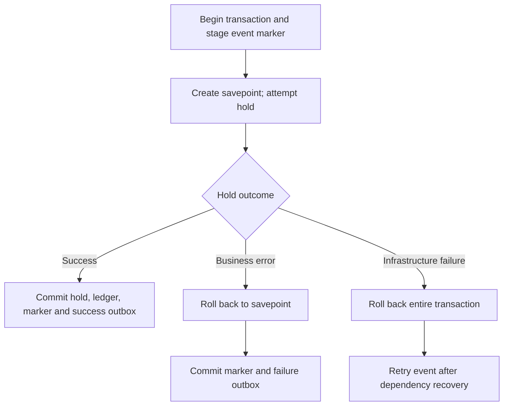

<!--
AI Assistance Disclosure:
Tool: Codex (model: GPT-6), date: 2026-10-25 to 2026-11-09
Scope: Source-linked implementation documentation and evidence review requested by Reallyeasy1; updated across 4 AI-assisted revisions through D4 wrap-up (document registration email validation mismatch and lazy initialization).
Author review: I validated correctness, edited for style, and verified with automated tests.
-->

# Credit Service: wallets, escrow and the ledger

Credit Service owns the virtual-credit economy: available balances, held rewards, payments, refunds and the record of each movement. Its HTTP API only reads the caller's wallet and ledger. Financial writes are driven by validated RabbitMQ events from User and Order.

The separation matters when debugging. [Order Service](../order-service/README.md) decides that an errand is completed; Credit decides whether its reserved reward can be settled and records the payment. A completion toast is not a wallet receipt. The full cross-service sequence is in [Order's Saga walkthrough](../order-service/README.md#submission-and-the-saga).

The behavior below was checked against main [`b989758`](https://github.com/AY2627S1-CS3219-P25/friend-on-campus/commit/b989758e766cb593c3b8c94102eb6dfb5c7d8491) on 9 November 2026. The [documentation index](../../README.md) separates source verification from runtime evidence.

## Follow ten credits

Suppose Mei and Arun each start with 100 available credits and no held reward. Mei offers 10 credits for an errand, Arun delivers it, and Mei confirms completion. These are integer virtual credits, not external payment-provider transactions.

| Point in the flow | Mei available | Mei escrow | Arun available | Arun earned | Ledger movement |
|---|---:|---:|---:|---:|---|
| After each welcome grant | 100 | 0 | 100 | 0 | One `WELCOME_GRANT` per account |
| Credit accepts Mei's reservation | 90 | 10 | 100 | 0 | `ESCROW_HOLD` |
| Arun accepts, picks up and delivers | 90 | 10 | 100 | 0 | No credit movement from these actions |
| Credit processes completion | 90 | 0 | 110 | 10 | `ESCROW_RELEASE` |

**Available** credits can fund another errand. **Escrow** credits are held for an existing errand and cannot be spent again. **Earned** credits track courier payouts, not the current spendable balance. If the errand is cancelled or expires instead, the refund moves Mei's 10 escrow credits back to available: 100 available, 0 escrow, with an `ESCROW_REFUND` ledger row.

Credit processes only the final financial triggers, so a courier unassigning from an errand does not refund the requester: the order reopens while its reservation remains held. The next courier can take the same funded errand.

A settled escrow cannot later be refunded, and a refunded escrow cannot later be settled. The service reports such contradictions rather than silently switching the outcome. These checks prevent a late/conflicting message from paying and refunding the same reward.

## Wallet initialization

An accepted `user.registered` event provides the initial grant. Credit creates a wallet, a `CreditGrant` marker and a `WELCOME_GRANT` ledger row in one transaction. A successful reservation can also initialize a missing requester wallet, and settlement can initialize a missing courier wallet, using the default grant of 100. If that surrounding transaction fails, its initialization does not commit either.

The marker records that the welcome grant has already happened. It is not inferred from today's balance, because a user may already have spent or earned credits. A wallet without its marker, a marker without its wallet, or a different grant amount for an existing marker is a consistency error. The service does not silently repair these cases or issue a second grant.

This also explains a temporary wallet `404` immediately after registration: User may have committed the account before Credit has consumed the registration event. A wallet read does not initialize it. Check event delivery before assuming the account needs another seed or registration.

**Some registration events are rejected rather than delayed.** User accepts email addresses up to 320 characters, while [Credit's event parser](../../../services/credit-service/src/credits/events.ts) rejects addresses longer than 254. For an otherwise accepted 255–320-character address, account creation can succeed and Credit can dead-letter the registration event as `invalid_event`. Replaying that unchanged event will fail again. Inspect the parser failure and DLQ alongside CDC progress; see the [User registration boundary](../user-service/README.md#when-waiting-for-the-wallet-is-not-enough).

The account may still gain a wallet later through the reservation or settlement paths above. For example, a successful first 10-credit reservation can atomically create the default 100-credit grant and leave 90 available plus 10 in escrow. That explains how a wallet can appear despite the rejected registration event; it does not resolve the differing email validation rules.

## HTTP and event contracts

### Wallet reads

Both routes require a verified access token. The user ID is taken from that token; a body/query parameter cannot select another user's wallet.

| Route | Response |
|---|---|
| `GET /api/credits/wallet` | Caller wallet: `userId`, `availableCredits`, `escrowCredits`, `totalEarnedCredits`, `updatedAt`; `404` if absent |
| `GET /api/credits/ledger` | Caller transactions as sender or recipient; sorted by `createdAt` descending, then ID descending; currently unpaginated |

Successful responses use `{ "success": true, "data": ... }`. Known Credit failures use `{ "success": false, "error": "..." }`. There are no HTTP reserve, settle, refund or administrative ledger-repair endpoints. The exact behavior is in [routes.ts](../../../services/credit-service/src/credits/routes.ts) and [store.ts](../../../services/credit-service/src/credits/store.ts).

After Mei's 10-credit reservation, the wallet portion of the response would be:

```json
{
  "success": true,
  "data": {
    "userId": "<requester-uuid>",
    "availableCredits": 90,
    "escrowCredits": 10,
    "totalEarnedCredits": 0,
    "updatedAt": "2026-11-09T12:00:00.000Z"
  }
}
```

This is an illustrative balance snapshot, not a seeded account or a result captured from the deployment. Compare it with the relevant order's ledger records rather than assuming every concurrent balance change belongs to that order.

### Incoming business events

| Routing key | Operation |
|---|---|
| `user.registered` | Initialize wallet and its single welcome grant |
| `order.reservation.requested` | Hold the reward or record a business rejection; publish the reservation result |
| `order.completed` | Pay the assigned courier from the matching reserved escrow |
| `order.cancelled` | Return the matching reserved escrow to the requester |
| `order.expired` | Return the matching reserved escrow to the requester |

The [event parser](../../../services/credit-service/src/credits/events.ts) checks the routing key against `eventType`, UUID identities, valid UTC ISO timestamps and positive 32-bit integer amounts. It normalizes UUID case and fingerprints the normalized payload. Extra envelope fields are ignored; optional `orderCode` is display metadata and is excluded from the fingerprint so compatible old replays still match.

### Results and receipts

| Outgoing event | What has committed |
|---|---|
| `credit.reservation.succeeded` | The reservation and its financial writes |
| `credit.reservation.failed` | A recorded business rejection; attempted hold writes were rolled back |
| `credit.escrow.settled` | Escrow settlement, courier credit and ledger transaction |
| `credit.escrow.refunded` | Escrow refund, requester credit and ledger transaction |

Reservation results retain the request correlation ID and carry order ID, requester ID and reward; failure includes a reason. Settlement/refund receipts use schema version 2 and producer `credit-service`, and identify the amount, beneficiary, ledger transaction ID/code and order/correlation IDs. Event-driven receipts also identify the causative Order event; `orderCode` remains optional display metadata.

A receipt is inserted into the Credit outbox in the same transaction as the financial movement. It therefore describes committed business state, but delivering that receipt to another service still depends on CDC and RabbitMQ. Notification can be delayed even after the payment is safely recorded.

## Transactions and replays

Two kinds of duplicate protection work together:

1. **Event identity:** `ProcessedCreditEvent` stores event ID, type and normalized fingerprint. Reprocessing the same identity is a no-op. Reusing the ID with a different type or normalized payload is a conflict.
2. **Business identity:** one grant belongs to each user and one escrow belongs to each order. A different event ID does not allow a second welcome grant, a second hold for the same order, or a second payout.

Escrow retains its original requester and amount. Replays must match both; settlement must also agree on the courier. Repeating a matching terminal action produces no new ledger row or receipt. An attempted reservation against a terminal escrow is rejected rather than reopening it.

These controls run inside a PostgreSQL **serializable transaction**: the database either commits the processed-event marker, financial changes, ledger and applicable outbox together, or commits none of them. Serializable isolation detects incompatible concurrent work; the store retries Prisma `P2034`/`P2002` conflicts up to ten total attempts. Each transaction has a ten-second timeout and five-second maximum connection wait. Those database retries are separate from later RabbitMQ delivery retries.

### Why insufficient credit differs from a database outage

Reservation processing creates a database savepoint before attempting the hold. A savepoint lets it undo the attempted financial changes while keeping the surrounding transaction alive.

For a new, validated reservation event, the three outcomes differ in what can be committed. Matching event replays have already returned before reaching this diagram:

*Legend: each arrow is the next step, and arrow labels name the condition; the diamond is a decision.*



For example, if Mei has only 5 available credits and offers 10, the attempted hold is rolled back and `credit.reservation.failed` commits with the event marker. Her balance remains 5 and Order can move to `REJECTED`. An unavailable database produces no committed failure result: the event must be retried, and Order may remain `PENDING`. This distinction prevents a dependency failure from being reported as insufficient funds.

The [financial service](../../../services/credit-service/src/credits/service.ts) defines this sequence; the [transaction adapter](../../../services/credit-service/src/credits/store.ts) implements savepoints, conditional balance changes and conflict retries. This gives idempotent financial effects over at-least-once message delivery. It is not exactly-once transport.

## Data to inspect when debugging

The [Prisma schema](../../../services/credit-service/prisma/schema.prisma) and [SQL migrations](../../../services/credit-service/prisma/migrations) define the six owned models:

| Model / table | Useful question it answers |
|---|---|
| `CreditWallet` / `credit_wallets` | What can this user spend, what is held, and what have they earned? |
| `CreditTransaction` / `credit_transactions` | Which movement occurred, for which order/participants, under which unique transaction code? |
| `CreditGrant` / `credit_grants` | Has this user already received the welcome grant, and for what amount? |
| `CreditEscrow` / `credit_escrows` | Is this order's reward `RESERVED`, `SETTLED` or `REFUNDED`, and for whom? |
| `ProcessedCreditEvent` / `processed_credit_events` | Was this event already processed with this normalized content? |
| `CreditOutboxEvent` / `credit_outbox_events` | Which result or receipt was committed for publication? |

Available and escrow balances must remain nonnegative, and financial amounts must be positive. Conditional updates require sufficient balance when moving a hold or releasing escrow. User/order IDs are cross-service scalar references; there are no foreign keys into User or Order databases.

The ledger is the operation record, whereas the wallet is the current balance. Use both when investigating a discrepancy. Outbox `status`/`retryCount` fields are not consumer acknowledgements: Debezium publishes committed inserts, and no application polling worker marks every downstream delivery complete.

For Mei and Arun's example, first inspect the escrow by order ID, then the ledger rows for that order. `SETTLED` with its 10-credit `ESCROW_RELEASE` and receipt means the payout committed; a late notification is a separate delivery problem. `RESERVED` means the completion has not yet produced a committed settlement. Check the Order completion outbox, Credit queue and processing failure before attempting recovery. Arun's current wallet alone is insufficient evidence: later rewards or spending can change it after this payout.

## Running and testing

Prepare dependencies, generated clients, migrated databases and credentials through [local development](../../development/local-development.md). Credit itself needs its PostgreSQL database, RabbitMQ and JWT verification key. The User/Order/Credit CDC chain is needed for end-to-end registration, reservation and financial receipt delivery.

Run from the repository root:

```sh
npm run dev -w @campus-errand/credit-service
```

The default port is 8004. `curl -i http://localhost:8004/health` checks process liveness. `curl -i http://localhost:8004/ready` checks the database, consumer and shutdown state; expect `200` when ready and `503` otherwise. Startup checks all six expected database models before serving. A fatal broker failure stops the process so its supervisor can restart it.

| Configuration | Default / purpose |
|---|---|
| `PORT`, then `CREDIT_SERVICE_PORT` | HTTP port, default 8004 |
| `DATABASE_URL`, then `CREDIT_DATABASE_URL` | Database connection; generic setting wins if both exist |
| `JWT_PUBLIC_KEY`, `JWT_ISSUER`, `JWT_AUDIENCE` | Offline access-token verification |
| `RABBITMQ_URL`, `CREDIT_EXCHANGE` | Broker connection; exchange defaults to `campus.events` |
| `CREDIT_QUEUE` | `credit-service.events` |
| `CREDIT_DLX`, `CREDIT_DLQ` | Defaults `<exchange>.dlx` and `<queue>.dlq` |
| `CREDIT_RETRY_DELAY_MS`, `CREDIT_RETRY_LIMIT` | Defaults 5,000 ms / 5 for bounded unknown-error retries |
| `USER_SERVICE_URL` | Development wallet seeding only; not the runtime reservation path |

The [seed implementation](../../../services/credit-service/src/database/seed.ts) resolves development identities through User login and initializes grants/wallets. Its fallback behavior is a development convenience. Do not use a seed run as a repair for an existing financial ledger.

The focused test command needs no database or broker:

```sh
npm run test:unit -w @campus-errand/credit-service
```

It runs financial-rule, replay/parser and transaction-retry tests with test doubles. Other suites use disposable infrastructure:

| Workspace script | What it verifies |
|---|---|
| `test:integration` | Real PostgreSQL financial and concurrency checks |
| `test:messaging` | PostgreSQL/RabbitMQ delivery, retry and replay behavior |
| `test:migration` | Temporary-schema checks of the original migration; not all later outbox/CDC migrations |
| `test:seed` | Development identity and seed behavior |

Run them with `npm run <script> -w @campus-errand/credit-service` after preparing the prerequisites in the [testing guide](../../development/testing-strategy.md). The database-backed suites require `CREDIT_TEST_DATABASE_URL` pointing to a dedicated `_test` database; messaging also uses `CREDIT_TEST_RABBITMQ_URL`. Inspect the [test files](../../../services/credit-service/tests) and [aggregate runner](../../../scripts/ci/run-all-tests.mjs) before a direct run, because they create/delete test state. A green unit suite is not financial acceptance evidence for a live deployment.

## Troubleshooting

| Symptom | Inspect first | Meaning / next step |
|---|---|---|
| Wallet `404` after successful registration | User registration outbox, User CDC, Credit consumer and invalid-event DLQ entries | Distinguish delivery lag from the [320/254 email-limit mismatch](#wallet-initialization); the GET route does not initialize a wallet |
| Order is `PENDING`, no hold exists | Reservation event reaching Credit, parser failures and DLQ | Determine whether processing has started; do not replay an unrelated or reconstructed financial command |
| Hold exists but order remains `PENDING` | Credit result outbox, Credit CDC, Order result consumer | The money can be reserved before Order observes the result |
| Completion/cancellation succeeded, balance appears stale | Order lifecycle event, escrow state, corresponding ledger row and receipt | Separate delayed processing from committed payment with delayed UI delivery |
| Duplicate event does nothing | Event ID/type/fingerprint and escrow state | Matching replays are expected no-ops; a new financial record should not be forced |
| Event fails with identity/state conflict | Original requester/amount/courier, grant marker and prior terminal escrow state | Investigate the conflicting source event or data; automatic repair could pay/refund twice |
| `/health` passes while finance stalls | `/ready`, CDC progress, queue/DLQ backlog and database errors | HTTP liveness alone does not establish a working event chain |

The [consumer](../../../services/credit-service/src/credits/consumer.ts) dead-letters malformed events, business conflicts and recognized permanent database constraints. Recognized infrastructure failures use delayed retry outside the application's transient-attempt cap; unknown errors use the configured bound before dead-lettering. Broker-level limits still matter; consult [message recovery](../../infrastructure/cdc-and-broker.md).

There is no general automated DLQ replay, business repair or HTTP ledger-repair API. Fix the underlying cause, retain the event/escrow identities, and use a reviewed recovery procedure. Repeated manual writes or reseeding are not substitutes for following the failed transaction and event chain.

[Documentation index](../../README.md) · [Order Service](../order-service/README.md)
