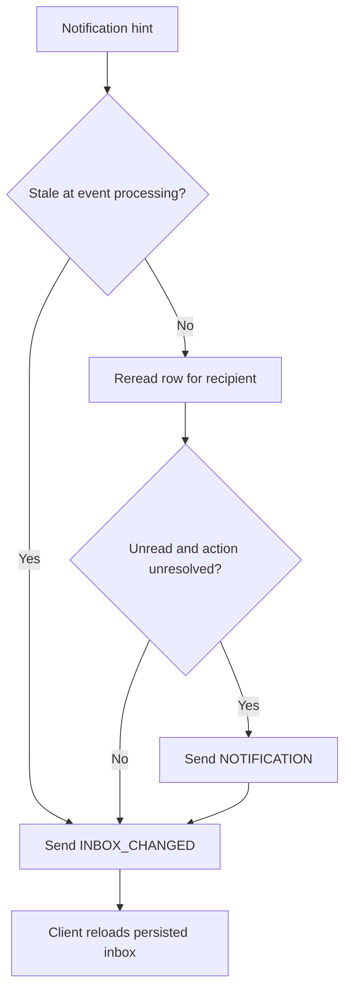
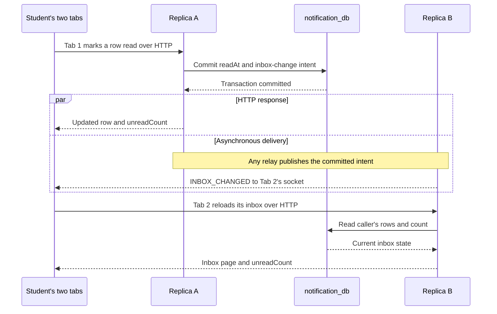

<!--
AI Assistance Disclosure:
Tool: Codex (model: GPT-6), date: 2026-11-09
Scope: Add concrete receipt/read-state examples, clarify the legacy event envelope, and diagram read-state synchronization between replicas.
Author review: <to be completed by Reallyeasy1>

Tool: Codex (model: GPT-6), date: 2026-11-09
Scope: Consolidate recipient policy, inbox/read contracts, persistence, realtime eligibility and operational diagnosis into one source-checked guide.
Author review: <to be completed by Reallyeasy1>

Tool: Codex (model: GPT-6), date: 2026-11-09
Scope: Reconcile current implementation, contracts, realtime delivery and verification limits; preserve historical records.
Author review: <to be completed by the author>

Tool: Codex (model: GPT-6), date: 2026-10-25
Scope: Source-linked implementation documentation and evidence review requested by Reallyeasy1.
Author review: <to be completed by Reallyeasy1>
-->

# Notification Service

Notification turns committed business events into a student's durable inbox. It decides **who should hear about a change and what they need to do next**; it does not accept errands, settle payments or authorize those commands. Its HTTP API is `/api/notifications`, its WebSocket endpoint is `/ws/`, and its local port is **8005**.

Consider a completed delivery. `order.delivered` asks the requester to review it. When the requester confirms, `order.completed` tells the courier that confirmation happened. A separate `credit.escrow.settled` receipt says the credits were actually transferred. The distinction is intentional: Order confirmation can precede Credit settlement because the two services process events asynchronously.

For a 12-credit errand, the courier can therefore see “Delivery confirmed” before “12 credits received.” Once Notification processes the settlement event, the receipt is stored even if the courier has no connected browser. Reading that receipt only marks an inbox row read; it neither transfers credits nor changes the wallet. Receipt toasts are suppressed by the frontend, so no toast is also the expected behavior for a successfully stored receipt.

## Who receives an inbox item

The service consumes nine Order routing keys and two Credit receipt keys from `campus.events`. The [recipient policy](../../../services/notification-service/src/notifications/policy.ts) maps each validated fact to zero or more recipient rows; its current policy version is 1.

| Committed event | Recipient and useful outcome |
|---|---|
| `order.created` | Requester: the errand is published |
| `order.accepted`, `order.in_transit` | Requester: courier acceptance and pickup progress |
| `order.delivered` | Requester: high-priority delivery review action |
| `order.completed` | Courier when the requester confirms; requester and courier when an administrator completes it |
| `order.cancelled` | Assigned courier for requester cancellation; requester and any assigned courier for administrator cancellation |
| `order.expired` | Requester: expiry or publication-deadline failure |
| `order.rejected` | Requester: credit reservation/publication failure; insufficient-credit cases point to the wallet |
| `order.unassigned` | Requester; also the prior courier when an administrator removes them |
| `credit.escrow.settled` | Validated courier beneficiary: credits received, with amount and transaction code |
| `credit.escrow.refunded` | Validated requester beneficiary: credits returned, with amount and transaction code |

For Order events, duplicate recipient IDs are removed and the acting user is excluded when `actorId` is present. No intended recipient is a valid outcome: the service records that event as suppressed rather than repeatedly trying to create a row. Credit receipts name their financial beneficiary and are not inferred from an Order status.

Version-1 compatibility produces only the original accepted, picked-up and delivered requester alerts. A legacy V1 envelope **omits `schemaVersion`**; an explicit `schemaVersion: 1` is rejected. Expanded recipients require the V2 fields, including producer, committed Order version, actor/status data and applicable reasons. [`events.ts`](../../../services/notification-service/src/notifications/events.ts) checks the envelope against the routing key before applying this policy.

## From a fact to durable inbox state

The handler normalizes the event and computes a payload fingerprint. [`store.applyEvent`](../../../services/notification-service/src/notifications/store.ts) then performs one transaction:

1. Claim `(producer,event_id)`. An already processed key with the same known fingerprint is a no-op; a different fingerprint is a contract error.
2. For an Order V2 fact, advance the local Order projection only if its version is newer.
3. Insert all recipient rows, or record a suppressed outcome when the policy chose none.
4. When there are recipients, store their realtime delivery intent alongside the changes before committing and acknowledging the business message.

An older Order version cannot move the projection backwards. Its historical inbox rows can still be stored, but their intent is marked stale so they are not pushed as a new live notification. Credit receipts use their own producer scope and do not advance the Order projection. Legacy processed records can have a null fingerprint, so duplicate handling for those rows cannot establish payload equality.

| Table | Responsibility and important key |
|---|---|
| `notifications` | Recipient, content, category/priority/action and read timestamps; unique `(producer,event_id,user_id,kind)` |
| `processed_notification_events` | Event deduplication and normalized fingerprint; primary key `(producer,event_id)`; records schema/policy version and created/suppressed/legacy outcome |
| `order_notification_state` | Latest observed Order version, status and participants, keyed by `order_id`; controls display state, not command authorization |
| `notification_realtime_outbox` | Unique delivery event, retry time and lease metadata, indexed by availability/creation time |

The [schema and indexes](../../../services/notification-service/prisma/schema.prisma) support recipient-scoped reads. `createdAt` preserves when the source event occurred; `storedAt` is when the row reached the inbox. These may differ after a delay or retry. There is no service API for deleting inbox history.

## The inbox API

All routes use the verified token's user ID. There is no recipient parameter and no administrator bypass: an administrator can read only their own notification inbox through these endpoints.

| Request | Input / response |
|---|---|
| `GET /api/notifications` | Optional `view`, `unread`, `page`, `limit`; returns `data: {items,total,page,limit,totalPages,unreadCount}` |
| `PATCH /api/notifications/:id/read` | UUID notification ID; returns `data: NotificationDTO` and `meta: {unreadCount}` |
| `POST /api/notifications/read-all` | No recipient/body needed; returns `data: {updated,unreadCount}` |

For example, `GET /api/notifications?view=action_needed&unread=true&page=1&limit=20` selects the caller's unread delivery-review items whose locally projected order is still `DELIVERED` or whose projection is not yet known. The response's `unreadCount` still counts **all** unread items for that caller, not just the filtered page.

| Query | Meaning / validation |
|---|---|
| `view=all` | Default inbox view |
| `view=action_needed` | Unresolved delivery-review actions; independent of whether the row is read |
| `view=important` | Category `IMPORTANT`; does not mean every high-priority or actionable item |
| `unread=true` | Add an unread-only filter; other values do not enable it |
| `page`, `limit` | Page defaults to 1 and has minimum 1; limit defaults to 20 and clamps to 1–100. Integer conversion/fallback is permissive |

Invalid views return 400 `INVALID_VIEW`. Invalid, missing and other-user notification IDs all return 404 `NOTIFICATION_NOT_FOUND`, so the read endpoint does not reveal another user's row. Shared authentication can return 401. Source: [routes](../../../services/notification-service/src/notifications/routes.ts) and [DTOs](../../../packages/common-dtos/src/index.ts).

Rows sort by `storedAt DESC, id DESC`. Pagination is offset-based, so a new arrival can shift rows between page requests. The list queries execute inside a Prisma transaction without explicit repeatable-read isolation; do not treat the result as an immutable snapshot under concurrent writes.

Reading a row preserves its first `readAt`; repeating the call does not move that timestamp. Mark-all changes only the caller's unread rows stored by the transaction's time boundary, so later arrivals remain unread. Read changes and their delivery intent commit together. A delivery action is resolved by the projected Order lifecycle, not merely by marking the notification read.

For example, marking “Review the delivery” read removes it from `unread=true` results, but it remains in `view=action_needed` while the local Order projection is still `DELIVERED`. Confirming the delivery is a separate Order command. When the resulting completion event advances the projection, the review item stops matching `action_needed`; the historical inbox row remains.

## Live updates and read-state synchronization

The socket's first frame must be `AUTH` with a valid access token within five seconds. Invalid or expired credentials close with 4401; a 30-second heartbeat removes unresponsive connections. Later client frames are ignored: mark-read operations use HTTP.

| Server frame | What the client should do |
|---|---|
| `AUTH_OK` with `unreadCount` | Reconcile through REST, including changes during connection setup |
| `NOTIFICATION` with `data: NotificationDTO` | Display or merge an eligible live item; it is not the complete inbox |
| `INBOX_CHANGED` | Refetch inbox/count; do not increment or decrement a counter from the signal alone |

The shared [realtime transport](../../infrastructure/cdc-and-broker.md) sends hints to every running replica. Notification's subscriber then rereads the owner and **current stored state**, rather than trusting an old payload. This service-specific check prevents a delayed hint from restoring an item that the student already read or an action that a newer Order event resolved:



A missing or wrong-owner row also skips `NOTIFICATION`. The `INBOX_CHANGED` path still runs for valid recipients even when the intent was stale or the live item was suppressed. An event that produced no recipients does not create such an intent.

When one tab marks a row read, other tabs on any replica receive an inbox-change hint and refetch. [`useNotifications.ts`](../../../apps/student-app/src/notifications/useNotifications.ts) reconciles on authentication/reconnection and hints, merges by ID and avoids repeated toasts for already seen IDs. [`inbox.ts`](../../../apps/student-app/src/notifications/inbox.ts) suppresses receipt/publication-confirmation toasts and can use the frontend's newer Order state to hide resolved delivery actions.

The following successful-delivery example uses two tabs belonging to the same student. The HTTP response and asynchronous hint can arrive in either order; both refer back to the committed inbox state.



`INBOX_CHANGED` carries no row or count. If Tab 2 misses that hint, Tab 1's committed `readAt` still exists; a later REST reconciliation recovers it. If a delayed new-notification intent arrives after the read, the subscriber rereads the row and skips its `NOTIFICATION` frame, while still sending the inbox-change hint. The [store](../../../services/notification-service/src/notifications/store.ts), [subscriber delivery](../../../services/notification-service/src/notifications/realtime.ts) and [hub](../../../services/notification-service/src/ws/hub.ts) implement these separate steps.

Live signals can repeat or be missed; neither the bounded subscriber cache nor broker confirmation means every browser received them. REST inbox state is the recovery source. The linked Order/Credit endpoint always checks current permissions and state again when the student acts on an item.

## Running and configuring Notification

Complete [local setup](../../development/local-development.md) before starting this service: JWT verification configuration, PostgreSQL/RabbitMQ and migrations are required, and User/Order/Credit CDC must run to observe real business events. From the repository root:

```bash
# AI-generated (edited by Reallyeasy1)
npm run db:deploy -w @campus-errand/notification-service
npm run dev -w @campus-errand/notification-service
```

The first command applies committed migrations to the configured database without resetting or seeding it; use your development database. The second starts the service watcher. `/health` reports sockets and business/realtime connection state. `/ready` requires a database ping, connected business consumer and realtime subscriber, and no shutdown in progress.

| Configuration | Default / purpose |
|---|---|
| `PORT` / `NOTIFICATION_SERVICE_PORT` | 8005; `PORT` takes priority |
| `DATABASE_URL` / `NOTIFICATION_DATABASE_URL` | Notification database; direct `DATABASE_URL` takes priority |
| `JWT_PUBLIC_KEY`, `JWT_ISSUER`, `JWT_AUDIENCE` | Shared offline token verification |
| `RABBITMQ_URL`, `NOTIFICATION_EXCHANGE`, `NOTIFICATION_QUEUE` | Broker credentials/address; `campus.events`; `notification-service.events` |
| `NOTIFICATION_DLX`, `NOTIFICATION_DLQ` | `<queue>.dlx`, `<queue>.dlq` by default |
| `NOTIFICATION_RETRY_DELAY_MS`, `NOTIFICATION_RETRY_LIMIT` | 2000 ms and 5 for transient business-event failures |
| `RABBITMQ_REALTIME_EXCHANGE` | `notification-service.events.realtime` |

Configuration lives in [`config.ts`](../../../services/notification-service/src/config.ts) and [`.env.example`](../../../.env.example). Keep broker/database credentials out of examples and reports. Queue declarations must agree with the [broker topology](../../infrastructure/cdc-and-broker.md); redeploying an existing classic queue with a quorum declaration is not an in-place conversion.

## Failure handling and diagnosis

The business consumer uses a quorum queue with prefetch/concurrency one. Invalid envelopes and fingerprint conflicts are permanent errors. Recognized infrastructure failures retry outside the application's transient threshold; other failures retry while the broker-reported delivery count is below the configured limit (5 by default). Permanent/exhausted failures dead-letter through the configured DLX/DLQ. Native broker delivery limits are a separate constraint, and a retry delay occupies the replica's consumer slot.

Realtime publication/subscription is separate: a failed outbox publication remains scheduled for retry, but a published live hint can be lost after the bounded subscriber retries or while a browser is offline. That subscriber has **no DLQ**. Inspect the [messaging guide](../../infrastructure/cdc-and-broker.md) for the common lease, queue and retry parameters.

When the realtime subscription is lost, existing sockets close and new ones are refused with 1013 until it is ready again. Clients must reconnect and fetch the inbox. A fatal business-consumer connection/startup failure triggers bounded shutdown. Termination stops readiness, drains work and closes relay/subscriber/consumer, HTTP/sockets and database resources with a ten-second hard deadline. See [`index.ts`](../../../services/notification-service/src/index.ts) and [`app.ts`](../../../services/notification-service/src/app.ts).

Diagnose the first missing step rather than treating every absent toast as a lost event:

| Symptom | Check next |
|---|---|
| No inbox row exists | Trace the producer's committed event, CDC, business queue and consumer logs; check actor/recipient suppression and dead letters |
| Inbox row exists, but no toast | Check whether it is a quiet receipt/publication item, already read, stale or a resolved delivery action before investigating transport |
| Row appears only after refresh | Compare realtime health, pending delivery intents and receiving replica subscription; durable processing may have succeeded |
| Tabs disagree on unread count | Compare authenticated REST counts, then the inbox-change and reconnect paths; do not repair the count by counting frames |
| Delivery review remains visible | Compare projected Order version/status with actual Order state; the projection can lag |
| Payment receipt has not arrived | Verify the financial outcome in Credit, then its receipt event and CDC; an Order completion alone does not prove settlement |
| Consumer stops advancing | Inspect the in-flight retry and dependency health as well as queue depth; prefetch one can hold later work behind that event |

Do not replay or purge a queue simply to clear an alert. Identify the owning workflow and its idempotency behavior first. Automated dead-letter inspection/replay and a complete operational-alert loop are not implemented just because a DLQ exists.

## Tests and evidence

Use isolated dependencies from the [testing guide](../../development/testing-strategy.md), then run from the repository root:

```bash
# AI-generated (edited by Reallyeasy1)
npm run test:unit -w @campus-errand/notification-service
npm run test:integration -w @campus-errand/notification-service
npm run test:messaging -w @campus-errand/notification-service
```

Integration requires `NOTIFICATION_TEST_DATABASE_URL`; messaging/realtime integration also requires `NOTIFICATION_TEST_RABBITMQ_URL`. Missing prerequisites cause skips, not evidence that those scenarios passed. Do not point event-injection suites at production.

| Tests | Useful evidence supplied when executed with prerequisites |
|---|---|
| [`events.test.ts`](../../../services/notification-service/test/events.test.ts), [`policy.test.ts`](../../../services/notification-service/test/policy.test.ts) | V1/V2 validation, recipients, actor suppression, financial receipts and failure classification |
| [`hub.test.ts`](../../../services/notification-service/test/hub.test.ts), [`realtime.test.ts`](../../../services/notification-service/test/realtime.test.ts) | Socket authentication/expiry and live-delivery eligibility |
| [`store-routes.integration.test.ts`](../../../services/notification-service/test/store-routes.integration.test.ts) | Atomic recipients/deduplication, conflicting fingerprints, projections, filters and owner-scoped read operations |
| [`messaging.integration.test.ts`](../../../services/notification-service/test/messaging.integration.test.ts), [`realtime.integration.test.ts`](../../../services/notification-service/test/realtime.integration.test.ts) | Real database/broker behavior, two replicas, duplicate/stale/read/resolved signals, leases, reconnects and persisted recovery |

Browser scenarios live in [`uat-realtime.mjs`](../../../scripts/uat/uat-realtime.mjs); inspect its account and infrastructure assumptions before reuse. Source checked against application commit [`b989758`](https://github.com/AY2627S1-CS3219-P25/friend-on-campus/commit/b989758e766cb593c3b8c94102eb6dfb5c7d8491), 9 November 2026. Shared verification limits are in the [documentation index](../../README.md). Earlier design and review material remains available in [the pinned pre-consolidation record](https://github.com/AY2627S1-CS3219-P25/friend-on-campus/blob/c45f9ed0eb46a54ac68937393e0355da34dd9f9d/docs/archive/services/notification-service/structure-review.md).
