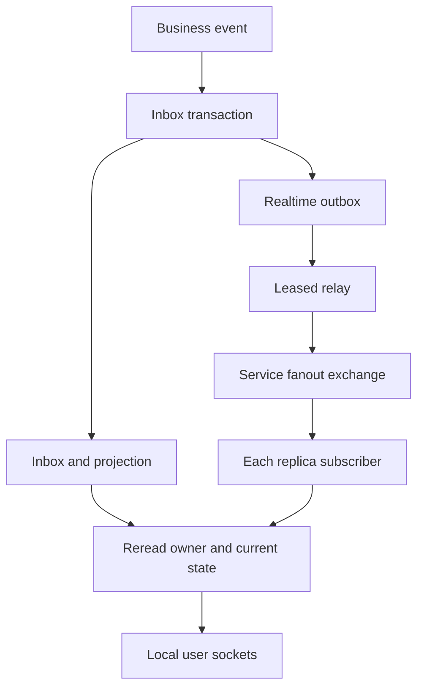

<!--
AI Assistance Disclosure:
Tool: Codex (model: GPT-6), date: 2026-11-09
Scope: Reconcile current implementation, contracts, realtime delivery and verification limits; preserve historical records.
Author review: <to be completed by the author>

Tool: Codex (model: GPT-6), date: 2026-10-25
Scope: Source-linked implementation documentation and evidence review requested by Reallyeasy1.
Author review: <to be completed by Reallyeasy1>
-->

# Notification execution paths

Implementation checked against [`b989758`](https://github.com/AY2627S1-CS3219-P25/friend-on-campus/commit/b989758e766cb593c3b8c94102eb6dfb5c7d8491), 2026-11-09 (SGT). This describes repository behavior, not verified deployment state.

[Service overview](README.md) · [Contracts and data](contracts-and-data.md) · [Reliability and tests](reliability-and-testing.md)

## Event to durable inbox

[`events.ts`](../../../services/notification-service/src/notifications/events.ts) parses a business event, computes a normalized fingerprint and calls the recipient [policy](../../../services/notification-service/src/notifications/policy.ts). [`store.applyEvent`](../../../services/notification-service/src/notifications/store.ts) then performs one database transaction:

1. Insert the processed-event key and fingerprint. A matching duplicate returns without another inbox write; a conflicting fingerprint raises `ContractMismatch`.
2. For Order V2, advance the order projection only for a greater committed Order version.
3. Insert all intended recipient rows, or record the event as suppressed if none are needed.
4. Store the realtime delivery intent alongside the new rows, then commit before acknowledging the business message.

The Credit receipt path uses the `credit-service` producer scope and does not modify the Order projection. Legacy processed rows can have no fingerprint, so their replay does not establish payload equality. Older/equal Order versions cannot move the projection backwards; their historical inbox rows can still be recorded, but are marked stale for live delivery.

## Cross-replica delivery

Every running replica creates a temporary queue bound to the Notification fanout exchange. The [shared relay](../../packages/messaging.md#realtime-delivery) publishes committed intents and deletes them only after broker confirmation. [`realtime.ts`](../../../services/notification-service/src/notifications/realtime.ts) receives hints and rereads the authoritative Notification rows before sending through its [local socket hub](../../../services/notification-service/src/ws/hub.ts).

A notification is pushed only if it still belongs to the target user, is unread, has no resolved delivery action and the intent is not stale. `INBOX_CHANGED` still prompts recipients to refetch for suppressed/stale live items. This prevents a delayed hint from resurrecting a read notification or a delivery action already resolved in the local projection. A signal carries references; it does not overwrite persisted state.

The shared subscriber caches recently successful event IDs, with bounded memory. This reduces duplicate frames but is not permanent deduplication. Missing or repeated live hints remain possible; the inbox is durable and REST is the recovery source.

## Reading and reconciliation

`PATCH /:id/read` scopes the update to the caller, preserves the first `readAt`, and commits an `INBOX_CHANGED` intent in the same transaction. Repeating mark-one may create another hint but does not move the read timestamp. `POST /read-all` creates a hint only when rows changed. Both return an unread count from the store.

The list route queries items, filtered total and the global unread count inside a Prisma transaction. It does not explicitly select repeatable-read isolation, so this should not be described as an immutable snapshot under concurrent writes.

[`useNotifications.ts`](../../../apps/student-app/src/notifications/useNotifications.ts) refetches on authentication/reconnection and inbox hints, merges by row ID and avoids repeating toasts for a seen notification ID. [`inbox.ts`](../../../apps/student-app/src/notifications/inbox.ts) also uses available live Order state when deciding whether to show delivery review. These are UI reconciliation controls; Order and Credit remain authoritative for business outcomes.
