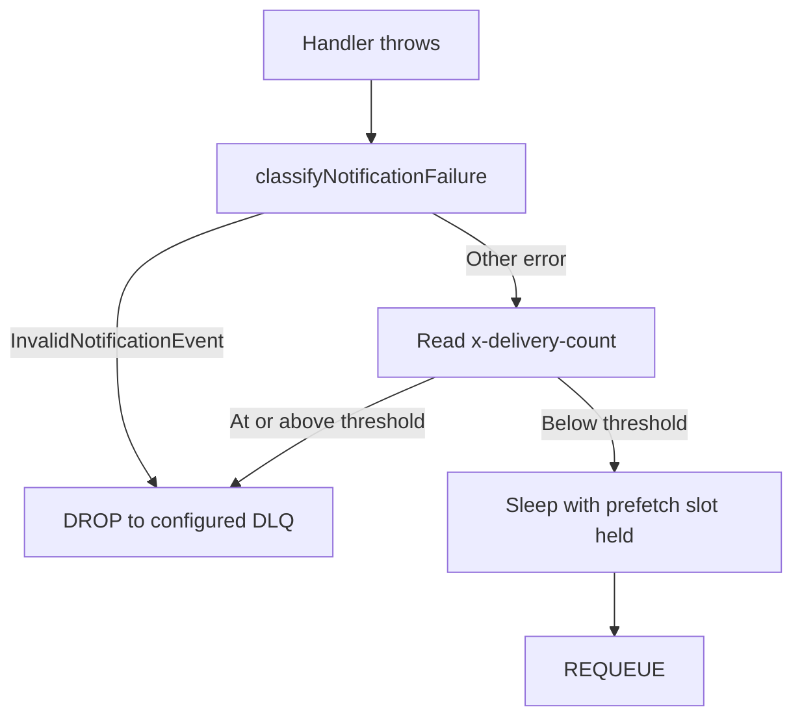

<!--
AI Assistance Disclosure:
Tool: Codex (model: GPT-6), date: 2026-10-25
Scope: Source-linked implementation documentation and evidence review requested by Reallyeasy1.
Author review: <to be completed by Reallyeasy1>
-->

# Notification reliability and tests

Implementation baseline: [`52d791e`](https://github.com/AY2627S1-CS3219-P25/friend-on-campus/commit/52d791e4eea28ce7d817f025ef096f8d96bda467); inspected 2026-10-25 (SGT). Pending work is explicitly labelled.

## Implemented guarantees and limits

| Mechanism | Supported statement | Limit |
|---|---|---|
| Unique event_id insert | Duplicate event does not create a second row | One recipient per event on main; no payload-fingerprint conflict check |
| Store before push | Committed notification remains queryable after missed hint | Replay does not durably resend socket frame |
| Owner predicates | REST and socket delivery scoped to authenticated user | Tokens are offline claims until expiry |
| Quorum queue and DLQ | Broker redelivery/dead-letter path is configured | No automatic DLQ replay/alert worker |
| Process-local socket Set | Multiple tabs attached here receive push | No cross-replica fan-out guarantee |
| /ready | Database query and bound consumer checked | Does not prove producer CDC or end-to-end delivery |

`InvalidNotificationEvent` is permanent. Every other handler failure, including database outage, is transient at this baseline. Shared messaging sleeps 2 seconds while holding the only prefetch slot, then requeues while x-delivery-count is below 30; at/above it the message is dropped into the configured dead-letter route. The threshold is not an independently verified total-attempt count or a precise wall-clock deadline. The shared infrastructure-unbounded category is not selected here.

## Test and operational evidence

| Test/source | Establishes |
|---|---|
| events.test.ts | Parsing, mapping, malformed events and duplicate/no-push behavior |
| hub.test.ts | Authentication and user-scoped socket behavior; inspect exact cases before claiming liveness coverage from pending PR tests |
| store-routes.integration.test.ts | Real PostgreSQL persistence, owner scoping, read behavior and pagination |
| messaging.integration.test.ts | Broker delivery/dedup and malformed-event dead-lettering |
| uat-notifications.mjs | Standalone event→store→socket/REST acceptance chain |
| notification_collection.json | REST/F5 Postman collection |

Run workspace test:unit; integration requires NOTIFICATION_TEST_DATABASE_URL, messaging also NOTIFICATION_TEST_RABBITMQ_URL. These suites skip without prerequisites. Current-main tests do not cover every DB-outage exhaustion/recovery or crash-before-push scenario. PR #184 incorporates additional tests from #140; do not attribute them to main.

For diagnosis inspect readiness, `rabbitmq_consumer_failure` action/log context, queue/DLQ state, stored row and REST history separately. No DLQ message should be automatically replayed by this documentation workflow. Source comments claiming unfinished delivered mapping are stale; implementation/tests contain it.

Local checks and blocked infrastructure are recorded in the central verification record. No broker or database outage was induced by this documentation change.

Related contracts: [event catalogue](../../architecture/communication-and-events.md), [shared DTOs](../../packages/common-dtos.md), and [messaging semantics](../../packages/messaging.md).

## Source evidence and related reading

- [`services/notification-service/src/notifications/events.ts`](../../../services/notification-service/src/notifications/events.ts)
- [`services/notification-service/src/config.ts`](../../../services/notification-service/src/config.ts)
- [`services/notification-service/test/events.test.ts`](../../../services/notification-service/test/events.test.ts)
- [`services/notification-service/test/hub.test.ts`](../../../services/notification-service/test/hub.test.ts)
- [`services/notification-service/test/store-routes.integration.test.ts`](../../../services/notification-service/test/store-routes.integration.test.ts)
- [`services/notification-service/test/messaging.integration.test.ts`](../../../services/notification-service/test/messaging.integration.test.ts)
- [`packages/messaging/src/index.ts`](../../../packages/messaging/src/index.ts)
- [`scripts/uat/uat-notifications.mjs`](../../../scripts/uat/uat-notifications.mjs)
- [`tests/postman/notification_collection.json`](../../../tests/postman/notification_collection.json)
- [Wiki: Notification Service](https://github.com/AY2627S1-CS3219-P25/friend-on-campus/wiki/Notification-Service)
- [Documentation index](../../README.md) · [Drift register](../../audits/documentation-drift.md) · [Verification record](../../audits/review-findings.md)
