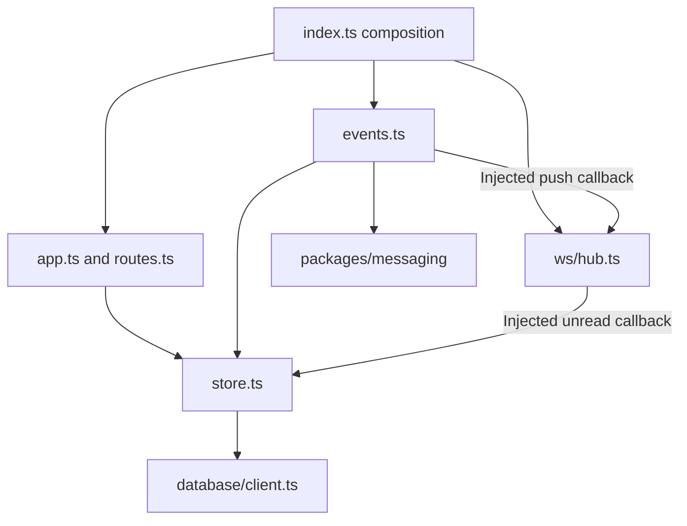

<!--
AI Assistance Disclosure:
Tool: Codex (model: GPT-6), date: 2026-10-25
Scope: Source-linked implementation documentation and evidence review requested by Reallyeasy1.
Author review: <to be completed by Reallyeasy1>
-->

# Notification structure review

Implementation baseline: [`52d791e`](https://github.com/AY2627S1-CS3219-P25/friend-on-campus/commit/52d791e4eea28ce7d817f025ef096f8d96bda467); inspected 2026-10-25 (SGT). Pending work is explicitly labelled.

This is a factual review to support a later human-led redesign. It does not select new component boundaries, patterns, interfaces, schemas or trade-offs. The user approved documentation and inspection, not production refactoring.

## Current tree and responsibilities

| Path | Existing responsibility/dependencies |
|---|---|
| src/index.ts | Composition of config, Prisma store, socket hub, app and consumer |
| src/app.ts | Express/probes/auth and route registration |
| src/config.ts | Environment and validation |
| src/database/client.ts | Prisma facade |
| src/notifications/events.ts | Event parsing, mapping, consumer setup, failure classification and store/push orchestration |
| src/notifications/store.ts | Database adapter and DTO mapping |
| src/notifications/routes.ts | HTTP validation, owner scoping and store calls |
| src/ws/hub.ts | Socket lifecycle/auth/registry, unread-count callback and delivery |
| prisma/ | Schema and committed migration |
| test/ | Unit, PostgreSQL and broker suites |

## Evidence-based observations

| Observation | Evidence/implication |
|---|---|
| Composition is explicit | index supplies dependencies; route/event factories and callback seams permit focused tests |
| events.ts holds several responsibilities | Parser, mapping, retry classifier, subscription list and delivery orchestration are co-located; changes to one domain behavior can touch this file |
| Persistence and delivery have separate failure boundaries | store commits before injected push; no durable push acknowledgement joins them |
| Data model constrains mapping | Global event_id uniqueness means one stored row per event; merely returning multiple recipients would conflict |
| Error handling differs across entrypoints | REST error middleware, WebSocket close codes and consumer classifications are separate mechanisms |
| Lifecycle functions exist without production wiring | hub.close and shared consumer.close are available; index installs no graceful signal handler |
| Socket state is local | byUser registry belongs to one process, not a shared delivery registry |
| Stale source comment | events TODO contradicts implemented delivered mapping; record drift without editing production code |

These facts inform cohesion, coupling, dependency direction and testability discussion without assigning a generic SOLID score or prescribing abstractions. No evidence requires adding a new architectural layer merely because the file has several functions.

## Human decisions and pending work

PR #184 adds policy.ts, transactional multi-recipient processing and order projections, but remains unmerged. Its plan is evidence of proposed work, not automatically approved target architecture. See [PR review](../../audits/pr-184-review.md) for implemented branch behavior, compatibility and defects. The inspected Wiki proposal and issue texts do not independently establish a final human-approved replacement structure.

Questions remain with the team: which pending design/specification is authoritative; whether deployment permits mixed binaries; required historical inbox reconciliation; intended multi-instance delivery behavior; acceptable failure/replay policy. This document does not answer those questions for the author.

## Verification checklist for a later approved migration

- Trace every existing route, event binding, auth check and socket close behavior through the approved new structure.
- Exercise populated database upgrade, legacy rows/read timestamps, duplicate IDs and rollback compatibility.
- Verify recipient isolation, concurrent processing, partial-write rollback and malformed messages.
- Exercise outage/retry/DLQ, crash-after-commit and missed-hint REST recovery.
- Verify account changes, pagination, filter removal, multi-tab updates and authoritative action state.
- Compare broker permissions, producer contracts, generated clients, tests and CI against the approved target.

This is a checklist of evidence to collect, not authorization to perform the migration or alter production code.

## Source evidence and related reading

- [`services/notification-service/src/index.ts`](../../../services/notification-service/src/index.ts)
- [`services/notification-service/src/app.ts`](../../../services/notification-service/src/app.ts)
- [`services/notification-service/src/notifications/events.ts`](../../../services/notification-service/src/notifications/events.ts)
- [`services/notification-service/src/notifications/store.ts`](../../../services/notification-service/src/notifications/store.ts)
- [`services/notification-service/src/notifications/routes.ts`](../../../services/notification-service/src/notifications/routes.ts)
- [`services/notification-service/src/ws/hub.ts`](../../../services/notification-service/src/ws/hub.ts)
- [`services/notification-service/prisma/schema.prisma`](../../../services/notification-service/prisma/schema.prisma)
- [Wiki: Notification Service](https://github.com/AY2627S1-CS3219-P25/friend-on-campus/wiki/Notification-Service)
- [Documentation index](../../README.md) · [Drift register](../../audits/documentation-drift.md) · [Verification record](../../audits/review-findings.md)
