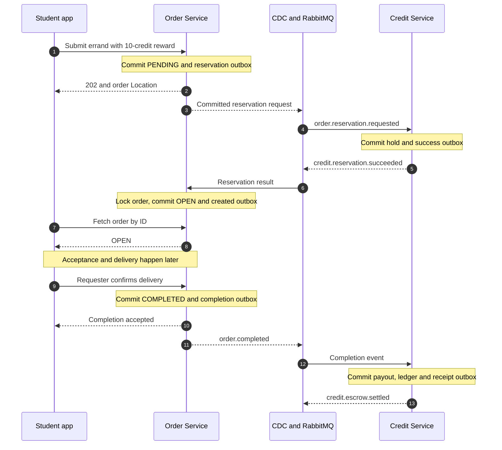
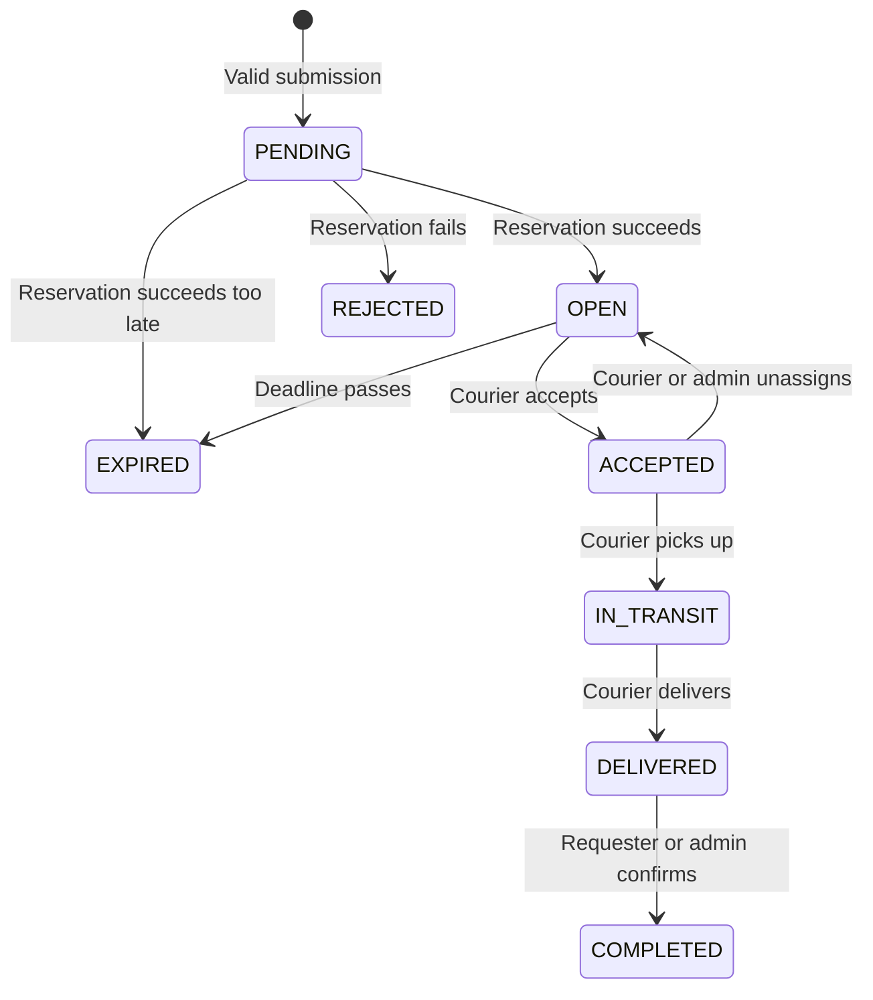

<!--
AI Assistance Disclosure:
Tool: Codex (model: GPT-6), date: 2026-11-09
Scope: Consolidate Order contracts, Saga, runtime and tests into one developer guide with concrete examples and focused diagrams.
Author review: <to be completed by Reallyeasy1>

Tool: Codex (model: GPT-6), date: 2026-10-25
Scope: Source-linked implementation documentation and evidence review requested by Reallyeasy1.
Author review: <to be completed by Reallyeasy1>

Tool: Codex (model: GPT-6), date: 2026-11-09
Scope: Reconciled this guide with current service code, schemas, configuration and tests; consolidated duplicated reference material.
Author review: <to be completed by Reallyeasy1>

Tool: Codex (model: GPT-6), date: 2026-10-25
Scope: Source-linked implementation documentation and evidence review requested by Reallyeasy1.
Prior diagram attribution: AI-generated (edited by Reallyeasy1).
Author review: <to be completed by Reallyeasy1>
-->

# Order Service: from request to completed errand

Order Service owns the errand lifecycle: what was requested, who accepted it, whether it was delivered, and whether the delivery is disputed. [Credit Service](../credit-service/README.md) owns the reward. The two services coordinate through events, so an order changing status and a wallet changing balance are separate commits.

For example, Mei posts a lunch errand with a reward of 10 credits. Order first records the request as `PENDING`. Credit reserves the reward, then Order publishes the errand as `OPEN`. Much later, Mei confirms delivery; Order records `COMPLETED`, and Credit pays the courier asynchronously. This guide follows those boundaries so a delayed wallet update is not confused with a failed HTTP request.

The implementation below was checked against main [`b989758`](https://github.com/AY2627S1-CS3219-P25/friend-on-campus/commit/b989758e766cb593c3b8c94102eb6dfb5c7d8491) on 9 November 2026. Live deployment and test evidence are separate; see the [documentation index](../../README.md).

## Submission and the Saga

A **Saga** coordinates local transactions in different services. There is no database transaction spanning `order_db` and `credit_db`. Each service commits its own state together with an **outbox** row describing an event to publish. Debezium reads committed changes and sends those events through RabbitMQ. The [messaging guide](../../infrastructure/cdc-and-broker.md) explains that transport and its recovery paths.

Submission has three durable milestones:

1. **Request accepted:** input and Supplier checks pass; Order commits `PENDING` plus `order.reservation.requested` and returns HTTP `202` with a `Location` header.
2. **Reward reserved:** Credit moves the reward from available balance into escrow and commits `credit.reservation.succeeded`. Escrow means credits are held for this errand rather than spendable elsewhere.
3. **Errand published:** Order consumes that result, commits `OPEN` plus `order.created`, and the errand can be accepted by a courier.

This sequence shows the successful path. “CDC and RabbitMQ” represents the transport, not another business transaction.



The first `202` proves neither reservation nor publication. Likewise, the completion response proves the Order transition, not that the courier has already been paid. Verify financial completion through the Credit wallet/ledger or its committed receipt event.

Before creating the order, the [Supplier client](../../../services/order-service/src/clients/supplier.client.ts) performs a lookup with a four-second timeout. A missing or inactive supplier rejects posting; an unavailable upstream returns `503`. The server checks `isActive`, not whether the supplier is currently within its opening hours. It stores the supplier name and campus zone as snapshots on the order.

When a reservation result arrives, the [repository](../../../services/order-service/src/repositories/order.repository.ts) locks the order row with `SELECT ... FOR UPDATE`, checks the requester and reward, and changes it only while it is `PENDING`:

- A failed reservation produces `REJECTED`, a rejection reason and `order.rejected`.
- A successful reservation before the deadline produces `OPEN` and `order.created`.
- A successful reservation after the deadline produces `EXPIRED` and `order.expired`; Credit subsequently refunds the held reward. This is the compensating action for a reservation that arrived too late.
- A matching replay after the order has left `PENDING` makes no further transition.

**There is no general timeout worker for `PENDING` orders and no requester/admin cancellation route for that state.** The expiry worker only processes overdue `OPEN` orders, in batches of 50. A pending request must be diagnosed through the event chain rather than assumed to expire automatically. The configured duration limits the publication/acceptance window; it is not an automatically enforced delivery deadline once an errand is accepted.

## Order lifecycle

The main path and reservation outcomes are below. Cancellation and dispute permissions are described beneath the diagram so the primary flow stays readable.



`DELIVERED` means the courier has reported delivery; `COMPLETED` means the requester or administrator has confirmed it. A requester can cancel an `OPEN` or `ACCEPTED` errand. An administrator can additionally cancel `IN_TRANSIT` or `DELIVERED` errands. Cancellation produces the terminal `CANCELLED` state and an asynchronous refund request through `order.cancelled`.

Concurrent commands are guarded by status, version and, where relevant, ownership predicates in database updates. Two couriers racing to accept the same errand do not both win: the successful update changes the version/status, and the other receives a conflict. State changes and their applicable outbox events commit together, so a losing transaction does not publish a successful transition.

A `409` therefore means the caller should reload the current order before deciding the next action. It does not mean that the database should be manually reset to the expected state.

## HTTP contract

Routes are under `/api/orders` and require authentication. The user ID comes from the verified access token. Successful responses use `{ "success": true, "data": ... }`; known domain failures use `{ "success": false, "error": "..." }`.

### Read and submit

| Route | Behavior |
|---|---|
| `GET /` | Filter by status, campus zone, text search, requester or courier; returns an array and `total`. Page/limit must be positive integers; limit is capped at 100 |
| `GET /user/activity` | Current caller's requested, delivering and historical orders |
| `GET /:id` | Find an order by UUID or public order code |
| `POST /` | Submit a new request; returns `202`, the `PENDING` order and its `Location` |
| `POST /assistant/draft` | Extract editable fields from a nonblank `prompt`; does not create an order |

Non-admin requester/courier filters must identify the caller. `PENDING` and `REJECTED` details are restricted to the requester or admin; published order details are readable by other authenticated users. Services implementing participant-private features must enforce their own participant checks.

An illustrative creation body is below; replace the supplier placeholder with an existing active supplier ID. The requester is taken from authentication, not from the body.

```json
{
  "supplierId": "<active-supplier-uuid>",
  "itemDescription": "One chicken rice, no chilli",
  "dropoffLocation": "COM1 level 2 entrance",
  "rewardCredits": 10,
  "durationMinutes": 30,
  "specialNotes": "Please bring cutlery"
}
```

After an ambiguous submission timeout, inspect the caller's activity before retrying. Each `POST /` generates a new order UUID; it is not an idempotent retry of the previous submission.

### Input limits

| Field | Accepted value |
|---|---|
| `supplierId` | UUID of an active supplier |
| `itemDescription` | Trimmed nonblank text, at most 1,000 characters |
| `dropoffLocation` | Trimmed nonblank text, at most 255 characters |
| `rewardCredits` | Integer from 1 to 2,147,483,647 |
| `durationMinutes` | Integer from 30 to 1,440; defaults to 30 |
| `specialNotes` | Optional text, at most 1,000 characters |
| `requesterContactNote`, `courierContactNote` | Optional text, at most 255 characters; courier note is supplied on acceptance |
| `dropoffLatitude`, `dropoffLongitude`, `estimatedRewardCredits` | Supply all three or omit all three; finite coordinates within geographic bounds and a positive 32-bit integer estimate |

The reward estimate is display/input metadata. The server checks its range but does not recalculate its relationship to distance or force the chosen reward to equal it. Exact DTOs are in [`packages/common-dtos/src`](../../../packages/common-dtos/src); runtime checks live in [Order validation](../../../services/order-service/src/orders/order.service.ts).

### Lifecycle actions

All action routes use `POST /:id/<action>`.

| Action | Caller and transition | Event |
|---|---|---|
| `accept` | Authenticated nonrequester: unexpired `OPEN` → `ACCEPTED` | `order.accepted` |
| `pickup` | Assigned courier: `ACCEPTED` → `IN_TRANSIT` | `order.in_transit` |
| `deliver` | Assigned courier: `IN_TRANSIT` → `DELIVERED` | `order.delivered` |
| `complete` | Requester: undisputed `DELIVERED` → `COMPLETED` | `order.completed` |
| `cancel` | Requester: `OPEN` / `ACCEPTED` → `CANCELLED` | `order.cancelled` |
| `unassign` | Assigned courier: `ACCEPTED` → `OPEN` | `order.unassigned` |
| `dispute`, `courier-dispute` | Corresponding participant adds dispute details while `DELIVERED` | None |
| `admin/cancel` | Admin: `OPEN`, `ACCEPTED`, `IN_TRANSIT` or `DELIVERED` → `CANCELLED` | `order.cancelled` |
| `admin/complete` | Admin: `DELIVERED` → `COMPLETED`, including disputed delivery | `order.completed` |
| `admin/unassign` | Admin: `ACCEPTED` → `OPEN` | `order.unassigned` |

Creation/reservation outcomes emit the events described in the Saga section; overdue open orders emit `order.expired`. Lifecycle events use schema version 2 and include the committed `orderVersion`, previous/current status, producer, correlation ID, actor metadata and optional reason code. Unassignment includes the previous courier. The consumer must not assume that every field mutation has an event.

Errors distinguish bad input (`400`), authentication (`401`), authorization (`403`), missing orders (`404`), state/version conflicts (`409`) and Supplier unavailability (`503`). The [router](../../../services/order-service/src/orders/order.routes.ts) defines the exact envelopes and messages.

## Disputes and admin actions

Either the requester or assigned courier can initiate a dispute on a `DELIVERED` order. Each can submit their own trimmed `details` once, between 1 and 2,000 characters. The order stays `DELIVERED`; the repository sets `dispute = true`, stores each party's details and increments the version.

Requester completion is blocked while disputed. An admin can settle the business outcome by completing or cancelling; either action clears the dispute flag while retaining the recorded detail fields. Admin commands require a trimmed reason of 1–500 characters and accept an optional `expectedVersion` to reject work based on a stale view.

The shared `DISPUTED` enum is **not** a status produced by these routes. Dispute submission has no outbox event, so it must not be described as an `order.disputed` notification flow.

## Assistant drafts

The assistant helps fill the normal posting form. A prompt such as “Get chicken rice from the canteen to COM1, reward 10 credits” produces a draft for review; it does not reserve credits or bypass the submission rules above.

The [assistant implementation](../../../services/order-service/src/assistant/assistant.service.ts) grounds extraction in an active-supplier list. A nonempty result is cached for 60 seconds; if refreshing it fails, an older cached list may be reused. Missing model credentials, model failure or unusable output can fall back to deterministic local extraction with warnings. The current Supplier lookup fetches at most 100 active entries, so the assistant is not a complete inventory browser.

Manual posting remains available without the external model. A successful draft is not proof that its fields are correct or that the supplier remains active when the user submits it. Final creation revalidates the request and supplier.

## Data and transaction boundaries

`order_db` contains two models:

| Model | What it owns |
|---|---|
| `Order` / `orders` | Unique UUID and public code; requester/courier/supplier IDs; supplier name/zone snapshots; description/location/reward/estimate; status, expiry, lifecycle timestamps, dispute details and version |
| `OutboxEvent` / `outbox_events` | Event identity, aggregate, type and serialized payload written with applicable Order transactions |

User and Supplier IDs are scalar references, not cross-database foreign keys. The authoritative definition is the [Prisma schema](../../../services/order-service/prisma/schema.prisma) plus [migrations](../../../services/order-service/prisma/migrations). Do not infer downstream delivery from an outbox row's `status` or `retryCount`: Debezium publishes committed rows, and no application outbox polling worker updates those fields as consumer acknowledgements.

For code changes, start at the [HTTP router](../../../services/order-service/src/orders/order.routes.ts), follow validation/event drafting into [the service](../../../services/order-service/src/orders/order.service.ts), then inspect the transaction in [the repository](../../../services/order-service/src/repositories/order.repository.ts). The [reservation consumer](../../../services/order-service/src/messaging/reservation.consumer.ts) and [expiry sweeper](../../../services/order-service/src/orders/expiry.sweeper.ts) are the two background entry points.

## Running and testing

First prepare dependencies, generated Prisma clients, migrations and local credentials using [local development](../../development/local-development.md). The individual service needs PostgreSQL, RabbitMQ and a JWT public key. Posting needs Supplier; the full Saga also needs Credit and the Order/Credit Debezium connectors.

From the repository root:

```sh
# AI-generated (edited by Reallyeasy1)
npm run dev -w @campus-errand/order-service
```

The default port is 8003. In a second terminal, `curl -i http://localhost:8003/health` checks the HTTP process; `curl -i http://localhost:8003/ready` checks database/consumer readiness and returns `503` when unavailable. Neither verifies CDC progress or a completed Saga.

| Configuration | Default / purpose |
|---|---|
| `PORT`, then `ORDER_SERVICE_PORT` | HTTP port, default 8003 |
| `DATABASE_URL`, then `ORDER_DATABASE_URL` | Order database connection; generic setting wins if both exist |
| `JWT_PUBLIC_KEY`, `JWT_ISSUER`, `JWT_AUDIENCE` | Offline access-token verification |
| `SUPPLIER_SERVICE_URL` | Supplier API, default `http://localhost:8002` |
| `RABBITMQ_URL`, `EVENTS_EXCHANGE` | Broker connection; default exchange `campus.events` |
| `ORDER_RETRY_DELAY_MS`, `ORDER_RETRY_LIMIT` | Defaults 5,000 ms / 5 for bounded unknown-error retries |
| `RABBITMQ_TIMEOUT_MS` | Connection timeout, default 5,000 ms; minimum 1,000 |
| `EXPIRY_SWEEPER_INTERVAL_MS` | Default 30,000 ms; minimum 5,000 |
| `SOCLAAS_BASE_URL`, `SOCLAAS_API_KEY`, `SOCLAAS_MODEL` | Optional assistant provider settings |

The consumer queue is fixed as `order-service.events`; its dead-letter exchange and queue are distinct objects both named `order-service.events.dlq`. See [config.ts](../../../services/order-service/src/config.ts) for validation/defaults and [the messaging guide](../../infrastructure/cdc-and-broker.md) for delivery mechanics.

Missing JWT configuration fails startup unless `ORDER_DEV_AUTH=1` or `true` enables the header-based fallback. That fallback trusts `x-user-id` / `x-user-role`, and the code has no separate production-mode guard. Use a real public key outside an explicitly isolated development setup.

Startup starts the result consumer and expiry sweeper. SIGINT/SIGTERM stop background work and close resources; a fatal broker failure exits the process so its supervisor can restart it.

The focused no-infrastructure test command is:

```sh
# AI-generated (edited by Reallyeasy1)
npm run test:unit -w @campus-errand/order-service
```

It runs HTTP/domain/assistant tests with test doubles. A passing result does not prove the database concurrency predicates. For real messaging evidence, `npm run test:messaging -w @campus-errand/order-service` needs disposable `ORDER_TEST_DATABASE_URL` and `CREDIT_TEST_DATABASE_URL` databases, `CREDIT_TEST_RABBITMQ_URL`, and the dedicated Credit CDC setup described by the [aggregate test runner](../../../scripts/ci/run-all-tests.mjs).

The [reservation messaging test](../../../services/order-service/test/reservation.messaging.test.ts) manually relays Order outbox rows, uses a real Credit connector for initial results, then exercises replays/failures. It is hybrid evidence, not a complete production topology test. [CDC UAT](../../../scripts/uat/uat-cdc.mjs) covers registration/reservation/refund through CDC. Use the [testing guide](../../development/testing-strategy.md) for safe orchestration; do not target live application databases.

## Troubleshooting

| Symptom | Inspect first | Meaning / next step |
|---|---|---|
| Submission returns `503` before an order exists | Supplier endpoint, URL and four-second lookup timeout | Restore Supplier access; no reservation should be inferred from this rejected submission |
| Order remains `PENDING` | Reservation request outbox → Order CDC → Credit queue → Credit result outbox → Credit CDC → Order queue | Find the first missing transition. Reload the existing order instead of creating another request; the expiry sweeper will not clear it |
| Order becomes `REJECTED` | `rejectionReason` and reservation result | A business rejection differs from unavailable infrastructure; fixing balance does not reopen this terminal order |
| Order becomes `EXPIRED` immediately after pending | Deadline versus arrival of successful reservation | The hold succeeded too late; verify the later refund in Credit |
| `COMPLETED` / `CANCELLED`, but wallet looks unchanged | Corresponding lifecycle event, Credit escrow/ledger and receipt outbox | The Order commit can precede financial completion; verify Credit before treating it as lost money |
| Acceptance/action returns `409` | Reload status, assignee and version | Another action may already have won, or the transition is no longer allowed |
| Requester cannot complete `DELIVERED` | `dispute` and party details | Admin resolution is required while disputed |
| `/health` is green but events stall | `/ready`, consumer connection, CDC and queue/DLQ backlog | Liveness does not cover the full asynchronous chain |

Malformed or mismatched reservation results are permanent failures. Recognized infrastructure failures use delayed retry outside the application's transient-attempt cap; unknown processing errors use the configured bound and eventually dead-letter. That classification is not an automatic business repair or DLQ replay mechanism. Follow [message recovery](../../infrastructure/cdc-and-broker.md) before attempting a replay or changing persistent state.

[Documentation index](../../README.md) · [Credit Service](../credit-service/README.md)
