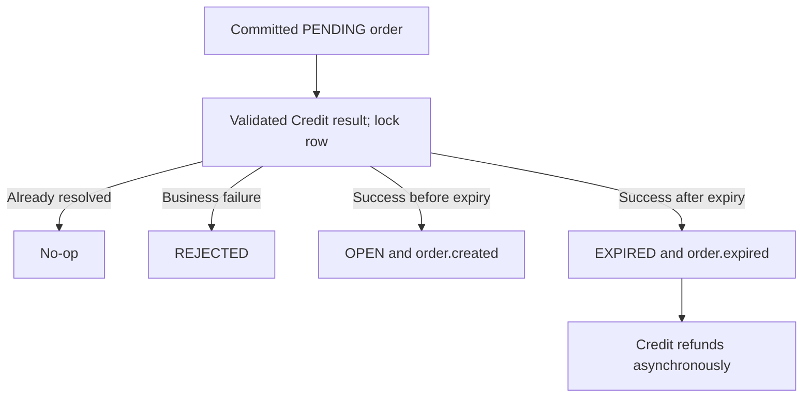

<!--
AI Assistance Disclosure:
Tool: Codex (model: GPT-6), date: 2026-10-25
Scope: Source-linked implementation documentation and evidence review requested by Reallyeasy1.
Author review: <to be completed by Reallyeasy1>
-->

# Order runtime, consistency and tests

Implementation baseline: [`52d791e`](https://github.com/AY2627S1-CS3219-P25/friend-on-campus/commit/52d791e4eea28ce7d817f025ef096f8d96bda467); inspected 2026-10-25 (SGT). Pending work is explicitly labelled.

## Submission and reservation

`handleCreateOrder` validates before calling Supplier (4-second timeout). A missing/inactive supplier yields 400; network/unexpected upstream failure yields 503. It allocates order UUID, code and expiry, then `createOrderWithOutbox` commits PENDING plus reservation request. request eventId/correlationId/orderId share that UUID. The HTTP response is 202, not publication success.

`applyReservationResult` locks the Order row with SELECT FOR UPDATE, checks requester and amount, and ignores results once the row is no longer PENDING. Failed result commits REJECTED. Successful result commits OPEN with order.created, or EXPIRED with order.expired if too late; Credit later refunds the reserved amount. No pending-order cancel endpoint is available. The sweeper processes expired OPEN orders in batches of 50; it is not a general PENDING timeout mechanism.

## Concurrent transitions and failure boundaries

Repository transitions use transactions and conditional updateMany predicates for status/version/ownership. Event insertion is part of applicable transition transactions. An unsuccessful conditional update does not publish the successful transition's event. Application prechecks alone are not the concurrency guard; the database predicate is essential.

Unassignment reopens the order without an event at this baseline. Completion/cancellation commits Order state and outbox before Credit applies settlement/refund. Existing response messages overstate financial completion; the drift register records this, and PR #184 changes the wording. Neither message text nor HTTP 200 proves the downstream ledger has converged.

Permanent reservation input/mismatch failures dead-letter. Infrastructure failures retry through shared messaging; transient unexpected failures use the configured bound. Consumer failures and DB readiness are distinct from process liveness. Broker fatal callbacks can exit and rely on Compose restart. There is no automatic DLQ resolution.

## Testing

`test/app.test.ts` and `test/order.service.test.ts` run through workspace `test:unit`, covering routes/domain behavior with fake repositories. A fake single-winner test does not itself establish real PostgreSQL concurrency. `test/reservation.messaging.test.ts` runs through `test:messaging` with isolated Order/Credit test databases and RabbitMQ.

The saga harness manually relays Order outbox rows but uses an actual dedicated Credit Debezium connector for first result delivery; later manual publications inject replay/fault cases. Aggregate runner/CI provision that connector and await streaming. This is hybrid evidence; `uat-cdc.mjs` separately covers end-to-end registration/reservation/refund.

Use `npm run test:unit -w @campus-errand/order-service`; messaging prerequisites and exact variables come from the test and runner. It is unsafe to point these suites at application databases. Local execution/blocked infrastructure is recorded centrally; inspected tests are not reported as newly passed.

## Source evidence and related reading

- [`services/order-service/src/orders/order.service.ts`](../../../services/order-service/src/orders/order.service.ts)
- [`services/order-service/src/repositories/order.repository.ts`](../../../services/order-service/src/repositories/order.repository.ts)
- [`services/order-service/src/messaging/reservation.consumer.ts`](../../../services/order-service/src/messaging/reservation.consumer.ts)
- [`services/order-service/src/orders/expiry.sweeper.ts`](../../../services/order-service/src/orders/expiry.sweeper.ts)
- [`services/order-service/test/order.service.test.ts`](../../../services/order-service/test/order.service.test.ts)
- [`services/order-service/test/reservation.messaging.test.ts`](../../../services/order-service/test/reservation.messaging.test.ts)
- [`scripts/ci/run-all-tests.mjs`](../../../scripts/ci/run-all-tests.mjs)
- [`scripts/uat/uat-cdc.mjs`](../../../scripts/uat/uat-cdc.mjs)
- [Wiki: Order Service](https://github.com/AY2627S1-CS3219-P25/friend-on-campus/wiki/Order-Service)
- [Documentation index](../../README.md) · [Drift register](../../audits/documentation-drift.md) · [Verification record](../../audits/review-findings.md)
