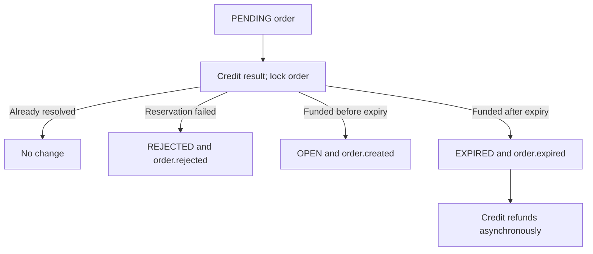

<!--
AI Assistance Disclosure:
Tool: Codex (model: GPT-6), date: 2026-10-25
Scope: Source-linked implementation documentation and evidence review requested by Reallyeasy1.
Prior diagram attribution: AI-generated (edited by Reallyeasy1).
Author review: <to be completed by Reallyeasy1>

Tool: Codex (model: GPT-6), date: 2026-11-09
Scope: Reconciled this guide with current service code, schemas, configuration and tests; consolidated duplicated reference material.
Author review: <to be completed by Reallyeasy1>
-->

# Order runtime, consistency and tests

Source baseline: [`b989758`](https://github.com/AY2627S1-CS3219-P25/friend-on-campus/commit/b989758e766cb593c3b8c94102eb6dfb5c7d8491), inspected 2026-11-09 (SGT). This describes repository behavior, not a verified deployment.

## Submission and reservation

Posting first validates the input and fetches Supplier with a four-second timeout. A missing/inactive supplier returns `400`; unavailable or unexpected upstream responses return `503`. The repository then commits `PENDING` and `order.reservation.requested` together. The initial request's event ID, correlation ID and order ID share the new order UUID. HTTP `202` means accepted for processing, not published or funded.

Credit reserves the reward and publishes a reservation result through its own outbox. Order locks the order row (`SELECT FOR UPDATE`), verifies requester and amount, then applies the first result while the order is still `PENDING`. Replayed results after resolution do not transition it again.



There is no requester cancellation endpoint for `PENDING`. The expiry sweeper processes overdue `OPEN` orders in batches of `50`; it is not a timeout mechanism for orders stuck awaiting reservation. Investigate the Order outbox, CDC connectors, Credit consumer/result outbox and Order result consumer before treating a pending order as lost or retrying submission.

## Concurrent transitions and failure boundaries

Repository transactions use conditional status, version and ownership predicates. Losing a concurrent update does not publish the winning action's event. Completion and cancellation commit Order state before Credit settles or refunds; current response messages correctly describe that asynchronous boundary. Confirm the wallet/ledger or Credit receipt before claiming the financial operation finished.

Dispute submission changes the flag/details/version without an outbox event. Requester completion is blocked while disputed; an admin can resolve via completion or cancellation. Unassignment does publish `order.unassigned`, including the prior courier, and reopens the order.

Malformed or mismatched reservation results are permanent failures. Identified infrastructure failures retry without the transient retry limit; unknown processing failures use the configured bound. Dead-lettered messages need diagnosis and deliberate recovery, not automatic replay. See [shared messaging](../../packages/messaging.md) for transport guarantees and failure handling.

`/ready` checks the database and consumer, whereas `/health` only establishes process liveness. A healthy HTTP process does not establish that CDC is publishing or that the Saga has converged. Fatal broker failures stop the process for supervisor restart; check connector state and queue/DLQ backlog separately.

## Assistant degradation

The assistant returns a draft for user review; it never bypasses ordinary order creation validation. It caches a nonempty active-supplier list for 60 seconds and can reuse an older cached list if refresh fails. Missing/unavailable model output or invalid JSON falls back to local extraction with warnings. This keeps manual posting independent of model availability, but does not establish that every generated draft is correct or that a supplier remains available at submission.

## Testing

After repository dependencies and generated clients are prepared, run from the repository root:

```sh
npm run test:unit -w @campus-errand/order-service
```

| Suite | Evidence and prerequisites |
|---|---|
| [`app.test.ts`](../../../services/order-service/test/app.test.ts) | HTTP validation/authorization and response behavior with test doubles |
| [`order.service.test.ts`](../../../services/order-service/test/order.service.test.ts) | Domain transitions and concurrent commands with fake repositories |
| [`assistant.service.test.ts`](../../../services/order-service/test/assistant.service.test.ts) | Draft extraction and fallback behavior |
| [`reservation.messaging.test.ts`](../../../services/order-service/test/reservation.messaging.test.ts) | `test:messaging`; isolated Order/Credit databases, RabbitMQ and a dedicated Credit CDC connector |

The messaging harness manually relays Order outbox rows, uses the real Credit connector for initial results, then injects replay/failure cases. It is hybrid evidence. The separate [`uat-cdc.mjs`](../../../scripts/uat/uat-cdc.mjs) covers registration/reservation/refund through CDC. A fake-repository concurrency test does not prove PostgreSQL concurrency, and neither suite proves the deployed environment passed.

Use the current [test runner](../../../scripts/ci/run-all-tests.mjs) and [package scripts](../../../services/order-service/package.json) for infrastructure setup and exact variables. Integration/UAT suites write test data and must target disposable databases, not a deployed application database. No live Saga or infrastructure suite was run to refresh this document.

## Source evidence and related reading

- [Order domain](../../../services/order-service/src/orders/order.service.ts) · [Repository](../../../services/order-service/src/repositories/order.repository.ts)
- [Reservation consumer](../../../services/order-service/src/messaging/reservation.consumer.ts) · [Expiry sweeper](../../../services/order-service/src/orders/expiry.sweeper.ts)
- [Assistant](../../../services/order-service/src/assistant/assistant.service.ts)
- [Contracts and data](contracts-and-data.md) · [Credit runtime](../credit-service/runtime-and-testing.md)
- [Documentation index](../../README.md) · [Verification record](../../audits/review-findings.md)
