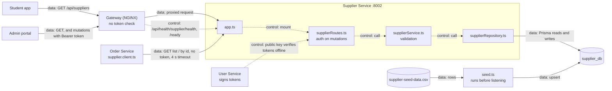
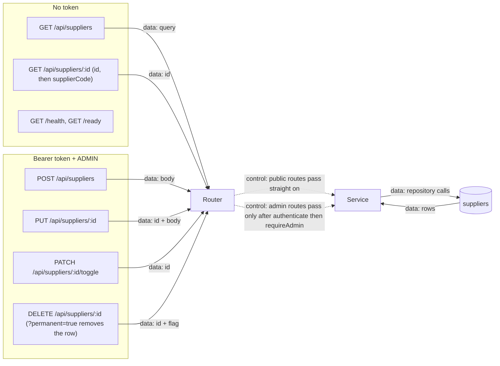
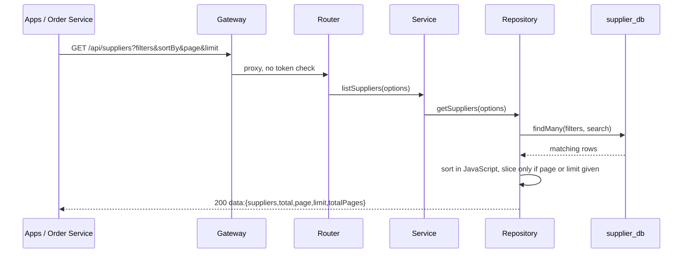
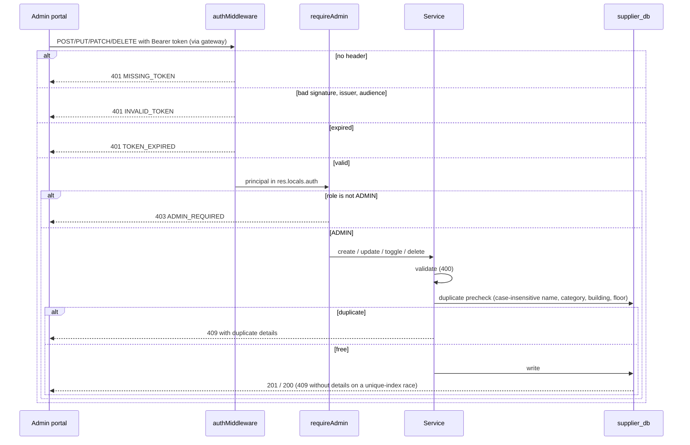

<!--
AI Assistance Disclosure:
Tool: Claude Code (model: Claude Fable 5.1), date: 2026-11-04
Scope: PR #222 review: seed description notes that recorded coordinates survive a reseed.
Author review: <to be completed by Reallyeasy1>

Tool: Codex (model: GPT-6), date: 2026-11-01
Scope: Link the supplier coordinate upgrade and recovery instructions.
Author review: <to be completed by Reallyeasy1>

Tool: Codex (model: GPT-6), date: 2026-10-25
Scope: Source-linked implementation documentation and evidence review requested by Reallyeasy1.
Author review: <to be completed by Reallyeasy1>
-->

# Supplier Service

Baseline: branch `order_dispute`, HEAD `d49e883`, inspected 2026-11-08 (SGT).

Owns the campus pickup directory in `supplier_db` (port 8002). Reads are public; create, update, toggle and delete need an ADMIN token. Order Service reads it over HTTP before creating an errand and copies the supplier name and zone into the order. There is no RabbitMQ, outbox or call to any other service.

| Module | Responsibility |
|---|---|
| `src/index.ts` | Start the app with a `SELECT 1` readiness check; on SIGINT/SIGTERM disconnect Prisma, then close the server |
| `src/app.ts` | `cors()`, JSON parsing, `/health`, `/ready`, mounts `/api/suppliers` |
| `src/suppliers/supplierRoutes.ts` | Query extraction, `authMiddleware` + `requireAdmin` on mutations only, error to status mapping |
| `src/suppliers/supplierService.ts` | Required fields, coordinate checks, duplicate precheck, unique-violation to 409 |
| `src/suppliers/supplierRepository.ts` | Prisma CRUD, filtering, in-memory sort and paging |
| `src/database/seed.ts` | Validate the CSV and upsert `SUP-NNN` rows |

**Config:** port from `PORT` or `SUPPLIER_SERVICE_PORT` (default 8002); `DATABASE_URL` (falls back to `SUPPLIER_DATABASE_URL`); `JWT_PUBLIC_KEY`, `JWT_ISSUER`, `JWT_AUDIENCE` (the key is required or the app will not start). `CORS_ORIGIN` is loaded but unused: `cors()` allows every origin.

**Startup:** the container runs `prisma migrate deploy`, then the seed, then the server. The seed reads the CSV path from the CLI, `SEED_CSV_PATH`, or `data/csv/supplier-seed-data.csv`. It upserts rows one at a time, keeps ids, active state and recorded coordinates, and updates the descriptive fields.

See [contracts and data](contracts-and-data.md), [runtime and tests](runtime-and-testing.md) and [coordinate upgrades](coordinate-upgrades.md).

## Diagrams

**Arrows:** `->` (solid) is **data flow**: a body, query or rows move along it. `-.-.-.-` (dashed) is **control flow**: a call, check or trigger. In sequence diagrams, a solid arrow is a call and a dashed arrow is a return.

### 1. Where it sits

Supplier photos are served by the gateway at `/images/`; this service only stores the `imageUrl` string.

### 2. API calls

### 3. Reading (public)

`GET /api/suppliers/:id` tries the id, then the supplier code, and absent gives 404.

### 4. Mutating (ADMIN)

Update, toggle and delete return 404 when the row is missing, and unexpected errors return 500.

### 5. Authorization notes

- Enforced only inside this service, per route. The gateway does not check tokens, so hitting `:8002` directly gets the same checks.
- Reads need no token. Order Service sends none.
- Mutations: `authMiddleware` (Ed25519 signature, issuer, audience, expiry, verified offline with `JWT_PUBLIC_KEY`), then `requireAdmin` (`role === 'ADMIN'`). No database or User Service call.
- Authentication (401) runs before authorization (403), which runs before validation.
- 401/403 bodies are `{success:false,error,code}`; other errors carry `error` only.
- Any admin can change any supplier. The admin portal uses `authFetch` for mutations; the student app only reads.

## Source

[`src/`](../../../services/supplier-service/src) · [`prisma/schema.prisma`](../../../services/supplier-service/prisma/schema.prisma) · [`package.json`](../../../services/supplier-service/package.json) · [Wiki](https://github.com/AY2627S1-CS3219-P25/friend-on-campus/wiki/Supplier-Service) · [Docs index](../../README.md) · [Drift register](../../audits/documentation-drift.md)
