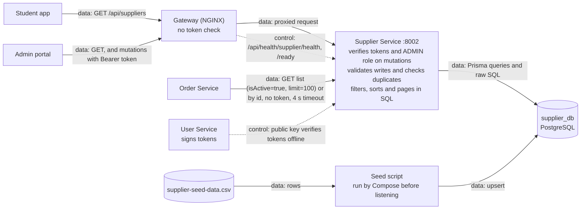
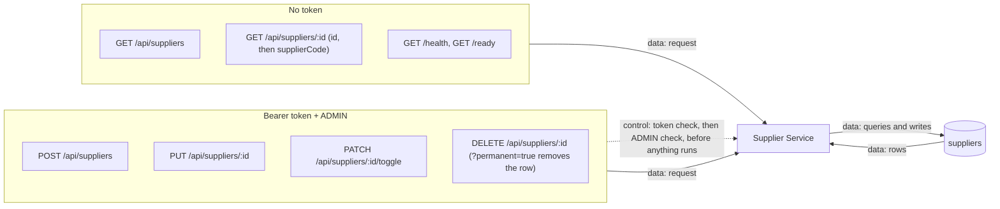
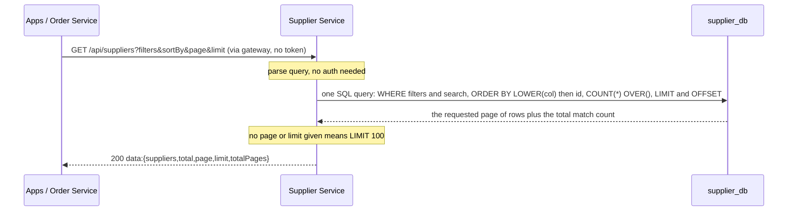
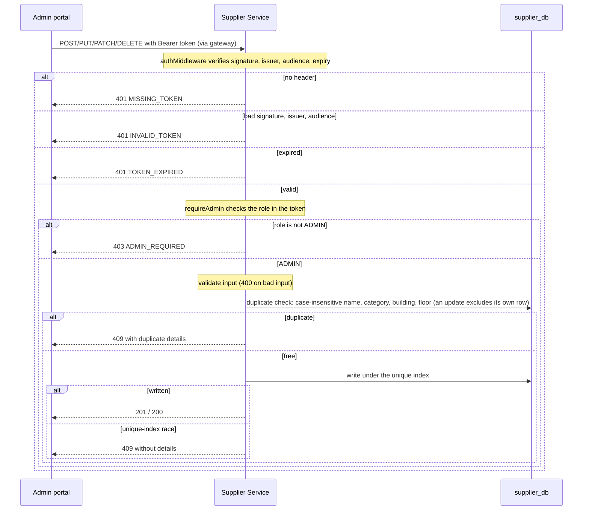
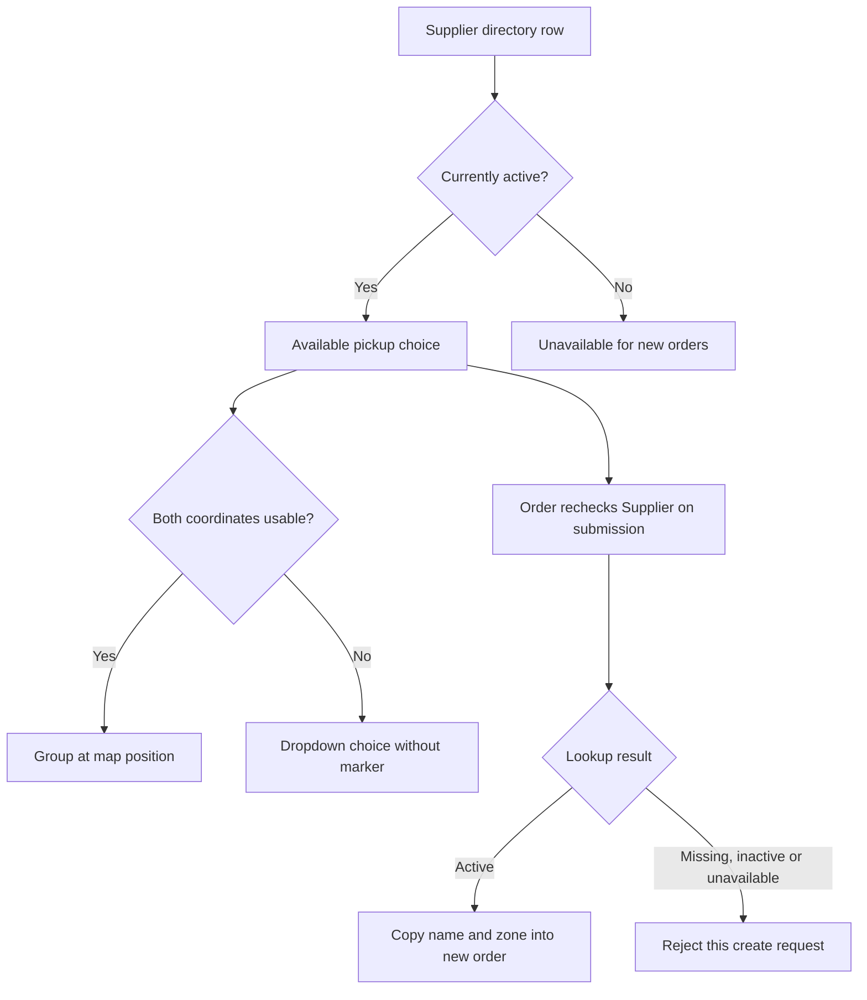
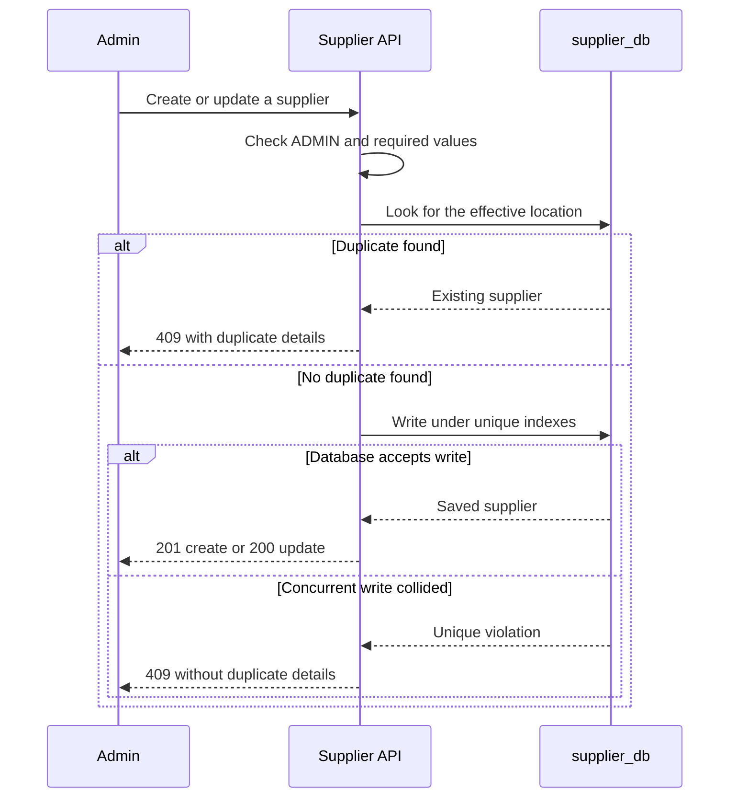

<!--
AI Assistance Disclosure:
Tool: Google Antigravity Agent; Codex (model: GPT-6); Claude Code (model: Claude Fable 5.1), date: 2026-10-25 to 2026-11-10
Scope: Source-linked implementation documentation and evidence review requested by Reallyeasy1; updated across 10 AI-assisted revisions through D4 wrap-up (reconciled consolidated Supplier Service guide with PR #254 (`85033d0`) PostgreSQL sorting (`LOWER(col)` with `"id" ASC` tie-breaking) and pagination..).
Author review: I validated correctness, edited for style, and verified with automated tests.
-->

# Supplier Service: the campus pickup directory

Supplier Service owns places students can choose as pickup points: their names, campus zones, descriptions, opening hours, map coordinates and availability. The data lives in `supplier_db`. Directory reads are public at this baseline; changing a supplier requires an ADMIN token.

Order Service looks up a supplier synchronously before accepting a new errand and copies its name and zone into the order. Supplier edits do not rewrite old orders. This service has no RabbitMQ producer or consumer, so disabling a supplier does not itself send clients a broker notification.

This guide was rechecked against documentation head `bc0efa4` on 9 November 2026, whose application baseline is `b989758`, in PR #255. It combines API behavior, local operation and the coordinate-upgrade procedure. Use [local development](../../development/local-development.md) for the shared setup.

## Diagrams

Legend: solid `->` is data flow, dashed `-.-.-.-` is control flow.

**Where it sits**



**API calls**



**Reading (public)**



**Mutating (ADMIN)**



## Follow a directory request

A student searching for a pickup point sends a request such as:

```http
GET /api/suppliers?campusZone=COM3&isActive=true&search=coffee&page=1&limit=10
```

The route converts query parameters, and the repository executes filtering, case-insensitive sorting (`LOWER(col) ASC|DESC, "id" ASC`) and pagination (`COUNT(*) OVER()` + `LIMIT`/`OFFSET`) directly in PostgreSQL. The response is shaped like:

```json
{
  "success": true,
  "data": {
    "suppliers": [],
    "total": 0,
    "page": 1,
    "limit": 10,
    "totalPages": 0
  }
}
```

This example is an empty search result, not a server failure. `total` counts all matches before paging. With neither `page` nor `limit`, the API returns up to **100 matching rows** (bounded by a 100-row SQL `LIMIT` cap). Clients should explicitly request `isActive=true` when they only want currently available pickup points; omitted or invalid values include both active and inactive suppliers.

Pushing sorting and pagination into PostgreSQL (`#110`, `#253`) avoids transferring and sorting the full table in Node on each request, allowing the 50-VU (`#29`) and 100-VU (`#33`) k6 load profiles to pass within their latency thresholds.

### Filters and ordering

| Query field | Implemented behavior |
|---|---|
| `campusZone`, `category` | Case-insensitive equality (`LOWER(col) = LOWER($n)`) |
| `search` | Trimmed, case-insensitive `ILIKE` substring over name, exact location, building, description and supplier code |
| `isActive` | Filters only for literal `true` or `false` |
| `sortBy` | `name`, `campusZone`, `category`, `createdAt` or `supplierCode`; otherwise `name` |
| `sortOrder` | Descending only for `desc`; otherwise ascending |
| `page`, `limit` | Either enables pagination; defaults 1/10, page minimum 1, limit clamped to 1–100 (unpaginated requests capped at 100 rows) |

Text sorting uses `LOWER(col)` in PostgreSQL and breaks equal-sort-key ties deterministically by `"id" ASC`. Query numbers use `parseInt` and repository sanitization (`Number.isFinite` + `Math.trunc`); do not rely on malformed numeric inputs being rejected with `400`.

### Directory presence, map position and availability are different

A supplier record can exist without being usable for every screen. The student app [loads the directory](../../../apps/student-app/src/api/suppliers.ts) without API filters, then searches names, zones, categories and exact locations in memory. Its category shortcuts populate that search string; they are not the API's exact `category` filter. This explains why a browser search and a hand-written API query can return different matches.

The pickup dropdown and map receive only active suppliers. The [map grouping helper](../../../apps/student-app/src/map/supplierLocations.ts) includes only finite numeric latitude/longitude pairs and combines suppliers at identical coordinates into one location. Two stalls at the same coordinates therefore need not produce two markers. A missing marker does not by itself mean the database row is missing.

This diagram follows the separate checks applied to a directory row:



Order's second lookup matters when an administrator disables a place after the browser loaded it. A stale enabled button cannot bypass that check. Supplier unavailability produces a `503`, while a missing or inactive selection produces a validation error. Once created, an order retains the copied name and zone even if the supplier is renamed later; see [the creation handler](../../../services/order-service/src/orders/order.service.ts).

Opening hours are another separate concept. The frontend [hours helper](../../../apps/student-app/src/suppliers/operatingHours.ts) interprets readable starting/closing times using Singapore time, including overnight opening. Unreadable hours produce an unknown result. An “active” database flag is not a guarantee that the shop is open at this moment, and Order's supplier check does not enforce those hours.

To inspect the distinction on a running local gateway, these reads make no changes:

```sh
curl --fail-with-body 'http://localhost/api/suppliers?isActive=true&page=1&limit=10'
curl --fail-with-body 'http://localhost/api/suppliers?category=Food&sortBy=name&sortOrder=asc&page=1&limit=10'
```

Expect a successful JSON envelope even when no suppliers match. Check `total` and `totalPages` before treating a single page as the entire directory. To query the service directly instead, use its configured port, normally `http://localhost:8002`.

## Add, update or disable a place

The browser's edit form is not the security boundary. Supplier mutation routes verify the access token using the shared auth package and require ADMIN. A non-admin cannot bypass that check by calling the URL directly. Read routes remain public even when a frontend screen requires login.

| Request | Access | Result |
|---|---|---|
| `GET /api/suppliers` | Public | `200 data.{suppliers,total,page,limit,totalPages}` |
| `GET /api/suppliers/:id` | Public | Looks up ID, then supplier code; `200 data` or `404` |
| `POST /api/suppliers` | ADMIN | Creates a supplier; `201 data` |
| `PUT /api/suppliers/:id` | ADMIN | Partial update; `200 data` |
| `PATCH /api/suppliers/:id/toggle` | ADMIN | Flips active status; `200 data` |
| `DELETE /api/suppliers/:id` | ADMIN | Soft delete by default; permanent removal only with `?permanent=true`; `200` message |

Responses serialize the stored Supplier row directly, including nullable optional fields and timestamps. Supplier IDs are text columns containing generated UUID strings; `supplierCode` is a separate unique lookup key.

Creation requires `name`, `campusZone`, `exactLocation`, `category`, `building`, `floor`, `latitude` and `longitude`. Coordinates must be finite JSON numbers: strings, missing values and explicit `null` are rejected. The API currently does not enforce latitude/longitude geographic ranges. Optional fields are `supplierCode`, `description`, `startingTime`, `closingTime` and `imageUrl`; new rows are active.

Updates accept only the fields implemented by the repository; `supplierCode` is not mutable. Omitted coordinates retain their old values, including legacy nulls. Explicit coordinate updates must be finite numbers. Updating `name`, `category`, `building` or `floor` to a blank string returns `400`. The TypeScript category union is not a complete runtime enum check; do not assume the backend rejects every category outside that union.

### Why two apparently identical creates can conflict

A place is unique by the case-insensitive combination of **name, category, building and floor**. The service first checks that combination so it can return helpful duplicate details. The SQL unique index then protects against two requests that pass the precheck at the same time.



For updates, the precheck combines changed values with the existing row and excludes that row itself. Changing an unrelated field therefore does not count as duplicating your own supplier.

Supplier codes have a separate unique constraint. Automatic code allocation uses a count-based candidate and timestamp fallback; it is not a collision-free sequence allocation guarantee. Toggling active status also reads then writes the inverse rather than performing one atomic SQL toggle. These details matter for concurrent administrative requests; the service does not automatically retry them.

Soft deletion sets `isActive=false`. Permanent deletion removes the Supplier row but has no cross-database cascade. Existing orders keep their copied details; new order creation independently checks current availability.

## Run it locally

After completing the [shared setup](../../development/local-development.md), run from the repository root:

```sh
npm run db:generate -w @campus-errand/supplier-service
npm run db:deploy -w @campus-errand/supplier-service
npm run dev -w @campus-errand/supplier-service
```

The generated client is service-local, migrations apply the canonical `prisma/migrations/` history, and the watched listener defaults to port 8002. Avoid starting a second listener if Compose already owns that port.

| Setting | Behavior |
|---|---|
| `PORT` / `SUPPLIER_SERVICE_PORT` | Default 8002 |
| `DATABASE_URL` / `SUPPLIER_DATABASE_URL` | Explicit `DATABASE_URL` takes priority |
| `JWT_PUBLIC_KEY`, `JWT_ISSUER`, `JWT_AUDIENCE` | Used to verify mutation requests; align them with User Service |
| `SEED_CSV_PATH` | Optional seed CSV; a command-line path takes priority |
| `CORS_ORIGIN` | Loaded by config but **not applied** by the current `app.use(cors())` call |

`GET /health` reports process liveness. `GET /ready` runs `SELECT 1`, so it can succeed even when the `suppliers` table or a migration is missing. SIGINT/SIGTERM handlers disconnect Prisma and close the server.

### Seed data without losing corrected coordinates

`npm run db:seed -w @campus-errand/supplier-service` reads a command-line CSV path, then `SEED_CSV_PATH`, then `data/csv/supplier-seed-data.csv`. CSV parsing validates the headers and row shape; each row then validates its required location fields and coordinates before its upsert. Rows use `SUP-NNN` codes.

For an existing matching code, seeding preserves the row ID, active state and each already-recorded coordinate. It updates descriptive fields and fills a coordinate only when it is missing. An administrator's corrected coordinates therefore survive reseeding. Writes happen sequentially rather than as one atomic batch: if a later row fails validation or its write fails, earlier rows may already be updated.

Choose the update path according to what you are changing:

| Task | Path | What it changes |
|---|---|---|
| Correct one place's description or coordinates | Admin edit form / authenticated `PUT` | Only submitted fields; omitted coordinates remain as recorded |
| Temporarily stop new pickups | Admin availability toggle | `isActive`; existing orders retain their saved details |
| Populate a prepared development database from CSV | `db:seed` script | Upserts seed rows and can overwrite descriptive fields of existing matching codes |
| Repair legacy null coordinates | Admin edit with verified coordinates | Preserve row identity and existing orders; migrations do not supply missing map positions |

The CSV path is a seed-script input, not an upload endpoint in the REST contract above. It expects the [checked-in CSV header order](../../../services/supplier-service/src/database/seed.ts), including Name, Type, Building, Floor and coordinates. It assigns `SUP-001`, `SUP-002` and so on **from row position**, then upserts by that generated code. Reordering or inserting rows into an existing seed file can therefore apply descriptions to a different stored supplier. Treat this as controlled fixture preparation, not a general-purpose import/synchronization tool.

For a disposable development database with migrations already applied, run the default seed from the repository root:

```sh
npm run db:seed -w @campus-errand/supplier-service
```

The script reports each created/updated code and finishes with `created=... updated=...`. Verify the intended rows through the read API afterward. A completed seed does not check that locations are geographically correct; a failed run may have already changed earlier rows, so inspect the last successful code before retrying.

Local Compose explicitly runs migrations and this development seed before listening. The application image itself starts only the app; [cloud deployment](../../new-cloud-architecture-guide.md) uses separate migration/seed tasks. Reseeding is not an automatic production recovery procedure.

## Upgrade a database with missing coordinates

Older suppliers can have null coordinates because earlier API versions allowed them. New API creates now require coordinates, while the database columns deliberately remain nullable so historical rows can be repaired without being deleted or assigned invented locations. The frontend map excludes a supplier without both coordinates. An administrator can enter verified values in **Edit Supplier**, or update other fields while leaving legacy coordinates unset.

The supported migration history lives in [services/supplier-service/prisma/migrations](../../../services/supplier-service/prisma/migrations). The old copy under `src/database/prisma/` is not used by the configured deployment script.

| Database state | Safe upgrade path |
|---|---|
| Fresh database, or coordinate migration never attempted | Apply committed migrations with `npm run db:deploy -w @campus-errand/supplier-service`; corrected history preserves nulls |
| Original coordinate migration already succeeded | Apply the same history; `20261101040000_preserve_legacy_coordinates` drops its NOT NULL constraints without changing values |
| Original coordinate migration failed on existing nulls | Verify that exact failure, then use the recovery procedure below |

`20261017102809_make_coordinates_required` is now a no-op. This correction lets a database that failed the original migration advance to later migrations. A database that applied the older SQL can report a changed-migration checksum warning; the forward migration reconciles its schema. `migrate dev` may request a reset after this history change. **Do not reset a database containing needed data.** Use `migrate deploy` for this upgrade and a separate disposable database for migration development.

### Recover a failed original attempt

Back up the intended database and inspect the recorded migration failure first. Continue only if the original single `ALTER TABLE` statement failed because existing latitude/longitude values were null. That statement is atomic; the recovery is not an instruction to undo arbitrary partial manual changes.

Run from `services/supplier-service`. The bare Prisma CLI reads `DATABASE_URL`; unlike the repository's `db:deploy` wrapper, it does not map `SUPPLIER_DATABASE_URL` for you. Configure the intended connection privately in your shell. If it is already exported as `SUPPLIER_DATABASE_URL`, use:

```sh
: "${SUPPLIER_DATABASE_URL:?Set the intended database connection first}"
export DATABASE_URL="$SUPPLIER_DATABASE_URL"
npx prisma migrate status --schema prisma/schema.prisma
```

After confirming the specific failed migration, mark **that failed attempt** rolled back and deploy the corrected history:

```sh
npx prisma migrate resolve --rolled-back 20261017102809_make_coordinates_required --schema prisma/schema.prisma
npx prisma migrate deploy --schema prisma/schema.prisma
```

In PowerShell the variable assignment is `$env:DATABASE_URL = $env:SUPPLIER_DATABASE_URL`; ensure it is set to the intended database before running Prisma. A successful deployment should leave the legacy row intact with its original values and make the migration status current. Investigate other failure causes separately. Do not mark a successful migration rolled back, edit Prisma's history table or delete volumes to force this upgrade through.

The [migration test](../../../services/supplier-service/test/coordinates.migration.ts) exercises this exact recovery using the Prisma CLI, in addition to fresh schemas and databases where the original constraints were already applied. Database-level NOT NULL enforcement remains deferred until historical coordinates are verified; this guide does not introduce it.

## Troubleshoot and test

| Symptom | Likely boundary | What to inspect |
|---|---|---|
| `401` / `403` on a mutation | Authentication or administrator authorization | Access-token expiry, issuer/audience/public key and role; read access does not imply write access |
| `400` creating a location | Missing/blank required input or invalid coordinate type | Send numeric latitude/longitude, not form strings or nulls |
| `409` saving a location | Location or supplier-code uniqueness | Case-insensitive name/category/building/floor combination; concurrent inserts may omit duplicate metadata |
| Inactive places appear in search | `isActive` filter omitted or invalid | Send literal `isActive=true` |
| `/ready` is green but queries return `500` | Connectivity works; schema/query may not | Selected database, committed migrations and server logs |
| Directory response slows as it grows | Unindexed `ILIKE '%...%'` substring search across five columns | Dataset size, search pattern and connection pool capacity |
| Supplier is absent from the map | One or both coordinates are null | Repair with verified coordinates; do not fabricate a fallback location |
| Seed stops partway through | Sequential upserts or invalid CSV | Preserve logs and inspect prior writes before rerunning |

Business errors generally return `{success:false,error}` without a stable machine code. Unexpected caught errors return `500` with `err.message` when present; unlike User Service, this handler does not consistently suppress internal error details. Avoid treating response messages as a guaranteed safe/public diagnostic contract.

Run the focused suites from the repository root:

```sh
npm run test:unit -w @campus-errand/supplier-service
npm run test:migration -w @campus-errand/supplier-service
```

Unit route tests combine HTTP/shared auth with a mocked repository; repository tests mock Prisma. They cover read filters, mutation authorization, validation, duplicates, ordering, paging, delete semantics and probes. They do not prove concurrent database CRUD or cloud performance.

The migration suite requires `DATABASE_URL` naming a **dedicated `_test` database**. It creates and drops isolated schemas and intentionally rehearses a failing migration and its recovery. Never point it at application data. Supplier has no `test:integration` script; real seeded API coverage comes from the system suites described in [testing strategy](../../development/testing-strategy.md).

## Find the implementation

- [supplierRoutes.ts](../../../services/supplier-service/src/suppliers/supplierRoutes.ts) extracts HTTP inputs and maps errors; [supplierService.ts](../../../services/supplier-service/src/suppliers/supplierService.ts) validates writes and effective update values.
- [supplierRepository.ts](../../../services/supplier-service/src/suppliers/supplierRepository.ts) implements PostgreSQL filtering, case-insensitive sorting (`LOWER(col)`), pagination (`COUNT(*) OVER()` + `LIMIT`/`OFFSET`), code allocation and CRUD.
- The [schema](../../../services/supplier-service/prisma/schema.prisma) defines the directory row; [migration SQL](../../../services/supplier-service/prisma/migrations/20260929134701_add_location_uniqueness/migration.sql) defines its case-insensitive location index.
- [seed.ts](../../../services/supplier-service/src/database/seed.ts) owns CSV parsing and coordinate preservation; [coordinates.migration.ts](../../../services/supplier-service/test/coordinates.migration.ts) is the upgrade/recovery executable reference.

[Documentation index](../../README.md) · [Order Service](../order-service/README.md)
