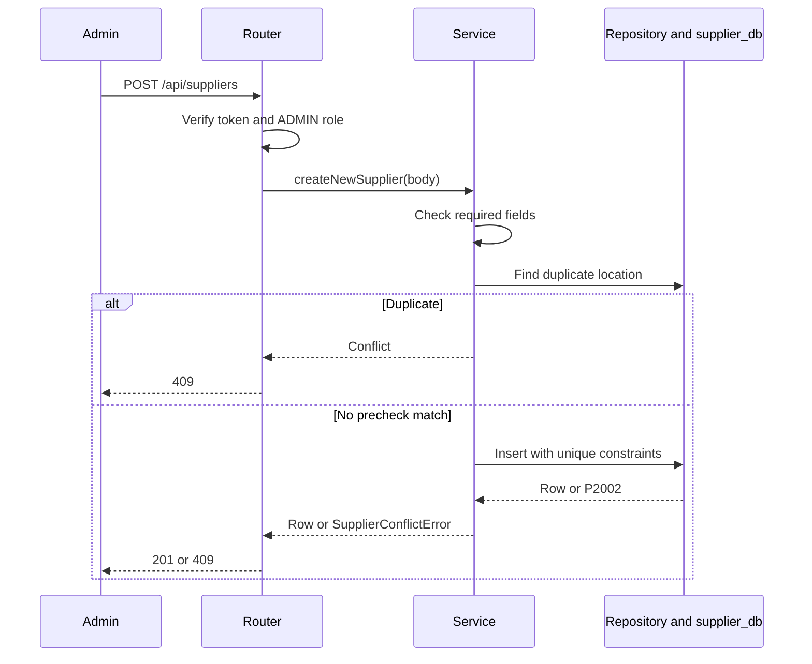

<!--
AI Assistance Disclosure:
Tool: Codex (model: GPT-6), date: 2026-10-25
Scope: Source-linked implementation documentation and evidence review requested by Reallyeasy1.
Author review: <to be completed by Reallyeasy1>
-->

# Supplier runtime, failures and tests

Implementation baseline: [`52d791e`](https://github.com/AY2627S1-CS3219-P25/friend-on-campus/commit/52d791e4eea28ce7d817f025ef096f8d96bda467); inspected 2026-10-25 (SGT). Pending work is explicitly labelled.

For reads, route query extraction feeds repository filtering, JavaScript sorting and optional slicing. There is no requirement for a token on current collection/detail GET routes. The frontend may still gate its screens behind login; that is a different layer.

Updates validate the effective combination of existing and changed values before duplicate checking. SQL uniqueness handles concurrent races missed by the precheck. Supplier-code generation uses count-based numbering with a timestamp fallback; it is not a demonstrated collision-free concurrent allocation guarantee.

Default deletion sets isActive=false; permanent=true removes the row. Toggle reads the current state then writes its inverse, not a single atomic database toggle. There is no automatic retry. Existing orders retain copied supplier details; new order creation independently checks current supplier availability.

## Failure boundaries

Validation/duplicate/missing records map to 400/409/404. Authentication errors precede mutations. Unexpected database errors become 500; no local compensation workflow runs. SELECT 1 readiness can succeed despite a missing table. The service has no event publication, so changing availability does not itself send a broker notification to clients.

## Tests

`npm run test:unit -w @campus-errand/supplier-service` uses Node/tsx and module mocks. `supplierRoutes.test.ts` combines HTTP/shared auth with a mocked repository; `supplierRepository.test.ts` mocks Prisma. Cases cover public reads, every mutation's authorization, validation, duplicates, sorting, pagination, delete semantics and probes.

There is no dedicated Supplier database-integration script. Mock tests do not prove actual SQL concurrency or expression-index behavior; D2 API acceptance uses real seeded PostgreSQL. Seed validation and committed migration SQL should be inspected when schema/seed behavior changes. Current verification results are in the central record.

## Source evidence and related reading

- [`services/supplier-service/src/suppliers/supplierRoutes.ts`](../../../services/supplier-service/src/suppliers/supplierRoutes.ts)
- [`services/supplier-service/src/suppliers/supplierService.ts`](../../../services/supplier-service/src/suppliers/supplierService.ts)
- [`services/supplier-service/src/suppliers/supplierRepository.ts`](../../../services/supplier-service/src/suppliers/supplierRepository.ts)
- [`services/supplier-service/test/supplierRoutes.test.ts`](../../../services/supplier-service/test/supplierRoutes.test.ts)
- [`services/supplier-service/test/supplierRepository.test.ts`](../../../services/supplier-service/test/supplierRepository.test.ts)
- [`services/supplier-service/package.json`](../../../services/supplier-service/package.json)
- [Wiki: Supplier Service](https://github.com/AY2627S1-CS3219-P25/friend-on-campus/wiki/Supplier-Service)
- [Documentation index](../../README.md) · [Drift register](../../audits/documentation-drift.md) · [Verification record](../../audits/review-findings.md)
