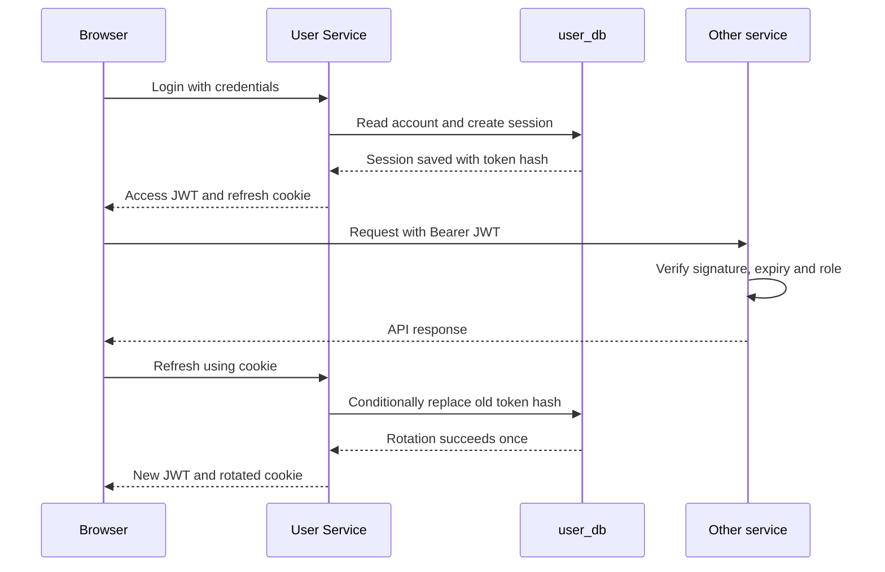

<!--
AI Assistance Disclosure:
Tool: Codex (model: GPT-6), date: 2026-11-09
Scope: Consolidate User Service identity, API, session behavior, operations and tests into one practical guide with an explained authentication sequence.
Author review: <to be completed by Reallyeasy1>

Tool: Codex (model: GPT-6), date: 2026-11-09
Scope: Reconcile implementation guidance with current source, simplify duplication and preserve historical attribution.
Author review: <to be completed by the author>

Tool: Codex (model: GPT-6), date: 2026-10-25
Scope: Source-linked implementation documentation and evidence review requested by Reallyeasy1.
Author review: <to be completed by Reallyeasy1>
-->

# User Service: accounts, login and sessions

User Service owns accounts and authentication in `user_db`. It answers “who is this caller?”, issues access tokens and manages refresh sessions. It also supplies profile and administrator APIs. Wallets belong to Credit Service: creating an account and receiving its welcome credits are separate steps.

This guide describes code at `b989758` (inspected 9 November 2026), carried by documentation PR #255. For the whole application, start with [local development](../../development/local-development.md); this page explains the User-specific behavior you need when implementing or debugging a feature.

## Follow a new account through the system

Suppose a student registers and then opens their wallet. Registration first validates the username, email and password, hashes the password with scrypt, and writes two records in **one database transaction**: the account and a `user.registered` outbox event. If either write fails, neither commits.

The `201` response means the account exists. It does not log the student in, and it does not mean Credit has created the wallet. The browser logs in separately. Debezium later reads the committed outbox row and publishes the event through RabbitMQ; Credit consumes it to initialize the wallet and grant 100 credits. A successful login with a temporarily missing wallet therefore points to the asynchronous registration-to-Credit path, not necessarily failed registration.

The [registration module](../../../services/user-service/src/auth/auth-module.ts) creates the event with `eventId`, `eventType`, `timestamp`, `userId`, `email` and `initialGrant`. The [auth repository](../../../services/user-service/src/persistence/auth-repository.ts) owns the transaction. User Service has no runtime RabbitMQ publisher; see [messaging and recovery](../../infrastructure/cdc-and-broker.md) when an event is not reaching Credit.

## Understand the two tokens

An **access token** is a short-lived signed JWT. Other services verify it locally using the public key, rather than asking User Service on every request. A **refresh token** is an opaque random value used only to obtain a replacement access token. User Service stores its hash in a session row; it cannot recover the raw token from that hash.

This sequence shows why refreshing needs User Service and its database, while an ordinary authenticated API request does not:



The browser receives the refresh token in `refresh_token`, an `HttpOnly`, `SameSite=Lax` cookie scoped to `/api/auth`. Production enables `Secure`, so the browser must use HTTPS to send it. The access token is returned in JSON. Browser handling is described in the [frontend guide](../../frontend/README.md); the shared verifier's public API is in [packages/auth](../../../packages/auth/README.md).

Refresh looks up the supplied token hash, rejects an expired or disabled session, and conditionally replaces the old hash. If two requests use the same refresh token concurrently, only one rotation succeeds. The losing request receives `401 INVALID_SESSION`; replaying an old token does not revoke the replacement session.

### What logout and account changes actually revoke

| Action | Immediate effect | What can remain valid |
|---|---|---|
| Logout | Deletes the matching refresh session and clears this browser's cookie | Previously issued access JWTs until expiry |
| Disable account | Blocks login and refresh | Existing JWTs accepted by offline verifiers until expiry |
| Change username or role | Updates the stored account; later token issuance uses current claims | Older JWT claims until refresh/expiry |
| Change password | Conditionally replaces the password hash after verifying the old password | Other refresh sessions and existing JWTs are not revoked |
| Delete account | Removes the local account and cascades its refresh sessions | Other services' records and already-issued JWTs are not centrally revoked |

These are implementation limits, not promises of immediate authorization revocation. There is no user-deleted event or cross-database cascade that removes the account's orders, wallets, notifications or chat history.

## Use the HTTP API

Through the gateway, the routes below use `/api/auth` and `/api/users`. Direct local requests use port 8001. A successful JSON response has `success: true`; `204` responses deliberately have no body.

### Authentication

| Request | Input | Successful result | Common failure |
|---|---|---|---|
| `POST /api/auth/register` | `username`, `email`, `password` | `201`, `data.user`; no tokens | `400 INVALID_INPUT`; `409 DUPLICATE_EMAIL` / `DUPLICATE_USERNAME` |
| `POST /api/auth/login` | `email`, `password`, optional boolean `keepLoggedIn` | `200`, `data.accessToken`, `accessTokenExpiresInSeconds`, `user`, and refresh cookie | `401 INVALID_CREDENTIALS`; `403 ACCOUNT_DISABLED` after correct password |
| `POST /api/auth/refresh` | Refresh cookie; body `refreshToken` is a fallback | `200`, replacement access token and rotated cookie | `401 INVALID_SESSION` |
| `POST /api/auth/logout` | Same refresh-token lookup | `204` and cleared cookie; missing/unknown token is harmless | Unexpected database failure returns `500` |

The response's `user` object contains `userId`, `username`, `email`, `userRole` and `status`. Password hashes and session internals are never part of that DTO.

For example, a profile update sends only the editable field:

```http
PATCH /api/users/me
Authorization: Bearer <access-token>
Content-Type: application/json

{"username":"Campus Runner"}
```

The response contains `data.user`. Sending an email or role in this body returns `400`; those are not editable profile fields. The current frontend has no password-change form, even though the endpoint exists.

### Profiles and administration

All routes in this table require a Bearer token. Administrator checks use its signed role claim.

| Request | Who can call it | Input / result |
|---|---|---|
| `GET /api/users/me` | Any authenticated caller | Own profile; `404 USER_NOT_FOUND` if absent |
| `PATCH /api/users/me` | Any authenticated caller | Exactly `{username}`; `200 data.user` |
| `PUT /api/users/me/password` | Any authenticated caller | `currentPassword`, `newPassword`; `204` or `401 INVALID_CURRENT_PASSWORD` |
| `GET /api/users` | ADMIN | `200 data.users`, sorted by username |
| `PATCH /api/users/:id/toggle-status` | ADMIN | Toggles enabled status; `200 data.user` |
| `PATCH /api/users/:id/toggle-role` | ADMIN, targeting another account | Toggles STUDENT/ADMIN; self-targeting returns `403 SELF_ACTION_FORBIDDEN` |
| `DELETE /api/users/:id` | That user or ADMIN | `204`; successful self-deletion also clears the refresh cookie |

Malformed UUID path IDs return `400 INVALID_INPUT`. Missing, invalid or expired Bearer tokens produce shared-auth `401` codes; non-admin access to an admin route returns `403 ADMIN_REQUIRED`. Known service errors use `{success:false,error,code}`. Unexpected errors hide internal details and include an error correlation ID; malformed JSON is `400 INVALID_JSON`, and unknown routes return JSON `404`.

### Input rules and concurrent changes

Usernames are trimmed, nonblank and at most 50 JavaScript string units. Emails are trimmed, lowercased, at most 320 characters and checked by a simple address regex. The backend does **not** enforce an NUS-only email domain. Passwords are not trimmed: they accept 8–24 Unicode code points and have no additional complexity rule.

The database enforces case-insensitive uniqueness for usernames and emails with `LOWER(...)` expression indexes. These SQL indexes intentionally do not appear as Prisma `@unique` annotations. A successful application-side lookup is not a guarantee that a concurrent registration will not collide; the database constraint is the final guard.

Administrative role, status and deletion changes serialize through transaction-scoped advisory lock `pg_advisory_xact_lock(3219, 1)`. That means competing changes take turns before counting administrators. The checks differ: role changes and deletion preserve an ADMIN-role count, while disabling preserves an **enabled** ADMIN count. Do not describe this as one universal enabled-admin invariant. A rejected operation returns `409 LAST_ADMIN_REQUIRED`.

## Run and configure it locally

Use the root [setup guide](../../development/local-development.md) to install dependencies, provision PostgreSQL and configure keys first. The following commands run from the repository root:

```sh
# AI-generated (edited by Reallyeasy1)
npm run db:generate -w @campus-errand/user-service
npm run db:deploy -w @campus-errand/user-service
npm run dev -w @campus-errand/user-service
```

Generation builds this service's isolated Prisma client; deployment applies committed migrations; development starts the watched listener on port 8001 unless overridden. Do not start a second host process on a port already owned by Compose. The application image starts `node dist/index.js`; local Compose adds migration and development seeding steps before startup, while cloud runs them as separate tasks.

| Setting | Behavior |
|---|---|
| `PORT` / `USER_SERVICE_PORT` | Default 8001; integer from 1 to 65535 |
| `DATABASE_URL` / `USER_DATABASE_URL` | Explicit `DATABASE_URL` takes priority; use the safe root `.env.example` for local values |
| `JWT_PRIVATE_KEY`, `JWT_PUBLIC_KEY` | Required signing and verification keys |
| `JWT_ACCESS_TOKEN_TTL` | Default `15m` |
| `JWT_REFRESH_TOKEN_TTL` | Default `1d` idle lifetime |
| `JWT_PERSISTENT_REFRESH_TOKEN_TTL` | Default `30d` idle lifetime when `keepLoggedIn` is true |
| `JWT_ISSUER`, `JWT_AUDIENCE` | Defaults `friend-on-campus-user-service` and `friend-on-campus-services`; must match downstream verifiers |
| `CORS_ORIGIN` | Default `http://localhost:5173`; credentialed CORS |
| `NODE_ENV` | `production` enables Secure refresh cookies |

Durations use a positive integer followed by `s`, `m`, `h` or `d`. Both normal and persistent sessions expire; “keep logged in” changes the idle lifetime rather than making a session permanent.

The development seed is available through `npm run db:seed -w @campus-errand/user-service`. It creates deterministic Alice/Bob/Admin identities. Reseeding can overwrite an existing matching account's username, role and password while preserving its ID and enabled status. It bypasses registration and its outbox, so the Credit seed is separate. Use it only for intended development/demo data, not routine account repair.

## Diagnose a failure

Start by separating the process, database and asynchronous dependencies. `GET /health` is a liveness response. `GET /ready` checks expected User/Session columns, but not the outbox schema or the CDC pipeline. A green readiness result therefore cannot prove welcome-credit delivery.

| Symptom | Check | Next step |
|---|---|---|
| Service fails before listening | Missing JWT keys, invalid duration/port, selected database URL | Compare names with [config](../../../services/user-service/src/config.ts); keep real values out of logs and commits |
| `/health` succeeds but `/ready` fails | Database access and committed User/Session migrations | Apply the intended migrations to the intended database; do not reset needed data |
| Registration succeeds but no wallet appears | Registration outbox, Debezium, broker and Credit consumer | Trace `userId` / `eventId` through [messaging](../../infrastructure/cdc-and-broker.md); do not repeatedly register the same person |
| Refresh returns `INVALID_SESSION` | Cookie path/Secure behavior, expiry, disabled account, duplicate refresh requests | Inspect browser request metadata; retry through the normal login flow rather than replaying an old token |
| Admin change does not immediately affect another service | JWT role/expiry versus stored account | Obtain a fresh token; existing JWTs are not checked against the account on each request |
| A profile update returns `409` | Another account's username, ignoring case | Choose a distinct username; the SQL uniqueness check is intentional |
| Unexpected `500` | `X-Request-Id` and returned error ID | Correlate the request with server logs; the browser response intentionally omits internal details |

The registration outbox retains polling-era `status` and `retryCount` fields. They are not CDC delivery acknowledgements; a `PENDING` value alone does not prove that Debezium has failed. Shutdown handles SIGINT/SIGTERM, disconnects Prisma and closes the listener.

## Test the behavior you changed

```sh
# AI-generated (edited by Reallyeasy1)
npm run test:unit -w @campus-errand/user-service
npm run test:integration -w @campus-errand/user-service
```

Unit tests cover HTTP envelopes, validation, login/session orchestration, password hashing, token behavior and profile/admin rules. The PostgreSQL integration suite is opt-in through **`ADMIN_GUARD_TEST_DATABASE_URL`**. It creates a random schema, applies migrations, uses two independent application/database instances and drops that schema afterward. Use a disposable test database with those permissions. Without the variable, it skips; that is not successful database verification.

The integration cases exercise atomic account/outbox rollback, concurrent administrator changes, disabled refresh and account deletion. Cross-service API/browser suites provide additional coverage; see [testing strategy](../../development/testing-strategy.md) for setup and evidence limits.

## Find the implementation

- [Auth routes and cookies](../../../services/user-service/src/auth/auth-routes.ts) lead into [auth-module.ts](../../../services/user-service/src/auth/auth-module.ts) and the [auth repository](../../../services/user-service/src/persistence/auth-repository.ts).
- [User routes](../../../services/user-service/src/users/user-routes.ts) lead into [user-module.ts](../../../services/user-service/src/users/user-module.ts); [user-repository.ts](../../../services/user-service/src/persistence/user-repository.ts) owns administrator locks and conditional writes.
- The [Prisma schema](../../../services/user-service/prisma/schema.prisma) defines `User`, `Session` and `OutboxEvent`; [migration SQL](../../../services/user-service/prisma/migrations) defines the case-insensitive indexes and other SQL constraints.
- [admin-guard.integration.test.ts](../../../services/user-service/test/admin-guard.integration.test.ts) is the executable reference for real-database concurrency behavior.

[Documentation index](../../README.md) · [Credit Service](../credit-service/README.md)
