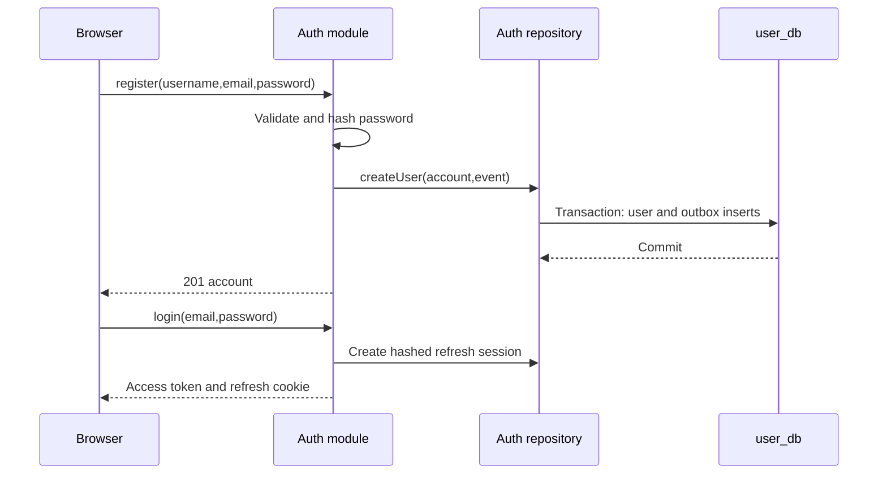

<!--
AI Assistance Disclosure:
Tool: Codex (model: GPT-6), date: 2026-10-25
Scope: Source-linked implementation documentation and evidence review requested by Reallyeasy1.
Author review: <to be completed by Reallyeasy1>
-->

# User runtime, failure behavior and tests

Implementation baseline: [`52d791e`](https://github.com/AY2627S1-CS3219-P25/friend-on-campus/commit/52d791e4eea28ce7d817f025ef096f8d96bda467); inspected 2026-10-25 (SGT). Pending work is explicitly labelled.

## Registration and credit initialization

`auth.register` normalizes input, hashes the password and allocates identifiers. `authRepository.createUser` inserts the account and registration outbox row in one transaction. A failure rolls back both. HTTP 201 establishes account creation; Debezium and Credit later initialize the wallet. Frontend registration followed by login is a separate flow.

## Sessions and administrative changes

Login cleans expired sessions, performs a case-insensitive lookup, verifies scrypt (dummy work for unknown email), checks account status, persists an opaque token hash and signs access claims. Refresh rejects absent/expired/disabled sessions. Its transaction conditionally updates the matching old hash and unexpired row; concurrent rotation has one winner. Replayed old tokens fail without revoking the valid replacement.

Password changes conditionally replace the old hash but do not revoke other sessions. Logout revokes the matching refresh session; downstream offline access tokens can remain valid until expiry. Refresh mints current role/name claims. This differs from immediate authorization revocation.

Administrative role/status/deletion operations use transaction advisory lock `pg_advisory_xact_lock(3219,1)`. Role change and deletion preserve an ADMIN-role count; disabling preserves an enabled-ADMIN count. These are not one universal enabled-admin invariant. Self-role change is forbidden. Deletion cascades local sessions only.

Database failures propagate to centralized error handling. Request IDs/error IDs aid correlation. Logging redacts common secret patterns, but documentation does not claim comprehensive security certification or measured latency guarantees.

## Test inventory and execution

| Suite | Evidence |
|---|---|
| app.test.ts | HTTP registration/login/profile/admin behavior and envelopes |
| auth-module.test.ts | Session/auth orchestration and failures |
| password.test.ts; tokens.test.ts | Hashing, token issuance/verification and invalid inputs |
| user-module.test.ts; validation.test.ts | Profile/admin rules and normalization |
| admin-guard.integration.test.ts | Real PostgreSQL atomic registration/outbox rollback, concurrent administration, disabled refresh and deletion |

Unit command: `npm run test:unit -w @campus-errand/user-service`. Integration command: `npm run test:integration -w @campus-errand/user-service`, with **ADMIN_GUARD_TEST_DATABASE_URL**. The integration suite creates a random schema, applies committed migrations, uses two Prisma/app instances and drops its schema afterward; its connection requires those permissions. It skips without the variable. README's USER_TEST_DATABASE_URL wording is stale.

D2 API/browser drivers add cross-service evidence. They do not prove every security requirement or production deployment property. Current runs are recorded in the central verification record; source inspection alone is not a test pass.

## Source evidence and related reading

- [`services/user-service/src/auth/auth-module.ts`](../../../services/user-service/src/auth/auth-module.ts)
- [`services/user-service/src/persistence/auth-repository.ts`](../../../services/user-service/src/persistence/auth-repository.ts)
- [`services/user-service/src/persistence/user-repository.ts`](../../../services/user-service/src/persistence/user-repository.ts)
- [`services/user-service/src/users/user-module.ts`](../../../services/user-service/src/users/user-module.ts)
- [`services/user-service/test/admin-guard.integration.test.ts`](../../../services/user-service/test/admin-guard.integration.test.ts)
- [`services/user-service/test/auth-module.test.ts`](../../../services/user-service/test/auth-module.test.ts)
- [`services/user-service/package.json`](../../../services/user-service/package.json)
- [Wiki: User Service](https://github.com/AY2627S1-CS3219-P25/friend-on-campus/wiki/User-Service)
- [Documentation index](../../README.md) · [Drift register](../../audits/documentation-drift.md) · [Verification record](../../audits/review-findings.md)
