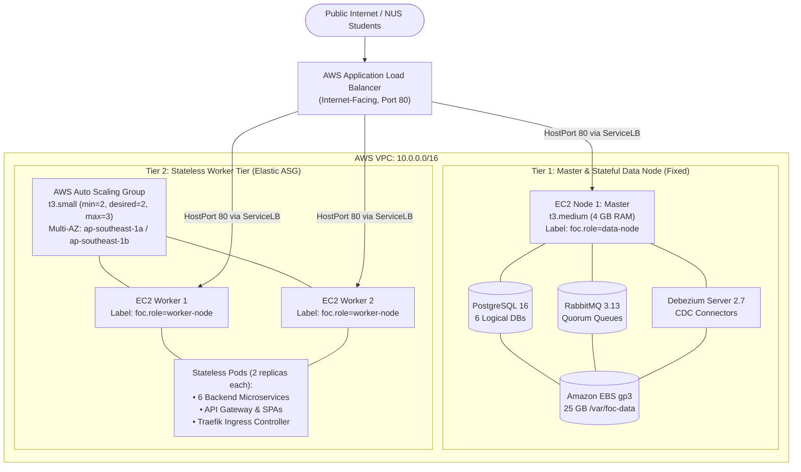

# Kubernetes (K3s) Manifests & Cluster Topology

> **Course**: NUS CS3219 Software Design and Architecture (AY26/27 S1)  
> **Namespace**: `foc` (Friend on Campus)  
> **Platform**: Lightweight Kubernetes (K3s) on AWS EC2 Multi-AZ  

This directory contains the declarative production Kubernetes manifests for the **Friend of Campus (FoC)** microservices platform. Manifests use sequential numeric prefixes (`00` through `07`) so that dependencies (namespaces, configs, storage) are guaranteed to be evaluated before workloads.

---

## 📁 Manifest Directory Index

| File | Kubernetes Kind(s) | Role & Description |
| :--- | :--- | :--- |
| [`00-namespace.yaml`](./00-namespace.yaml) | `Namespace` | Creates the isolated `foc` namespace to prevent collisions with `kube-system`. |
| [`01-configmaps-secrets.yaml`](./01-configmaps-secrets.yaml) | `ConfigMap`, `Secret` | Injects cluster environment variables, database URLs, Ed25519 JWT keys, RabbitMQ definitions (`definitions.json` + `rabbitmq.conf`), Postgres init SQL, and Debezium CDC configs. |
| [`02-storage.yaml`](./02-storage.yaml) | `StorageClass`, `PV`, `PVC` | Binds the 25 GB gp3 Amazon EBS persistent volume (`/var/foc-data`) on Node 1 via `nodeAffinity` and `local-storage`. |
| [`03-stateful-data.yaml`](./03-stateful-data.yaml) | `Deployment`, `Service` | Pinned to Node 1 (`foc.role=data-node`): PostgreSQL 16 (logical WAL enabled), RabbitMQ 3.13 (quorum queues), and 3 Debezium Server 2.7 CDC connectors (Order, Credit, User). |
| [`04-stateless-services.yaml`](./04-stateless-services.yaml) | `Deployment`, `Service` | 6 backend microservices (`user-service`, `supplier-service`, `order-service`, `credit-service`, `notification-service`, `chat-service`) with 2 replicas each, pod anti-affinity, and resource requests/limits. |
| [`05-frontends-gateway.yaml`](./05-frontends-gateway.yaml) | `Deployment`, `Service` | Presentation tier: `student-app` (Vite PWA), `admin-portal` (Admin SPA), and `api-gateway` (NGINX reverse proxy with decoupled `/health` readiness probes). |
| [`06-ingress.yaml`](./06-ingress.yaml) | `Ingress` | Configures K3s Traefik Ingress Controller to route root and wildcard HTTP/WS traffic to the internal `api-gateway` service. |
| [`07-hpa.yaml`](./07-hpa.yaml) | `HorizontalPodAutoscaler` | Tier 1 elastic pod autoscaling: scales `order-service`, `credit-service`, and `api-gateway` from 2 to 5 replicas when CPU > 60%. |

---

## 🏗️ Two-Tier Node Topology

The cluster separates stateful persistence from elastic stateless workloads across two distinct compute tiers:



### 1. Master & Stateful Data Node (Fixed `t3.medium`, ap-southeast-1a)
- **Role**: K3s control plane + single source of truth for persistent data.
- **Node Label**: `foc.role: data-node`.
- **EBS Volume**: Formatted as `ext4` and persistently mounted at `/var/foc-data`.
- **Workloads**:
  - `postgres`: 6 logical databases (`user_db`, `supplier_db`, `order_db`, `credit_db`, `notification_db`, `chat_db`) with logical replication WAL (`wal_level=logical`).
  - `rabbitmq`: Quorum queues with preloaded users, policies, and topic exchange bindings via ConfigMap (`rabbitmq-definitions`).
  - `debezium-order`, `debezium-credit`, `debezium-user`: CDC connectors reading transactional outbox tables and publishing events directly into RabbitMQ.

### 2. Stateless Worker Tier (Auto Scaling Group, `t3.small`, min=2, desired=2, max=3)
- **Role**: Elastic compute capacity for stateless business logic.
- **Node Label**: `foc.role: worker-node`.
- **Minimum Sizing Rationale**: The 17 microservice pods require $\approx$3.5 GB of aggregated memory. A single `t3.small` has 2 GB RAM. Setting `worker_min_size = 2` (4 GB RAM total) guarantees sufficient capacity across multiple Availability Zones, preventing low-CPU target tracking alarms from terminating nodes and triggering pod eviction.
- **Pod Anti-Affinity**: Uses `podAntiAffinity` on `topologyKey: kubernetes.io/hostname` so paired replicas of every microservice are distributed across distinct physical worker nodes.

---

## 🔌 Networking & Load Balancing Architecture

### Why K3s ServiceLB is Kept Enabled
K3s includes a built-in lightweight load balancer daemon called **Klipper ServiceLB**. 
- When K3s deploys Traefik, it creates a Service of type `LoadBalancer`.
- The `svclb-traefik` DaemonSet runs on **every node** (master and workers) and binds `HostPort: 80` to forward traffic to Traefik.
- The external **AWS Application Load Balancer (ALB)** target group sends HTTP requests directly to port 80 of any EC2 instance in the VPC.
- Because port 80 is bound on every host, the ALB target health checks pass immediately, and incoming user requests reach Traefik $\to$ `api-gateway` $\to$ internal microservices.

### Decoupled Health Probes
The `api-gateway` deployment in [`05-frontends-gateway.yaml`](./05-frontends-gateway.yaml) configures its `readinessProbe` and `livenessProbe` to `GET /health` on port 80.
- Probing `/health` tests the NGINX proxy server itself and returns HTTP 200 directly.
- **Why this matters**: If the readiness probe tested `/` (the root path), NGINX would proxy the probe to `student-app:5173`. If `student-app` restarted or rescheduled, the probe would fail with 502, evicting `api-gateway` endpoints and cascading into a cluster-wide 503 outage. Decoupling ensures resilience.

---

## 🚀 How Developers Apply & Manage Manifests

### Day 1: Initial Cluster Bootstrapping (One-Time)
After running `terraform apply` locally to create the VPC, EC2 instances, and ALB:

```bash
# 1. Obtain master instance ID
MASTER_ID=$(cd ../terraform && terraform output -raw master_instance_id)

# 2. Apply all manifests in order via AWS SSM (Zero SSH keys needed!)
for f in infra/k8s/*.yaml; do
  echo "Applying $f..."
  B64=$(cat "$f" | base64 | tr -d '\n')
  aws ssm send-command \
    --region ap-southeast-1 \
    --instance-ids "$MASTER_ID" \
    --document-name "AWS-RunShellScript" \
    --parameters "{\"commands\":[\"echo '$B64' | base64 -d | k3s kubectl apply -f -\"]}"
done
```

### Day 2: Everyday Code Updates (Continuous Delivery)
Developers **do NOT need to re-apply Kubernetes manifests** during regular development!
1. Developers push code to GitHub (`feat/*` or `main`).
2. GitHub Actions (`.github/workflows/deploy.yml`) builds Docker images with the commit SHA tag, pushes them to Amazon ECR, and executes:
   ```bash
   kubectl set image deployment/<service> <service>=<ecr_repo>:<commit_sha> -n foc
   kubectl rollout status deployment/<service> -n foc --timeout=180s
   ```
3. Kubernetes performs a **zero-downtime rolling update**: spinning up a new container, waiting for its `/ready` probe to pass, routing traffic to it, and cleanly terminating the old replica.

### Updating Manifest Architecture
If you modify infrastructure configs (e.g., add environment variables in `01-configmaps-secrets.yaml`, update replica counts in `04-stateless-services.yaml`, or change HPA thresholds in `07-hpa.yaml`):
1. Commit and push the manifest changes to GitHub.
2. Apply the specific file via AWS SSM or by starting an interactive session:
   ```bash
   aws ssm start-session --target <MASTER_INSTANCE_ID>
   k3s kubectl apply -f /path/to/manifest.yaml
   ```
