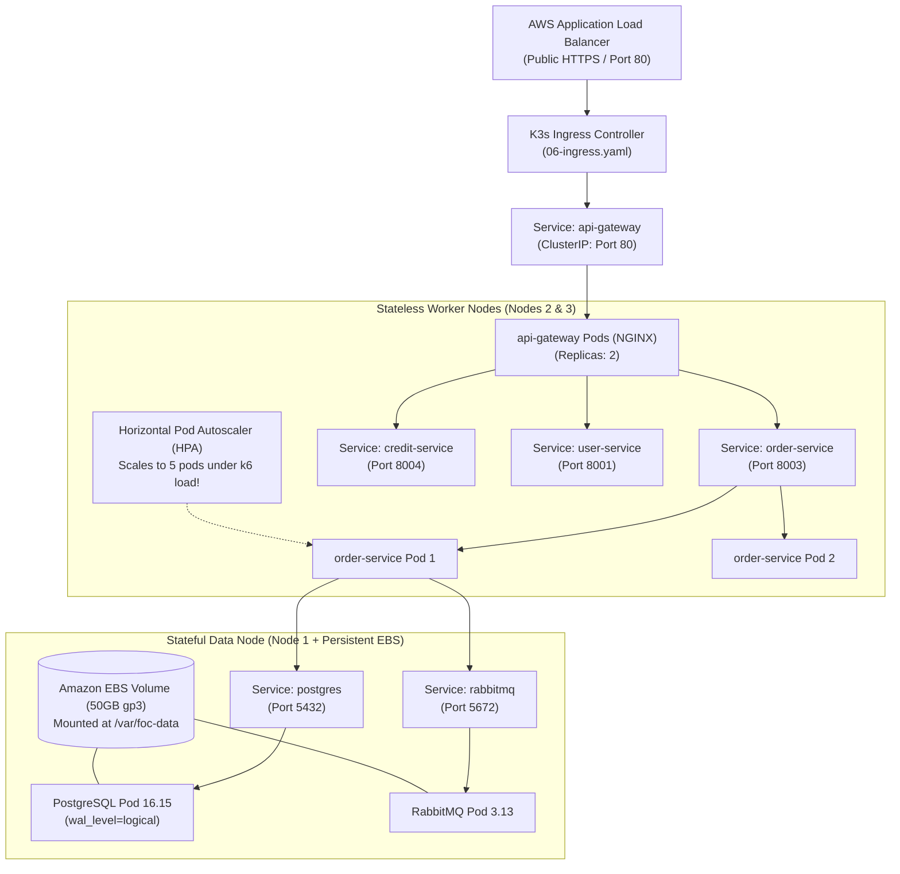

# Kubernetes (K3s) Architecture & Student Walkthrough Guide

> **Course**: NUS CS3219 Software Design and Architecture  
> **Project**: Friend on Campus (`campuserrand`)  
> **Rubric Target**: Category N4 (Cloud Deployment & DevOps) + Category N3 (Testing & Scalability)  

---

## 1. The Big Picture: Why Kubernetes (K3s) over Docker Compose?

In local development, you run `docker-compose up`. Why can't we just run `docker compose` in production?

| Limitation of Docker Compose | How Kubernetes (K3s) Solves It |
| :--- | :--- |
| **Single-Machine Bound**: All containers run on one EC2 instance. If the VM crashes or runs out of RAM, the entire system dies. | **Multi-Node Cluster**: Distributes containers across multiple EC2 instances. If one worker VM fails, pods are immediately rescheduled onto surviving workers. |
| **No Automated Scaling**: Cannot automatically increase replicas when traffic spikes during campus lunch hours. | **Horizontal Pod Autoscaler (HPA)**: Dynamically scales pods (e.g. from 2 to 5 replicas) based on live CPU and memory metrics. |
| **Downtime During Updates**: Restarting containers interrupts live user HTTP requests and WebSocket connections. | **Zero-Downtime Rolling Updates**: Spins up new pod version, waits for readiness probe to pass, shifts load-balancer traffic, and gracefully terminates the old pod. |
| **Static Networking**: Container IPs change on restart, requiring manual restarts or custom DNS workarounds. | **Native Cluster DNS (`kube-dns`)**: Provides permanent internal domain names (e.g., `postgres.foc.svc.cluster.local`) backed by automatic load balancing. |

### Why K3s specifically?
Standard Kubernetes (EKS) costs **\$73 USD per month** just for the control plane—which would burn your entire NUS \$50 SGD student budget in two weeks!  
**K3s** is a fully certified, production-grade lightweight Kubernetes created by Rancher/SUSE. It bundles the control plane into a tiny 50MB binary, requires zero control-plane fees, and executes the **identical Kubernetes YAML manifests and `kubectl` commands** as standard EKS.

---

## 2. Kubernetes Mental Model (Core Primitives in Plain English)



### The 7 Core Concepts
1. **Pod**: The smallest atomic unit in Kubernetes. A Pod wraps one (or more) running containers. Think of it as a disposable worker.
2. **Deployment**: A supervisor that ensures a specific number of identical Pods (replicas) are running at all times. If a Pod crashes, the Deployment immediately creates a replacement.
3. **Service (ClusterIP)**: Pods are ephemeral and their IP addresses change when recreated. A **Service** provides a permanent internal IP and DNS name (e.g. `order-service:8003`) that automatically round-robins traffic across all healthy Pod replicas.
4. **ConfigMap & Secret**:
   - `ConfigMap`: Stores non-sensitive configuration (hostnames, port numbers, log levels).
   - `Secret`: Stores sensitive credentials (passwords, JWT keys, connection strings) as base64-encoded environment variables.
5. **PersistentVolume (PV) & PersistentVolumeClaim (PVC)**: Containers have ephemeral file systems (files are deleted when a container restarts). A PV/PVC links a container directory (like `/var/lib/postgresql/data`) to the physical AWS EBS storage disk so data persists indefinitely.
6. **Ingress**: The router sitting at the cluster entrance. It listens for incoming HTTP/HTTPS traffic from the AWS ALB and routes requests to the internal `api-gateway` Service.
7. **Horizontal Pod Autoscaler (HPA)**: An automated controller that monitors real-time CPU/memory consumption. When CPU exceeds 60%, it instructs the Deployment to spin up additional Pods (up to 5). When traffic dies down, it scales back down to 2.

---

## 3. Our Cluster Topology: Stateful vs. Stateless Division

In CS3219, we apply the **IaaS Cloud-Native Architectural Pattern**:

### Node 1: Master & Stateful Data Node (`foc.role: data-node`)
- Runs PostgreSQL, RabbitMQ, and Debezium CDC.
- **Why pinned to Node 1?** Databases and message brokers require consistent disk I/O. Terraform mounts the physical AWS 50GB gp3 EBS disk to `/var/foc-data` on this EC2 instance. Pinning these stateful containers guarantees they always have access to the physical disk.

### Nodes 2 & 3: Stateless Worker Nodes (`foc.role: worker-node`)
- Runs the 6 microservices (`user`, `supplier`, `order`, `credit`, `notification`, `chat`), frontends, and API Gateway.
- **Why distributed across workers?** Microservices are stateless—they hold no local disk state. If demand spikes, they can horizontally scale across both worker instances using `podAntiAffinity` to ensure true high availability.

---

## 4. Manifest File Breakdown

The manifests are sequenced with numeric prefixes (`00-` to `07-`) so `kubectl apply -f infra/k8s/` provisions them in exact dependency order:

| Manifest File | What It Provisions | Academic Rationale |
| :--- | :--- | :--- |
| [`00-namespace.yaml`](00-namespace.yaml) | Isolated `foc` namespace. | Isolates our application resources from system resources (`kube-system`). |
| [`01-configmaps-secrets.yaml`](01-configmaps-secrets.yaml) | `foc-common-config`, `foc-secrets`, `postgres-init-sql`. | **12-Factor App (Factor III)**: Config in the environment, separating credentials from container images. |
| [`02-storage.yaml`](02-storage.yaml) | `foc-ebs-pv` & `foc-data-pvc` (50GB). | **Volume Decoupling**: Binds container data directories to the mounted AWS EBS volume on Node 1. |
| [`03-stateful-data.yaml`](03-stateful-data.yaml) | Deployments & ClusterIP Services for Postgres & RabbitMQ. | Configures `wal_level=logical` for Debezium CDC and loads database-per-service isolation schemas. |
| [`04-stateless-services.yaml`](04-stateless-services.yaml) | Deployments & Services for 6 backend microservices. | Sets 2 replicas per service with `podAntiAffinity`, CPU/Memory requests & limits, and health probes. |
| [`05-frontends-gateway.yaml`](05-frontends-gateway.yaml) | `student-app`, `admin-portal`, and `api-gateway`. | NGINX reverse-proxy gateway routing `/api/*` and `/ws/*` traffic. |
| [`06-ingress.yaml`](06-ingress.yaml) | Traefik Ingress routing rules. | Public traffic entry point receiving traffic forwarded by AWS ALB. |
| [`07-hpa.yaml`](07-hpa.yaml) | Horizontal Pod Autoscalers. | **Grading Rubric N4**: Demonstrates automated horizontal scaling under concurrent load. |

---

## 5. Student Hands-on Runbook (How to Operate the Cluster)

### Step 1: Connect to the Cluster (Zero SSH Keys Needed!)
Using AWS Systems Manager (SSM) Session Manager:
```bash
# Retrieve instance ID from Terraform outputs
terraform -chdir=infra/terraform output -raw master_instance_id

# Connect securely via AWS SSM
aws ssm start-session --target <MASTER_INSTANCE_ID>
```

### Step 2: Switch to Root & Check Cluster Status
```bash
sudo -i

# Verify that all 3 EC2 nodes have joined the cluster
kubectl get nodes -o wide
```
*Expected output*: You will see 1 control-plane/master node and 2 worker nodes in `Ready` status.

### Step 3: Apply All Manifests
```bash
kubectl apply -f /path/to/infra/k8s/
```

### Step 4: Inspect Running Pods
```bash
# Watch pods booting up in real time
kubectl get pods -n foc -w

# View services and their internal ClusterIPs
kubectl get svc -n foc

# View Persistent Volume status
kubectl get pvc -n foc
```

### Step 5: How to Inspect Pod Logs (Debugging)
```bash
# View logs for a specific service
kubectl logs -n foc deployment/order-service -f

# If a pod crashed, view why it crashed
kubectl logs -n foc <POD_NAME> --previous

# Inspect detailed events and health check failures
kubectl describe pod -n foc <POD_NAME>
```

### Step 6: Live Autoscaling Demonstration (`k6` Load Spike)
In Terminal 1 (on the cluster):
```bash
kubectl get hpa -n foc -w
```
In Terminal 2 (on your local machine):
```bash
# Run k6 load test against the public ALB DNS
k6 run --vus 150 --duration 60s tests/k6/discovery-load.js
```
*Live Result*: As concurrent virtual users spike, `order-service` CPU utilization crosses 60%, and K3s immediately scales the replica count from **2 $\to$ 3 $\to$ 5 pods** in real time! This terminal capture provides the primary submission evidence for Category N4.

---

## 6. Common Troubleshooting Scenarios

| Pod Status | What It Means | How to Fix It |
| :--- | :--- | :--- |
| `CrashLoopBackOff` | The application process started but crashed immediately (e.g., failed DB connection or missing environment variable). | Run `kubectl logs -n foc <pod-name>` to read the fatal error stack trace. |
| `ImagePullBackOff` | Kubernetes cannot download the container image from AWS ECR. | Verify the image tag in ECR exists and that the EC2 node's IAM role has `AmazonEC2ContainerRegistryReadOnly`. |
| `Pending` | Kubernetes has not found a node with enough free CPU or RAM to run the pod. | Run `kubectl describe pod -n foc <pod-name>` to see which resource constraint was not met. |
